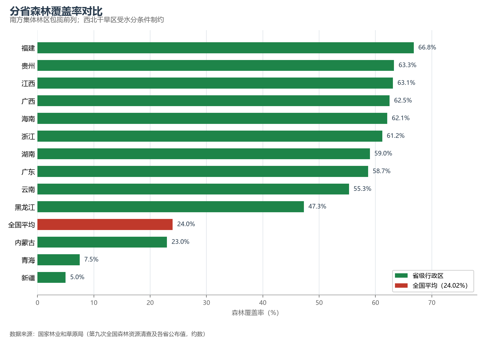
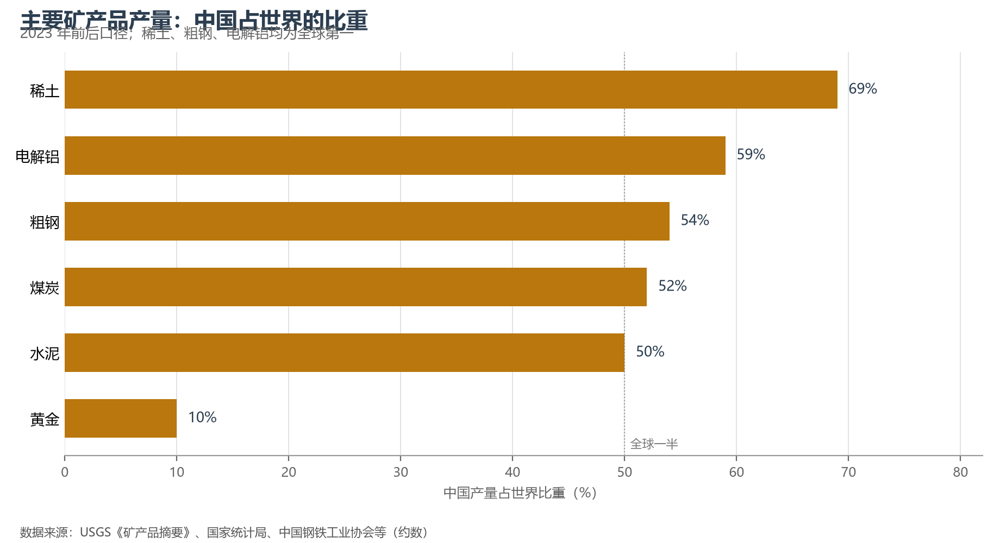

# 6.4 森林、水与矿产

土地之上是三类流动性资源：森林、水与矿产。它们的共同特征是空间分布极不均衡——森林长在东南，水流向南方，矿产埋在北方与西部；它们的现代治理也都指向同一个方向：跨区域调配与集约利用。

## 一、森林：覆盖率 24% 的背后

全国森林覆盖率约 24.02%（2023 年林草口径），森林面积 2.31 亿公顷，人工林面积居世界第一。分布极不均衡：南方集体林区（福建、江西、广西、浙江等省森林覆盖率逾 60%）与东北、西南国有林区贡献了绝大部分森林，而西北五省区的覆盖率大多不足 15%——新疆仅约 5%。森林的"东南密、西北疏"与降水的分布几乎完全同构：400 mm 线以西，自然植被的本底就是草原与荒漠，人工造林必须遵循水分承载力。

**图 6-3 分省森林覆盖率对比**：南方集体林区包揽前列，西北受水分条件制约。

## 二、水：分布错配最严重的资源

全国水资源总量约 2.8—3.1 万亿 m³，人均约 2 000 m³（约为世界平均的三分之一）；南多北少的错配与调水工程已在 5.5 节详述。这里只补一个工业视角：中国是全球第一用水大国（年用水近 6 000 亿 m³），也是用水效率提升最快的国家之一——万元 GDP 用水量十余年间下降了约五成，农业节水灌溉面积超过 4 亿亩。

## 三、矿产：北煤、南有（色）、西油（气）

中国已发现矿产 173 种，45 种主要矿产的潜在总值居世界前列。分布格局一句话可概括：**煤炭在晋陕蒙新**（山西、内蒙古、陕西、新疆四省区原煤产量占全国八成以上），**稀土与钨在南方**（赣州、包头一南一北两大基地，中国稀土冶炼分离产能占全球近九成），**石油天然气在西北与海上**（塔里木、鄂尔多斯盆地与渤海湾、南海），**铜铝铅锌等大宗有色依赖进口**（原油对外依存度约七成、铁矿石约八成）。

**图 6-4 主要矿产品产量中国占世界比重**：稀土、电解铝、粗钢、煤炭、水泥均占全球一半上下。

## 四、世界视角：制造大国的资源账本

把产量占比换成"资源账本"，能看到中国与世界经济的新型绑定：中国生产全球一半左右的钢铁、水泥与电解铝，也因此消化了全球约七成的铁矿石贸易、一半以上的铝土矿与铜矿贸易——"世界工厂"的另一面是"世界原料市场"。能源安全与关键矿产供应链由此成为国家战略：能源的饭碗必须端在自己手里（煤炭兜底 + 可再生能源跃升），矿产的饭碗则要靠国内找矿突破与海外资源布局双轮驱动。

## 参考与数据来源

1. 森林资源：国家林业和草原局历次全国森林资源清查与年度公报。
2. 水资源：水利部《中国水资源公报》（2024 年）。
3. 矿产：自然资源部《中国矿产资源报告》、USGS《Mineral Commodity Summaries》（约数）。
