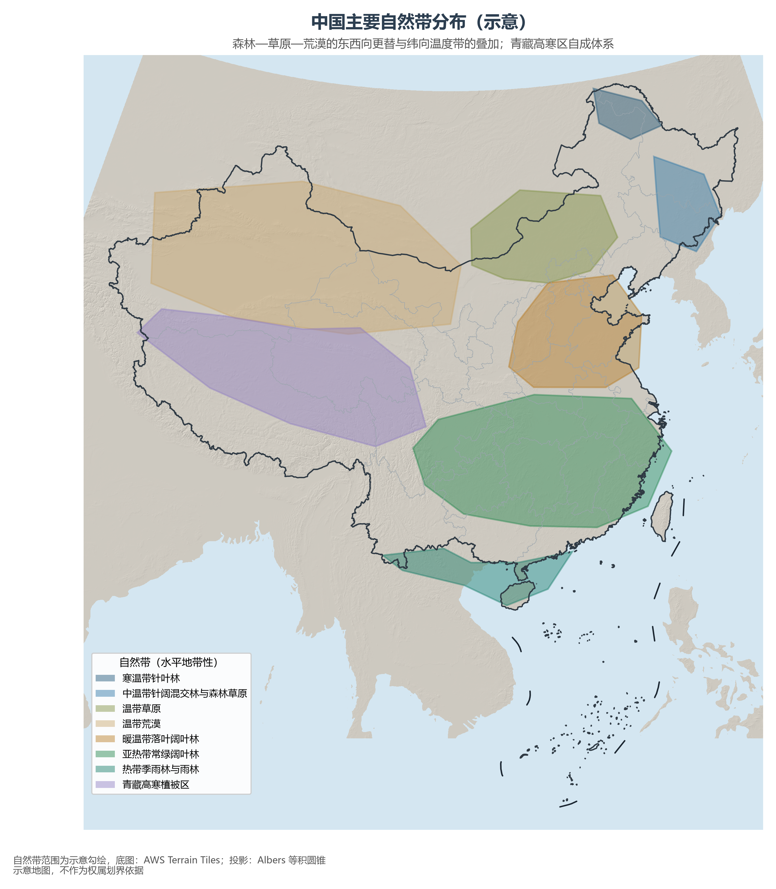

# 7.1 自然带与生物多样性

如果把中国跨越近 50 个纬度的温度阶梯（第 4 章）与深入内陆数千公里的干湿水分梯度在三级阶梯的宏伟地貌（第 3 章）上叠加，展现在世人面前的，就是一幅全球绝无仅有的自然生态大拼图。

从海南五指山密不透风的热带季雨林，到大兴安岭冰雪覆盖的寒温带泰加林；从江南丘陵郁郁葱葱的常绿阔叶林，到内蒙古高原开阔壮丽的绿色草甸，直至新疆塔里木腹地寸草不生的苍凉沙海——中国大地上的**水平自然地带性**（热量主导的纬度分异与水分主导的经度分异）交织激荡，加之青藏高原与横断山脉高差数千米的**垂直自然带谱**，共同构成了全球生态系统最完备、生物物种最繁盛的“生物多样性超级大国”。

**图 7-1 中国主要自然带分布（示意）**：森林—草原—荒漠的东西更替与纬向温度带的叠加，青藏高寒区自成体系。

---

## 一、双向地带性交织：中国水平自然带谱系

中国地表植被与土壤的水平空间展开，受到南北热量差异与东西水分梯度的双重正交驱动，形成了极具几何规律的水平带谱结构：

| 自然带类型 | 核心分布区域 | 水热组合特征 | 代表性优势植被 | 代表性野生动物与土壤类型 |
|:---|:---|:---|:---|:---|
| **热带季雨林与雨林带** | 海南岛中南部、雷州半岛、云南西双版纳及台湾南部 | 全年高温皆夏（最冷月 > 15 ℃），年降水 1 500—2 500 mm，干湿季分明 | 望天树、龙脑香、榕树（绞杀植物）、红树林、桫椤 | 亚洲象、海南长臂猿、绿孔雀、巨蜥；砖红壤 |
| **亚热带常绿阔叶林带** | 秦岭—淮河以南至两广丘陵，青藏高原以东的广袤南方平原与丘陵山地 | 冬温夏热，四季分明；最冷月均温 0—15 ℃；年降水量 800—1 600 mm | **全球同纬度面积最大的常绿阔叶林区**；樟树、青冈栋、楠木、毛竹林 | 大熊猫、川金丝猴、华南虎（野外灭绝）、白颈长尾雉；红壤、黄壤 |
| **暖温带落叶阔叶林带** | 华北平原全境、辽东半岛、山东半岛及黄土高原南部 | 冬冷干燥，夏热多雨；年均温 8—14 ℃；年降水 400—800 mm，集中于盛夏 | 辽东栎、麻栎、槲树、栓皮栎、杨树、桦木 | 华北豹、褐马鸡（中国特有）、草原雕；棕壤、褐土 |
| **中温带针阔叶混交林带** | 东北长白山地、小兴安岭山区及松辽平原周边 | 冬季漫长严寒，无霜期 100—140 天；年降水量 500—800 mm | 红松、长白落叶松、水曲柳、黄檗、胡桃楸（东北“三大硬阔”） | 东北虎、东北豹、紫貂、原麝、梅花鹿；暗棕壤、典型黑土 |
| **寒温带针叶林带（泰加林）** | 黑龙江大兴安岭北端（呼玛、漠河一带） | 漫长酷寒，年均温 < −4 ℃；降水量 400—500 mm；多年冻土广布 | 兴安落叶松为主的纯林或针叶混交林、樟子松、白桦 | 驼鹿、雪兔、黑嘴松鸡、猞猁；棕色针叶林土 |
| **温带草原带** | 内蒙古高原大部、松辽平原西部、黄土高原西北部 | 温带半干旱大陆性季风，年降水 200—400 mm，春季大风多沙 | 羊草、大针茅、贝加尔针茅、克氏针茅、耐旱灌木（柠条、锦鸡儿） | 黄羊（蒙原羚）、普氏野马、草原旱獭、沙狐；黑钙土、栗钙土 |
| **温带荒漠与荒漠草原带** | 塔里木盆地、准噶尔盆地、内蒙古阿拉善高原、柴达木盆地 | 极端干旱，降水 < 200 mm（腹地 < 50 mm），蒸发极剧烈，温差极大 | 极耐旱柽柳（红柳）、梭梭、白梭梭、胡杨林（绿洲）、麻黄 | 普氏原羚、野骆驼、鹅喉羚、塔里木兔；棕钙土、荒漠灰钙土、盐漠土 |
| **青藏高寒植被区** | 青藏高原主体（海拔 > 3 500—4 000 m 区域） | 空气稀薄、强太阳辐射、极寒干燥；日较差大而年较差小 | 高寒草甸（高山嵩草）、高寒草原（紫花针茅）、垫状驼绒藜 | 藏羚羊、野牦牛、藏野驴、雪豹、黑颈鹤；高山草甸土、高山寒冻土 |

---

## 二、垂直地带性：耸立高山中的“微缩地球”

除了广袤平原的水平分异，中国中西部高大山系的剧烈隆升，创造了世界上层次最丰富、落差最极致的**山地垂直自然带谱**。一座高山就宛如一部竖直摆放的自然地理全书：

### 1. 贡嘎山垂直带谱：全球山地生态的巅峰标本
横断山脉最高峰**贡嘎山（海拔 7 556 m）**，东坡垂直俯瞰大渡河河谷（海拔约 1 300 m），在不足 30 公里的水平距离内，垂直落差达 **6 200 余米**：
- **海拔 1 300—2 200 m**：亚热带干热河谷灌丛向常绿阔叶林带过渡；
- **海拔 2 200—2 800 m**：常绿与落叶阔叶混交林带，古老被子植物丰富；
- **海拔 2 800—3 600 m**：亚高山针叶林带（峨眉冷杉、麦吊云杉、大果红杉），林冠整齐挺拔；
- **海拔 3 600—4 400 m**：高山杜鹃灌丛与高寒草甸带，初夏野花漫山如锦；
- **海拔 4 400—4 900 m**：高山流石滩垫状植被带（雪莲、绿绒蒿等极端耐寒抗风微型植物）；
- **海拔 4 900 m 以上**：永久积雪与冰川带，巨大的现代冰川（如海螺沟冰川）倾泻而下。
在贡嘎山徒步一天，相当于从江南水乡穿越数千公里直达北极冰原。

### 2. 秦岭太白山：南北过渡带的垂直阶梯
秦岭主峰太白山（海拔 3 771 m）作为我国大陆东半壁最高峰，垂直带谱生动演绎了暖温带向高寒生态的演替：山麓为暖温带落叶阔叶林（栓皮栎、锐齿槲栎），山腰分布红桦林与牛背桦林，海拔 3 000 m 附近演变为华丽的**太白红杉纯林**，山顶终见高山灌丛草甸与第四纪冰川拔仙台角峰碎石，成为我国南北过渡带垂直分异的经典范本。

---

## 三、生物多样性超级大国：第四纪冰期的“庇护方舟”

中国是全球 12 个“**巨大多样性国家**”（Megadiverse Countries）之一，其物种丰富度与特有度在整个北半球无出其右：

1. **惊人的物种家底**：
   - **高等植物约 3.7 万种**：居全球第三位（仅次于巴西与哥伦比亚），高居**北半球第一位**，占全球高等植物总数的 10% 以上；其中特有植物超过 **1.5 万种**（特有率超 40%）；
   - **脊椎动物约 7 300 余种**：鸟类 1 445 种、兽类 690 种、爬行类超 500 种、两栖类超 500 种、淡水鱼类超 1 300 种，占世界脊椎动物种数的近 14%；
   - **“活化石”物种的避难所**：大熊猫（国宝旗舰）、朱鹮（从 1981 年仅存 7 只抢救性繁殖至上万只）、雪豹、川金丝猴、藏羚羊、东北虎、长江江豚；水杉（植物界“活化石”）、珙桐（鸽子树）、银杉、银杏、百山祖冷杉。
2. **为什么中国能成为欧亚大陆古老生命的方舟？**  
   地质学与古生物学研究给出了关键答案：在距今数百万年至一万年前的**第四纪大冰期**中，欧洲和北美大陆受到自北向南连绵推进的巨型大陆冰盖横扫，且欧洲东西走向的阿尔卑斯山脉挡住了动植物向南逃生的通道，导致大量古近纪、新近纪温热带生物绝灭；
   而在中国，由于季风气候与山地阻隔，**中国大陆并未发育覆盖全境的大陆冰盖，只有局部山地冰川发育**。崇山峻岭之间的四川盆地、秦巴山区、武陵山区、南岭以及横断山深切峡谷，充当了天然的保温避难所，使亿万年前的水杉、银杏、大熊猫等孑遗生命得以奇迹般繁衍至今。

---

## 四、世界视角：全球生物多样性热点中的中国贡献

在国际保护生物学界划定的全球 **36 个生物多样性热点地区**（Biodiversity Hotspots）中，有 **4 个关键热点区域深入中国境内**：
- **中国西南山地（横断山热点区）**：全球温带植物区系最丰富、高山花卉（杜鹃花、报春花、龙胆花、绿绒蒿）发源演化的超级中心；
- **喜马拉雅热点区**：西藏南部雅鲁藏布大峡谷与珠峰南翼低海拔湿润谷地；
- **中亚山地热点区**：天山与帕米尔高原冷温带野生果树（野生苹果、野生核桃原始基因库）；
- **印缅热点区**：云南南部西双版纳与华南热带季雨林交界走廊。

2021 年，联合国《生物多样性公约》第十五次缔约方大会（**COP15**）第一阶段会议在云南昆明成功召开，通过了具有历史里程碑意义的《昆明宣言》，中国正式宣布率先出资 15 亿元人民币设立“**昆明生物多样性基金**”，展现了中国从全球生物多样性大国走向全球生态文明治理关键引领者的宏阔胸襟。

---

## 参考与数据来源

1. 物种数量统计：中国科学院生物多样性委员会《中国生物物种名录（2024版）》、生态环境部《中国生物多样性保护战略与行动计划（2023—2030年）》。
2. 自然带划分与垂直带谱：任美锷《中国自然地理纲要》、郑度《中国生态地理区域系统》。
3. 贡嘎山与太白山野外考察数据：中国科学院成都山地灾害与环境研究所、中国科学院地理科学与资源研究所野外观测站台网公报。
4. 全球生物多样性热点区界定：保护国际（Conservation International, CI）全球 36 大生态热点区权威档案。
