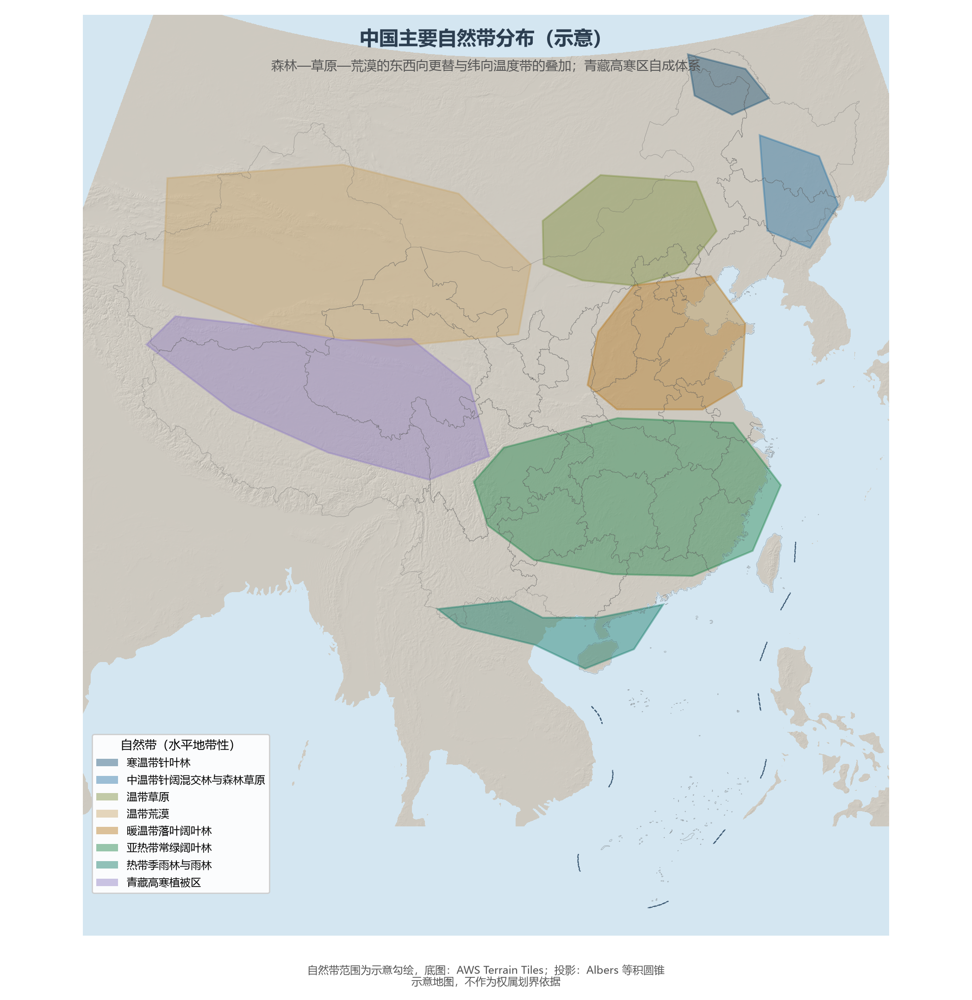

# 7.1 自然带与生物多样性

把温度带（第 4 章）与干湿区叠加，中国大地呈现出清晰的**自然带谱**：从东南的热带季雨林向西北方向，依次更替为常绿阔叶林、落叶阔叶林、温带草原与温带荒漠——东西向的"经度地带性"（水分主导）与南北向的"纬度地带性"（热量主导）交织，再加上青藏高原自成一体的垂直带谱，构成全球最完整的自然带组合之一。

**图 7-1 中国主要自然带分布（示意）**：森林—草原—荒漠的东西更替与纬向温度带的叠加，青藏高寒区自成体系。

## 一、地带性与垂直性

水平方向上，中国东部是森林的世界：热带季雨林与雨林（海南、滇南）、亚热带常绿阔叶林（江南—华南，全球同纬度面积最大的常绿阔叶林区）、暖温带落叶阔叶林（华北）、中温带针阔混交林（东北东部山地）与寒温带针叶林（大兴安岭北端，泰加林的南缘）依次排开；中部是草原带，西部是荒漠带。垂直方向上，一座山就是一张竖着的自然带谱——秦岭太白山在 3 000 余米的高差内重演了从落叶阔叶林到高山灌丛草甸的完整序列；横断山脉"一山有四季，十里不同天"，是全球垂直带谱最复杂的山地之一。

## 二、生物多样性大国

中国是全球 12 个"巨大多样性国家"之一：**高等植物约 3.7 万种**（居北半球第一）、脊椎动物约 7 300 余种、已知真菌约 1.5 万种；大熊猫、朱鹮、藏羚羊、珙桐、水杉等特有物种与"活化石"举世闻名。多样性的地理密码仍是三大阶梯：横断山区是全球 36 个生物多样性热点之一（川滇生物多样性热点），华南与西双版纳保存了热带区系，青藏高原演化出独特的高原动物群（藏羚羊、野牦牛）。

## 三、世界视角：北半球的物种方舟

把物种数字放进世界坐标系：巴西高等植物约 3.4 万种、哥伦比亚约 2.4 万种，中国的约 3.7 万种位居世界第三，其中特有种比例超过一半。更关键的是"完整谱系"——中国的国土连续跨越五个温度带与四类干湿区，使同一国家内同时保存着从热带到寒温带的代表性生态系统，这在国土大国中独一无二，也是中国植物园、动物园与种质资源库体系的天然优势。

## 参考与数据来源

1. 物种数量：《中国生物物种名录》（2023 年版）、生态环境部《中国生物多样性保护战略与行动计划》。
2. 自然带划分：通行自然地理教材口径；范围为示意勾绘。
