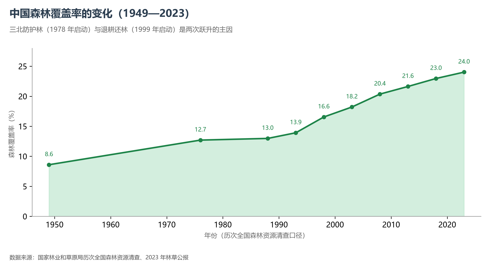
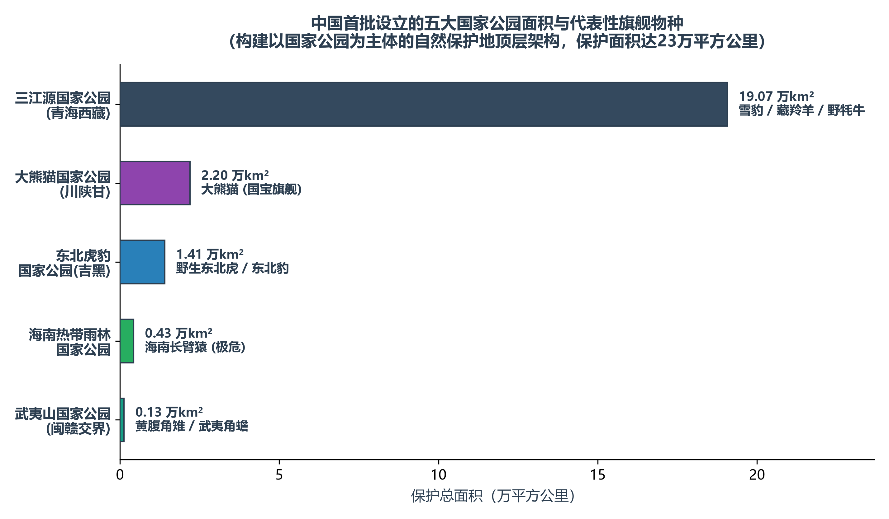

# 7.2 生态保护与修复

中华民族五千年的文明史，是一部人与自然互动博弈的恢弘历史。在传统农耕时代，人口繁衍与口粮扩张曾驱使华夏先民对原始森林与天然沼泽进行大规模开垦，“毁林造田、围湖造田、陡坡开荒”一度导致黄土高原千沟万壑、长江中下游湖泊萎缩与北方风沙肆虐。

1978 年 11 月，国家在十一届三中全会召开的同月，正式批准启动**“三北”防护林体系建设工程**，标志着中国正式拉开了以国家力量大尺度修复山河生态的世纪大幕。经过半个世纪的接续奋战，中国完成了从“战天斗地向自然过度索取”到“**绿水青山就是金山银山**”与“**山水林田湖草沙是生命共同体**”的深刻哲学飞跃，创造了人类生态建设史上规模最宏大、惠及人口最广阔的绿色传奇。

**图 7-2 中国森林覆盖率的变化（1949—2023）**：从 8.6% 到 24.02%，人工林面积世界第一。

**图 7-4 中国首批设立的五大国家公园面积与代表性旗舰物种**：构建以国家公园为主体的自然保护地顶层架构，保护面积达 23 万平方公里。

---

## 一、六大超级生态工程：重塑大地的世纪工程

从图 7-2 可以看出，中国森林覆盖率在过去 70 余年间走出了一条令人震撼的上升斜率（由建国初的 8.6% 持续攀升至 24.02%）。支撑这一全球变绿奇迹的，正是国家在不同历史关口统筹布局的六大超级生态保护与修复工程：

| 工程名称 | 启动时间与覆盖范围 | 核心工程措施与历史转折 | 取得的标志性生态与综合效益 |
|:---|:---|:---|:---|
| **“三北”防护林体系工程** | 1978 年启动；规划至 2050 年（历时 73 年）；跨越西北、华北、东北 13 个省区 | 被誉为“**绿色万里长城**”；人工造林、封山育林、飞机播种造林与退化林分改造结合；塞罕坝林场从荒原变为百万亩人工林海 | 累计造林保存面积逾 **3 200 万公顷**，三北工程区森林覆盖率由 5.05% 提升至 13.84%；坚决打好黄河“几字弯”攻坚战、科尔沁/浑善达克歼灭战、河西走廊—塔克拉玛干阻击战三大标志性战役 |
| **退耕还林还草工程** | 1999 年启动试点；覆盖全国 25 个省区及新疆生产建设兵团 | **全球规模最大、惠及人口最多的生态补偿工程**；对坡度大于 25 度的坡耕地和严重沙化耕地实施退耕还林还草，国家给予现金与粮食直接补贴 | 累计实施退耕还林还草超 **5.2 亿亩**，中央财政累计投入逾 5 700 亿元，惠及 4 100 余万农户、1.58 亿农牧民；黄土高原植被覆盖率由 31% 跃升至 67% 以上，彻底终结了黄河下游巨量输沙 |
| **天然林资源保护工程** | 1998 年长江松花江特大洪水后全面实施；覆盖 16 个省区 | **全面彻底停止长江上游、黄河上中游天然林商品性采伐**，东北、内蒙古重点国有林区全面停伐；数十万林业工人实现由“砍树人”向“看林人”的身份转变 | 保护天然林近 **30 亿亩**，工程区森林面积净增近 3 亿亩，长江上游与黄河中游年输入干流泥沙量大幅降低 |
| **京津风沙源治理工程** | 2000 年启动；覆盖北京、天津、河北、山西、内蒙古 5 省区市 | 针对沙尘暴侵袭首都经济圈问题，综合推进退耕还林、飞播牧草、小流域水土保持治理与生态移民 | 工程区地表覆被率显著上升，北京年均沙尘日数由 20 世纪末的每年数十天骤降至年均不足 5 天，构筑起环首都绿色生态安全屏障 |
| **防沙治沙与库布齐模式** | 持续推进；重点聚焦内蒙古、新疆、甘肃等干旱半干旱沙区 | 创新推广“麦草方格机械固沙”、“光伏治沙”与肉苁蓉中药材全产业链固沙模式 | 全国荒漠化和沙化土地面积自 2004 年以来连续多个监测期实现**“双缩减”**；库布齐沙漠治理面积达三分之一，被联合国环境规划署确立为全球沙漠生态经济示范区 |
| **长江十年禁渔工程** | 2021 年 1 月 1 日起实施；覆盖长江流域重点水域 | **世界大江大河中空间跨度最大、禁捕时间最长、涉及渔民最多的保护行动**；全流域干支流与通江湖泊常年禁捕 | 11.1 万艘渔船、23.1 万退捕渔民上岸转产安居；长江江豚种群数量实现历史性止跌回升（2022 年恢复至 1 249 头），赤水河鱼类资源翻倍恢复 |

---

## 二、国家公园体制：自然保护地体系的顶层重塑

在过去数十年中，中国的自然保护空间曾长期存在着“多头管理、孤岛化分割、产权不清、职能交叉”的制度弊端（林业管保护区、住建管风景名胜区、国土管地质公园、农业管水产种质保护区）。

2021 年 10 月，在昆明 COP15 峰会上，中国正式宣布设立**第一批五大国家公园**（见图 7-4），标志着我国正式确立了以“**国家公园为主体、自然保护区为基础、各类自然公园为补充**”的新型中国特色自然保护地架构：

### 1. 首批五大国家公园的战略空间图谱
- **三江源国家公园（面积 19.07 万 km²，青海/西藏）**：
  作为“中华水塔”，是中国面积最大、海拔最高的国家公园。全面统筹保护长江、黄河、澜沧江三江源头，区内高寒草甸湿地广袤，藏羚羊种群恢复到 7 万多只，野牦牛、雪豹种群数量大幅攀升，实现了“一户一岗”生态管护公益岗位全覆盖，农牧民化身国家公园的主人与守护者；
- **大熊猫国家公园（面积 2.20 万 km²，四川/陕西/甘肃）**：
  横跨三省，打破了过去横亘在岷山、邛崃山、大相岭、秦岭之间的行政壁垒，通过建设数十处森林走廊带，成功缝合了被道路和居民点切割的破碎化生境，有效保护了全国 70% 以上的野生大熊猫种群，并协同庇护了川金丝猴、雪豹、羚牛、珙桐等上万种共生野生动植物；
- **东北虎豹国家公园（面积 1.41 万 km²，吉林/黑龙江）**：
  地处长白山脉中朝俄边境交界地带，建立了全球领先的天空地一体化自然资源监测网络。野生东北虎种群由试点前的 27 只强劲增长至约 **70 只**，野生东北豹由 42 只增至 **80 余只**，幼崽成活率大幅提升，成为温带针阔混交林顶级捕食者王者归来的生动典范；
- **海南热带雨林国家公园（面积 0.43 万 km²，海南）**：
  保存了中国分布最集中、保存最完好、连片面积最大的大陆性岛屿热带雨林。全球最濒危的灵长类动物——**海南长臂猿**野外种群，通过雨林冠层绳桥生态廊道建设与生境恢复，已由极危时期的仅存 2 群 7—9 只奇迹般恢复壮大至 **6 群 37 只**；
- **武夷山国家公园（面积 0.13 万 km²，福建/江西）**：
  中国首个也是目前唯一一个既是世界自然遗产又是世界文化遗产的国家公园。保存了同纬度地球上最完整的中亚热带原生性森林生态系统，是著名的“鸟的王国、昆虫世界、蛇的避难所与生物模式标本产地”。

---

## 三、世界自然遗产王冠：自然美学与全球责任

在联合国教科文组织《保护世界文化和自然遗产公约》体系下，中国已拥有 **15 处世界自然遗产** 与 **4 处自然与文化双遗产**，世界自然遗产总数稳居**全球第一位**：

- **从江南溶洞到青藏天境**：九寨沟、黄龙、武陵源、云南三江并流、四川大熊猫栖息地、中国南方喀斯特、中国丹霞、新疆天山、梵净山、湖北神农架、青海可可西里、黄（渤海）候鸟栖息地等，系统代表了地球数亿年演化中鬼斧神工的地貌绝景与生态庇护所；
- **2024 年世界遗产最新突破**：
  - *巴丹吉林沙漠—沙山与湖泊群*：高耸入云的“沙漠珠峰”与 140 余个沙山咸水湖群的共生奇观，填补了世界自然遗产中沙山沙海湖泊系统的全球空白；
  - *中国黄（渤海）候鸟栖息地（第二期）*：将辽宁丹东鸭绿江口、河北沧州南大港等关键停歇地扩展纳入，为“东亚—澳大利西亚”全球候鸟迁徙线上数百万只长途跋涉的水鸟构筑了无可替代的生命安全驿站。

---

## 四、世界视角：人烟稠密国土上的生态修复范式

在国际传统保护观念中，西方国家往往追求将人完全迁出、建立孤立无人区公园的“荒野保护模式”；然而中国必须直面**人口极度稠密、发展任务极其紧迫、生态极度脆弱**的三重现实约束。

在此背景下，中国探索并成功走出了第三种全球生态治理新范式：
1. **生态产品价值实现（“两山”转化机制）**：
   大力推广生态系统生产总值（GEP）核算，建立生态补偿制度。如浙皖两省跨省推行的**新安江水质对赌补偿机制**（上游安徽黄山出水水质达标，下游浙江出资补偿，不达标则上游补偿下游），开创了跨行政区江河流域横向生态补偿的国际先河；
2. **“生态脱贫”与民生共赢**：
   在脱贫攻坚与乡村振兴中，国家聘用数十万深度贫困山区群众担任生态护林员、巡护员，将国家巨额生态工程资金直接转化为困难群众的劳动报酬，走出了一条“**山上增绿、群众增收、生态向好**”的绿色发展新路，为全球众多面临生存与保护两难的发展中国家提供了深刻的中国启示。

---

## 参考与数据来源

1. 森林覆盖率与林业工程数据：国家林业和草原局历年《中国林业和草原统计年鉴》《三北工程建设综合评估报告》。
2. 首批五大国家公园面积与物种监测：国家林草局国家公园管理办公室、各国家公园管理局年度工作白皮书。
3. 海南长臂猿与东北虎豹种群调查：中国科学院动物研究所、国家林业和草原局东北虎豹监测与研究中心官方通报。
4. 世界自然遗产名录更新：联合国教科文组织（UNESCO）世界遗产中心官方公报（截至 2026 年最新名录）。
