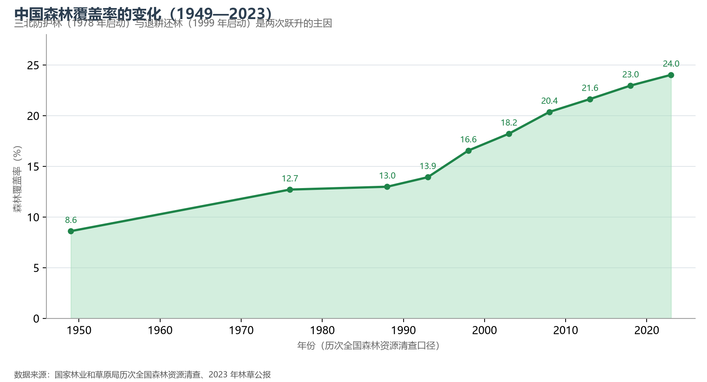

# 7.2 生态保护与修复

1978 年 11 月，"三北"防护林工程在十一届三中全会召开的当月启动——生态保护由此成为一项跨越半个世纪的国家工程。今天回望，中国的生态叙事可以概括为两条线：**给生态让空间的退与还**（退耕还林、退牧还草、休渔禁渔），与**给生态建制度的守与护**（国家公园、生态红线、生态补偿）。

**图 7-2 中国森林覆盖率的变化（1949—2023）**：从 8.6% 到 24.02%，人工林面积世界第一。

## 一、五大工程：再造山河的半个世纪

- **三北防护林**（1978 年启动）：横跨西北、华北、东北 13 省区的"绿色长城"，累计造林保存面积逾 3 000 万公顷，工程区森林覆盖率提升逾一倍；
- **退耕还林还草**（1999 年启动）：全球规模最大的生态补偿工程，累计实施逾 1 亿亩，黄土高原是最大受益者（植被覆盖度由约 31% 升至约 67%，见 3.2 节）；
- **天然林保护**（1998 年洪水后全面启动）：长江上游、黄河上中游天然林全面禁伐，数十万森工从"砍树人"转为"看树人"；
- **退牧还草与沙源治理**：京津风沙源治理二期、塔里木盆地边缘防沙治沙，全国荒漠化面积自 2004 年以来持续净减少——实现从"沙进人退"到"绿进沙退"的历史性转折；
- **长江十年禁渔**（2021 年起）：世界流域面积最大的常年禁渔制度，长江江豚数量止跌回升。

## 二、国家公园：保护地体系的重组

2021 年 10 月，第一批五处国家公园正式设立——**三江源、大熊猫、东北虎豹、海南热带雨林、武夷山**，保护面积 23 万 km²。它们是把原有的近万处各级自然保护地"整合优化"后的顶层架构：此前多头管理的保护区、森林公园、地质公园被归并为"国家公园—自然保护区—自然公园"三级体系，生态保护红线（陆域约 25% 国土）为其提供法定边界。东北虎豹国家公园的东北虎种群由 27 只回升至约 70 只，是这套体系成效最直观的注脚。

## 三、世界视角：从跟跑到并跑

1980 年代，中国的保护地模式学习自美国（严格保护区）与 IUCN 分类体系；今天，中国的贡献是另一种范式——**在人烟稠密的国土上做生态修复**：退耕还林的规模（惠及上亿农户的现金补偿）、"两山"理念驱动的生态产品价值实现机制（GEP 核算、生态补偿横向转移支付），都已成为全球生态治理的"中国方案"。联合国《生物多样性公约》第十五次缔约方大会（COP15）落地昆明，正是对这一实践的注目。

## 参考与数据来源

1. 森林覆盖率与工程规模：国家林业和草原局历年公报、三北工程 forty 周年评估资料。
2. 国家公园：国家公园管理局公开资料（第一批 5 处，2021 年 10 月设立）。
3. 长江江豚数量：农业农村部 2022 年长江江豚科学考察（1 249 头，止跌回升）。
