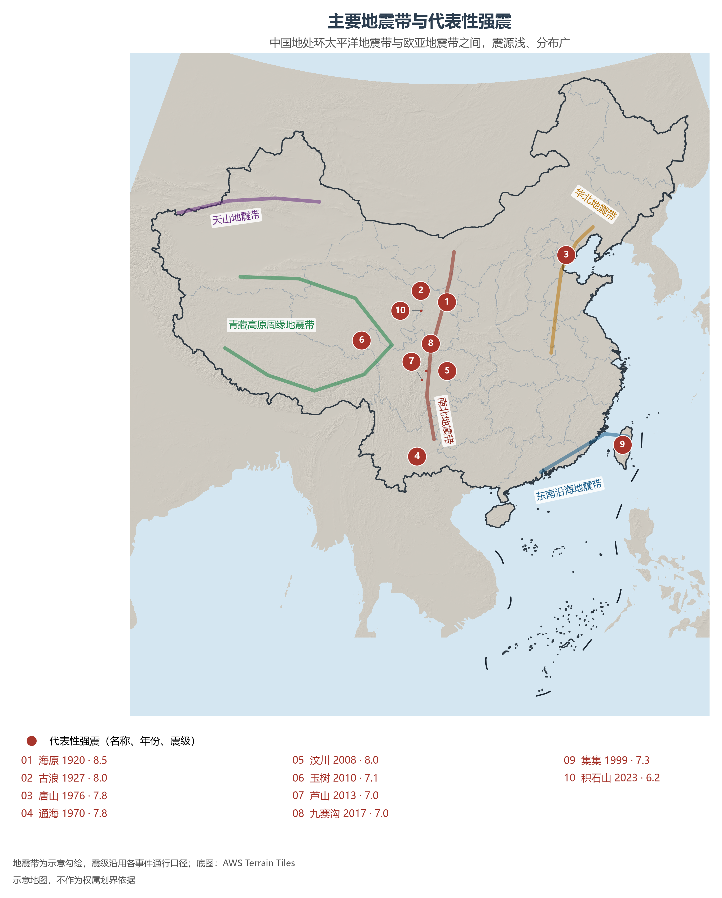
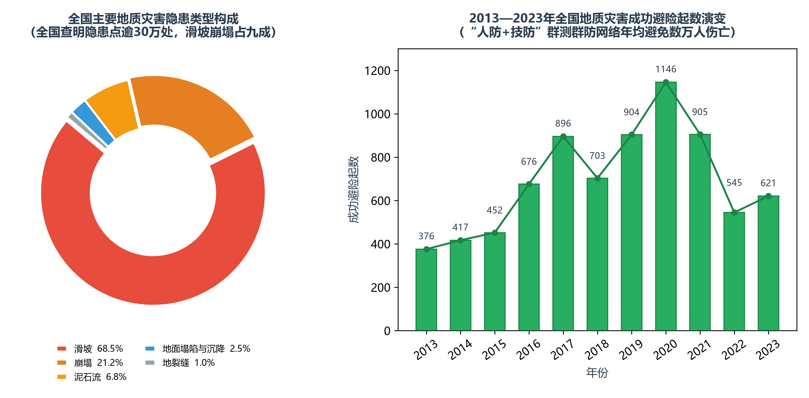

# 7.3 自然灾害与防灾减灾

在人类赖以繁衍生息的地球表层，中国被国际减灾界公认为自然灾害最复杂、灾情最为严重的少数大陆国家之一。灾害种类全、分布地域广、发生频度高、极端损失重——全国有超过 70% 的大中城市、50% 以上的人口与 60% 以上的工业产值，紧密依偎在气象、地震、地质、海洋与水旱灾害高风险影响区域之内。

这种剧烈而频繁的灾难威胁，并非偶然的气象或地质偶然，而是深深植根于中国两大不可变更的地球物理宏观根基：
1. **地表之上**：全球最强盛的亚洲大陆季风环流，以其极高的年际与年内不稳定性，频繁制造特大暴雨、流域性洪涝、严重伏旱春旱、超强台风与强寒潮风暴（详见第 4 章）；
2. **地表之下**：中国大陆被死死夹在**环太平洋地震带**与**欧亚地震带（地中海—喜马拉雅带）**两大全球顶级活动构造带之间，印度洋板块以每年约 40—50 mm 的速度向欧亚大陆俯冲碰撞，使中国成为全球大陆浅源强震最多、构造活动最剧烈的陆内变形区。

**图 7-3 主要地震带与代表性强震**：南北地震带是主干，五大支线上的★为 20 世纪以来的代表性强震。

**图 7-5 全国主要地质灾害隐患类型构成与综合防治成效**：滑坡与崩塌占地质灾害隐患九成，“人防+技防”群测群防网络年均实现成功避险数百起。

---

## 一、地震灾害：处于两大世界地震带之间的陆内震颤

20 世纪以来，全球大陆地区发生的所有浅源强震（震源深度通常 < 20 km，地表破坏力极大）中，**中国大陆承受了约三分之一的强震袭击**，因地震死亡的人口一度占到全球同期地震死亡总人数的近半数。

中国地震空间分布受到几组大型断裂带的牢牢锁定，形成了以**“南北地震带”为主干、多条横向构造带交织**的宏大地震震中网（见图 7-3）：

| 地震构造带 | 走向与核心断裂系背景 | 构造应力机理与烈度风险 | 二十世纪以来代表性历史强震个例 |
|:---|:---|:---|:---|
| **南北地震带** （中国地震主干中轴） | 贺兰山、六盘山断裂带向南纵贯秦岭、龙门山断裂带、安宁河断裂带、小江断裂带及红河断裂带 | 青藏高原地壳物质向东逃逸时，受刚性稳定的四川盆地扬子地台强烈阻挡，应力在盆山交界陡崖断裂面集中暴发释放 | **1920 年宁夏海原 8.5 级特大地震**（陆内极震，死伤惨重）；**2008 年四川汶川 8.0 级特大地震**（龙门山破裂超 300 km，极震区烈度达 Ⅺ 度）；2013 年芦山 7.0 级、2014 年鲁甸 6.5 级 |
| **华北地震构造带** | 郯城—庐江（郯庐）巨型断裂带、太行山东麓断裂带、张家口—渤海断裂带、汾渭地堑陷落带 | 华北古老地台内部被深大断裂横向切穿，构造破碎，历史强震往往直接袭击平原核心人口稠密区 | **1976 年河北唐山 7.8 级大地震**（整座百年工业重镇瞬间夷平，极震区烈度达 Ⅺ 度）；1679 年北京三河—平谷 8.0 级地震；1556 年陕西华县 8¼ 级大地震（明嘉靖关中大地震） |
| **青藏高原周缘带** | 喜马拉雅弧前断裂带、昆仑山断裂带、阿尔金走滑断裂带、祁连山断裂带 | 印度板块向北直接楔入挤压的最前沿与青藏高原北部剪切滑移边界 | **2001 年昆仑山口西 8.1 级特大地震**（产生长达 426 km 的地表破裂带，创中国现代构造地表破裂长度之最）；2010 年青海玉树 7.1 级地震；2021 年玛多 7.4 级地震 |
| **天山地震构造带** | 南天山与北天山深大逆冲推覆构造带 | 印度洋板块挤压应力远场向北传导，被塔里木与准噶尔两大刚性克拉通夹持隆起 | 1902 年新疆阿图什 8¼ 级大地震；1906 年玛纳斯 7.7 级地震；2024 年乌什 7.1 级地震 |
| **东南沿海地震带** | 福建长乐—诏安断裂带、泉州外海断裂带及广东沿海断裂 | 欧亚板块与菲律宾海板块西向俯冲的侧向剪切传导区 | 1604 年泉州海外 8.0 级大地震；历史记录偶有强震，现代多以中强震活动为主 |
| **台湾地震带** | 台湾中央山脉与东部花东纵谷断裂带（板块碰撞直接缝合线） | 欧亚板块与菲律宾海板块在此正面对撞，地壳运动极度活跃，**全国 50% 以上的强震发生于此** | 1999 年台湾南投集集 7.6 级地震；2024 年台湾花莲 7.3 级强震；年均感知地震达数百次 |

---

## 二、地质与海洋灾害：复合链生风险的阻击

在复杂山地地形与强对流季风暴雨的叠加催化下，地表岩土体极易演化为破坏力极大的突发性群发地质灾害（见图 7-5）：

### 1. 地质灾害隐患谱系与三大高危区
国务院第一次全国自然灾害综合风险普查显示，全国共查明各类地质灾害隐患点 **30 余万处**，主要类型构成具有极强集中性（图 7-5 左图）：
- **滑坡（占 68.5%）与崩塌（占 21.2%）**：两者合计占全国地质灾害隐患总量的近 **90%**，是威胁山区村庄、铁路与公路干线最主要的地质杀手；
- **泥石流（占 6.8%）**：虽然点位占比不及滑坡，但暴发突然、流速极快、破坏力呈毁灭性（如 2010 年甘肃舟曲“8·8”特大山洪泥石流造成重大伤亡）；
- **全国三大地质灾害高危易发核心区**：
  1. *横断山区与西南高山峡谷*：断裂带交织、地应力极高、山体极其破碎，暴雨诱发高位山体滑坡滑脱；
  2. *黄土高原千沟万壑区*：湿陷性黄土垂直节理发育，遇暴雨浸润极易整体崩塌软化失稳；
  3. *秦巴山区与三峡库区*：深切地层风化强烈，人类工程切坡活动频繁，水库水位周期性消落诱发顺层滑坡。

### 2. 海洋灾害：风暴潮与海平面上升
- **台风风暴潮**：当夏秋超强台风登陆时，极低的气压和暴风强风将海水强烈推向陆地，恰逢天文大潮时形成“风、暴、潮、浪”四碰头，巨浪漫堤可倒灌内陆数十公里（如 2014 年“威马逊”、2024 年“摩羯”）；
- **沿海相对海平面上升**：自然资源部监测公报显示，近 40 年中国沿海海平面上升速率约为 **3.5 mm/年**，高于同期全球平均水平。海水倒灌与土壤盐渍化，迫使长三角、珠三角等低洼沿海全面加固万米超级防潮海堤。

---

## 三、中国特色减灾体系：从“被动救灾”走向“全链条韧性治理”

在历经汶川地震、舟曲泥石流、郑州特大暴雨等一系列极限灾难考验后，中国完成了从“灾后被动应急救灾”向“**以防为主、防抗救结合、常态减灾与非常态救灾相统一**”的现代应急管理治理体系跨越：

1. **管理体制的大部制重组**：
   2018 年国家正式组建**中华人民共和国应急管理部**，彻底破除了此前消防、水利、林业、地质、民政救灾各自为政的“九龙治水”碎片化痛点，整合组建了约 20 万人的**国家综合性消防救援队伍**（作为应急救援主力军），建立了军地协同、跨区域机动支援的高效统一大应急大救援中枢；
2. **“人防 + 技防”群测群防闭环网络（图 7-5 右图）**：
   针对分布广泛的 30 万处地质灾害隐患点，国家布设了数十万套由北斗地表位移计、深部测斜仪、裂缝报警器与泥位计构成的自动化物联网实时普适型监测仪器，并联合基层社区村组设立了数万名受补贴的“网格化专职灾害群测群防员”；
   *防灾实效*：如图 7-5 右图所示，全国每年成功实现地质灾害突发提前转移避险 **500—1 000 余起**，年均使数万名涉险群众在山体滑坡轰然滑塌前数十分钟安全撤离，创造了世界发展中大国地灾伤亡持续下行的宝贵治理经验；
3. **“秒级”地震预警全国一张网**：
   中国地震局在全国重点防震减灾区部署了由 **15 000 余个** 强震仪与烈度计构成的全球规模最大“国家地震烈度速报与预警工程”。利用电磁波远快于地震破坏性横波的物理时间差，实现了**震后几秒内自动向破坏区发布秒级预警信息**，通过智能手机弹窗、智能电视与大喇叭广播，为数十万家庭争取紧急闭气闭火、就近避震的宝贵黄金数秒至数十秒；
4. **提升城乡本质安全与国土空间韧性**：
   强制实施第五代《中国地震动参数区划图》（GB 18306—2015），将全国所有城镇新建工程纳入抗震设防法定监管；全面推进农村危房抗震改造与城市既有建筑韧性加固；彻底落实“自然灾害风险前置审查”，避开活动断裂带与高危滑坡带，让现代国土空间在与大自然的长期共处中更加坚韧、从容。

---

## 参考与数据来源

1. 地震构造带划分与历史强震参数：中国地震局地质研究所、中国地震台网中心（CENC）全国地震目录库。
2. 地质灾害隐患点与成功避险序列：中华人民共和国自然资源部地质勘查管理司历年《全国地质灾害灾情及防治公报》（2013—2023年连续序列）。
3. 第一次全国自然灾害综合风险普查成果：国务院第一次全国自然灾害综合风险普查领导小组办公室官方通报（2023年发布）。
4. 海洋风暴潮与海平面上升速率：自然资源部海洋预警监测司《中国海平面公报》《中国海洋灾害公报》。
