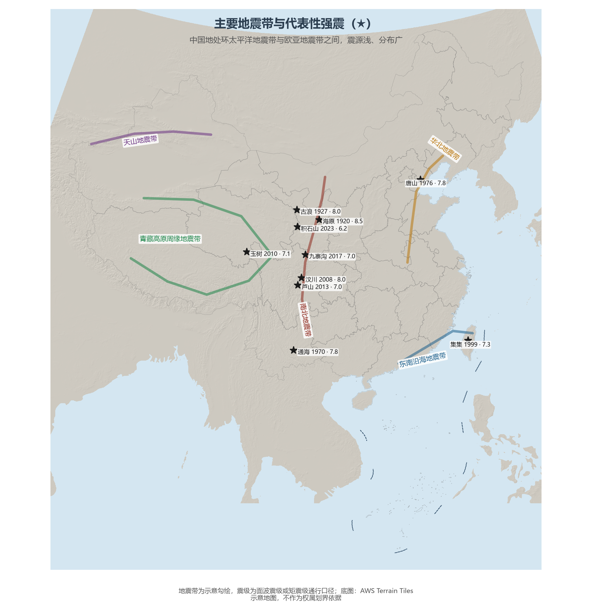

# 7.3 自然灾害与防灾减灾

中国是世界上自然灾害最严重的国家之一：灾害种类多、分布地域广、发生频率高——70% 以上的城市、50% 以上的人口分布在气象、地震、地质、海洋等灾害严重的地区。季风气候（第 4 章）与板块位置（第 3 章）是两个根源：前者制造气象灾害，后者制造地震与地质灾害。

## 一、地震：两大地震带之间

中国地处环太平洋地震带与欧亚地震带（地中海—喜马拉雅带）之间，地震活动呈现"分布广、频度高、震源浅、灾害重"的特点。地震活动的空间格局十分清晰：**南北地震带**（从贺兰山、六盘山沿横断山东缘南下）是中部的主干，**华北地震带**（张家口—渤海—郯庐一线）、**东南沿海带**、**天山带**与**青藏高原周缘带**构成四大支线。20 世纪以来全球死于地震的人口中，中国约占三分之一：1920 年海原 8.5 级、1976 年唐山 7.8 级、2008 年汶川 8.0 级三次巨震，分别是百年间三个时代的国殇。汶川地震后，全国地震烈度区划与农居抗震工程全面升级，抗震设防成为国土规划的法定前置。

**图 7-3 主要地震带与代表性强震**：南北地震带是主干，五大支线上的★为 20 世纪以来的代表性强震。

## 二、地质灾害与海洋灾害

滑坡、泥石流集中在三个区域：横断山区（地震松动 + 陡坡 + 暴雨）、黄土高原（湿陷性黄土 + 沟壑地形）与秦巴山区。全国已查明地质灾害隐患点 30 余万处，汛期"群测群防"体系每年成功避险数百起。海洋灾害中，风暴潮损失居首——台风风暴潮主要袭击粤、闽、浙、琼四省海岸，温带风暴潮则偶发于渤海湾。海平面上升是慢变量：近 40 年中国沿海海平面上升速率约 3.5 mm/年，高于全球平均。

## 三、减灾体系：以防为主、防抗救结合

2008 年汶川地震与 2010 年代一系列巨灾之后，中国完成了一次减灾体系的重组：组建应急管理部（2018 年），把分属各部门的救灾职能整合为一；建成国家自然灾害综合风险普查（2020—2022 年，第一次全国性灾害风险底账）；建立"预警—响应—转移"的临灾闭环，汛期每年提前转移数百万人。水文监测上，全国雨量站逾 7 万个、大江大河实现洪水预报全覆盖——在 2020 年长江流域性大洪水中，水库群联合调度拦洪约 260 亿 m³，"以空间换时间"的工程哲学走向成熟。

## 四、世界视角：巨灾国家的风险管理

把中国放进全球巨灾版图，其风险管理规模无出其右：地震预警网（秒级预警覆盖地震区中小学）、气象预警手机直达系统、国家综合性消防救援队伍（约 20 万人）——这些系统的共同前提是"人口稠密区的灾害必须零容忍"。对比日本（地震工程最精）、荷兰（防洪工程最重），中国的特点是"全灾种、全链条、大人口覆盖"。气候变化背景下，极端事件频率上升正在抬高这条防线的标准——巨灾保险与韧性城市将是下一程的关键词。

## 参考与数据来源

1. 地震带与震例：中国地震局公开资料；海原 8.5 级、唐山 7.8 级、汶川 8.0 级为通行震级口径。
2. 灾害隐患点与普查：自然资源部、国务院第一次全国自然灾害综合风险普查公报。
3. 2020 年水库拦洪量：水利部长江水利委员会公开数据。
