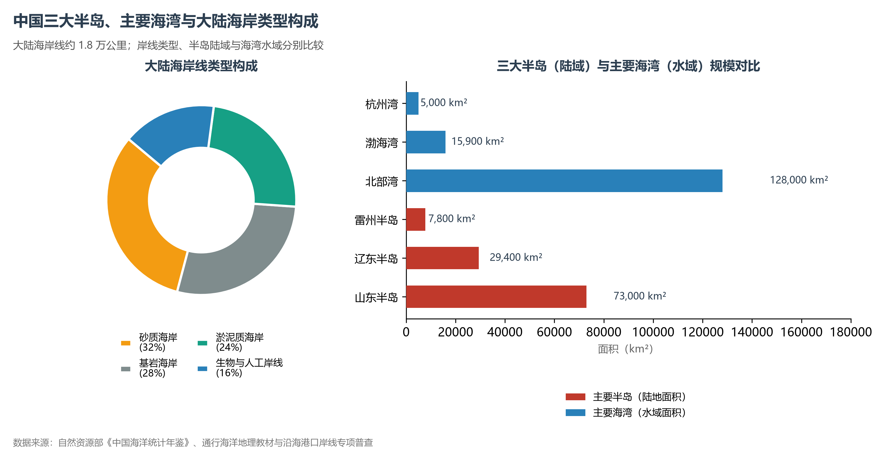

# 8.1 海岸与海湾半岛

中国大陆海岸线北起中朝边界的鸭绿江口，南至中越边界的北仑河口，全长约 1.8 万公里，纵跨温带、亚热带与热带三个气候带。这不仅是一条漫长的地理分界线，更是海陆两相流体与固体地球表面激烈相互作用的动力前沿。受区域构造、地貌基底、大江大河入海输沙以及潮汐波浪水动力条件的综合控制，中国大陆海岸线形成了基岩海岸、砂质海岸、淤泥质平原海岸与生物海岸交织并存的复杂地貌拼贴格局，孕育了三大半岛与三大海湾，深刻奠定了中国沿海航运港口、盐业渔业、滨海工业与都市圈空间集聚的地缘底座。

**图 8-3 中国三大半岛、主要海湾与大陆海岸类型构成**：三大海岸类型水土特征与沿海半岛海湾空间禀赋。

---

## 一、杭州湾分界与海岸宏观格局

中国大陆海岸线以**杭州湾**为天然界线，呈现出“北平南奇、北泥南石”的鲜明南北二元宏观结构：

- **杭州湾以北**：海岸以低平的堆积平原为主，黄河、长江、淮河、海河与辽河等大江大河携带海量陆源泥沙入海，形成了世界规模最宏大的淤泥质潮滩和平原海岸；但山地逼近海洋的局部断块隆起区（如辽东半岛、山东半岛及秦皇岛沿线）则发育着壮观的基岩岬角与沙质砾质海滩。
- **杭州湾以南**：浙闽丘陵、两广丘陵与东南沿海山脉紧贴海岸线，山势直逼海疆，构造沉降与海水侵入山间谷地，形成了极其曲折漫长、岬湾相间的基岩港湾型海岸（溺谷型海岸）；河口处仅在珠江、韩江、九龙江、闽江、瓯江等下游发育小型堆积三角洲或平原；在华南与热带海域，更发育着独特的红树林海岸与珊瑚礁海岸。

这种南北宏观格局，根本上由中生代以来的燕山运动构造骨架与第四纪冰期后海平面上升演变共同塑造成型。

---

## 二、四大海岸类型及其地貌动力机制

### 1. 基岩海岸（港湾型海岸）：天然深水良港的摇篮

基岩海岸约占我国大陆海岸线总长度的 28%，主要分布在辽东半岛、山东半岛南部、浙闽沿海、华南雷州半岛以东、海南岛东部与南部，以及台湾岛东部断崖海岸。

- **地貌特征**：山地丘陵直接延伸入海，受波浪狂烈冲刷剥蚀，沿岸广泛发育海蚀崖（Sea Cliff）、海蚀平台（Wave-cut Platform）、海蚀洞（Sea Cave）、海蚀拱桥与海蚀柱（如大连金石滩的海蚀喀斯特与沉积岩奇观、山东荣成成山角、福建平潭海坛岛双帆石等）。岸线犬牙交错，港湾深入陆地，岬角突出外海。
- **港口水深禀赋**：基岩海岸掩护条件极佳，岸外等深线密集，潮汐水道冲刷强劲，泥沙淤积量极少。天然水深普遍在 10—30 米以上，是大吨位深水港口的绝对主体。中国著名的大连港、青岛港、宁波舟山港核心港区、福建三沙湾（宁德天然深水良港，水深 30—100 米，常年不淤，号称“海上浮城”）、深圳盐田港等，无一例外依托基岩岬湾发育而成。

### 2. 淤泥质平原海岸（泥滩型海岸）：江河馈赠的潮滩与盐场

淤泥质海岸约占大陆海岸线总长度的 24%，集中连片分布在渤海湾底部、苏北沿海（废黄河三角洲至长江口北岸）、莱州湾南部以及杭州湾两岸和珠江三角洲前缘。

- **地貌动力**：由大江大河所输送的细粒泥沙与黏土在微弱波浪与潮汐流顶托下沉淀堆积而成。海底水深极浅，地形坡度平缓（常在 1/1000 至 1/5000 之间），沿岸潮滩（Intertidal Mudflat）宽达数公里至数十公里。退潮时海水泥沙尽褪，露出广袤无垠的盐沼滩涂。
- **资源与工程挑战**：
  - **盐业与湿地**：平坦泥滩地表黏土防渗性强，日照蒸发充沛，造就了中国历史上规模宏大的盐业基地（如环渤海长芦盐场、苏北淮北盐场）。同时，苏北东台条子泥潮滩湿地是我国候鸟迁徙的重要栖息地，作为“中国黄（渤）海候鸟栖息地”被正式列入世界自然遗产名录。
  - **航运劣势与人工深水港工程**：淤泥质海岸天生缺乏深水岸线，大船难于靠泊。现代天津港、黄骅港等大型综合性港口，完全依托世界级航道吹填与人工疏浚技术，硬生生在浅滩淤泥上深挖出水深超 21 米的人工巨型深水航道，开创了人工建港的工程奇迹。

### 3. 砂砾质海岸：波浪分选下的滨海胜境

砂质与砾质海岸约占大陆海岸线总长度的 32%，呈斑块状广泛镶嵌分布于基岩岬湾内侧、山前平原边缘以及海岛迎风面。

- **动力机制**：入海河流搬运的砂砾碎屑或沿岸海蚀残屑，在海浪破碎带往复冲刷与沿岸流（Longshore Current）的长期搬运分选下，在潮上带与潮间带堆积而成。常见沿岸沙堤、沙嘴（Spit）、沿海沙丘与水下沙坝，常将局部水面封闭形成潟湖（Lagoon）。
- **代表分布**：河北秦皇岛北戴河海滨、昌黎黄金海岸（发育全国罕见的巨型沿海风成沙丘群与七里海潟湖）、山东半岛威海与烟台海滨、雷州半岛东岸、海南三亚亚龙湾与海棠湾、广东阳江海陵岛。沙细水清、滩阔坡缓，是我国最重要的滨海旅游度假核心区。

### 4. 生物海岸：热带亚热带的生态护盾

生物海岸是陆海过渡带由生物生命活动（植被与钙质生物残体）堆积塑造的特异海岸类型，在我国主要包含两类：

- **红树林海岸（Mangrove Coast）**：
  - 由红树科、马鞭草科等耐盐木本植物群落构成的潮间带木本植物湿地，素有“海上森林”之称。在我国自南向北自然分布于海南、广西、广东、港澳、福建及台湾沿岸（浙江南部有人工引种移栽）。
  - 代表保护区：广东湛江红树林国家级自然保护区（全国面积最大）、广西北仑河口、海南东寨港。红树林庞大的支柱根与呼吸根网络能削减台风风暴潮波浪能量 60%—80%，固碳速率（蓝碳）可达陆地森林的数倍至数十倍，是海岸防护的绿色堤坝。
- **珊瑚礁海岸（Coral Reef Coast）**：
  - 由造礁石珊瑚骨骼与钙藻历经数千至数万年碳酸钙堆积胶结而成。主要分布在南中国海各群岛（东沙、西沙、中沙、南沙）、海南岛四周海域（如三亚珊瑚礁国家级自然保护区）及台湾恒春半岛垦丁沿岸。
  - 珊瑚礁作为“海洋热带雨林”，虽仅占全球海洋面积的不足 0.2%，却栖息着近 25% 的海洋生物物种，对海浪具有极其卓越的消能削波功效，是南海海疆国土形成的生态基石。

---

## 三、三大半岛的地质构造与地理禀赋

中国大陆边缘伸入海洋的三大半岛——**辽东半岛、山东半岛与雷州半岛**，分别以辽东湾、渤海湾、莱州湾、琼州海峡为屏障，各具鲜明的构造演化背景：

| 半岛名称 | 陆域面积 | 所在省份 | 地质地貌成因 | 海洋气象与水体 | 核心战略与经济港口 |
|:---|:---|:---|:---|:---|:---|
| **山东半岛** | 约 7.3 万 km² | 山东省 | 泰沂山地延伸之胶东断块丘陵；花岗岩基岩海岸为主；成山角（中国大陆最东极岬角） | 濒临黄海与渤海；受季风与温带气旋影响显著；冬季受冷流降雪塑造“雪窝” | 青岛港（天然深水大港）、烟台港、威海港、日照港；东北亚海上物流枢纽 |
| **辽东半岛** | 约 2.94 万 km² | 辽宁省 | 长白山千山余脉入海形成的古老断块低山丘陵；基岩岬湾发育；老铁山岬与山东蓬莱隔海峡相望 | 扼守渤海海峡北部；冬季边缘海湾易结冰；温带海洋性特征显著 | 大连港（天然避风不冻港）、旅顺军港、营口港；东北重工业出海总门户 |
| **雷州半岛** | 约 0.78 万 km² | 广东省 | 新生代玄武岩熔岩台地与第四纪海蚀沉积阶地；地势平缓微波起伏；湖光岩玛珥湖地貌奇观 | 濒临南海北部与北部湾；热带季风气候；常受强台风侵袭，干热少雨 | 湛江港（华南天然深水良港、大西南出海口）；红树林与热带农业基地 |

---

## 四、三大海湾与特色水动力奇观

中国沿海海湾众多，其中面积广大、地缘区位关键、水动力机制极其特殊的海湾以渤海湾、杭州湾与北部湾最具代表性：

### 1. 渤海湾：京津冀的半封闭海上大门

渤海湾是渤海西部的陆表半封闭海湾，水域面积约 1.59 万平方公里，平均水深仅 12.5 米。海湾底部为黄河、海河冲积形成的低平潮滩海岸，海流以弱潮流和风海流为主，水体交换更新周期长达数百天。由于海湾向陆深入腹地，是京津冀城市群、雄安新区及华北内陆最近的入海通道，天津港、黄骅港在此形成了北方能源与集装箱运输的核心枢纽。

### 2. 杭州湾与钱塘江涌潮：世界级强潮海湾的动力机制

杭州湾是钱塘江入海的喇叭形河口海湾，水域面积约 5 000 平方公里。湾口宽达 98.5 公里，自外向内急剧收缩，至海宁澉浦一带湾宽骤减至约 20 公里，至杭州闸口宽仅 1 公里左右；同时湾底水深由外海数十米迅速抬升为大片浅滩沙坎。

- **涌潮动力**：外海东海半日潮潮波传入杭州湾后，由于水浅阻力剧增，潮波波谷传播变缓而波峰推进迅速，潮波前坡急剧变陡。当后浪推前浪无法平稳过渡时，水流在海宁一带形成高达数米、势如万马奔腾的水墙破浪直前，形成名震天下的“钱塘江大潮”。其最大潮差达 8.93 米，潮流流速超过 5 米/秒，水动力强度冠绝全国。
- **现代跨海工程**：强潮与深厚软黏土底质曾是人类交通的重大天堑，而 2008 年建成的杭州湾跨海大桥（全长 36 公里）与在建通苏嘉甬高铁杭州湾大桥，使海湾两岸由“V”字形绕行迈向“一小时交通圈”。

### 3. 北部湾：面向东盟的热带半封闭渔仓与出海通道

北部湾水域面积达 12.8 万平方公里，东临雷州半岛与海南岛，北靠广西丘陵，西接越南，南通南海。平均水深约 42 米，是典型的热带热湿浅海大陆架。海域水温常年保持在 20—30 ℃，浮游生物极其丰茂，是我国著名传统四大渔场之一（北部湾渔场）。在现代地缘格局中，北部湾港（钦州、防城港、北海）构成了“西部陆海新通道”的核心出海枢纽，直联中国西南大腹地与东盟经济共同体。

---

## 五、海岸带动态变迁与陆海统筹治理

中国大陆海岸带处于剧烈的人类活动与自然营力耦合期，面临双向动态演变：

- **三角洲的淤进与侵蚀转化**：历史上黄河曾以每年数公里的速度向渤海填筑三角洲，但自黄河水沙锐减与小浪底水库调水调沙以来，黄河三角洲造陆速率显著放缓，局部入海口甚至转为海浪冲刷侵蚀；苏北废黄河口自 1855 年黄河北徙后，失去泥沙供给，海岸线长期处于强侵蚀蚀退状态，泥沙随沿岸流南移沉淀于射阳、如东一带潮滩。
- **海平面上升与地面沉降双重压力**：沿海部分经济高密度平原与三角洲（如天津滨海新区、上海市、苏锡常沿海），因历史上过量开采地下水与超密集建筑物荷载曾产生显著地面沉降，与全球气候变暖导致的海平面上升（近四十年中国沿海海平面上升速率约 3.5 毫米/年，略高于全球平均）叠加，加剧了风暴潮灾害风险与海岸防护压力。
- **严格岸线管控与“生态红线”建立**：2018 年国务院出台最严围填海管控政策，除国家重大战略项目外全面严禁新增围填海。国家《全国海岸带保护与利用规划》明确要求划定海洋生态保护红线，确保全国大陆自然岸线保有率不低于 35%，启动“蓝色海湾”综合整治行动，实施退堤还海、退养还滩与红树林修复工程，推动海岸带从单向掠夺开发迈入“陆海统筹、人海和谐”的系统治理时代。

---

## 参考与数据来源

1. 自然资源部：《2024 年中国海洋经济统计公报》、《中国海洋生态环境状况公报》（2024 年）。
2. 《中国海湾志》、《中国海岛志》编纂委员会编著，海洋出版社。
3. 任美锷等：《中国海岸地貌学》，科学出版社。
4. 自然资源部第一海洋研究所：《现代黄河三角洲与渤海湾地貌动力演变研究报告》。
5. 交通运输部：《全国沿海港口布局规划》及主要大港吞吐量公报。
