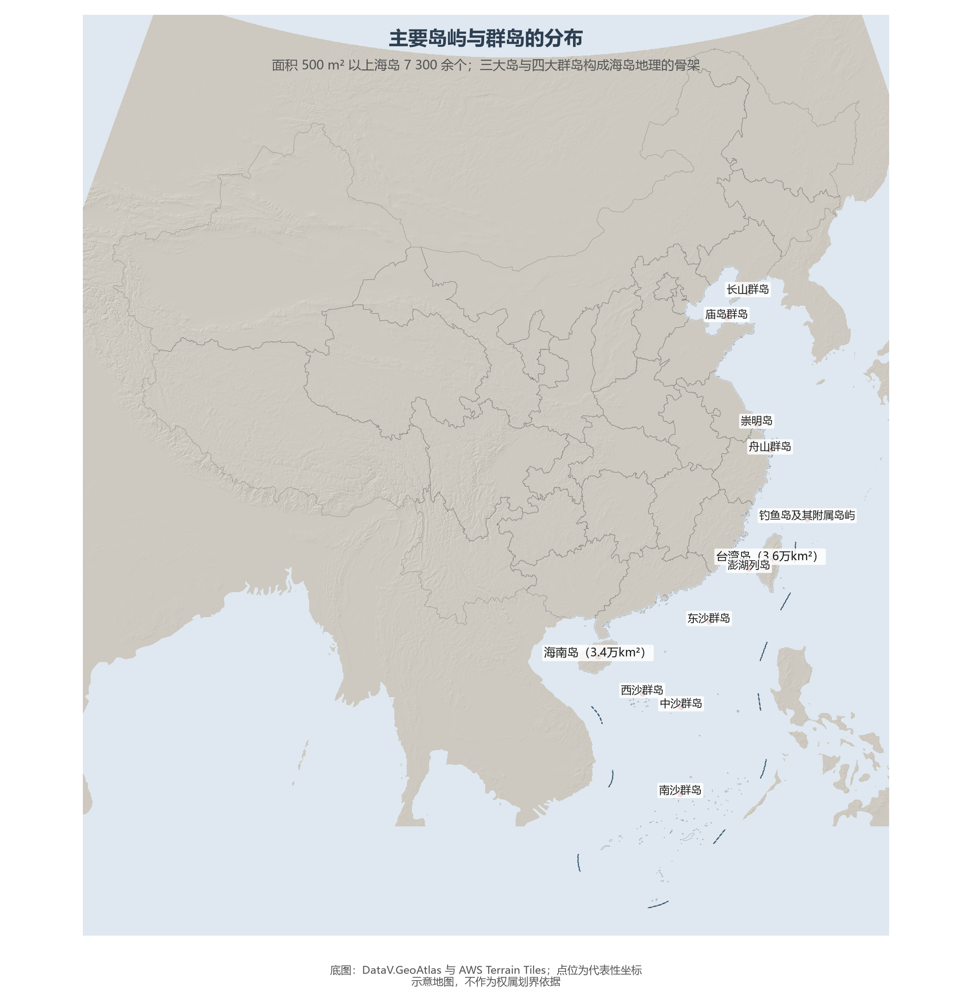

# 8.2 岛屿与群岛

中国是海洋岛屿大国：面积 500 m² 以上的海岛 7 300 多个，若计入更小的岛礁逾 1.1 万个，海岛总面积约占陆地面积的 0.8%。它们可分为三大家族：大陆岛（基岩大陆的延伸）、冲积岛（江河泥沙的堆积分号）与海洋岛（珊瑚与火山造的深海建筑）。

**图 8-1 主要岛屿与群岛的分布**：三大岛与四大群岛构成中国海岛地理的骨架。

## 一、三大岛：台湾、海南、崇明

**台湾岛**面积约 3.6 万 km²，中国第一大岛（见 2.4 节）；**海南岛**约 3.4 万 km²，是第二大岛，1988 年建省并成为全国最大经济特区；**崇明岛**约 1 269 km²，世界最大的河口冲积岛，由长江泥沙淤积而成，至今仍以每年数十米的速度向东生长——三座大岛恰好代表了海岛的三个成因家族。

## 二、群岛：从长山到南沙

群岛是海岛的主要存在形式：渤海海峡的**庙岛群岛**把守京津门户；黄海的**长山群岛**与东海的**舟山群岛**（1 390 个岛屿，中国最大群岛、最大渔场）分别拱卫两大渔港区；东南沿海的澎湖列岛、钓鱼岛及其附属岛屿隶属台湾省（见 2.4 节）。南海的**东沙、西沙、中沙、南沙四大群岛**散布于九段线之内——西沙的永兴岛是地级三沙市的驻地，南沙的曾母暗沙是中国领土的最南端。珊瑚岛是南海群岛的主体：它们由珊瑚虫的钙质骨骼经万年堆砌而成，只生长在水温 20 ℃ 以上的热带海域。

## 三、海岛的价值与保护

海岛的价值在"小而要害"：领海基点绝大多数设在海岛上，一个海岛可以依法主张约 1 550 km² 的领海与更广的管辖海域；海岛还是航道依托、渔场支点与生态屏障。《海岛保护法》（2010 年）确立了"保护优先、适度利用"的原则，无居民海岛实行"一岛一策"严管。

## 四、世界视角：岛屿国家的两种活法

世界海岛经济有两条路：一是马尔代夫、塞舌尔的"旅游立岛"，二是新加坡、中国台湾的"枢纽立岛"。中国海岛走的第三条路是"体系立岛"——舟山群岛以港口群（宁波舟山港货物吞吐量世界第一）与渔业跻身世界级枢纽，海南以自由贸易港对接全球，南海诸岛则以生态保护与航运服务为主业。把 7 300 个海岛放回世界海岛版图，中国群岛的多样性（大陆岛、冲积岛、珊瑚岛、火山岛俱全）仅次于印尼与菲律宾。

## 参考与数据来源

1. 海岛数量与面积：自然资源部《2015 年海岛统计调查公报》、全国海岛资源综合调查。
2. 崇明岛面积：上海市规划资源部门公开数据（约 1 269 km²）。
3. 底图：DataV.GeoAtlas、AWS Terrain Tiles；点位为代表性坐标。
