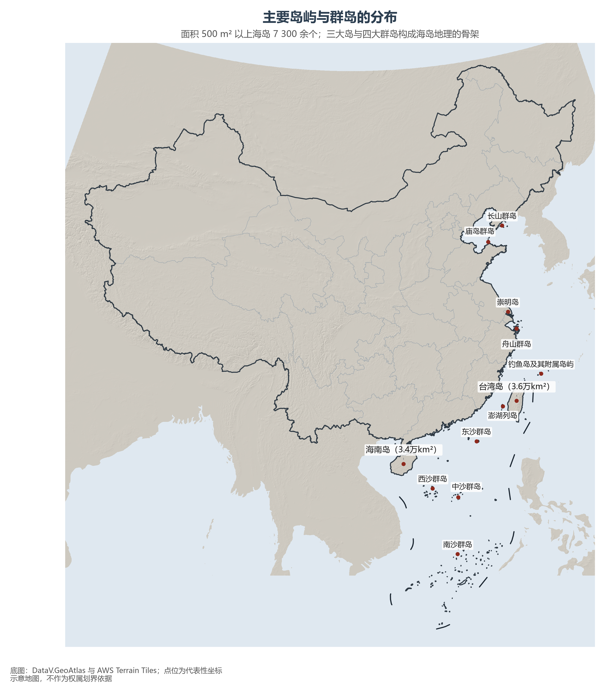
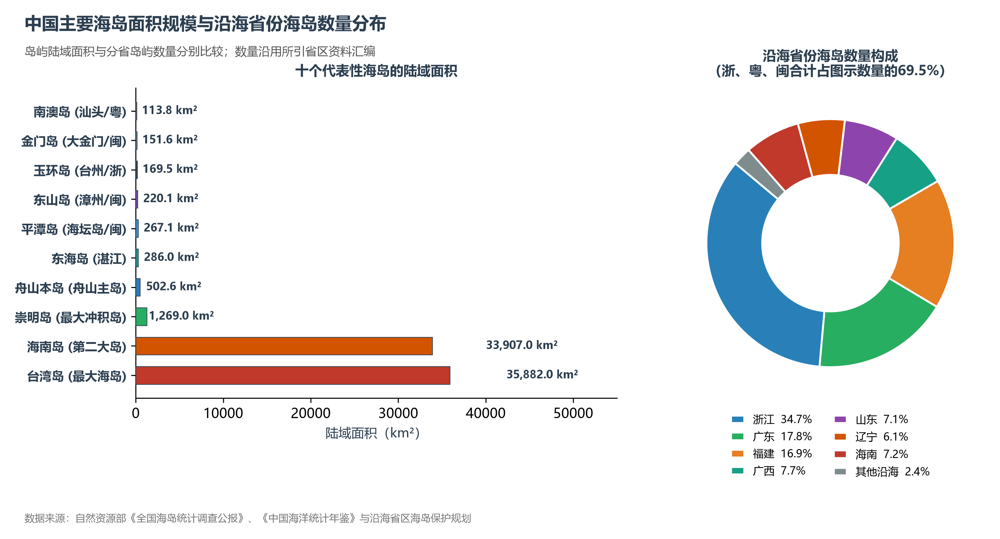

# 8.2 岛屿与群岛

中国不仅是大陆辽阔的大国，更是海岛星罗棋布的海洋大国。依据全国海岛资源综合调查最新数据，我国拥有面积在 500 平方米以上的海岛 **7 300 多个**；若计入 500 平方米以下的岛礁与低潮高地，总数逾 **1.1 万个**。全国海岛陆域总面积近 **8 万平方公里**，约占我国陆地国土总面积的 0.8%。这些海岛与群岛自北向南宛如一串明珠镶嵌在黄海、渤海、东海与广袤的南中国海之中，不仅构成陆地国土伸向大洋的前沿屏障，更是依法主张领海、毗连区与 200 海里专属经济区（EEZ）的坚实空间基石。

**图 8-1 主要岛屿与群岛的分布**：三大岛与四大群岛构成中国海岛地理的骨架。

---

## 一、海岛成因三大分类谱系

从地球物理、地质构造与外力沉积过程来看，中国海岛并非由单一地质营力所成，而是严格划分为三大成因家族：

| 成因类型 | 形成机制与地质构造 | 占海岛总面积比例 | 典型代表岛屿与群岛 | 核心资源与环境特征 |
|:---|:---|:---:|:---|:---|
| **大陆岛** | 第四纪冰期后海平面上升或构造断裂下沉，大陆山脉被淹没留存之峰顶，岩性与邻近大陆完全一致 | **> 90%** | **台湾岛**、**海南岛**、舟山群岛、平潭岛、东山岛、长山群岛、南澳岛 | 地势起伏大，多基岩低山丘陵；港湾深邃，淡水来源依靠降水河流径流 |
| **冲积岛** | 大江大河入海口处，巨量细颗粒泥沙受潮汐与海浪顶托减速，在河口水下堆积抬升露出海面的沙岛 | **约 2%** | **崇明岛**（世界最大河口沙岛）、长兴岛、横沙岛、珠江口沙仔岛 | 地势极其平坦低洼，地质年代年轻且持续处于动态消长冲淤中 |
| **海洋岛（火山岛/珊瑚礁岛）** | **火山岛**：大洋板块熔岩溢出冷凝喷发堆积； **珊瑚礁岛**：造礁石珊瑚碳酸钙骨骼与钙藻经数万年堆积胶结而成 | **约 8%** | **火山岛**：涠洲岛、澎湖列岛、兰屿、绿岛； **珊瑚礁岛**：南海诸岛（东沙、西沙、中沙、南沙四大群岛） | 火山岛多玄武岩地貌；珊瑚岛发育环礁、台礁与灰砂岛，极度依赖淡水透镜体 |

**图 8-4 中国主要海岛面积规模与沿海省份海岛数量分布**：台湾岛与海南岛面积占全国海岛总面积约九成，浙江省海岛总数达 2 878 个居全国首位。

---

## 二、中国三大主力海岛地貌与空间格局

在全国 7 300 多个海岛中，**台湾岛、海南岛与崇明岛**位列陆域面积前三甲，且恰好分别代表了构造断块大陆岛、地堑断裂大陆岛与河口冲积沙岛的三种典型演变演化路径：

### 1. 台湾岛：中国第一大岛与地质构造年轻之巅

台湾岛陆域面积约 **35 882 平方公里**（见 2.4 节），位于欧亚板块与菲律宾海板块聚合碰撞带前沿，新生代造山运动极其剧烈。
- **地形骨架**：全岛约三分之二为高峻山地丘陵，五大平行山脉（中央山脉、雪山山脉、玉山山脉、阿里山山脉、海岸山脉）呈北北东—南南西走向纵贯全岛。主峰**玉山**海拔高达 **3 952 米**，不仅是中国东部及东南沿海最高峰，亦是东北亚第一高峰。
- **水系与平原**：台湾岛地势极其陡峻，河流源短流急，暴雨时山洪暴发挟带巨量砾石。浊水溪、高屏溪为主要大川。西部沿海受冲积物堆积发育了广阔的台南平原与彰化平原，集中了全岛 90% 以上的人口与经济命脉；东部则为落差千米的清水断崖直插太平洋。

### 2. 海南岛：中国第二大岛与热带环状生态大岛

海南岛陆域面积约 **33 907 平方公里**。地质构造上原属华夏地块的一部分，第四纪早更新世受雷琼地堑断裂沉陷影响，海水涌入形成宽约 18—30 公里的琼州海峡，海南岛遂与雷州半岛分离成为独立海岛。
- **环状阶梯地貌**：海南岛地貌形态呈现出完美的同心圆环状构造。中部五指山（海拔 1 867 米）与鹦哥岭为隆起核心，向外逐级递降为丘陵、玄武岩台地以及外围狭窄的滨海冲积平原。
- **热带雨林与自贸港地缘**：海南岛地处北回归线以南，长夏无冬，发育了我国分布最集中、保存最完好的热带雨林群落（海南热带雨林国家公园，见 7.2 节）。2020 年以来，海南全岛推进建设具有中国特色的自由贸易港，打造面向太平洋和印度洋的重要对外开放门户。

### 3. 崇明岛：世界最大的河口冲积沙岛

崇明岛陆域面积约 **1 269 平方公里**，坐落于长江入海口，是世界第一大河口冲积沙洲。
- **千百年动态淤长史**：崇明岛始见于公元 618 年左右（唐代武德年间），最初仅为露出江面的两片狭小沙洲（东沙、西沙）。历经一千三百余年来长江每年数亿吨泥沙的搬运与潮汐潮流的反复顶托冲淤，沙洲历经“坍塌沉浮、反复迁徙”，直至清代中期各沙洲逐渐合并定型为连片大岛。
- **生态屏障与现代调控**：崇明岛地表海拔普遍仅 3—4 米，地表水网纵横交错。崇明东滩是全球候鸟迁徙的重要中继站与国家级自然保护区。目前上海市已全面将崇明岛定位为“世界级生态岛”，严格限制重化工业，守护长江大口门生态安全屏障。

---

## 三、四大战略群岛与海疆咽喉

海岛在海洋中的集聚多以群岛形式呈现。长山群岛、庙岛群岛、舟山群岛与南海诸岛分别扼守中国北、中、南三大海域的咽喉通道：

### 1. 舟山群岛：千岛之城与江海联运超级枢纽

舟山群岛位于杭州湾口外东海海域，由 **1 390 个岛屿**组成，总面积达 1 440 平方公里，是我国第一大群岛。
- **群岛地貌与区位**：舟山各岛为浙东天台山脉延伸入海形成的基岩岛屿，主岛为舟山本岛（面积 502.65 平方公里，全国第四大岛）。各岛之间深水航道交织，潮汐冲刷强劲，常年不冻不淤。
- **国家战略与港口之冠**：舟山群岛背靠长江黄金水道与长三角巨型经济腹地，拥有我国首个国家级以海洋经济为主题的新区（浙江舟山群岛新区）。宁波舟山港核心港区（如穿山港区、梅山港区、金塘港区、衢山港区）拥有大量 20—30 万吨级超大型矿石与原油专用深水泊位，年货物吞吐量超 13 亿吨，稳居全球第一。舟山还是我国著名的国家石油战略储备基地与国际海事服务保税燃料油加注中心。

### 2. 庙岛群岛（长山列岛）与长山群岛：渤海咽喉之锁

- **庙岛群岛（32 岛）**：位于山东半岛蓬莱角与辽东半岛老铁山角之间的渤海海峡中，自南向北由南长山岛、北长山岛、砣矶岛、大钦岛、北隍城岛等岛屿呈链状排布，将渤海海峡分割为老铁山水道、长山水道等狭窄深水通道。庙岛群岛是京津冀环渤海海上门户的天然前哨，自古被誉为“渤海锁钥”。
- **长山群岛（黄海北部群岛）**：位于辽东半岛东侧黄海北部，由大长山岛、小长山岛、广鹿岛、獐子岛、海洋岛等 100 多个岛礁组成。海域处于温带冷水团边缘，是我国极具代表性的现代化温带海洋牧场与国家级现代农业产业园。

### 3. 南海四大群岛：两千年深蓝海疆与造礁史诗

南中国海海域辽阔，岛礁散布于九段线之内，历史上被严谨划分为**东沙群岛、西沙群岛、中沙群岛与南沙群岛**四大群岛：

| 群岛名称 | 地理区位与核心要冲 | 主要岛礁构成与地貌特征 | 战略与历史文化价值 |
|:---|:---|:---|:---|
| **东沙群岛** | 南海北部陆坡外缘，扼守台湾海峡与巴士海峡要冲 | 以东沙环礁为主，包括东沙岛、北卫滩、南卫滩等 | 距大陆最近的南海群岛；南海北部国际深水航线要冲 |
| **西沙群岛** | 海南岛东南约 180 海里，分永乐群岛与宣德群岛 | 40 余座岛礁沙洲；永兴岛（三沙市驻地）、石岛、甘泉岛 | 甘泉岛唐宋居住遗址；西沙海槽与海洋深水研究前沿基地 |
| **中沙群岛** | 西沙群岛东偏南，水下巨型中沙大环礁 | 唯一出露水面的环礁为黄岩岛；其余 20 余座暗沙均没于水下 | 扼守马尼拉海沟西侧；大洋渔场与深海构造关键节点 |
| **南沙群岛** | 分布最广、岛礁最多（230 余座）、纬度最南 | 环礁、台礁、暗沙；曾母暗沙（领土最南端）、美济礁、渚碧礁、永暑礁 | 掌控连接太平洋与印度洋的马六甲海上生命线；现代化海事导航搜救公益中心 |

- **东沙群岛**：以东沙环礁为主，位于南海北部陆坡外缘，扼守台湾海峡与巴士海峡西口，是中国南海诸岛中距大陆最近、位置最北的群岛。
- **西沙群岛**：由永乐群岛与宣德群岛两大岛礁群组成，共有 40 余座岛礁、沙洲。主岛**永兴岛**（面积约 3.16 平方公里）为地级三沙市人民政府驻地，岛上建有现代化机场、港口、学校与科研基地。西沙甘泉岛留有唐宋时期的先民居住历史遗址，是我国历代开发经营南海的铁证。
- **中沙群岛**：由中沙大环礁及周边数十座暗沙、暗滩组成，除东部的**黄岩岛**为环礁边缘发育出露海面的礁石外，其余水下暗沙均沉没在水深 10—20 米的海面之下。
- **南沙群岛**：是中国南海诸岛中分布范围最广、岛礁数量最多、纬度最南的群岛，涵盖 230 多个岛、礁、沙洲、暗沙和暗滩。中国领土最南端**曾母暗沙**（见 1.1 节）即位于南沙群岛南部，是一座埋深约 17.5 米的水下珊瑚暗沙。美济礁、渚碧礁、永暑礁建有现代化的专业航行灯塔、海洋气象观测站、大型救援跑道与深水避风港，为穿越南海国际深水航道的全球各国商船提供全天候公益海事气象搜救服务。

---

## 四、海岛权益、水资源机制与现代开发治理

### 1. 领海基点与海洋国土空间权益

依据《联合国海洋法公约》（UNCLOS）及《中华人民共和国领海及毗连区法》，海岛是划定国家领海基线、主张管辖海域不可或缺的核心基点。我国已公布的领海基点绝大多数设在沿海外侧基岩海岛上（如嵊山岛、海礁、台山岛、牛山岛、乌丘屿、钓鱼岛及其附属岛屿等）。一个合法的海岛，其外侧划定 12 海里领海即可圈定约 1 550 平方公里的领海水域，并可依法向外延伸主张 200 海里专属经济区与大陆架，其所维系的海洋空间战略纵深无比辽阔。

### 2. 淡水透镜体与海岛生态脆弱性

海岛地表集水面积狭小，多缺乏常年径流河流，地下淡水资源极度匮乏。
- **淡水透镜体（Ghyben-Herzberg Lens）**：在珊瑚灰砂岛或基岩小岛上，降雨下渗由于淡水密度（1.00 g/cm³）略低于海水密度（1.025 g/cm³），浮在致密海水之上形成如凸透镜状的薄层地下淡水层。该透镜体十分脆弱，一旦过量抽采或地表植被退化，海水即刻倒灌导致地下水咸化毁灭。
- **现代工程破局**：近年来，我国通过自主研发的大型模块化反渗透海水淡化成套设备、离网风光互补储能微电网、雨水深层集蓄净化系统，根本上打破了西沙永兴岛、南沙各礁及沿海远海海岛的淡水与能源生命线瓶颈。

### 3. 《海岛保护法》与“一岛一策”分类管护

海岛生态系统高度孤立、物种敏感脆弱、易受台风海蚀破坏。2010 年《中华人民共和国海岛保护法》正式颁布实施，确立了“保护优先、适度利用、陆海统筹”的法定原则：
- 对全国 400 多个有居民海岛，严控岸线过度硬化开发与近岸养殖污染，加强海岛地灾监测治理；
- 对全国 6 900 多个无居民海岛，实行国家统一所有制度与极严格的“一岛一策”用途管制红线。严禁私自炸礁、开矿、采伐珊瑚礁及填海造地，使海岛真正成为我国海疆永续繁荣的绿色前哨。

---

## 参考与数据来源

1. 自然资源部：《全国海岛保护规划》、《2015 年海岛统计调查公报》。
2. 地级三沙市人民政府官方门户：三沙市地理区划与岛礁建设资料。
3. 《中国海岛志》编纂委员会：《中国海岛志（总论与各卷）》，海洋出版社。
4. 中国科学院南海海洋研究所：《南中国海岛礁地貌演化与生态系统研究》。
5. 浙江省海洋经济发展厅：《宁波舟山港建设与世界一流强港规划进展（2024 年）》。
