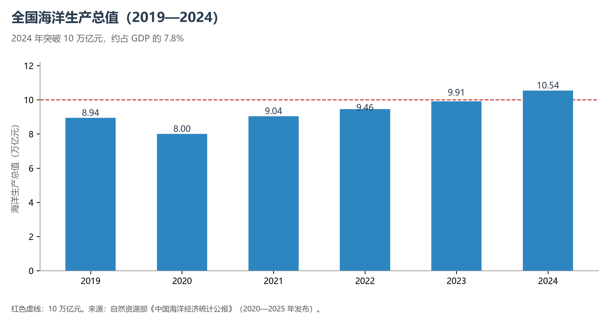
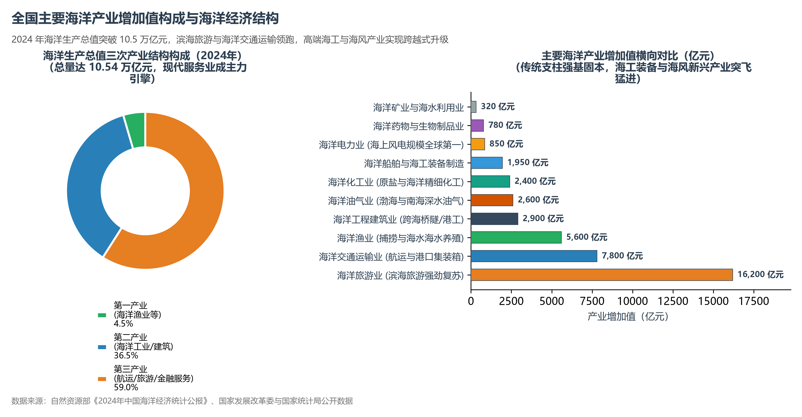

# 8.3 海洋经济

2024 年，全国海洋生产总值（Gross Ocean Product, GOP）突破 10.5 万亿元大关（达 **105 438 亿元**，按不变价格计算比上年增长 5.8%），占沿海地区生产总值的近 15%，占全国国内生产总值（GDP）的比重稳定在 **7.8% 左右**。从渤海之滨的石化与重工业码头，到长三角外高桥与舟山的万吨级造船坞；从珠江口与北部湾的深水航运枢纽，到南海万顷波涛之上的深海油气钻井平台与现代海洋牧场工船，中国海洋经济已彻底脱离历史上单一的“渔盐之利、舟楫之便”，构建起规模庞大、门类齐全、技术尖端的现代海洋产业生态体系。

**图 8-2 全国海洋生产总值（2019—2024）**：五年间从 8 万亿量级站上 10 万亿台阶。

---

## 一、海洋产业结构的高阶化演进

伴随着现代海洋产业体系建设与海洋综合国力的跃升，中国海洋产业三次结构发生了深刻的转型升级，已由早期的“二三一”格局全面迈入现代化的“三二一”服务主导型结构：

- **第一产业（占比约 4.5%）**：以海洋渔业为核心，向生态健康养殖、深远海智慧养殖与海洋生物碳汇演进；
- **第二产业（占比约 36.5%）**：涵盖海洋油气勘探开发、海洋工程建筑、船舶工业与海工装备、海洋化工业、海洋电力业及海洋药物制品，制造业技术密集度与附加值大幅跃升；
- **第三产业（占比约 59.0%）**：以海洋交通运输业、滨海旅游业、涉海金融与海事信息服务为支柱，现代海洋服务业成为引领海洋经济高质量发展的绝对主力。

**图 8-5 全国主要海洋产业增加值构成与海洋经济结构**：传统支柱强基固本，海工装备与海风新兴产业突飞猛进。

---

## 二、传统支柱海洋产业的转型与升级

### 1. 海洋渔业：从“近海捕捞”到“深远海蓝色粮仓”

中国是世界第一大水产品生产国与消费国，水产品年总产量常年占全球总产量的三分之一以上，其中海水养殖产量占海水产品总量的 80% 以上。
- **近海生态休养与最严休渔制度**：历史上长期过量近海捕捞曾导致黄渤海、东海“四大传统海产”（大黄鱼、小黄鱼、带鱼、乌贼）资源剧烈衰退。为此，我国全面确立了涵盖渤海、黄海、东海及南海的严格**伏季休渔制度**（每年 5 月 1 日至 8 月至 9 月中旬分区闭海休渔），配合增殖放流与限额捕捞，近海生物资源得到关键修复。
- **深远海大型养殖工船与海洋牧场**：全国已累计创建国家级海洋牧场示范区超 160 个。更具划时代意义的是以全球首艘 10 万吨级大型养殖工船**“国信1号”**为代表的移动式深远海养殖平台，其在黄海冷水团与南海温暖海域随水温变迁巡回游弋，封闭式船舱深层提水养殖高品质大黄鱼，实现“离岸百里、水深千米”的全天候工业化养殖；在黄海深水冷水团试验成功的“深蓝1号”网箱，打破了我国温水海域规模化养殖优质三文鱼的地理壁垒。

### 2. 海水利用与盐业：空间集聚与海水淡化破局

- **四大海盐场与气候禀赋**：海水制盐要求“多日照、强蒸发、少降水、平坦防渗潮滩”。我国主要海盐产区呈现鲜明的地理分异：
  - **长芦盐场**（渤海湾西岸，我国最大盐场）：春季干旱多大风，日照强、蒸发量远大于降水量，泥质潮滩平整；
  - **淮北盐场**（苏北沿海）：利用暖温带向亚热带过渡区的平坦潮滩与日照；
  - **布袋盐场**（台湾岛西南沿海）：中央山脉背风雨影区，全年干燥晴热，蒸发旺盛；
  - **莺歌海盐场**（海南岛西南端）：五指山背风干热区，年蒸发量高达 2 600 毫米以上，年日照超 2 600 小时，是中国南部最大的高纯度海盐基地。
- **工业海水淡化**：全国已建成海水淡化工程 150 余个，工程规模突破每日 240 万吨，集中布局在天津、青岛、大连、舟山、洋浦等沿海重化工业区与严重缺水海岛，海水淡化水全面接入市政管网与高耗水工业冷却流程；同时形成“海水淡化—浓盐水制盐—苦卤提溴提取氯化钾/硫酸镁”的全链条循环经济。

### 3. 海洋油气开采：浅海向超深水的地质突破

- **渤海油田稳产基石**：渤海盆地是我国第一大原油生产基地，年产原油突破 3 000 万吨，历经垦利 6-1 等多座亿吨级大型油田勘探发现，依托注水驱油与浅层大斜度多分支井技术，实现了老油田持续高产稳产。
- **南海深水大气田群**：2021 年我国自主研制的全球首座十万吨级深水半潜式生产储油平台**“深海一号”**在南海琼东南盆地正式投产，水深超 1 500 米，井深超 4 000 米，年产天然气达 30 亿立方米，通过海底高压管网直供粤港澳大湾区与海南自贸港；2024 年更在珠江口盆地发现开平南亿吨级深水深层油田，奠定了我国深海油气勘探跻身世界先进行列的工业根基。

---

## 三、战略性新兴海洋产业与世界级枢纽

### 1. 海上风电：全球第一大海上清洁能源高地

我国东南沿海毗邻季风海流交汇带，海上风能资源丰富度冠绝全球。截至 2024 年底，全国海上风电累计并网装机容量突破 **3 800 万千瓦**，连续多年蝉联全球第一，占全球海上风电总装机量的近半壁江山。
- **重点风电基地**：形成了广东阳江、江苏盐城/南通、福建平潭/兴化湾三大海上风电超级基地。其中台湾海峡受两岸地形“狭管效应”压缩加速，常年海风呼啸，风能密度极高，平潭兴化湾海上风电场单机容量已跃升至 16—18 兆瓦级超大型海上风电机组，年满负荷发电等效利用小时数超 4 000 小时。
- **“海风+”多元融合**：现代海上风电正在由近海走向深远海漂浮式风电（如“海油观澜号”），并与深远海网箱养殖、离岸海水制氢、海洋观测试验实现一体化立体开发。

### 2. 船舶工业与高端海工装备：摘取工业制造“三颗明珠”

中国造船业在完工量、新接订单量、手持订单量三大核心指标上，国际市场份额连续 15 年保持在 50% 左右，位居全球绝对第一。
- **制造业皇冠的三颗明珠**：我国已成为全球唯一能同时建造航空母舰、大型液化天然气（LNG）运输船与大型豪华邮轮的国家。首艘国产大型豪华邮轮“爱达·魔都号”在上海外高桥造船厂成功交付商运；全球最大级 2.4 万标准箱（TEU）超大型绿色集装箱船批量下水。
- **大国重器挺进深海**：自主研制建造了亚洲最大重型自航绞吸船“天鲲号”（吹沙造陆与深水航道疏浚神器）、“蓝鲸1号”超深水双钻塔半潜式钻井平台、“奋斗者”号全海深载人潜水器（实现马里亚纳海沟万米海底常态化科考），标志着我国海工装备核心技术全面摆脱对外依赖。

### 3. 世界级超级港口群：全球物流供应链中枢

中国沿海构建了环渤海、长三角、东南沿海、珠三角、西南沿海五大世界级港口群。
- **全球霸主地位**：在全球货物吞吐量前十名大港中，中国独占八席；在全球集装箱吞吐量前十名港口中，中国常年稳占七席。
- **超级港口代表**：
  - **宁波舟山港**：依托深水岬湾群岛优势，年货物吞吐量超 **13 亿吨**，连续 15 年位居全球第一，是我国大宗矿石、原油、煤炭与集装箱江海联运的战略总枢纽；
  - **上海港**：依托洋山深水港与外高桥港区，年集装箱吞吐量逼近 **5 000 万标准箱（TEU）**，连续 14 年位居世界第一，洋山四期全自动化码头代表了全球自动化集装箱作业最高效率。

---

## 四、三大海洋经济圈与陆海统筹空间格局

依据《全国海洋经济发展规划》，我国沿海国土纵深布局了三大海洋经济圈，形成了各具特色、优势互补的现代海洋经济空间分工架构：

| 海洋经济圈 | 涵盖沿海省区市 | 核心海域与地理区位 | 支柱与特色战略产业 | 空间定位与地缘门户 |
|:---|:---|:---|:---|:---|
| **北部海洋经济圈** | 辽宁、河北、天津、山东 | 环渤海海域与黄海北部；半封闭内海与温带大陆架 | 海洋现代装备制造、石化工业、现代海洋渔业、海水淡化与海洋科技研发 | 东北亚海上经贸枢纽；环渤海协同发展；京津冀出海战略门户 |
| **东部海洋经济圈** | 江苏、上海、浙江 | 濒临东海与黄海南部；长江口与杭州湾核心腹地 | 国际航运与高端物流、豪华邮轮与超大型造船、海洋生物医药、现代海事金融 | 长三角一体化龙头；全球顶级国际航运物流中心与高端航运服务港 |
| **南部海洋经济圈** | 福建、广东、广西、海南 | 濒临南中国海与北部湾；直通西太平洋与印度洋 | 滨海高端旅游、深远海油气与海上风电、大宗海运集装箱、深海前沿科技 | 粤港澳大湾区国际一流湾区；海南自由贸易港；面向东盟与“一带一路”蓝色走廊 |

---

## 五、迈向海洋强国的空间治理与全球图景

把中国海洋经济置于世界海洋大国版图对比：在体量规模、造船完工量、港口吞吐量、水产养殖与海上风电装机上，中国已确立无可撼动的全球领先优势；而在深海高端传感器、船用高阶主机动力系统、海洋生物医药原始创新专利以及国际海事法治规则话语权方面，与老牌传统海洋强国相比仍有追赶空间。

进入新时代，我国坚持**“陆海统筹、向海图强、依海富国、人海和谐”**的现代化发展路径，严格守住海洋生态保护红线，推进“蓝色海湾”生态整治，全面参与联合国“海洋科学促进可持续发展十年（海洋十年）”倡议与“国际海底区域”资源绿色勘探，为保护全球海洋生态安全与推动深海国际治理贡献了中国力量。

---

## 参考与数据来源

1. 自然资源部：《2024 年中国海洋经济统计公报》（2025 年 3 月发布）。
2. 农业农村部渔业渔政管理局：《中国渔业统计年鉴（2024 年）》，中国农业出版社。
3. 国家能源局：《全国电力工业统计数据（海上风电并网与装机运行通报）》。
4. 交通运输部：《2024 年水运经济运行情况公报》及全国港口集装箱吞吐量数据。
5. 中国船舶工业行业协会：《2024 年中国船舶工业经济运行分析报告》。
