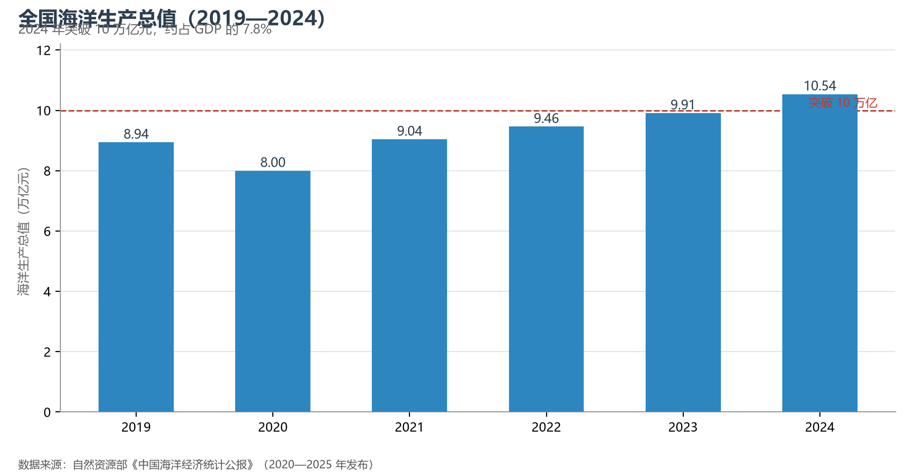

# 8.3 海洋经济

2024 年，全国海洋生产总值突破 10 万亿元（105 438 亿元，占 GDP 约 7.8%）——中国已成为全球体量最大的海洋经济体之一。从渤海湾的石化码头到深圳的海洋新城，从深远海的渔业船队到近海的万亿级风电场，海洋经济已从"渔盐之利、舟楫之便"长成一条完整的产业链。

**图 8-2 全国海洋生产总值（2019—2024）**：五年间从 8 万亿量级站上 10 万亿台阶。

## 一、产业构成：从传统到新兴

海洋经济的三大板块：**传统产业**——海洋渔业（水产品产量常年居世界第一，约占全球三成五）、海洋交通运输（全球货物吞吐量前十的大港中国占八席）、海洋油气（渤海、南海两大产区）；**新兴高技术产业**——海洋工程装备（全球订单份额约四成）、海洋电力业（海上风电累计装机世界第一）、海洋药物与生物制品；**服务业**——海洋旅游业（疫情后强劲修复，滨海旅游收入回升至万亿元级）。环渤海、长三角、珠三角三大海洋经济区合计贡献了全国海洋生产总值的七成以上。

## 二、世界视角：海洋强国的三张牌

世界海洋强国各有一张王牌：美国握军事与科研、挪威握海工与航运服务、日本握造船精密制造。中国手里的牌是**规模与体系**：全球第一的造船产能（三大指标均过半）、全球前十吞吐量大港中的八席、世界第一的海上风电装机与水产养殖产量。短板同样清晰——深海资源勘探开发（大洋矿产）、海洋生物医药的核心专利与高端船用设备仍依赖进口。"海洋强国"战略的全部含义，就是从"规模第一"走向"技术第一"。

## 参考与数据来源

1. 海洋生产总值与产业构成：自然资源部《中国海洋经济统计公报》（2024 年）。
2. 水产品产量：农业农村部《中国渔业统计年鉴》；海上风电装机：国家能源局公开数据。
