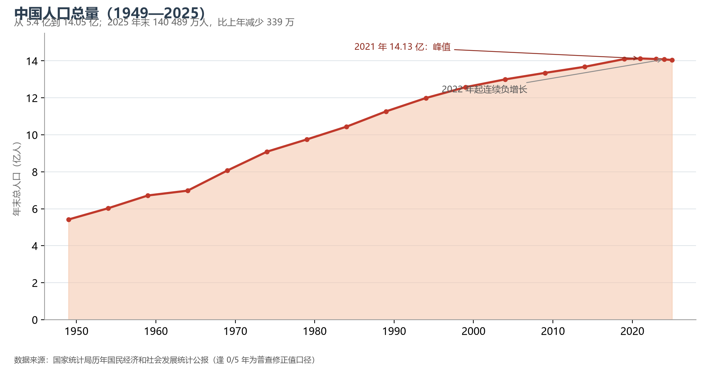
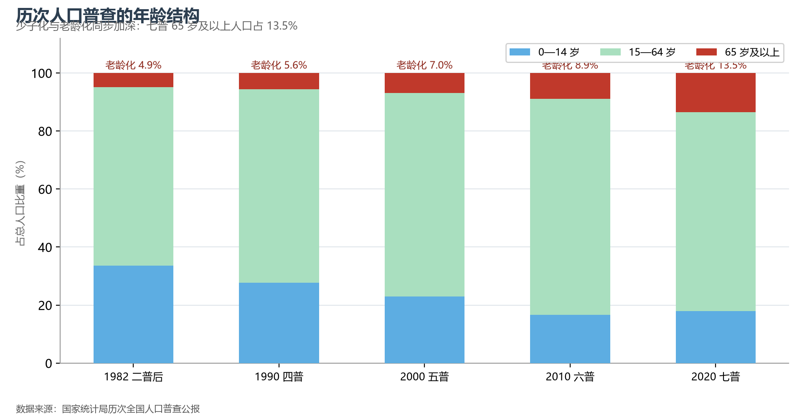

# 9.1 人口总量与结构

2025 年末，全国人口 140 489 万人——这是中国人口连续第四年负增长（比上年减少 339 万人）。从 1949 年的 5.4 亿到 2021 年的 14.13 亿峰值，中国用 72 年走完了人类历史上规模最大的人口增长；此后的下行曲线，则开启了一个从未有过的时代。

**图 9-1 中国人口总量（1949—2025）**：2021 年 14.13 亿为历史峰值，2022 年起连续负增长。

## 一、人口转变：三个时代

中国人口转变以三段弧线完成：**高增长时代**（1949—1970，年出生率长期在 30‰ 以上，1963 年补偿性生育高峰达 43.4‰）；**转型时代**（1971—2015，计划生育从"晚稀少"到独生子女政策，出生率一路下探至 12‰ 以下，总和生育率降至更替水平之下）；**负增长时代**（2022 年起，出生人口跌破千万、死亡人口过千万，2023 年出生率 6.39‰、死亡率 7.87‰）。人口峰值提前到来且规模低于此前所有预测——这是理解未来房地产、教育、养老金政策的人口底账。

**图 9-2 历次人口普查的年龄结构**：少儿占比先降后稳，65 岁及以上占比从 4.9% 升至 13.5%（七普）。

## 二、老龄化：未富先老的加速度

七普（2020 年）65 岁及以上人口占 13.5%；2024 年末已升至 15.6%，60 岁及以上人口超过 3.1 亿（占 22%）。按 65 岁占比超过 14% 的通行标准，中国已于 2021—2022 年间进入"深度老龄化"社会——从"老龄化"到"深度老龄化"只用了约 21 年，而法国走了 115 年。区域上，老龄化呈"东北最深、沿海次之、边疆最浅"的梯度：辽宁 65 岁及以上占比已超过 20%，西藏仍不足 6%。

## 三、世界视角：两个 14 亿的岔路口

中国与印度在 2023 年前后交换了"世界第一人口大国"的座位：印度人口中位年龄约 28 岁，中国约 39 岁——两国的分岔不在人口规模，而在人口结构。日本 1990 年代进入深度老龄化后的经验（劳动力短缺、储蓄率下降、通缩压力）是理解中国未来二十年最好的参照系；而中国的特殊变量是 近 3 亿规模的"农民工蓄水池"与远未用尽的城市化潜力（见 9.4 节）——"未富先老"与"未充分城市化就老"的双重叠加，是日本当年没有遇到过的考题。

## 参考与数据来源

1. 人口总量与出生率死亡率：国家统计局《中国统计年鉴 2024》、《2025 年国民经济和社会发展统计公报》。
2. 普查年龄结构：历次全国人口普查公报。
3. 国际对比：联合国《世界人口展望 2024》。
