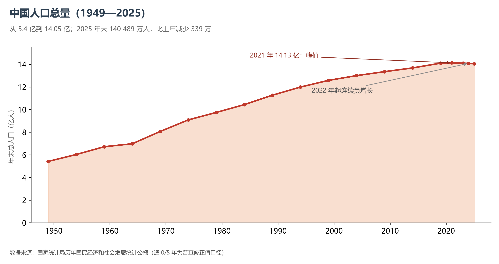
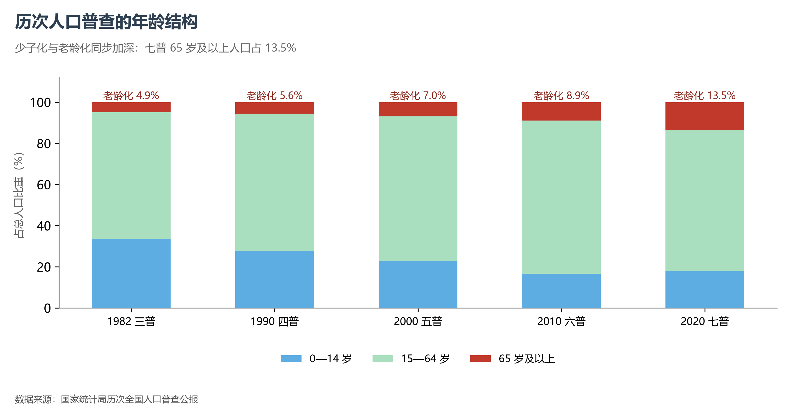

# 9.1 人口总量与结构

人口是一个国家最基本的国情国策底座，也是一切经济、社会、文化与地缘活动的空间载体。2025 年末，全国人口为 **140 489 万人**（约 14.05 亿人，不含港澳台及外籍人员），比上年减少 339 万人——这是中国自 2022 年开启人口负增长通道以来的连续第四年负增长。从 1949 年新中国成立初期的 5.4 亿人，到 2021 年达到历史最高峰的 **14.13 亿人**，中国仅用 72 年时间就走完了人类历史上规模空前宏大的人口高速扩张进程；而峰值过后陡峭下行的出生曲线与呼啸而来的老龄化浪潮，正驱动着这片古老土地迈入一个从未有过的人口新纪元。

**图 9-1 中国人口总量（1949—2025）**：2021 年 14.13 亿为历史峰值，2022 年起连续负增长。

---

## 一、中国人口转变的四大历史阶段

依据人口转变理论（Demographic Transition Model），西方发达国家的人口转变通常经历“高高低（高出生、高死亡、低自然增长）—高低高（高出生、低死亡、高自然增长）—低低低（三低阶段）”历经百余年的平缓演进。而中国的人口转变则在强有力的社会动员、卫生革命与国家生育政策的深度干预下，以一种高度压缩、波澜壮阔的节律完成了四次跃迁：

| 演变阶段 | 时间跨度 | 出生率与死亡率特征 | 自然增长率水平 | 核心动力机制与历史事件 |
|:---|:---:|:---|:---:|:---|
| **第一阶段：补偿性高速增长期** | 1949—1970 年 | 死亡率从 20‰ 急剧断崖降至 7‰ 左右；出生率长期居于 30‰—40‰ 极高位 | 20‰ 左右（年净增 1 500—2 000 万人） | 战后和平安宁、现代公共卫生与防疫体系普及；三年困难时期后迎来 1963 年补偿性生育狂潮（出生率达 43.4‰） |
| **第二阶段：政策驱动急剧降速期** | 1971—1990 年 | 出生率由 30‰ 快速腰斩至 21‰ 左右；总和生育率（TFR）从 5.8 跌至 2.3 | 从 23‰ 迅速收窄至 14‰ | 1970 年代推行“晚、稀、少”政策；1980 年将计划生育确立为基本国策，全面推行“独生子女”政策 |
| **第三阶段：超低生育与劳动力红利期** | 1991—2021 年 | 出生率持续跌破 12‰；TFR 长期低于 2.1 世代更替水平（七普降至 1.3） | 从 10‰ 持续下滑直至 0 附近 | 工业化与高速城镇化推动育儿成本跃升；15—64 岁劳动年龄人口占比超 70%，释放人类历史上最大规模“人口红利” |
| **第四阶段：人口负增长与重度老龄化期** | 2022 年至今 | 出生率降至 6‰—7‰ 左右，年出生人口跌破千万；死亡率升至 7.8‰ 以上 | 持续负增长（-1.5‰ 至 -2.5‰） | 育龄妇女规模收缩与初婚初育年龄大幅推迟；老龄群体快速扩大导致死亡人口绝对值上升 |

---

## 二、年龄结构演化与人口金字塔变迁

国家人口年龄结构通常划分为三大圈层：**少儿人口（0—14 岁）**、**劳动年龄人口（15—64 岁）**与**老年人口（65 岁及以上）**。七次全国人口普查的数据完整绘制了中国人口金字塔从“年轻扩张型”迅速收缩蜕变为“老龄坛型”的历史图景：

**图 9-2 历次人口普查的年龄结构**：少儿占比先降后稳，65 岁及以上占比从 4.9% 升至 13.5%（七普）。

### 1. 劳动年龄人口的峰值拐点与红利消退

15—64 岁劳动年龄人口是物质财富创造的核心支柱。中国劳动年龄人口在 2013 年达到峰值（约 **10.06 亿人**），此后以每年数百万人的速度持续净减少；至第七次人口普查（2020 年），劳动年龄人口降至 9.68 亿人（占 68.55%）。支撑中国成为“世界工厂”与三十余年经济奇迹的无限劳动力供给供给时代已经终结，“人口红利”正倒逼全社会向以素质、技能与科技创新驱动的“人才红利”和全要素生产率跃升转型。

### 2. 深度老龄化社会的呼啸而至

国际社会通常将 65 岁及以上人口占总人口比重达到 **7%** 定义为“进入老龄化社会”，达到 **14%** 定义为“深度老龄化社会”，达到 **20%** 则为“超老龄化社会”。
- **极速老龄化周期**：中国于 2000 年第五次人口普查时 65 岁及以上人口占比达 6.96%，正式迈入老龄化门槛；至 2021 年底该比例跨过 14.2%，正式迈入**深度老龄化社会**。中国完成这一深刻跃迁仅耗时 **21 年**（法国耗时 115 年，英国 45 年，美国 65 年，日本 24 年）。
- **最新现状与规模**：2024 年末，我国 60 岁及以上老年人口已突破 **3.1 亿人**（占总人口的 22.0%），其中 65 岁及以上人口达 **2.2 亿人**（占 15.6%）。老年人口规模已超过整个印尼的全国总人口。

---

## 三、老龄化与人口再生产的空间分异

受历史人口基数、经济发展水平、人口迁移流动与计划生育执行力度的多重交织，中国老龄化与生育水平呈现出极其显著的“地理梯度”：

### 1. 东北与华北部分工业腹地：深度老龄化与人口收缩

辽宁、吉林、黑龙江以及重庆、四川等省市是我国老龄化程度最深的板块。其中辽宁省 65 岁及以上人口占比已率先突破 **20%**，迈入超老龄化社会门槛。其根本原因在于：历史上作为老工业基地，国企职工比例高、城镇化起步早，独生子女政策执行最彻底；加上近年来年轻劳动力持续向东南沿海经济圈跨省迁移（见 9.4 节），导致常住人口年龄结构“底部迅速收缩、顶部急剧隆起”。

### 2. 东南沿海大都市圈：“候鸟青年”对冲老龄化

广东、浙江、上海、北京等沿海经济发达省市虽然户籍人口老龄化较深，但凭借强劲的现代制造业、金融与互联网科技产业，海量吸纳了来自全国各地的年轻外来流动人口（常住人口净流入），极大地稀释了本地的实际老龄化率。以广东省为例，全省 65 岁及以上人口占比仅约 8.6%（七普数据），常住人口中位年龄显著年轻于全国平均水平，成为支撑大湾区持续活力的年轻人口高地。

### 3. 西部与少数民族聚居区：年轻型人口结构与较高生育惯性

西藏、青海、新疆、宁夏、贵州等西部省区老龄化程度相对最轻。西藏 65 岁及以上人口占比长期低于 6%，总和生育率常年维持在全国前列。该区域历史上受少数民族生育政策相对宽松、传统农牧业家庭结构及城镇化率相对较低影响，少儿人口比重仍保持在较高区间。

---

## 四、世界视角：人类人口历史上的“中国变局”

2023 年前后，联合国正式宣布印度总人口超过中国，中国正式让渡了长达数百年的“世界第一人口大国”桂冠。把中国人口置于世界坐标中审视，面临着两大独一无二的结构性特征：

1. **“未富先老”与超级规模并发**：欧美日等发达经济体迈入深度老龄化时，人均 GDP 普遍已跨越 2 万至 4 万美元的门槛；而中国在人均 GDP 约 1.3 万美元的中等偏上收入阶段就已全面迎来深度老龄化，社会养老保险抚养比、老年医疗护理资源的供给面临极紧迫的财力与服务承载考验。
2. **“未充分城镇化就老”的结构叠加**：日本等老龄化国家在进入超老龄化前，城镇化率早已饱和在 80%—90% 以上；而中国在城镇化率尚未达到 70%（2025 年末约 67.89%）阶段就迎来了老龄化拐点，农村留守老人的照料空心化问题尤为严峻。

面对人口大势的深刻逆转，国家层面已相继出台实施“三孩生育政策”、将积极应对人口老龄化上升为国家战略、推行渐进式延迟法定退休年龄、构建普惠托育与全生命周期养老服务体系，全面推动人口工作由单纯“数量控制”向“提升人口整体素质、促进人口高质量发展”进行根本性战略重构。

---

## 参考与数据来源

1. 国家统计局：《历次全国人口普查公报》（第一至第七次）、《中国统计年鉴 2024》。
2. 国家统计局：《2025 年国民经济和社会发展统计公报》（2026 年初发布）。
3. 联合国经济和社会事务部（UN DESA）：《世界人口展望（World Population Prospects 2024）》。
4. 翟振武等：《中国人口负增长与老龄化深度演化趋势研究》，《人口研究》。
