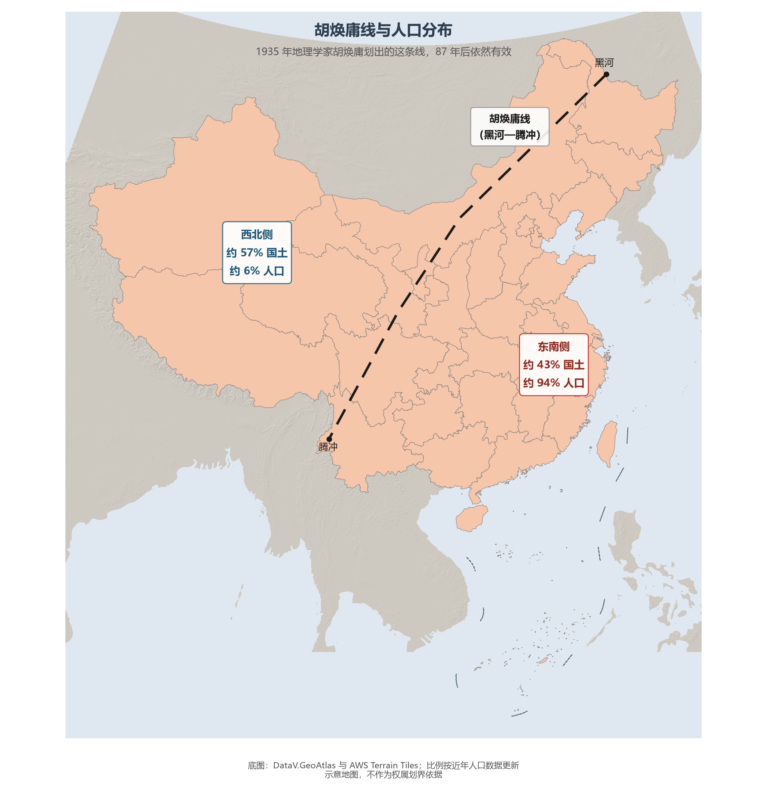

# 9.2 人口分布与胡焕庸线

1935 年，国立中央大学地理学者胡焕庸在《地理学报》发表《中国人口之分布》，用一条从黑龙江瑷珲（今黑河）到云南腾冲的直线，把中国切成两个人口世界：东南侧 36% 的国土承载 96% 的人口，西北侧 64% 的国土只有 4% 的人口。近九十年后，这条线的两侧是约 43% 与 57% 的国土、约 94% 与 6% 的人口——比例有移动，格局未动摇。

**图 9-3 胡焕庸线与人口分布**：东南侧约 43% 国土集中约 94% 人口，"东密西疏"的格局长期稳定。

## 一、这条线为什么难以撼动

胡焕庸线不是画出来的，而是被自然写出来的：它几乎与 400 mm 等降水量线、季风区界线、地势第二级与第三级阶梯的西缘重合——线的东南侧是雨热同期的季风农耕世界，西北侧是干旱半干旱的草原荒漠世界。人口跟着水土走，水土跟着气候走，气候跟着海陆位置与地形走。改革开放以来最大规模的人口流动（数亿人的乡城迁移）并没有冲破这条线，因为流动的目的地——城市群与制造业带——依然在线的东南侧。

## 二、线的两侧：两种人口地理

东南侧内部，人口密度从上海（约 3 900 人/km²）到云贵山地递减出一个完整的梯度；西北侧的人口则高度"绿洲化"——新疆 90% 以上的人口生活在占全疆面积不足 5% 的绿洲上，兰州—西宁、银川平原、天山北坡是几个孤岛式的密集区。因此严格地说，中国人口分布是"东南连片密集 + 西北绿洲点状密集"的双层结构。

## 三、世界视角：人口线的国别比较

以人口重心与国土的关系论，中国不是孤例：俄罗斯乌拉尔山以西的欧洲部分聚集了约八成人口，加拿大的"金马蹄地区"集中了约四分之一人口，埃及 95% 以上的人口挤在尼罗河谷与三角洲约 4% 的国土上。大国的宜居边界都由自然写就——但胡焕庸线的特殊在于：它以如此完整的水热逻辑横贯一个 14 亿人口的大国，且九十年来稳定性如此之强。"西部大开发"改变的是西北的发展速度，而不是人口分布的方向。

## 参考与数据来源

1. 胡焕庸线数据：《中国人口之分布》（胡焕庸，1935）；两侧比例按第七次人口普查与近年数据更新（约 43%/94%）。
2. 省级人口与密度：《中国统计年鉴 2024》。
