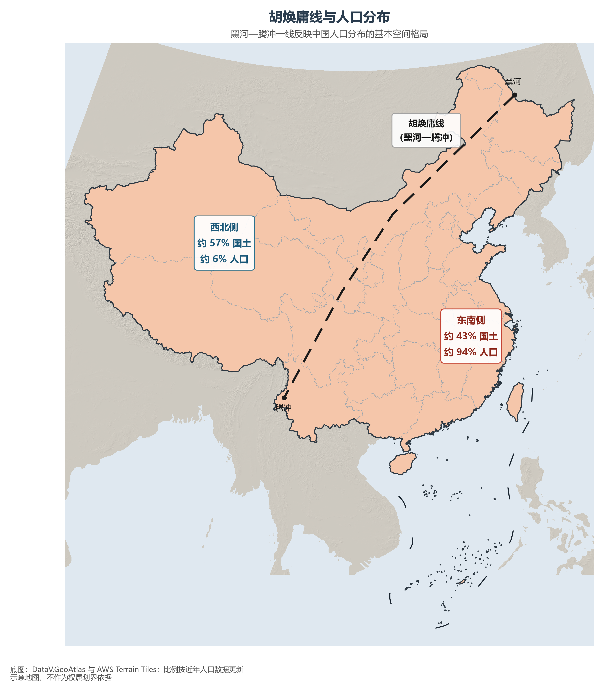
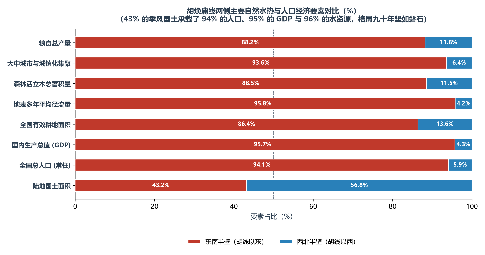

# 9.2 人口分布与胡焕庸线

1935 年，国立中央大学地理学者胡焕庸在《地理学报》第 2 卷第 2 期发表了奠定中国人口地理学基石的学术名篇——《中国人口之分布》。胡焕庸先生使用手工绘制的 2 万个红点（每个点代表 2 万人），在中国地图上画出了一条由**黑龙江瑷珲（今黑河）直抵云南腾冲**的倾斜直线。这条看似简单的线，犹如一道惊人的地表分水岭，将中国版图精准划分为截然不同的两个人口地理世界：东南半壁仅占当时全国国土面积的 36%，却聚居了 96% 的全国人口；而西北半壁幅员占国土的 64%，人口却仅占 4%。

近一个世纪沧海桑田，中国历经了战乱重生、工业化崛起、改革开放与数以亿计的人口跨区域大迁徙，但历次全国人口普查的铁律数据表明：在这条线的两侧，依然是约 **43% 与 57% 的国土面积**，承载着约 **94% 与 6% 的人口**——这便是名震中外地理学界的**“胡焕庸线”（Hu Line）**。

**图 9-3 胡焕庸线与人口分布**：东南侧约 43% 国土集中约 94% 人口，"东密西疏"的格局长期稳定。

---

## 一、胡焕庸线的实证检验与九十年稳定性

从 1935 年至今，中国先后进行了七次全国人口普查。在现行版图口径下，胡焕庸线两侧的人口比重表现出超乎想象的超稳态空间刚性：

| 普查年份 / 时点 | 东南半壁面积占比 | 西北半壁面积占比 | 东南半壁人口占比 | 西北半壁人口占比 | 东南人口密度（人/km²） | 西北人口密度（人/km²） |
|:---:|:---:|:---:|:---:|:---:|:---:|:---:|
| **1935 年（论文发表）** | 约 36%（含蒙古） | 约 64% | 96.0% | 4.0% | 约 105 | 约 3 |
| **1953 年（一普）** | 43.2% | 56.8% | 94.8% | 5.2% | 131 | 5.4 |
| **1982 年（三普）** | 43.2% | 56.8% | 94.4% | 5.6% | 221 | 10.3 |
| **2000 年（五普）** | 43.2% | 56.8% | 94.1% | 5.9% | 288 | 13.8 |
| **2010 年（六普）** | 43.2% | 56.8% | 94.0% | 6.0% | 303 | 14.7 |
| **2020 年（七普）** | 43.2% | 56.8% | 94.1% | 5.9% | 319 | 15.3 |

九十年间，尽管西北边疆地区因生产建设兵团开垦、三线建设支援、西部大开发及较高的自然生育率，人口总量增加了数倍，但与此同时，东南沿海经历了全球规模最宏大的城镇化集聚，数以亿计的中西部流动人口涌入珠三角、长三角、京津冀三大超级城市群。两相抵消之下，全国人口重心始终没有脱离胡焕庸线东南侧的引力场。

**图 9-8 胡焕庸线两侧主要自然水热与人口经济要素对比**：43% 的季风国土承载了 94% 的人口、95% 的 GDP 与 96% 的水资源，格局九十年坚如磐石。

---

## 二、自然物理机制：为什么胡焕庸线难以撼动？

胡焕庸线之所以历经百年风云依然固若金汤，根本原因在于它绝非一条单纯的人口统计线，而是中国地球物理表层水热平衡、地势阶梯与生态承载力的**绝对自然分界线**：

### 1. 与 400 毫米等降水量线的精密重叠

胡焕庸线的空间走向几乎与我国 **400 毫米年等降水量线**（见 4.3 节）以及季风区与非季风区界线高度重合：
- **东南侧**：受东亚季风水汽滋养，年均降水量普遍在 400—2 000 毫米之间，地表多年平均径流总量占全国总水量的 **95.8%**，雨热同季，适宜集约化大农作与森林湿地生态系统；
- **西北侧**：远离深海受高原阻隔，年降水量多在 400 毫米以下，广袤的塔里木盆地与柴达木盆地甚至不足 50 毫米。水分年蒸发潜抗远超降水量数倍至数十倍，广布戈壁、荒漠、干旱草原与终年积雪冻土。

### 2. 与三大阶梯地势地貌过渡带的空间耦合

胡焕庸线在空间上斜跨中国第二级地势阶梯与第三级阶梯的边缘交接地带（见 3.1 节）：
- 东南侧为广袤的平原（东北平原、华北平原、长江中下游平原）与低缓丘陵，海拔多在 500 米以下，平原连片，土壤深厚肥沃，有效耕地面积占全国总耕地的 **86.4%**；
- 西北侧则由青藏高原的高寒冰冻圈与内蒙古高原、塔里木盆地、准噶尔盆地交错构成，平均海拔在 1 000 至 4 500 米以上，生态环境极度严苛脆弱。

地质演化决定了地貌骨架，地貌骨架决定了大气环流与水热分配，水热分配决定了土壤生成与植被生产力，而土壤植被生产力最终决定了人类农耕生存的绝对人口容量极限。

---

## 三、微观地理景观的二元对峙

胡焕庸线两侧呈现出截然不同的人口地表集聚形态：

### 1. 东南半壁：连续面状密集与超高密度都市圈

在东南半壁内部，人口呈现出从沿海向内陆、从平原向山地递减的连绵面状连续分布：
- **超高密度核心**：上海市常住人口密度达 **3 900 余人/km²**，深圳更是突破 **8 000 人/km²**；长三角、珠三角及华北平原的农耕与城镇密集区，人口密度普遍维持在 600—1 200 人/km²；
- **人口大省连片**：广东（1.27 亿）、山东（1.01 亿）、河南（9 800 万）、江苏（8 500 万）、四川（8 300 万）等常住人口超八千万乃至过亿的超级人口大省，无一例外盘踞在胡线东南侧。

### 2. 西北半壁：极度绿洲化与点状岛状集聚

西北半壁看似人口稀疏（西藏常住人口密度仅 3.0 人/km²，青海 8.2 人/km²，新疆 16.0 人/km²），但其内部空间并非均匀分布，而是呈现极端的**“绿洲点状集聚”**：
- **绿洲承载极限**：以新疆为例，全区荒漠与高山占 95% 以上，而全疆 95% 的常住人口与城市高密度集中在占全区面积不到 5% 的天山北坡、塔里木盆地边缘冲积扇绿洲之上。绿洲内部的人口密度常常高达 300—500 人/km²，其人口密度甚至不亚于内地许多农业县。
- **水资源刚性约束**：在西北干旱区，“有水则有绿洲，有绿洲则有人口；水枯则绿洲死，绿洲死则城镇湮灭”（如楼兰古城的消失）。水资源的物理可供应量对人口容量具有 100% 的绝对排他性制约。

---

## 四、“总理之问”与新时代的生态破局

2014 年，国家高层在参观国家博物馆人居环境展时曾提出深刻的“总理之问”：**“胡焕庸线引出了一系列发人深省的问题。我国 94% 的人口居住在东南部。我国九百六十万平方公里土地，这条线能不能破？怎么破？”**

进入新时代，中国地理学界与国家重大战略对“破解胡焕庸线”形成了全新的科学共识：**“破线”绝非违背自然规律强行向干旱生态脆弱区大规模机械迁移人口，而是通过新型生产力与国家重大基础设施布局，缩小线两侧居民在发展机会、收入水平、公共服务与生活品质上的梯度落差**：

1. **“西电东送”与新型能源算力大基地**：西北地区虽然干旱缺水，但拥有全国最富集的戈壁风光太阳能资源与煤炭资源。国家通过特高压输电工程（西电东送）、风光大基地以及“东数西算”国家算力工程，将西北的绿色电力与数字算力源源不断输往东南，实现了线西侧“绿电赋能全中国”的价值裂变。
2. **“交通与信息一张网”抹平空间鸿沟**：兰新高铁、格库铁路、和若铁路环塔里木盆地闭合，高速公路网络与 5G 基站覆盖边疆牧区，极大地消解了西北地理纵深的距离摩擦。
3. **“一带一路”向西开放新前沿**：随着中欧班列的高密度常态化运行，乌鲁木齐、兰州、西安、银川等西北内陆中心城市，由过去的“沿海开放腹地末端”跃变为“面向中亚、西亚和欧洲开放的大陆桥最前沿”，构筑起我国向西开放的高能级枢纽城市群。

---

## 五、世界视角：幅员大国的人口“自然律令”

胡焕庸线所揭示的人口与自然物理屏障的严苛依存关系，在世界其他陆地幅员大国同样以惊人的相似性存在：

- **美国“西经 100 度线”**：将美国本土切分为湿润丰沛的东半球农业制造业带与干旱干热的西部高平原大盆地，美国约 80% 的人口聚集在西经 100 度线以东及西海岸狭长沿海带；
- **澳大利亚“回旋镖人口带”**：约 90% 的澳洲人口高度挤在东南部沿海气候湿润凉爽的狭窄弧形平原上，辽阔的内陆红色荒漠人迹罕至；
- **埃及“尼罗河生命走廊”**：全国 95% 以上的人口被严苛束缚在占国土面积不到 4% 的尼罗河狭长谷地与三角洲绿洲之中；
- **俄罗斯“乌拉尔山分界”**：乌拉尔山以西的东欧平原仅占全国领土的四分之一，却生活着全国近 80% 的人口；西伯利亚与远东尽管矿藏富饶，人口却极其稀疏。

自然塑造了宜居空间的边界，而人类文明的智慧在于敬畏自然、顺应自然。胡焕庸线不是一道需要用蛮力推倒的高墙，而是一张教导我们在尊重水热承载力前提下走向高质量陆海统筹发展的生态底图。

---

## 参考与数据来源

1. 胡焕庸：《中国人口之分布》，《地理学报》，1935 年第 2 卷第 2 期。
2. 国家统计局：《第七次全国人口普查公报》、《中国统计年鉴 2024》。
3. 陆大道等：《“胡焕庸线”的稳定性及其在当代的科学内涵》，《地理学报》。
4. 方创琳等：《胡焕庸线两侧水土资源匹配与城镇化空间格局演化》，科学出版社。
