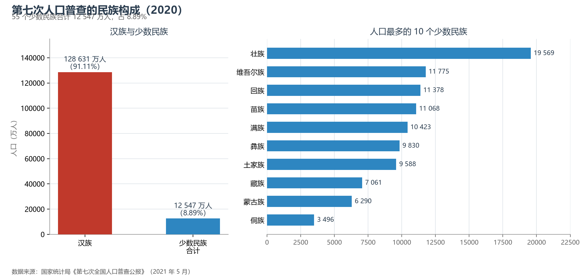

# 9.3 民族构成与分布

中国是统一的多民族国家：56 个民族中，汉族 12.86 亿人（占 91.11%），55 个少数民族合计 1.25 亿人（占 8.89%）。七普与六普相比，少数民族人口增长 10.26%，快于汉族——多民族的人口格局正在缓慢加权。

**图 9-4 第七次人口普查的民族构成**：左为汉族与少数民族总量对比，右为人口最多的十个少数民族。

## 一、十个千万级民族

人口逾千万的少数民族有 8 个：壮族（1 957 万，唯一人口接近两千万的少数民族，聚居于广西）、维吾尔族（1 178 万，新疆）、回族（1 138 万，大分散小集中的典型）、苗族（1 107 万）、满族（1 042 万，与汉族混居程度最深）、彝族（983 万）、土家族（959 万）、藏族（706 万）；蒙古族（629 万）与侗族（350 万）紧随其后。壮族聚居的广西壮族自治区，是全国少数民族人口最多的省级民族区域自治地方。

## 二、分布格局：大散居、小聚居、交错杂居

少数民族的人口分布画在一张"边缘地图"上：陆地边疆省份几乎全部是少数民族集中的地区——广西（壮）、云南（25 个世居少数民族，全国最多）、贵州（苗族、布依族、侗族）、新疆（维吾尔、哈萨克）、西藏（藏）、内蒙古（蒙古）、宁夏（回）、青海（藏、回、土族、撒拉）。但"聚居"之外是更深层的"散居"：全国约三分之二的少数民族人口生活在民族区域自治地方之外，城市中的少数民族流动人口已逾千万。"大散居、小聚居、交错杂居"六个字，是中国民族分布最准确的白描。

## 三、民族区域自治制度

民族区域自治是宪法确立的基本政治制度：5 个自治区（内蒙古 1947、新疆 1955、广西与宁夏 1958、西藏 1965）、30 个自治州、120 个左右自治县（旗）构成三级体系，覆盖全国陆地面积的约 64%。自治地方集中的国土恰好是资源富集带（能源、矿产、草场）与生态屏障带（三江源、塔里木、内蒙古草原）的叠加区——民族地区的地理，就是中国生态安全与资源安全的地理。

## 四、世界视角：多民族大国的治理样本

以民族构成论，中国与俄罗斯（190 余个民族）、印度（数百种语言）、印尼（300 余个族群）同属"多民族巨型国家"。中国方案的特色在"区域自治 + 交融居住"的组合：既给集中聚居区以制度化的自治空间，又在人口流动中自然深化各民族的混杂居住。全球多民族国家的稳定率不高——中国的经验（基础设施均等化 + 对口支援 + 双语教育）因此被视为"多元一体"的一个可参照样本。

## 参考与数据来源

1. 民族人口：国家统计局《第七次全国人口普查公报》（2021 年 5 月）。
2. 自治地方数量：国家民族事务委员会公开资料。
