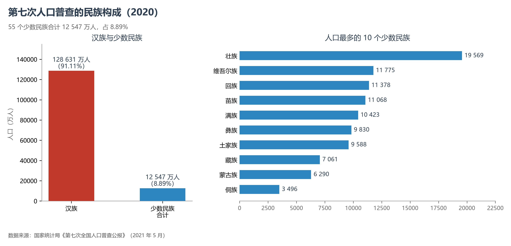

# 9.3 民族构成与分布

中国自古以来就是一个由多民族交融共生、休戚与共铸就的统一多民族国家。第七次全国人口普查数据显示，在全国 14.1178 亿总人口中，汉族人口为 **128 631 万人**（约 12.86 亿人），占全国总人口的 **91.11%**；55 个少数民族人口合计为 **12 547 万人**（约 1.25 亿人），占全国总人口的 **8.89%**。与第六次人口普查相比，十年间少数民族人口增长了 10.26%，增长率显著高于汉族的 4.93%，少数民族占全国总人口比重上升了 0.40 个百分点。各民族共同缔造了统一的伟大祖国，共同开发了辽阔的祖国疆土，构成了中华民族“多元一体”的博大人文地理版图。

**图 9-4 第七次人口普查的民族构成**：左为汉族与少数民族总量对比，右为人口最多的十个少数民族。

---

## 一、主要少数民族人口梯队与分布

在我国 55 个少数民族中，各民族人口规模差异显著，呈现出多梯度的金字塔形人口体量谱系：

| 人口规模梯度 | 涵盖民族及人口数量 | 主要聚居分布省区与地理环境 | 核心文化与传统经济形态 |
|:---|:---|:---|:---|
| **第一梯队：超千万人口超级大族（5 个）** | **壮族**（1 957 万，最大少数民族）、**维吾尔族**（1 178 万）、**回族**（1 138 万）、**苗族**（1 107 万）、**满族**（1 042 万） | 壮族集中于广西喀斯特峰丛河谷；维吾尔族聚居新疆塔里木绿洲；回族“大分散小集中”遍布宁夏、西北与全国各大城镇；苗族散居湘鄂黔渝桂山原；满族融居辽吉黑及京冀 | 稻作与梯田农业；绿洲灌溉农业与园艺；商业、餐饮与伊斯兰民俗；山地农耕、刺绣与芦笙文化；骑射渔猎演进之现代农工商业 |
| **第二梯队：500 万—1 000 万人口大族（4 个）** | **彝族**（983 万）、**土家族**（959 万）、**藏族**（706 万）、**蒙古族**（629 万） | 彝族聚居川滇凉山与乌蒙山；土家族聚居武陵山脉腹地；藏族分布于青藏高原青川藏滇甘；蒙古族分布于内蒙古草原及新疆、辽宁等 | 山地梯田与火把节节庆；山间农耕与摆手舞；高寒畜牧草场与青稞农作；传统草原游牧至现代定居畜牧业 |
| **第三梯队：100 万—500 万人口骨干民族（9 个）** | 布依族（358 万）、侗族（350 万）、瑶族（331 万）、白族（209 万）、哈尼族（173 万）、哈萨克族（156 万）、黎族（160 万）、傣族（133 万）等 | 集中分布于西南云贵高原、南岭走廊、天山山麓、海南岛五指山区及西双版纳热带坝区 | 梯田水稻（如元阳哈尼梯田）、热带作物、天山游牧、纺织与干栏式建筑 |
| **第四梯队：人口较少民族（28 个）** | 人口在 30 万以下之民族，如达斡尔族、鄂温克族、塔吉克族、裕固族、锡伯族、赫哲族、珞巴族、独龙族、门巴族、塔塔尔族等（部分仅数千人） | 集中分布于东北大兴安岭林区、西北帕米尔高原边缘、西藏喜马拉雅南坡及滇西北深大断裂峡谷 | 高山畜牧、冷温带森林渔猎、山间农作等；国家实施“人口较少民族专项扶持规划” |

壮族作为全国人口最多的少数民族，其人口规模相当于欧洲一个中等国家（如罗马尼亚或荷兰），主要聚居在广西壮族自治区；而赫哲族、独龙族、塔塔尔族等人口较少民族虽然总人口仅数千至万人，但在我国政治生活中享有完全平等的法定权利，并在全国人大中均拥有本民族的全国人大代表。

---

## 二、民族空间分布特征：“大散居、小聚居、交错杂居”

中国各民族在数千年波澜壮阔的历史演进、屯田戍边、迁徙融合中，形成了**“大散居、小聚居、交错杂居”**的总体空间宏观分布格局：

### 1. 汉族聚居于平原河谷，少数民族多分布于边疆与山地林海

汉族人口占绝对多数，主要连片稠密分布在东部三大平原、丘陵盆地与各大江河沿岸肥沃农耕区；少数民族则广泛分布在西南、西北、东北广大边疆地区以及中南部的低山丘陵区。
- **西南多民族交融高地**：以云南、贵州、四川最为典型。云南是我国世居少数民族数量最多的省份（共有 25 个世居少数民族），呈现出因海拔垂直地带性而分层居住的垂直人文景观（如著名的“坝区傣族、半山彝尼、高山苗瑶”）；
- **西北干旱走廊与绿洲群**：回族沿古代丝绸之路呈“大分散、小集中”线状点状分布；维吾尔族、哈萨克族、柯尔克孜族则紧随水源河流分布于天山南北麓与帕米尔高原；
- **东北内蒙古森林草原带**：蒙古族横亘于辽阔草原，满族、鄂伦春族、鄂温克族则世代生息于大兴安岭茂密林海之间。

### 2. 跨区域流动大潮催生“互嵌式”现代社区

改革开放和现代化建设极大地加速了各民族之间的人口空间对流。数以千万计的少数民族群众从西部边疆走向沿海东部大中城市就业经商，东部的资金、技术、人才源源不断奔赴民族地区投资兴业。
- 统计显示，目前全国已有超过三分之二的少数民族人口生活在原民族自治地方之外；
- 在北京、广州、深圳、义乌、上海等沿海经济重镇，各民族同胞毗邻而居、共同创业，现代城市“互嵌式”社会生活结构全面形成，打破了历史上族群地域区隔，极大地增强了各民族守望相助的心理纽带。

---

## 三、民族区域自治制度与战略空间基石

**民族区域自治制度**是我国宪法确立的一项根本性基本政治制度。在国家的统一领导下，以少数民族聚居区为基础建立自治地方，设立自治机关，行使自治权：

### 1. 三级自治行政架构

- **5 个自治区**：内蒙古自治区（1947 年设立，我国最早的省级民族自治区）、新疆维吾尔自治区（1955 年）、广西壮族自治区（1958 年）、宁夏回族自治区（1958 年）与西藏自治区（1965 年）；
- **30 个自治州**：如四川阿坝藏族羌族自治州、吉林延边朝鲜族自治州、湖北恩施土家族苗族自治州、湖南湘西土家族苗族自治州、新疆伊犁哈萨克自治州等；
- **120 个自治县（旗）**：包括 117 个自治县与内蒙古呼伦贝尔大草原北部的 3 个自治旗（鄂伦春自治旗、鄂温克族自治旗、莫力达瓦达斡尔族自治旗）。此外，在不设立自治地方的杂居区还设立了 1 000 多个民族乡。

### 2. 国土空间安全与生态屏障基石

民族区域自治地方陆地总面积达 **610 余万平方公里**，占全国陆地国土总面积的 **约 64%**。
- **地缘国防安全屏障**：我国 2.2 万公里的陆地边界线绝大部分穿越民族自治地方，边疆各族军民“家家是哨所、人人是哨兵”，筑牢了捍卫国家领土主权的铜墙铁壁；
- **生态与资源安全命脉**：民族自治地方是我国水塔（青藏高原“三江源”）、大粮仓、绿色林海与优质牧场最核心的承载区，风光清洁能源大基地、稀土战略矿产资源、煤炭石油天然气储量均高度集聚于此。民族地区的繁荣与生态稳定，直接决定了国家可持续发展的命脉。

---

## 四、铸牢中华民族共同体意识与兴边富民

著名人类学、社会学大师费孝通先生曾提出深刻的**“中华民族多元一体格局”**论断：“中华民族作为一个自觉的民族实体，是在近百年来中国和西方列强对抗中出现的，但作为一个自在的民族实体，则是在几千年的历史演进中形成的……它的主流是由许许多多分散存在的民族单位，经过接触、混杂、联结和融合，同时也有分裂和消亡，形成一个你来我去、我来你去，我中有你、你中有我，而又各具个性的多元统一体。”

进入新时代，党和国家把**铸牢中华民族共同体意识**确立为新时代党的民族工作和民族地区各项工作的主线：
- **精准扶贫与全面小康**：历史上集聚在深山喀斯特、高寒藏区、荒漠绿洲的少数民族极端贫困人口实现全员整体脱贫，独龙族、毛南族等人口较少民族实现整族脱贫历史性跨越；
- **兴边富民行动与全国对口支援机制**：中央设立援藏、援疆、对口支援三峡库区与西部民族地区战略制度，东部经济发达省市对口定向帮扶边疆地市，高标准建设边境小康村，实现水电路讯、义务教育、三级甲等医疗网络全天候覆盖边防一线；
- **文化遗产永续保护**：藏族《格萨尔》、蒙古族《江格尔》、柯尔克孜族《玛纳斯》三大世界级英雄史诗得到国家抢救性数字化保护与出版，壮族三月三、傣族泼水节、彝族火把节、维吾尔族麦西热甫成为全国人民共同领略的中华文化瑰宝。

---

## 参考与数据来源

1. 国家统计局：《第七次全国人口普查公报》（2021 年 5 月）。
2. 国家民族事务委员会：《中国民族统计年鉴》、《全国民族自治地方统计资料》。
3. 费孝通：《中华民族多元一体格局》，中央民族大学出版社。
4. 中国社会科学院民族学与人类学研究所编著：《中国少数民族分布图册与概况》。
