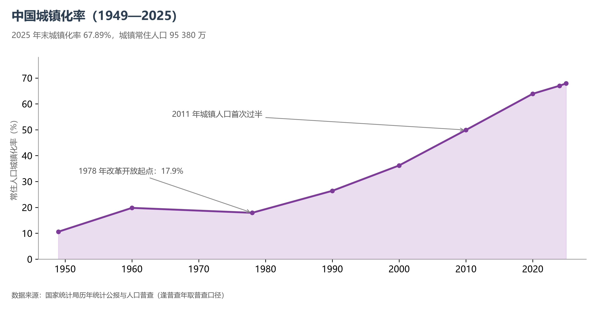
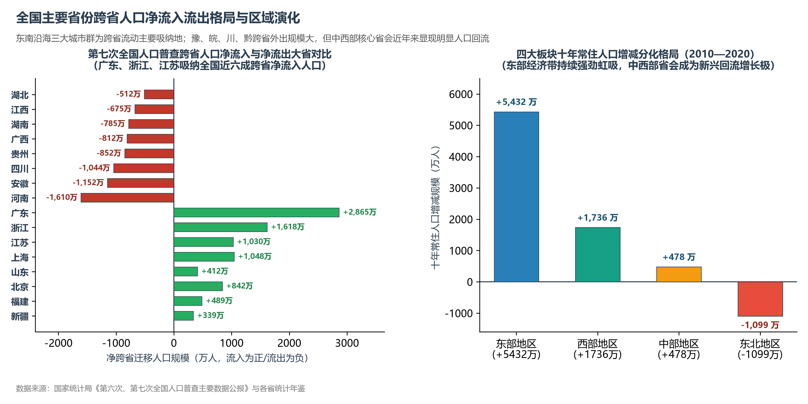

# 9.4 人口流动与城镇化

2025 年末，全国常住人口城镇化率已达到 **67.89%**，城镇常住人口规模攀升至 **95 380 万人**（约 9.54 亿人）——这意味着居住在城市里的中国人口总量，已显著超越整个欧洲西部的全部人口总和。与这一史诗级空间集聚相伴相生的，是人类历史上规模最宏大的常态化人口大迁徙：第七次全国人口普查数据显示，全国流动人口（人户分离人口）高达 **3.76 亿人**，平均每 4 个中国人中就有 1 个人生活在户籍登记地之外。人口的大规模自由空间流动与城镇化狂飙，构成了改革开放以来重塑中国经济地理版图最活跃、最强大的空间动力引擎。

**图 9-5 中国城镇化率（1949—2025）**：改革开放后进入快车道，2011 年城镇人口首次过半。

---

## 一、诺瑟姆曲线下的中国城镇化节律

依据美国地理学者诺瑟姆（Ray M. Northam）提出的城镇化 S 形发展曲线理论，世界各国的城镇化进程通常经历三大阶段：**起步阶段（城镇化率 < 30%）**、**加速推进阶段（30%—70%）**与**饱和稳定阶段（> 70%）**。西方发达国家走完这一弧线通常耗费了 80 至 150 年的漫长光阴，而中国在国家工业化与市场改革的双重加持下，仅用 47 年（1978—2025 年）便实现了从 17.92% 到 67.89% 的惊天跨越：

| 演进阶段 | 对应时期 | 城镇化率演变 | 年均增速 | 空间动力机制与标志性特征 |
|:---|:---:|:---:|:---:|:---|
| **一、波动徘徊期** | 1949—1978 年 | 10.64% → 17.92% | +0.25 个百分点 | 实行严格的城乡二元户籍统购统销制度；受三线建设及知识青年上山下乡影响，城镇化速度极度缓慢，甚至出现逆城市化波动 |
| **二、异地开花与乡镇企业期** | 1978—1995 年 | 17.92% → 29.04% | +0.65 个百分点 | 家庭联产承包责任制释放亿万农村富余劳动力；乡镇企业异军突起，“离土不离乡、进厂不进城”，小城镇大战略驱动基层城镇化 |
| **三、工业化主导与民工潮狂飙期** | 1996—2011 年 | 30.48% → 51.27% | +1.38 个百分点 | 中国加入 WTO，外向型制造业与城市房地产建设爆发；数亿农民工跨省奔赴东南沿海；**2011 年城镇人口首次过半**，中国由乡村社会全面迈入城市社会 |
| **四、城市群一体化与存量提质期** | 2012 年至今 | 52.57% → 67.89% | +1.10 个百分点 | 增速越过 65% 后逐步趋缓；国家推进“以人为核心的新型城镇化”；19 个城市群成为人口与产业承载主体，迈向 70% 诺瑟姆成熟拐点 |

**图 9-7 全国主要省份跨省人口净流入流出格局与区域演化**：东南沿海三大城市群为跨省流动主要吸纳地；豫、皖、川、黔跨省外出规模大，但中西部核心省会近年来显现明显人口回流。

---

## 二、流动人口的空间轨迹：从“孔雀东南飞”到“多点向心”

中国跨区域人口流动正在经历深刻的结构性空间转向，从单一沿海吸附走向沿海高能集聚与中西部核心省会回流并存的“双轨格局”：

### 1. 跨省人口迁移的“三大吸金黑洞”

在第七次全国人口普查中，跨省流动人口规模达 1.25 亿人，其目的地呈现极端的“沿海向心性”：
- **广东省**：跨省净流入人口高达 **2 865 万人**，高居全国绝对榜首，仅深圳、广州、东莞、佛山四座城市吸纳的外省人口就超过 2 000 万人，被誉为名副其实的“全国人口第一大磁场”；
- **浙江省**：跨省净流入 **1 618 万人**，民营经济的强大活力吸引了川、贵、豫、皖等省劳动力深耕温州、台州、杭州与义乌；
- **长三角两翼（苏、沪）**：江苏（净流入 1 030 万人）与上海（净流入 1 048 万人）依靠高端先进制造业与国际金融中心功能，对全国中高学历人才与产业技术工人形成持续强劲虹吸。

### 2. 传统人口输出大省与“候鸟”输出极

全国跨省流出人口主要集中在黄淮平原、长江中游与西南山地等人口稠密的农业大省：**河南（净流出 1 610 万人）、安徽（净流出 1 152 万人）、四川（净流出 1 044 万人）、贵州（净流出 852 万人）、广西（净流出 812 万人）、湖南（净流出 785 万人）**。上述六省合计跨省净流出人口超过 6 200 万人，为东部沿海的世界级工业园区提供了源源不断的产业工人与服务劳动力。

### 3. 中西部产业升级催生“人口孔雀回飞”

近年来，随着东南沿海土地、用工与生活成本的不断攀升，大批电子信息、新能源汽车、锂电光伏等高端制造产业链向中西部内陆腹地梯度转移，催生了显著的**“就近就地城镇化”与“跨省人口回流”**：
- **省内流动超越跨省流动**：七普数据显示，在 3.76 亿流动人口中，省内流动人口占比已攀升至 **66.8%**（达 2.51 亿人），成为人口流动的主流；
- **中西部强省会的崛起**：**成都**（常住人口突破 2 100 万人）、**武汉**（超 1 370 万人）、**郑州**（超 1 300 万人）、**西安**（超 1 300 万人）、**合肥**（常住人口净流入名列全国省会前茅）等中西部核心省会城市，通过集聚国家大科学装置、高校资源与新兴制造基地，不仅留住了省内外出劳动力，更成为吸引外省青年人才安家落户的区域超级增长极。

---

## 三、常住与户籍口径之差：破解“半城市化”体制堵点

在中国城镇化统计体系中，存在着两个至关重要的统计口径：
- **常住人口城镇化率（2025 年末为 67.89%）**：按半年以上居住在城镇行政区范围内的全部常住人口计算；
- **户籍人口城镇化率（目前约在 49% 左右）**：指在城镇拥有合法正式户籍身份的人口比例。

两者之间存在着约 **18 个百分点**的客观落差，这对应着全国约 **2.5 亿**“生活在城市、工作在城市，但户口仍保留在农村”的庞大农业转移人口群体。他们在城市长期从事二、三产业，但在子女公立学校随迁入学、保障性租赁住房申请、城市低保救助与职工社保接续等领域，曾面临制度性公共服务非均等化障碍，被称为**“半城市化”（Semi-urbanization）人群**。

针对这一制度痛点，国家在“新型城镇化”战略下全力破局：
1. **全面取消城区常住人口 300 万以下城市落户限制**，全面放宽城区常住人口 300 万至 500 万大城市落户条件，超大特大城市完善积分落户政策并大幅精简积分项目；
2. **推行以居住证为载体的基本公共服务均等化供给**，建立健全中央财政转移支付同农业转移人口市民化挂钩机制、城镇建设用地增加规模同吸纳农业转移人口落户数量挂钩机制（“人地钱挂钩”），确保农民工及其随迁家属在住房、教育、医疗等领域真正享有市民化同等待遇。

---

## 四、世界视角：超大规模国家城镇化的经验与前沿

把中国的城镇化放在世界现代化的天平上审视，中国在创造经济奇迹的同时，走出了完全不同于西方与发展中国家的特有道路：

- **有效规避“拉美陷阱”式的过度城市化与贫民窟危机**：在许多发展中国家（如巴西圣保罗、印度孟买），伴随农村破产的是无序涌入城市的极度贫困人口，城市内部滋生出占人口三分之一以上的恶性贫民窟，面临黑社会暴力失控、污水横流与公共卫生崩溃。而中国依托“农村土地集体所有制与承包权保护”，使农民进城失败后仍保有农村宅基地与承包地这一兜底退路；同时政府通过集中连片的城中村改造、市政大管网配套与公租房建设，成功避免了大规模赤贫贫民窟的出现。
- **“政府引导基建先行 + 产业园区筑巢引凤”的空间模式**：中国以举国体制推进高铁、高速公路、城市轨道交通与水电气热管网的超前规划建设，支撑了数亿人口在短时间内的高密度平稳承载。
- **迈入“增量放缓、存量精细”的后半程治理**：随着城镇化率逼近 70% 诺瑟姆拐点，中国城镇化已经结束了粗放式的“造城运动”与大拆大建阶段。未来的核心战场在于：以县城为重要载体的新型城镇化（就近吸纳农民就地落户）、超大特大城市都市圈的多中心扁平化分工、老旧小区与城市有机更新、以及在人口负增长与收缩型城市背景下的空间集约与韧性安全建设。

---

## 参考与数据来源

1. 国家统计局：《历年国民经济和社会发展统计公报》（2010—2025 年）。
2. 国务院人口普查办公室：《第七次全国人口普查超大特大城市与分省流动人口数据汇总》。
3. 国家发展改革委：《“十四五”新型城镇化实施方案》、《国家新型城镇化规划（2021—2035 年）》。
4. 陆铭：《空间的力量：地理、政治与城市发展》，格致出版社/上海人民出版社。
