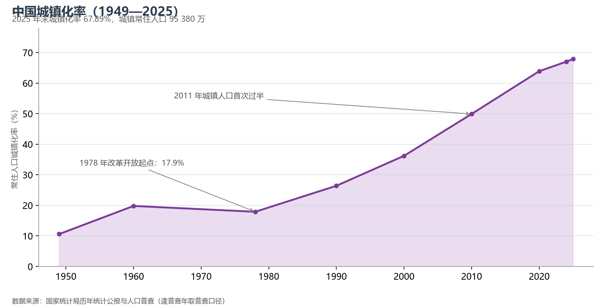

# 9.4 人口流动与城镇化

2025 年末，常住人口城镇化率 67.89%，城镇常住人口 95 380 万——相当于整个欧洲西部的总人口都住进了中国的城市。与此并存的是另一组数字：全国流动人口约 3.8 亿（七普口径），平均每 4 个中国人就有 1 个住在户籍地之外。人口流动是中国地理最活跃的变量。

**图 9-5 中国城镇化率（1949—2025）**：改革开放后进入快车道，2011 年城镇人口首次过半。

## 一、城镇化：压缩的百年进程

西方主要国家的城镇化从 30% 到 70% 用了 80—150 年，中国只用了约 40 年（1980 年的 19% 到 2020 年的 64%）。这条陡峭曲线分三段：1950—1978 年的"波动期"（户籍制度确立，城镇化徘徊在 18% 以下）；1978—2010 年的"工业化驱动期"（乡镇企业与外向型经济把 3 亿农民变成工人）；2010 年至今的"城市群驱动期"（增量人口向 19 个城市群集中，中西部省会成为新增长极）。按诺瑟姆曲线，中国已越过 70% 的减速拐点前夜——未来十年还有约 8 个百分点的空间，但节奏将明显放缓。

## 二、流动的方向：从"孔雀东南飞"到"省内城镇化"

七普流动人口 3.76 亿，比六普多 1.5 亿。流向结构正在变化：跨省流动的比重下降，省内流动上升——中西部农民工"离土不离省"。跨省流动的三大目的地依然是广东、浙江、江苏、上海与北京；而人口输出的"五大户"是河南、安徽、四川、贵州、广西。最新的变化是"回流"：随着产业向中西部转移，川渝、湖南、安徽出现明显的人口回流与省会扩张——成都、长沙、合肥由人口净流出转为净流入。人口地理正在从"单极东南飞"转向"多点向心"。

## 三、户籍与常住：两个口径的差距

常住人口城镇化率（67.9%）与户籍人口城镇化率（约 49%）之间约 18 个百分点的差距，对应着约 2.5 亿"人在城市、户籍在农村"的农业转移人口——他们享受的城市公共服务仍不完整。缩小这两个口径的差距（深化户籍制度改革、推进基本公共服务随人走），是"新型城镇化"战略下半场的核心议题。

## 四、世界视角：速度与代价

中国用两代人完成了英国用一个半世纪、印度还未完成的城镇化率跃升。速度的代价也很清楚：大城市房价、通勤拥堵、"半城市化"人群、乡村空心化与老龄化的叠加。与世界比较，中国城市化的独特之处是"政府主导的土地财政 + 工业化先行"模式——它创造了基础设施的前置供给（高铁、地铁、新城），也积累了地方债务与空间错配。下一程的看点不再是速度，而是质量：城市群的多中心分工、城市更新的存量时代、以及乡村振兴对"空心化"的回应。

## 参考与数据来源

1. 城镇化率与流动人口：国家统计局《2025 年国民经济和社会发展统计公报》、第七次全国人口普查公报。
2. 人口流入流出与回流：各省份人口变动数据（七普与近年公报对比）。
