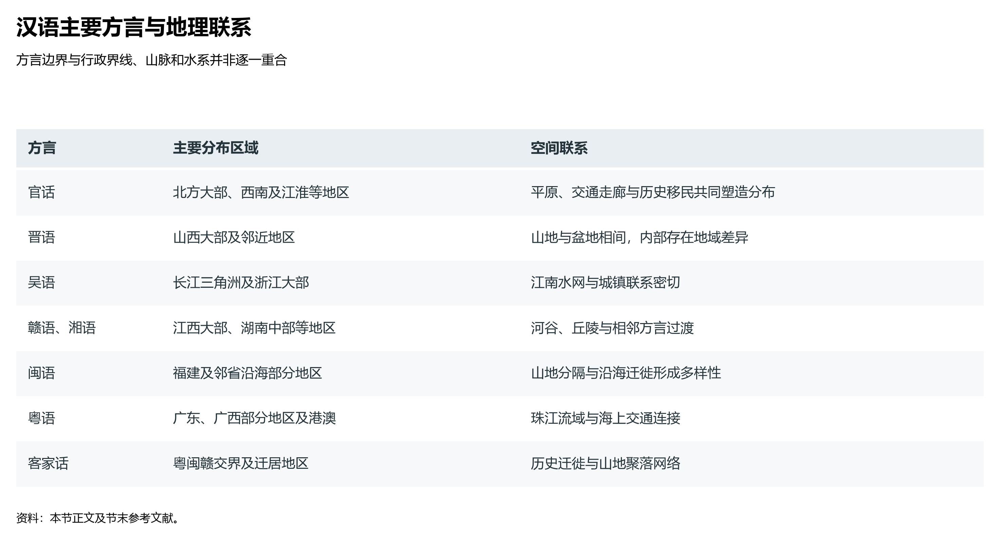

# 9.5 语言与方言地理

如果将中国的地表三维起伏与汉语的方言地图叠置在一起，会清晰看到一幅极具冲击力的人文地理图景：长江以北与西南广大腹地，在数百万平方公里的广袤大平原、盆地与高原上通行着高度互通的北方官话；而在东南一隅的山水褶皱与丘陵海湾之间，吴、粤、闽、客、赣、湘、晋、徽、平等诸方言纵横密布，甚至“隔山不同音、隔河不同语，十里不同调”。语言不仅是交流的工具，更是人类在地球表层迁徙扩散、遭遇地理天堑阻隔所留存下来的最深沉、最鲜活的文化化石。

**图 9-6 汉语主要方言与地理联系**：主要方言的分布受到地形、水系、交通与历史迁徙共同影响，方言边界与山川及行政界线并非逐一重合。

---

## 一、汉语方言分区的宏观空间谱系

依据中国社会科学院语言研究所《中国语言地图集》的经典权威划分，现代汉语方言通常被划分为北方官话与南方方言两大系统，在细分层面上形成了**“七大方言区”**（传统说）或更为精密的**“十大方言区”**（现代语言学界主流说）：

| 方言区名称 | 占汉族人口比重 | 核心地理分布范围 | 音韵与词汇核心特征 | 代表性城市方言 |
|:---|:---:|:---|:---|:---|
| **北方官话（官话区）** | **约 70%** | 覆盖东北平原、华北平原、黄土高原、西北盆地、江淮平原及西南川渝滇黔鄂湘西部（涵盖 8 个次方言片） | 调类较少（多为 4 个声调），无中古浊塞音声母与入声塞音韵尾；内部互通度极高；为现代普通话的语音与词汇基础 | 北京话、沈阳话、济南话、西安话、武汉话、成都话 |
| **晋语区** | 约 3.8% | 环抱山西高原，向外辐射内蒙古中西部（呼包鄂）、陕北及冀西太行山边缘 | 保留中古入声（收喉塞音韵尾 -ʔ）；发育丰富的“分音词”与特殊嵌 l 词，与北方官话差异显著 | 太原话、大同话、呼和浩特话 |
| **吴语区** | 约 7.5% | 核心集聚于太湖水网、钱塘江流域，涵盖苏南、浙北、上海市大部及浙中南山地 | 完整保留中古汉语“帮滂并”全浊辅音（b, d, g, v, z）系统；声调繁复（多达 7—8 个）；语调轻柔软糯 | 苏州话、上海话、绍兴话、温州话（内部差异极大） |
| **粤语区（白话）** | 约 5.0% | 珠江流域的广东中西部、广西东部及香港、澳门，并广布全球海外唐人街 | 保留“九声六调”以及完整的中古汉语入声辅音韵尾（-p, -t, -k）；古汉语单音节词汇与倒装语法丰富 | 广州话、佛山话、香港话、南宁白话 |
| **闽语区** | 约 4.5% | 以福建武夷山东麓为核心，跨海峡分布于台湾岛大部、海南岛（海南话）、潮汕平原及雷州半岛 | 汉语中存古特征最丰富的方言古化石；“无轻唇音”（非读如帮）、“无舌上音”（知读如端）；分闽南、闽东、闽北、闽中、莆仙五大片 | 厦门话、福州话、潮州话、台湾话、海口话 |
| **客家话区（客语）** | 约 3.5% | 闽粤赣交界处的南岭山脉与武夷山余脉（梅州、赣州、龙岩“客家大本营”），并散见于川桂各方言岛 | 保留完整的入声系统；声母多读塞音塞擦音；大量留存中原魏晋至唐宋时期的中原音韵遗痕 | 梅县话、赣州客家话、惠阳话 |
| **赣语区** | 约 2.5% | 鄱阳湖平原、赣江中下游、抚河流域及湘东、鄂东南、皖西南边境 | 上承江淮中原官话，下启客家话与粤语；保留部分古浊音声母清化送气特征；声调多为 6—7 个 | 南昌话、抚州话、宜春话 |
| **湘语区** | 约 3.0% | 湖南湘江流域与资水流域为主，辐射广西东北角 | 分新湘语（受官话冲刷较深）与老湘语（双峰、娄底保留中古全浊辅音系统，内部极具古风） | 长沙话（新湘语）、双峰话（老湘语） |
| **徽语区** | 约 0.4% | 黄山与新安江流域的古徽州六县（歙县、黟县、休宁、祁门、绩溪、婺源）及淳安等地 | 隔山阻水造就“一山分六门、十里不同音”的极端复杂音系；混合了吴语、赣语与中原官话的多重地层 | 歙县话、绩溪话、屯溪话 |
| **平话区** | 约 0.2% | 广西沿邕江、郁江、柳江平原河谷呈串珠状分布 | 为先秦秦汉时期中原驻军南戍形成的极早期古汉语地层遗存，分桂北平话与桂南平话 | 南宁平话、桂林平话 |

---

## 二、地理阻隔与历史移民：方言分化的双重动力

方言的空间分异，绝非随机的文化偶发事件，而是**大尺度地表地貌骨架与千年人口大迁徙通道相互耦合**的产物：

### 1. 广袤大平原造就北方官话的均质扩散

中国北方拥有连片开阔的东北平原、华北平原与沿黄冲积平原。平原之上河流虽有泛滥，但缺乏无法逾越的永久高大山系隔断。两千年来，统一的多民族中央集权政体在此推行官话制度与科举通婚，加之黄河改道、北方战乱引发的频繁人口大对流，将原本可能分化的局部乡音一次次均质化冲刷拉平。
更为波澜壮阔的是，明清时期的**“走西口”**（晋冀农民涌入内蒙古河套，诞生了晋语区与兰银官话的交融带）、**“闯关东”**（上千万山东、河北农民跨过山海关垦殖白山黑水，造就了跨越千里的东北官话），以及明初“湖广填四川”之后数百万湖广移民翻越三峡重构巴蜀人文，使得广袤的西南诸省（川、渝、云、贵）同样通行着内部高度互通的**西南官话**。从哈尔滨到昆明，直线距离三千余公里，北方官话居民仍能进行顺畅交流。

### 2. 南方山水深锁催生“方言基因库”

与北方的平原一体化截然相反，中国南方地势崎岖破碎，崇山峻岭与网状水系构成了天然的语言屏障：
- **南岭山脉（五岭）天堑**：越城岭、都庞岭、萌渚岭、骑田岭、大庾岭横亘于湘赣与粤桂之间。南岭不仅阻挡了南下冷空气（见 4.1 节），更阻断了中原官话对岭南的直接冲刷，庇护了粤语在珠江三角洲独立繁衍两千年；
- **武夷山脉阻隔**：武夷山高耸险峻，将江西与福建隔绝为两个世界。福建境内“八山一水一分田”，山峦重叠、河流各自入海，导致古代中原汉民进入福建后，被深锁在闽江、九龙江、晋江等彼此封闭的海湾河谷盆地中，演进分化出内部互不相通的闽语诸片；
- **太湖水网与浙闽丘陵**：京杭大运河与长江下游江南平原滋养了细腻典雅的吴语，而仙霞岭与雁荡山则在浙江南部构筑了吴语向闽语过渡的险峻界标。

### 3. 三次衣冠南渡的“语言地层学”沉淀

历史上三次北方士族百姓的大规模南迁移民浪潮，在南方山水间形成了如同地质层理般的语言叠压：
- **西晋“永嘉之乱”（公元 4 世纪初）**：中原门阀士族大批渡江南下建都建康（南京），其上古雅音注入江南，与当地古越语结合，奠定了早期六朝吴语的深层基底；
- **唐代“安史之乱”（公元 8 世纪中）**：大批北方难民沿大运河、江淮平原与鄱阳湖赣江走廊南徙，中原盛唐音韵全面渗入赣语与湘语核心区；
- **北宋“靖康之难”（公元 12 世纪初）**：高宗南渡定都临安（杭州），开封汴京官话直接空降江南，在吴语核心腹地硬生生植入了一个独特的“杭州官话方言岛”；
- **客家人“逢山必有客”**：历代后至的汉民难民由于沿海肥沃平原早已被先民开发殆尽，被迫深入闽粤赣交界的南岭荒山僻壤，聚族结寨（客家土楼、围屋），在封闭苦寒的山区完好封存了魏晋唐宋的中原古音，形成“客家”方言群体。

---

## 三、少数民族语言谱系：多语并存的中华锦绣

在汉语各大方言之外，中国 55 个少数民族展现出高度宏富的语言多样性。依据历史比较语言学分类，中国少数民族语言分属**五大语系**：

- **汉藏语系**：
  - **藏缅语族**：藏语（卫藏、康、安多三大方言）、彝语、白语、景颇语、纳西语、怒语等，分布于青藏高原与横断山脉；
  - **侗台语族（壮侗语族）**：壮语（分北部与南部方言）、布依语、侗语、水语、仫佬语、傣语、黎语等，深植于华南稻作农业区；
  - **苗瑶语族**：苗语（湘西、黔东、川黔滇三大方言）、瑶语、畲语，聚居于西南喀斯特山地与南岭走廊。
- **阿尔泰语系（北方语系群）**：
  - **突厥语族**：维吾尔语、哈萨克语、柯尔克孜语、撒拉语、乌孜别克语、塔塔尔语、裕固语（东部裕固语）等，分布于西北干旱盆地与绿洲；
  - **蒙古语族**：蒙古语（内蒙古、卫拉特、巴尔虎布里亚特方言）、达斡尔语、土族语、东乡语、保安语等，横亘于北部高原草场；
  - **满—通古斯语族**：满语、锡伯语、鄂温克语、鄂伦春语、赫哲语，分布于大兴安岭森林与新疆察布查尔。
- **南亚语系（孟—高棉语族）**：云南西南边境的佤语、德昂语、布朗语。
- **南岛语系（高山族诸语言）**：台湾岛原住各部族使用的阿美语、泰雅语、排湾语等二十余种语言。
- **印欧语系**：帕米尔高原上塔吉克族使用的塔吉克语（属于印度—伊朗语族伊朗语支）以及俄罗斯族使用的俄罗斯语。

---

## 四、国家共同语普及与“中国语言资源保护工程”

在幅员广袤、民族众多的大国推进现代化，语言既是统一市场的润滑剂，也是国家文化安全的生命线。新时代中国在语言地理治理上呈现出双轮驱动的卓越格局：

### 1. 普通话高水平普及消除空间摩擦

国家宪法明文规定“国家推广全国通用的普通话”。至 2025 年底，全国普通话普及率已跨越 **80.7%** 的高位。普通话的广泛普及，彻底打破了历史上“南人北语不可辨、行商出省如隔世”的区域沟通藩篱，为建立全国统一大市场、支撑近 4 亿人口的常态化自由流动（见 9.4 节）、促进各民族广泛交往交流交融提供了不可或缺的空间黏合剂。

### 2. 全球最大规模“语保工程”守护声音化石

推广通用语并不意味着消灭方言与少数民族语言。2015 年起，教育部、国家语委全面启动了**“中国语言资源保护工程”（语保工程）**：
- 全国设立了超过 **1 700 个**语言方言调查点，动用现代高保真声学仪器与多媒体采录手段，对全国所有的汉语方言片区和 120 余种少数民族语言进行精密记音、词汇发掘与音视频永久建档；
- 建成了全球体量最大的**“中国语言资源库与多媒体平台”**，出版了卷帙浩繁的《中国语言文化典藏》与《中国濒危语言志》。方言民俗、评弹戏曲、山歌民谣在数字化保护中获得了崭新生机，生动诠释了“通而不泯、殊途同归、美美与共”的中华文明语言空间画卷。

---

## 参考与数据来源

1. 中国社会科学院语言研究所、澳大利亚人文科学院编：《中国语言地图集》（第 1 版 1987 年，第 2 版商务印书馆 2012 年）。
2. 教育部、国家语言文字工作委员会：《中国语言文字事业发展报告》、《中国语言生活状况报告》。
3. 孙宏开、胡增益、黄行主编：《中国的语言》，商务印书馆。
4. 周振鹤、游汝杰：《中国方言与文化》，上海人民出版社。
5. 曹志耘主编：《汉语方言地图集》，商务印书馆。
