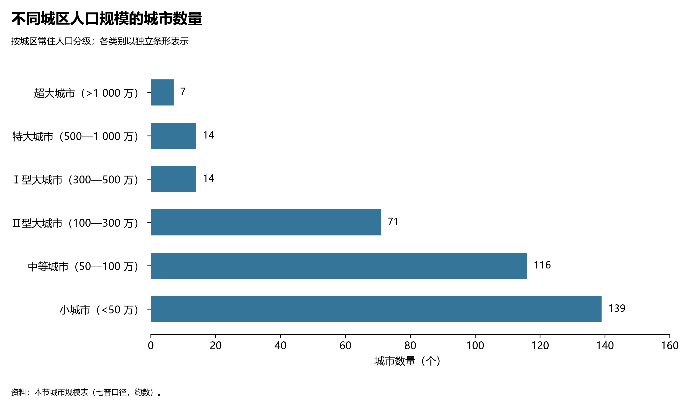
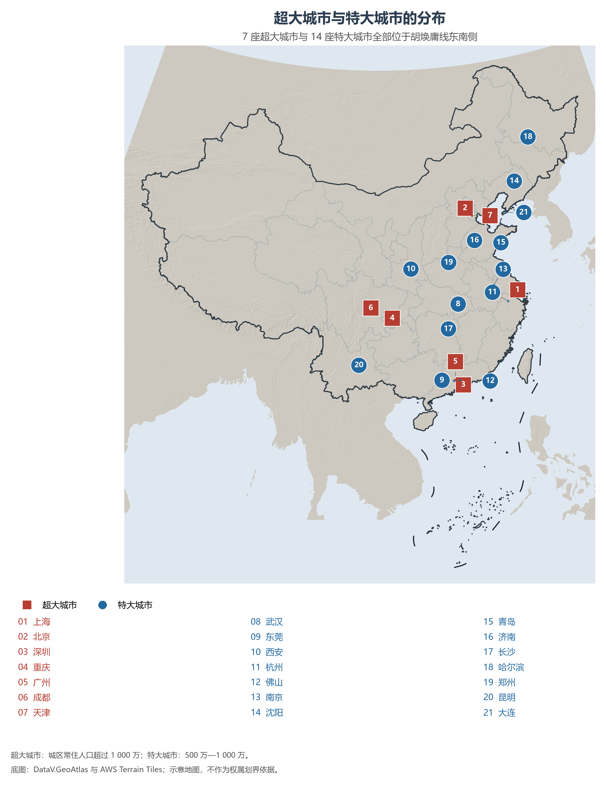
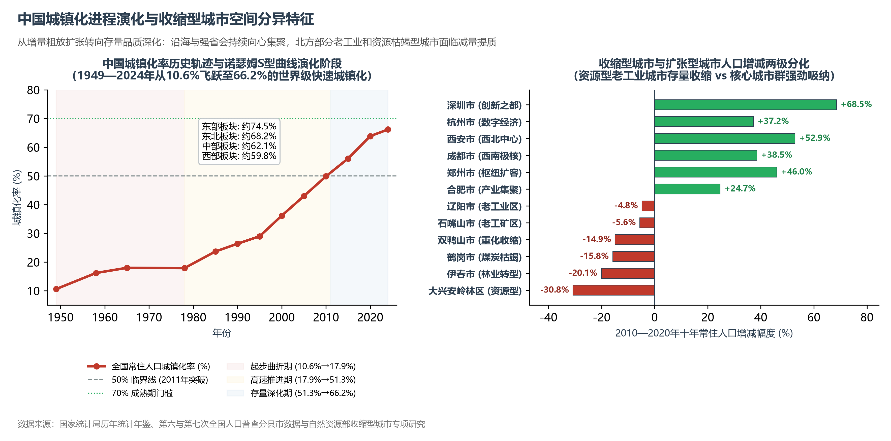

# 10.1 城市体系与规模等级

中国拥有 690 余座建制城市（含 4 座直辖市、293 个地级市与 397 个县级市），在九百六十余万平方公里的国土上构筑起全球规模最大、层级最严密、空间极化与扁平化并存的当代城市体系。伴随着常住人口城镇化率从 1949 年的 10.6% 飞跃至 2024 年的 66.2% 以上，数亿农业人口进城落户，彻底重塑了中华大地的地表人文肌理。

在科学认知中国城市体系时，首要的前提是厘清其**统计统计口径与空间实体地域**。长期以来，社会认知中常将“全市常住人口”（含下辖广大县市与乡村人口）、“市辖区常住人口”与“城区常住人口”相互混淆。2014 年国务院发布《关于调整城市规模划分标准的通知》（国发〔2014〕51 号），确立了以**城区常住人口**作为衡量城市规模等级的法定统一标准——这里的“城区”特指市辖区和不设区的市中，经市政公用设施和公共服务设施实际覆盖的非农业集聚实体地域。唯有以此口径为准绳，才能还原中国城市规模的真实金字塔底座与塔尖。

**图 10-1 不同城区人口规模的城市数量**：以独立条形比较各规模类别的城市数量，采用七普城区人口口径。

## 一、六级城市规模金字塔的深度解构

依据国发〔2014〕51 号文的界定标准，中国建制城市被严格划分为五等六级。第七次全国人口普查与住建部《城市建设统计年鉴》数据显示，中国城市规模呈现极为鲜明的层级跃迁与功能分工：

| 规模等级 | 城区常住人口门槛 | 城市数量 | 核心代表城市样本 | 关键政策导向与资源配置特征 |
|:---|:---|:---|:---|:---|
| **超大城市** | 1000 万人以上 | 7 座 | 上海、北京、深圳、重庆、广州、成都、天津 | 严格控制人口过度聚集；全面实行积分落户；疏解非核心功能；严控新增建设用地 |
| **特大城市** | 500 万—1000 万人 | 14 座 | 武汉、东莞、西安、杭州、佛山、南京、沈阳、青岛、济南、长沙、哈尔滨、郑州、昆明、大连 | 完善落户积分制度；推动产业高质量升级；都市圈核心集聚与外围组团疏解 |
| **Ⅰ 型大城市** | 300 万—500 万人 | 14 座 | 南宁、厦门、太原、贵阳、乌鲁木齐、宁波、无锡、福州、长春、石家庄等 | 全面放开落户限制；区域性现代产业高地；重大骨干交通枢纽；适度发展城市轨道交通 |
| **Ⅱ 型大城市** | 100 万—300 万人 | 70 余座 | 兰州、呼和浩特、徐州、洛阳、赣州、温州、芜湖、银川、包头、绵阳等 | 全面取消落户限制；省域副中心城市主要载体；承接产业转移；提升综合服务配套 |
| **中等城市** | 50 万—100 万人 | 100 余座 | 荆州、大庆、曲靖、乐山、九江、承德、安阳、开封、吉林、遵义等 | 全面放开落户门槛；县域与地级中枢结合部；发展特色优势工商业；吸纳就地城镇化 |
| **小城市** | 50 万人以下 (含Ⅰ/Ⅱ型) | 400 余座 | 井冈山、敦煌、芒市、阿尔山、义乌（实体大县）、广大中西部县级市与建制镇 | 实行户籍零门槛；因地制宜特色立市；强化公共基础设施补短板；生态宜居守护底线 |

在金字塔顶端，**7 座超大城市**构成了全国经济、金融、科技、国际交往的最强核心引擎：
- **上海**（城区人口约 1987 万）：全国最大的经济中心与金融、航运枢纽，长江经济带龙头的“世界级会客厅”；
- **北京**（城区人口约 1775 万）：全国政治中心、文化中心、国际交往中心、科技创新中心，正系统推进非首都功能疏解与“一核两翼”重塑；
- **深圳**（城区人口约 1744 万）：全球硬件创新之都与制度型开放先行示范区，以不足两千平方公里的极高经济密度傲视全国；
- **重庆**（城区人口约 1634 万）：全国直辖市中辖区面积最大者，主城都市区依托长江黄金水道与西部陆海新通道，构筑内陆现代制造重镇；
- **广州**（城区人口约 1488 万）：千年商都与华南综合门户，珠三角先进制造与国际贸易枢纽；
- **成都**（城区人口约 1334 万）：西南综合性枢纽与公园城市示范区，电子信息与现代服务业高地；
- **天津**（城区人口约 1093 万）：北方最大沿海开放城市与全国先进制造研发基地，北方国际航运核心区。

在紧随其后的 **14 座特大城市**中，不仅涵盖了武汉、西安、杭州、南京、沈阳、济南、长沙、哈尔滨、郑州、昆明等传统大区省会与区域中枢，还包含了东莞、佛山这两座以世界级制造业实体起家的珠三角巨镇，以及青岛、大连等北方计划单列滨海枢纽。此外，苏州、合肥、宁波等市凭借强劲的人口机械流入和实体建成区扩张，亦在持续向特大城市门槛迈进。

**图 10-2 超大城市与特大城市的分布**：圆面积示意城区人口规模。

## 二、行政等级与市场要素的“双轨驱动机制”

理解中国城市体系，仅看人口规模规模远远不够，必须将其置于**行政等级**与**市场要素**的双轨博弈网络中统筹剖析。

### 1. 行政等级的垂直序列与资源通道
中国城市在行政建制上严格遵循自上而下的四级垂直序列：
1. **直辖市（4 个，省级建制）**：北京、上海、天津、重庆。直接由中央政府管辖，享有省级政治、经济与规划审批决策权；
2. **副省级市（15 个，副省级建制）**：包含 10 个省会城市（广州、武汉、成都、杭州、南京、西安、济南、沈阳、长春、哈尔滨）与 5 个计划单列市（深圳、青岛、宁波、大连、厦门）。在国家计划、财政、外事、外贸及经济管理权限上享有准省级自主权；
3. **普通地级市（293 个，正厅级建制）**：管辖市辖区及代管县、县级市，是中国区域经济与社会治理的基本单元；
4. **县级市（397 个，县处级建制）**：通常由省直辖、地级市代管，是县域城镇化与新型工商业的基层中枢。

这一行政等级体系深刻影响着公共要素的流向与集聚能级：高等级城市往往优先获得国家重点实验室、大科学装置、高水平“双一流”大学、国家区域医疗中心、机场航权、大型铁路枢纽编组站以及城市轨道交通（地铁）的规划审批倾斜。

### 2. “强省会”战略与多核竞空格局
在行政权能与市场效率的交织下，中西部地区与东部沿海演化出截然不同的空间组织模式：
- **中西部“强省会”极化模式**：以四川（成都）、陕西（西安）、湖北（武汉）、湖南（长沙）、河南（郑州）、安徽（合肥）为代表。由于中西部腹地辽阔、要素分散，各省往往采取“倾全省之力做大做强省会”的发展战略，以成都、武汉等单核为战略支点，汇聚全省高端产业、金融与科创资源，提高区域首位度（如成都 GDP 占全省约 37%，西安人口增量领跑西北），从而在全国城市竞合中抵御东部沿海对中西部人才与资本的单向强力虹吸；
- **东部沿海“双子星”与“超级地级市”组团模式**：沿海省份市场化机制深厚、民营经济繁荣，普遍呈现“双核心”甚至多核均衡格局。广东（广州与深圳）、江苏（南京与苏州）、山东（济南与青岛）、浙江（杭州与宁波）、辽宁（沈阳与大连）构成了著名的“双子星”结构。尤为瞩目的是，江苏苏州凭借毗邻上海的地缘优势与深厚的外向型实体工业，GDP 突破 2.5 万亿元，高居全国第六，成为打破行政级别天花板的“中国第一地级市”；无锡、佛山、东莞、常州、南通等市亦跨入“万亿 GDP 城市”之列，生动诠释了市场要素在空间塑造中的磅礴力量。

**图 10-3 中国城镇化进程演化与收缩型城市空间分异特征**：从增量粗放扩张转向存量品质深化：沿海与强省会持续向心集聚，北方部分老工业和资源枯竭型城市面临减量提质。

## 三、城镇化“下半场”：存量提质与收缩型城市空间分异

按照城市地理学经典的“诺瑟姆曲线”（Northam's Curve），城镇化率跨过 30% 即进入加速膨胀期，跨过 70% 则进入存量稳定与减速提质的成熟期。中国城镇化率从 1978 年的 17.9% 攀升至 2011 年的 51.3%（历史上首次城镇人口过半），再至 2024 年的 66.2%，仅用 40 余年时间走过了西方工业化国家近两百年的路程。

### 1. 区域城镇化梯度的空间分异
当前，中国四大板块的城镇化进程展现出清晰的梯次分布：
- **东部板块（约 74.5%）**：率先迈入成熟期，上海、北京、天津已超过 85%，广东、江苏、浙江均在 75% 左右，城镇化重心转向都市圈同城化、存量更新与公共服务均等化；
- **东北板块（约 68.2%）**：老工业基地历史积淀深厚，建国初期城镇化水平极高，当前呈现“高城镇化率伴生常住人口持续外流”的典型存量特征；
- **中部板块（约 62.1%）**与**西部板块（约 59.8%）**：处于快速追赶期，依托强省会与区域中心城市，吸纳广大农民工省内就近回流与县域城镇化。

### 2. 空间两极分化与收缩型城市（Shrinking Cities）治理
在全国人口总规模达峰并进入微幅负增长的背景下，“所有城市普遍扩张”的时代宣告终结，城市间的人口与经济马太效应日益加剧。一方面，深圳、成都、西安、郑州、杭州、合肥等强核城市十年常住人口激增 20%—70%；另一方面，在北方重化工业走廊、老矿区和边远生态区，**收缩型城市**现象普遍显现：
1. **资源枯竭型收缩**：以黑龙江鹤岗、双鸭山、七台河，宁夏石嘴山，辽宁阜新等为代表。煤炭、铁矿等不可再生资源逐步枯竭，传统单一产业链条收窄，引致资本外流与劳动力净流出（如鹤岗十年常住人口下降 15.8%）；
2. **传统重工业转型迟缓型收缩**：以辽阳、抚顺、本溪、鞍山等为代表。老国企产能调整与现代高新产业接续不足，人口自然增长率走低与年轻人向沿海迁移交织；
3. **边远生态屏障与林区收缩**：以大兴安岭林区、伊春市为代表。天然林全面禁伐与大小兴安岭国家生态安全屏障战略推进，推动传统林业工人转岗外迁（伊春十年人口收缩 20.1%，大兴安岭林区收缩达 30.8%）。

收缩型城市的出现，彻底终结了以往“盲目铺摊子、新城大跃进”的粗放城市规划范式。国家发改委明确要求收缩型中小城市严控增量、盘活存量，推进“瘦身强体”与精明收缩（Smart Decline）：缩减过度超前的公共设施投资，撤并空心化校舍与医院，强化老旧小区功能修补，将闲置工业荒地退耕退林还湿，实现由“规模扩张”向“品质韧性”的根本转型。

## 四、世界视角：全球城市网络中的中国方阵

在经济全球化与跨国要素配置的全球坐标系中，中国城市正扮演着越来越决定性的角色。依据全球化与世界城市研究网络（GaWC）发布的《世界城市名册》（*The World According to GaWC*），中国已有 40 余座城市进入全球高级生产性服务业（金融、法律、会计、广告、管理咨询）网络矩阵：
- **顶级与世界一线城市（Alpha 级）**：**香港**（Alpha+，全球三大金融中心之一）、**北京**（Alpha+，央企与跨国公司总部集聚区、国家决策中枢）、**上海**（Alpha+，全球经贸、金融衍生品与集装箱吞吐第一大港）、**广州**（Alpha，综合性国际商贸网络节点）、**深圳**（Alpha-，全球高科技研发与资本市场先锋）；
- **世界二线城市（Beta 级）**：成都、杭州、武汉、天津、南京、重庆、苏州、西安、青岛、郑州等。这些城市作为大区经济命脉与新兴科技产业中心，正深度嵌入全球半导体、生物医药、新能源车及数字贸易产业链。

纵观世界城市化史，西方国家在其城镇化历程中曾饱受无序蔓延（Urban Sprawl）、郊区化带来的内城空心化（Inner City Decay）以及城市群各自为政的市场壁垒所困扰；而中国在短短数十年内承载逾 9 亿城镇人口的平稳运行，走出了一条独具特色的治理路径：坚持以公有制土地与“三区三线”刚性管控城市无序蔓延，以全球最稠密的高速铁路网破除城市群时空阻隔，以都市圈跨域协调机制化解行政壁垒。中国城市体系正向着“多中心、网络化、组团式、集约型”的高阶形态稳步迈进。

## 参考与数据来源

1. 城市规模划分标准：《国务院关于调整城市规模划分标准的通知》（国发〔2014〕51 号）。
2. 城市人口与实体规模统计：国家统计局《第七次全国人口普查公报》、住房和城乡建设部历年《中国城市建设统计年鉴》。
3. 城镇化发展规划与收缩型城市政策：国家发展和改革委员会《“十四五”新型城镇化实施方案》（发改规划〔2022〕960 号）。
4. 全球城市网络评价：全球化与世界城市研究网络（GaWC）《World Cities 2020 / 2024 研究公报》。
