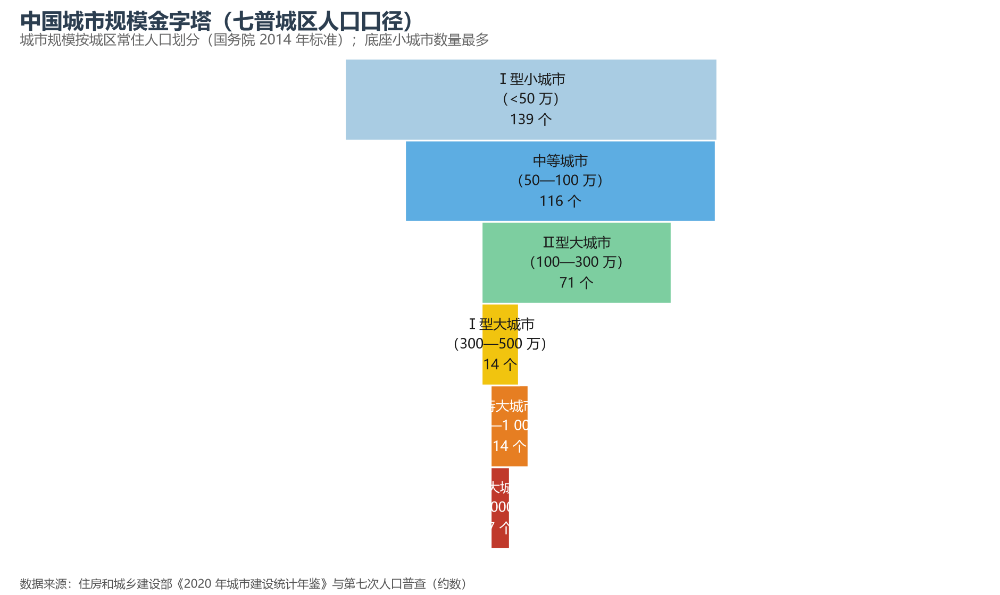
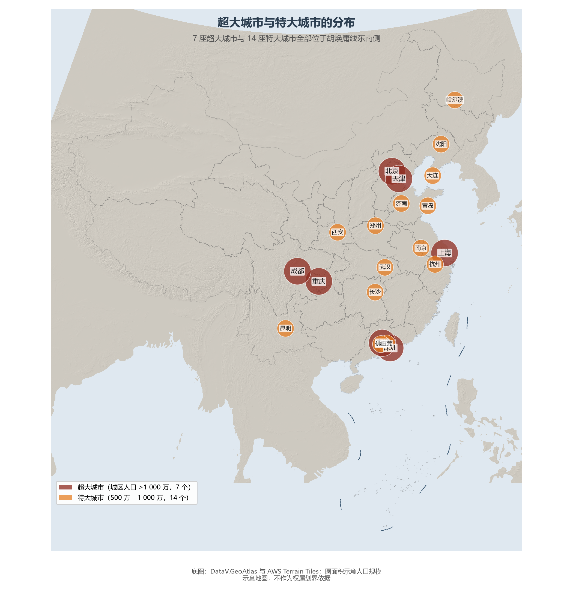

# 10.1 城市体系与规模等级

中国有 690 余座城市（含县级市），构成一座六层金字塔：塔尖是 7 座超大城市（城区人口逾千万的上海、北京、深圳、重庆、广州、成都、天津），往下依次是 14 座特大城市、14 座 Ⅰ 型大城市、70 余座 Ⅱ 型大城市、百余座中等城市与一百多座小城市。金字塔的层级由《国务院关于调整城市规模划分标准的通知》（2014 年）以**城区常住人口**一刀切定——注意是"城区人口"而非户籍或全域人口：东莞的常住人口逾千万，但按城区口径跻身超大城市行列的排名逻辑与此不同。

**图 10-1 城市规模金字塔（七普城区人口口径）**：底座的小城市数量最多，塔尖的超大城市贡献了最大的经济密度。

## 一、行政等级与市场等级的"双轨"

中国城市有另一套与规模并行的坐标——行政等级：直辖市（4）—副省级市（15）—地级市（293）—县级市（397）。两套体系大体吻合但并不重合：苏州的经济总量位居全国前列，行政上却只是普通地级市；拉萨的行政级别高，规模却只是小城市。理解中国城市，必须同时读这两张表——行政等级决定资源分配的通道，市场等级决定要素流动的方向，"强省会"战略正是两套逻辑博弈的产物。

## 二、超大特大城市的分布

7 座超大城市与 14 座特大城市全部位于胡焕庸线东南侧，其中 12 座集中在京津冀、长三角、粤港澳大湾区、成渝四大城市群——城市规模的分布比人口分布更为向心。

**图 10-2 超大城市与特大城市的分布**：圆面积示意城区人口规模。

## 三、世界视角：世界城市名单里的中国方阵

按全球化与世界城市研究网络（GaWC）的分级，中国内地已有香港、上海、北京、广州、深圳五座"世界一线城市"（Alpha 及以上）——数量仅次于美国。但城市群的竞争力比单体城市更重要：全球六大城市群中，长三角以约 2.4 亿人口、33 万亿元 GDP 成为世界上人口最多、经济体量前列的城市群连绵带。中国城市体系的下一个十年，将是"从城市竞争到城市群协同"的十年。

## 参考与数据来源

1. 城市规模等级：住房和城乡建设部《城市建设统计年鉴》、第七次全国人口普查（城区人口口径）。
2. 城市规模划分标准：《国务院关于调整城市规模划分标准的通知》（国发〔2014〕51 号）。
