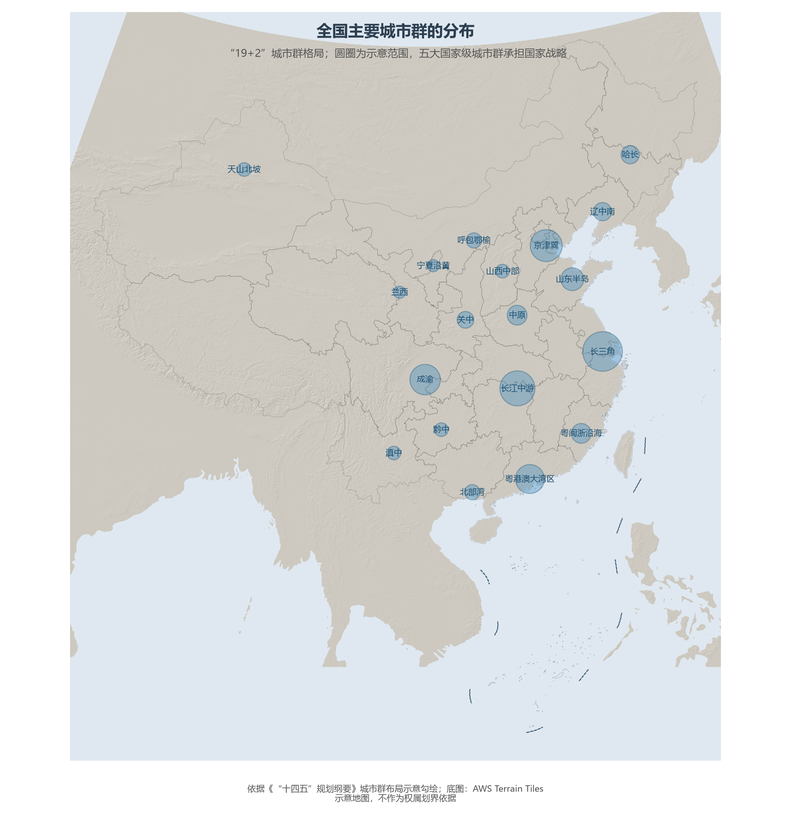
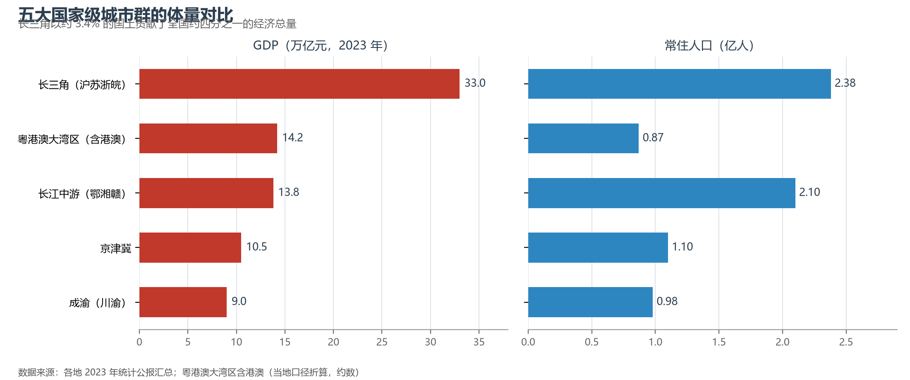

# 10.2 城市群与都市圈

单个城市的时代正在落幕，城市群的世纪已经开场。"十一五"以来，国家层面先后规划了 19 个城市群（"19+2"格局，再加新疆喀什、西藏拉萨两个边陲组团），它们以约四分之一的国土集聚了全国逾八成的人口与九成以上的经济总量。

**图 10-3 全国主要城市群的分布**：五大国家级城市群（京津冀、长三角、粤港澳大湾区、成渝、长江中游）承担国家战略使命。

## 一、五大国家级城市群

- **长三角**（沪苏浙皖）：中国最大城市群，GDP 约 33 万亿元、人口约 2.38 亿——以约 3.4% 的国土贡献约四分之一的全国经济总量，一体化上升为国家战略后，"轨道上的长三角"以一小时通勤圈重组了苏浙沪的城市分工；
- **粤港澳大湾区**（"9+2"城市）：以深圳—香港—广州为极核，是全球唯一兼具两种制度、三个关税区的城市群，科创与金融是两张王牌；
- **京津冀**：以雄安新区（2017 年设立）疏解北京非首都功能，"一核两翼"的格局正在重塑；
- **成渝**：西部唯一的国家级城市群，双城经济圈（2020 年上升为国家战略）是中国经济"第四极"的候选；
- **长江中游**（武汉、长株潭、环鄱阳湖三大组团）：承东启西的人口与制造业腹地。

**图 10-4 五大国家级城市群的体量对比**：GDP 与常住人口（2023 年，约数）。

## 二、都市圈：城市群的"分子"

城市群之下是更致密的**都市圈**——以一二线城市为核心、1 小时通勤圈为半径的日常功能体。国家已批复南京、福州、成都、长株潭、西安、重庆、武汉、杭州、广州、深圳、青岛等十余个都市圈发展规划。都市圈的看点是"轨道上的通勤"：北京—廊坊、上海—苏州、广州—佛山之间的跨城通勤者已以百万计，广佛两市地铁网互联互通，成为国内首个"同城化"样本。

## 三、世界视角：城市群的国家分量

美国的经济地理由东海岸、五大湖、西海岸三大城市群支撑；日本的一极集中造就了东京都市圈约 3 700 万人口的全球纪录。中国的特殊在于"多极并立 + 国家战略入场"：五大国家级城市群各有中央战略文件加持（京津冀协同、长三角一体化、大湾区建设、成渝双城经济圈、长江中游城市群），这种"顶层设计的城市群"模式在世界范围内独一无二——它以行政力量对冲了市场自发的单极化倾向，也留下了区域壁垒待破的课题。

## 参考与数据来源

1. 城市群名单与格局：《"十四五"规划和 2035 年远景目标纲要》。
2. GDP 与人口：各省市 2023 年统计公报汇总；粤港澳大湾区含港澳（当地口径折算，约数）。
