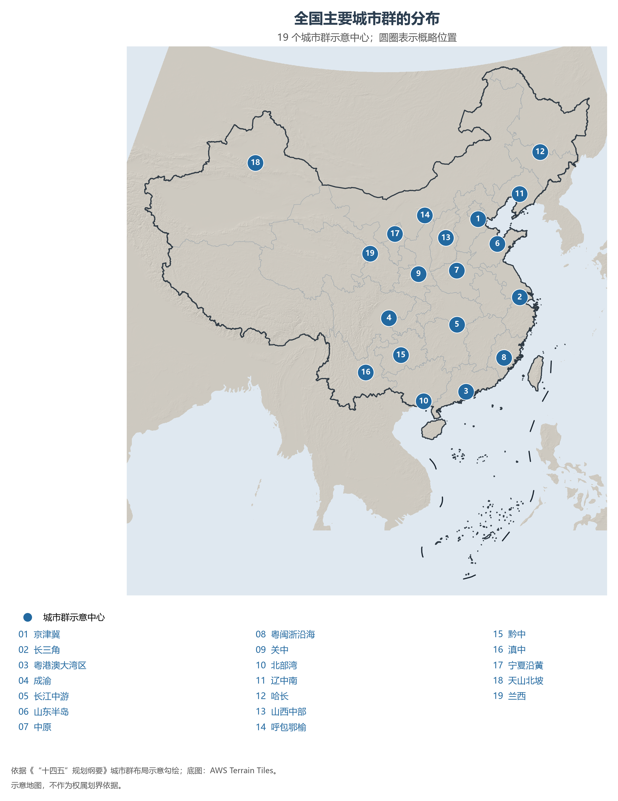

# 10.2 城市群与都市圈

城市之间的交通、产业、人口和公共服务联系，可以越过行政边界，形成相互关联的城市区域。城市群强调较大范围内多个城市的网络联系；都市圈则更关注中心城市与周边城镇之间的日常互动。二者的范围和尺度不同，不能把城市群、都市圈和单个城市的行政区域相互替代。

## 一、城市群的空间联系

《“十四五”新型城镇化实施方案》将城市群作为组织城镇化空间布局的重要主体，提出分层推进不同地区城市群的发展。图 10-4 选择京津冀、长三角、粤港澳大湾区、成渝和长江中游等区域展示其位置。图中城市群标记是区位示意，不代表统一口径的完整规划边界。

**图 10-4 主要城市群的区位示意**：阅读时应结合各自规划范围，不能直接用示意位置计算城市群面积、人口和经济总量。

| 区域 | 阅读空间范围时需要区分的概念 | 可以观察的跨区域联系 |
|:---|:---|:---|
| 长三角 | 长三角地区、城市群规划范围与各都市圈范围 | 沿江沿海港口、轨道交通和制造业网络 |
| 粤港澳大湾区 | 广东相关城市与香港、澳门的组合范围，各地统计与币种口径 | 跨境交通、港口机场分工与产业联系 |
| 京津冀 | 北京、天津、河北的区域范围与具体通勤走廊 | 城市功能、交通通道和跨界环境治理 |
| 成渝 | 成渝城市群、双城经济圈及相关城市行政范围 | 双核心联系、内陆交通枢纽和产业网络 |
| 长江中游 | 城市群范围与武汉、长株潭、南昌等城市区域 | 干支流水系、铁路通道和区域中心联系 |

同一地区在不同规划中可能有不同空间范围。计算其人口和 GDP 时，应先确定包含哪些城市、区县或部分区域，再统一统计年份。省域总量不能自动代替城市群总量；港澳与内地资料还需分别说明货币、折算时间与统计制度。

## 二、都市圈与日常通勤

国家发展改革委 2019 年《关于培育发展现代化都市圈的指导意见》以中心城市的辐射带动作用和一小时通勤范围界定都市圈的基本形态。这里的一小时通勤范围具有功能含义，不是围绕城市中心画一个固定半径的圆，也不是仅凭一趟高铁的车上时间判断所有地点都可实现一小时通勤。

真实通勤还包括步行、接驳、候车和换乘。线路通车能够改善城市间联系，但门到门时间、班次、票价和就业居住分布共同影响日常往来。判断同城化程度，应结合实际通勤与公共服务使用资料，而不能只依据规划目标。

## 三、跨行政区合作解决什么问题

交通网络贯通、公共服务共享、产业分工和生态环境协调，分别对应不同的空间联系。轨道交通可以连接就业和居住地点；教育医疗资源的跨市使用涉及服务资格与供给能力；河流和大气环境治理则需要上下游及相邻地区协作。这些关系往往跨越单个行政区，应按具体问题确定分析范围。

例如，上海与苏州之间的轨道交通联系可以作为跨市出行案例，南京周边的跨省合作可以作为区域协调案例，广佛之间的轨道联系可以作为相邻大城市联系案例。它们并不自动证明整个城市群已形成统一的一小时生活圈。对具体线路的运营状态和通勤规模，应采用相应年份的运营资料。

## 参考与数据来源

1. 国家发展改革委：《关于培育发展现代化都市圈的指导意见》，发改规划〔2019〕328 号，2019 年 2 月 21 日公开。
2. 国家发展改革委：《关于印发“十四五”新型城镇化实施方案的通知》，发改规划〔2022〕960 号，2022 年 6 月 21 日。
