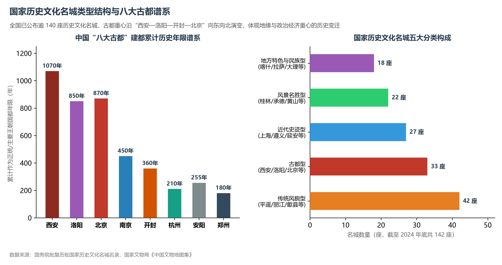
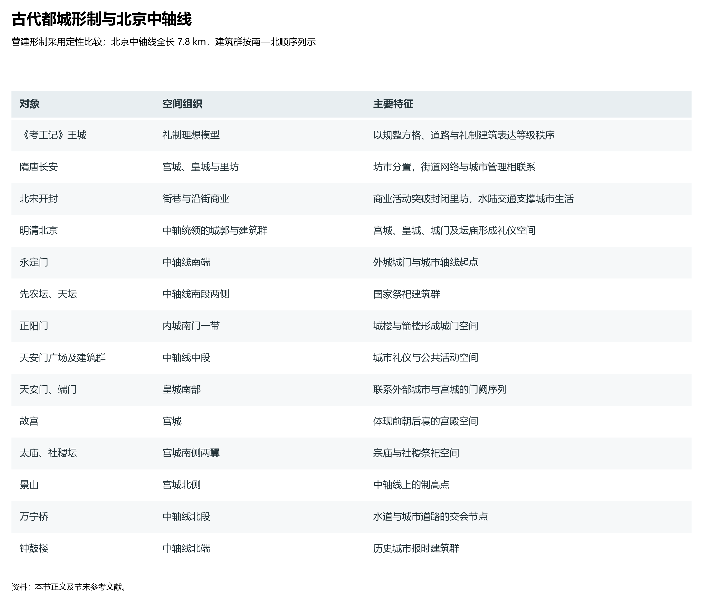

# 10.3 历史文化名城

1982 年，国务院分批公布第一批国家历史文化名城，正式确立了我国历史文化名城保护制度。经过四十余年的发展，全国已公布 140 余座国家历史文化名城，构建起涵盖“历史文化名城—历史文化名镇名村—历史文化街区—不可移动文物与历史建筑”的四级法定保护网络，形成了全世界规模最大、层级最完备的城市文化遗产空间保护体系。

这 140 余座历史文化名城在地理空间上的分布，绝非偶然的离散点，而是一部刻写在华夏大地上的立体通史：从黄河中下游古都群，到大运河沿线的漕运商埠链；从长江流域水网密布的秀美府城，到丝绸之路与西南茶马古道上的绿洲军镇与边邑，它们共同凝结了中华民族五千年人地和谐、营建城市的东方智慧。

**图 10-7 国家历史文化名城五大类型与八大古都谱系**：名城类型结构分布与古都建都历史演变。

## 一、“八大古都”谱系与中国地缘政治重心的历史大迁移

在数以千计的古城中，经中国古都学会科学论证的“**八大古都**”居于中国城市史的塔尖。古都的地理更迭与兴衰，深刻映射出中国数千年来气候环境演变、经济重心南移与陆海地缘战略变迁的宏大脉络：

| 古都名称 | 累计作为主要王朝国都年限 | 核心建都朝代 | 地理区位与营建依托 | 标志性都城遗存 |
|:---|:---:|:---|:---|:---|
| **西安 (长安)** | 约 1070 年 | 西周 (丰镐)、秦 (咸阳/长安)、西汉、新莽、前秦、后秦、西魏、北周、隋、唐 | 关中平原腹地，“被山带河，四塞以为固”；南依秦岭、北枕渭水 | 丰镐遗址、阿房宫遗址、汉长安城遗址、唐大明宫与大雁塔 |
| **北京** | 约 870 年 | 金 (中都)、元 (大都)、明、清、中华人民共和国 | 华北平原北端幽燕要冲；东临渤海，西倚太行，北枕燕山；控驭农牧分界 | 明清紫禁城、天坛、颐和园、八达岭长城、北京中轴线 |
| **洛阳** | 约 850 年 | 夏、商、西周 (成周)、东周、东汉、曹魏、西晋、北魏、隋、唐 (神都)、后梁、后唐 | 伊洛盆地中心，“天下之中”；南望伊阙，北依邙山，东扼虎牢，西控函谷 | 二里头遗址、偃师商城、汉魏洛阳城、隋唐洛阳城、龙门石窟 |
| **南京 (建康)** | 约 450 年 | 东吴、东晋、宋、齐、梁、陈 (六朝)、南唐、明初、太平天国、中华民国 | 长江下游沿江平原；“钟山龙蟠，石头虎踞”；江南财赋与长江天堑依存 | 明孝陵、南京明城墙、夫子庙秦淮河、孙中山陵寝 |
| **开封 (东京)** | 约 360 年 | 战国魏 (大梁)、后梁、后晋、后汉、后周、北宋、金后期 | 豫东冲积平原腹地；汴河、蔡河、金水河、五丈河四水汇流；漕运通天下 | 北宋东京城遗址、铁塔、繁塔、大相国寺 |
| **安阳 (殷)** | 约 255 年 | 商朝晚期 (盘庚迁殷至帝辛商亡) | 太行山东麓山前洪积平原；洹水之滨；铜矿与农耕资源丰沛 | 殷墟遗址（甲骨文发源地）、妇好墓、后母戊鼎出土地 |
| **杭州 (临安)** | 约 210 年 | 五代吴越国、南宋 | 钱塘江下游与杭州湾西端；京杭大运河南端终点；依托江南富庶水网 | 南宋临安城遗址、西湖文化景观、良渚古城遗址 |
| **郑州** | 约 180 年 | 商代早期至中期 (二里岗期) | 豫中太行山与伏牛山向黄淮平原过渡带；黄河南岸水陆交通十字中枢 | 郑州商城遗址（巍峨早商城垣）、大河村遗址 |

中国古代政治中枢的地理大迁移，呈现出极为鲜明的三大轨迹：
1. **由西向东移（从关中向中原平原推进）**：先秦至盛唐，关中盆地以“金城千里、天府之国”长期为帝王建都首选。然而，伴随中原高密度人口开垦、气候转干变冷、黄土高原水土流失加剧，关中粮食产出逐渐不敷都城消耗，唐代皇帝常不得不率百官“就食洛阳”。唐末以降，政治中枢顺黄河水系彻底东移至水陆大枢纽洛阳与开封，依靠通畅的汴渠水网转运江南粮饷；
2. **由北向南移（衣冠南渡与江南经济崛起）**：历史上永嘉之乱、安史之乱、靖康之变三次大规模人口南迁，推动江南由“卑湿贫瘠”一跃成为全国“鱼米之乡”与财赋命脉（“赋税所出，江淮居半”）。南京凭借六朝烟水与长江天险，杭州凭借运河南端商旅之便，相继成为南方王朝立国的空间基石；
3. **北定幽燕（大一统帝国的地缘战略锁定）**：元代以后，中国疆域空前辽阔，传统偏于中原腹地或江南的都城已难以平衡北方游牧边缘与南方农耕腹地。北京凭借“南控中原、北扼朔漠、东连辽沈、西通西域”的宏大地缘格局，成为元、明、清三代定鼎之所。通过贯通南北的京杭大运河与海上漕运，中华帝国构建起“政治军事重心居北、经济财赋基石在南”的超稳定地缘平衡架构。

**图 10-8 古代都城形制与北京中轴线**：比较礼制王城、隋唐长安、北宋开封与明清北京的空间组织，并按南北顺序列示北京中轴线的主要建筑群。

## 二、营建哲学：从《考工记》礼制秩序到北京中轴线的巅峰

中国古代城市规划自始至终贯穿着“天人合一”、“象天法地”与儒家礼制秩序的深层哲学：

### 1. 规制典范：《周礼·考工记》的营国蓝图
先秦古籍《考工记》所载“匠人营国，方九里，旁三门。国中九经九纬，经涂九轨。左祖右社，面朝后市，市朝一夫”，是中国古代最早、最完整的理想都城规划模型。这一规范确立了古代中国城市的核心要素：方正平直的城垣外郭、严格对齐的南北中轴对称、前朝执政后市经商的规整分区，以及左祖（太庙宗祠）右社（社稷坛祭地）的礼法秩序。

### 2. 空间演进的三大历史里程碑
- **隋唐长安城：封闭式里坊制的巅峰**：宇文恺主持规划的隋大兴城（唐长安城），总面积达 84 平方公里，是当时全世界规模最大的都市。全城以宽达 150 米的朱雀大街为中轴线，皇城居北，两侧划分为东西对称的 108 个封闭“里坊”。坊设围墙与坊门，实行“暮鼓六百下闭门、晨钟三千响开门”的严苛夜禁制度；商业交易严格限定于东市与西市，体现了强大的国家政权对城市空间与市民日常的绝对管控；
- **北宋东京开封：开放式街巷制的平民商业革命**：随着大运河漕运与江南商品经济爆发，封闭里坊制彻底瓦解。北宋东京汴梁破除里坊围墙，开创了“临街设店、市坊合一、夜市通宵”的开放式街巷空间形态。《清明上河图》生动记录了汴河两岸勾栏瓦肆、州桥夜市的市井繁荣，城市空间从封建等级工具走向了充满烟火气的市民公共空间；
- **明清北京城：皇权中轴秩序的世界巅峰**：元大都与明清北京城集中国古代城市营造哲学之大成，构筑起外城、内城、皇城、紫禁城四重由外向内嵌套的严整方阵。2024 年正式列入《世界遗产名录》的**北京中轴线**全长 7.8 公里，南起外城永定门，向北经先农坛、天坛、正阳门、天安门广场建筑群、天安门、端门、故宫（紫禁城）、太庙、社稷坛、景山、万宁桥，直抵钟鼓楼。这条中轴线统领了全城宏伟壮丽的建筑群落，将政治秩序、宗庙祭祀、自然山水（景山、什刹海）与市民生活完美熔铸于一炉，被梁思成誉为“全世界最长、也是最伟大的中轴线”。

### 3. 因地制宜：非正交山水城市的地理适应
并非所有中国古城皆拘泥于正方形制。在复杂的江河山川地貌面前，古代匠人充分展现了“因天时就地利”的灵活智慧：
- **水网平原古城（苏州）**：如宋代《平江图》所示，古城巧妙依托太湖水网，构建“水陆双棋盘”——道路与河道并驾齐驱，形成“前街后河”、“八水环绕”的水乡生态；
- **山地江城要塞（重庆）**：依长江与嘉陵江交汇处的崎岖山梁筑城，高低起伏，顺应天然岩壁设“九开八闭十七门”，形成了独特的立体梯坎防御空间；
- **高原向心名城（拉萨）**：突破棋盘方格，以大昭寺释迦牟尼佛殿为精神原点，环绕大昭寺形成八廓街转经道，向外放射生长，体现了藏传佛教信仰与高原谷地微地貌的有机融通。

## 三、国家历史文化名城的五大空间谱系

住建部与国家文物局现行标准将 140 余座国家历史文化名城划分为五大功能形态谱系，勾勒出中华大地多元一体的文化版图：

1. **古都型名城（如西安、洛阳、北京、南京、开封、杭州、安阳、郑州、大同、银川、拉萨、成都、荆州、江陵）**：曾为封建王朝或重要割据政权的国都，遗存有规模宏大的宫殿城址、帝王陵寝与宗庙祭祀空间；
2. **传统风貌型名城（如山西平遥、云南丽江、湖南凤凰、安徽歙县、云南建水、福建长汀、四川阆中）**：城垣格局完整、传统街巷肌理与历史民居密集保存。平遥古城是中国汉民族中原县城最完好的活态标本；丽江古城则将玉龙雪山融水引渠穿街，开创了纳西族无城墙山水聚落的奇迹；
3. **风景名胜型名城（如广西桂林、河北承德、江苏苏州、江苏扬州、浙江绍兴、广东肇庆）**：城市规划与自然山水景观天人合一。桂林“城在景中、景在城中”；承德避暑山庄与外八庙融合了汉、藏、蒙等多民族建筑风韵；
4. **地方与民族特色型名城（如西藏日喀则、新疆喀什、云南大理、青海同仁、新疆吐鲁番、四川康定）**：地处少数民族聚居区或边疆绿洲，建筑材质（生土、石砌）与聚落形态独树一帜。喀什噶尔老城的高台民居生土巷道，宛如中亚绿洲丝绸之路的千年活化石；
5. **近代史迹型名城（如上海、青岛、天津、武汉、大连、厦门、遵义、延安、重庆、广州）**：记录了鸦片战争以降中西文化的激烈碰撞、近代工商业开埠与中国革命的历史丰碑。青岛八大关红瓦绿树的欧陆风情、上海黄浦江畔的外滩万国建筑群与石库门里弄、遵义会议与延安革命旧址群，构成了这一谱系的厚重注脚。

## 四、世界视角：存量时代的“活态保护”与遗产治理新思维

面对全球汹涌的现代化浪潮，西方工业化国家在城市保护中曾经历过两个极端：一是一战、二战后的粗暴推倒重来（推土机式改造），二是将历史街区过度“博物馆化”导致原住民搬迁、城市沦为冰冷静态旅游假布景。

当代中国在 140 余座历史文化名城的保护与更新中，探索出了一条**“绣花功夫、渐进微更新、城人共生”**的中国新范式：
- 严格划定历史文化街区核心保护范围与建设控制地带，叫停“大拆大建”与“拆真建假、造假古董”；
- 推动以北京前门草厂胡同、福州三坊七巷、潮州古城、苏州姑苏平江路为代表的“微更新”实践：不搞大迁徙，改善给排水、电力、供暖等现代生活管网设施，让原住民留下来，保留下原汁原味的人间烟火气与非物质文化遗产；
- 历史文化名城不仅是冰冷的建筑标本，更是孕育当代城市文化认同与文化自信的鲜活源泉。

## 参考与数据来源

1. 国家历史文化名城名录与申报制度：国务院历批公布国家历史文化名城文件、住房和城乡建设部、国家文物局《国家历史文化名城申报管理办法》（2020）。
2. 古都历史与考古发掘：中国古都学会历届学术年会论文集、宿白《中国古代都城规划与考古》（文物出版社）、贺业钜《中国古代城市规划史》（中国建筑工业出版社）。
3. 世界遗产名录与申报文本：联合国教科文组织（UNESCO）世界遗产中心《北京中轴线：中国理想都城秩序的杰作》（2024）。
4. 城市保护与更新理论：吴良镛《北京宪章》（1999）、阮仪三《护城纪事》（生活·读书·新知三联书店）。
