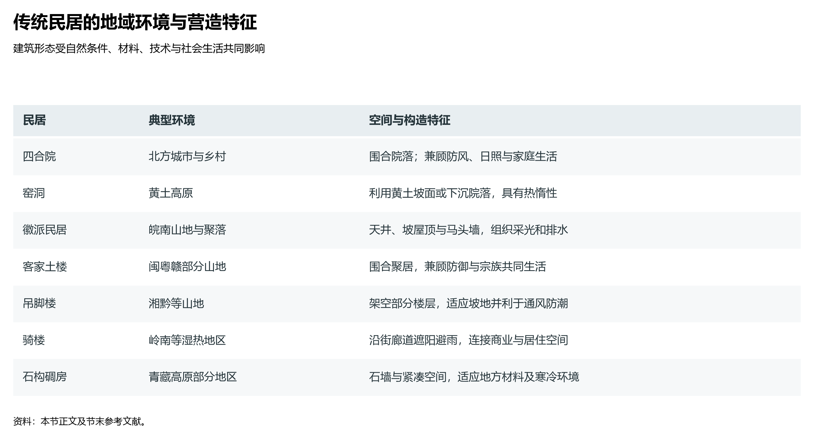
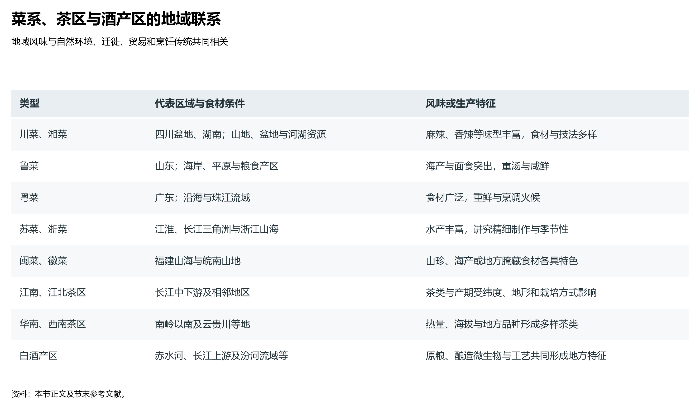

# 10.4 传统民居与饮食地理

地理学最温情、也最能直接触动人心的表达，莫过于百姓脚下的栖居与眼前的餐盘。中国东西横跨 5200 余公里、南北纵跨近 50 个纬度，由青藏高原、内陆荒漠、黄土塬梁、冲积平原到热带滨海，梯次铺展出全球反差最剧烈的自然生境。数千年来，中华先民在不同的水热、地质、土壤与生物圈中繁衍生息，不仅发展出顺应天地万物的传统民居营造体系，更孕育出博大精深、因地制宜的饮食风味图谱。民居是凝固在地表上的气候适应史，而菜系与食俗则是流淌在舌尖上的生物水土演变史。

**图 10-9 传统民居的地域环境与营造特征**：比较四合院、窑洞、徽派民居、土楼、吊脚楼、骑楼与石构碉房的环境条件及空间构造。

## 一、传统民居谱系：因天时就地利的营造力学

中国传统民间建筑从不盲目崇尚人工对自然的征服，而是将“光、热、水、土、风”五大物理因子转化为建筑形态的内生动力，创造出极具地域特质的民居营造力学体系：

| 民居类型 | 核心地理分布区 | 气候地貌生境 | 典型营造形制与结构 | 地理适应力学机理 |
|:---|:---|:---|:---|:---|
| **北方四合院** | 华北平原、北京、山东、河北 | 温带季风气候；冬季漫长干冷多北风，夏季炎热多雨 | 坐北朝南；中轴对称；正房高敞、倒座居南；厚重封闭外墙 | 封闭实墙抵御西伯利亚寒流与风沙；庭院空间最大限度接纳冬日低角度暖阳；夏日树冠遮阴形成自循环对流风 |
| **黄土窑洞与地坑院** | 黄土高原（陕北、晋西、豫西、陇东） | 温带半干旱区；黄土层极深厚，林木匮乏；冬寒夏酷 | 靠崖式窑洞、下沉式地坑院；拱形生土穹顶 | 利用第四纪黄土垂直节理发育、不易坍塌与极高的热惰性；冬暖夏凉（年温差极小）；节省木材且不侵占宝贵的塬面耕地 |
| **徽派与江南民居** | 皖南丘陵、新安江流域、太湖平原 | 亚热带季风气候；湿润多雨、夏季潮湿闷热；村落紧密 | 粉墙黛瓦；高耸阶梯式马头墙；四合围合天井；穿斗式木构架 | 高大马头墙在密集逼仄的村落中阻隔火势蔓延；天井兼具采光、通风拔风与雨水汇集（“四水归堂”），白墙反射强烈日照 |
| **客家土楼与围龙屋** | 闽西、粤东北、赣南（武夷山与南岭） | 南亚热带湿润山地；多台风、多地震；历史上族群迁徙冲突多 | 生土厚墙夯筑；圆楼、方楼围合；外实内虚、向心聚居 | 生土掺入糯米汁、红糖与竹木筋条，墙厚达 1.5—2 米，防震防台风；聚族数以百人同住一堡，强化封闭防卫与宗族凝聚 |
| **干栏式吊脚楼** | 湘西、黔东南、桂北山地（苗、侗、壮） | 亚热带喀斯特与山地丘陵；坡陡谷深、地表湿热多雾多毒虫 | 依山架木、半干栏悬挑；下层架空圈养或储柴，上层住人 | 化险峻斜坡为三维立体使用空间；架空层有效隔绝地表潮湿水汽与山林毒虫猛兽；通风顺畅以适应多雾高湿气候 |
| **岭南骑楼** | 广东、广西、海南、闽南滨海城镇 | 亚热带与热带季风；日照强烈灼人、突发性暴雨与台风频发 | 沿街建筑底层后退留出贯通走廊；二层及以上跨建在人行道上 | 柱廊连贯形成全天候公共步行遮阳避雨长廊；商住有机融合，适应滨海高密度商贸与极端湿热天气 |
| **青藏平顶碉房** | 青藏高原河谷（西藏、青海、川西） | 高原高寒气候；日照强烈、昼夜温差极大、风大缺氧 | 块石或生土厚实砌筑；窗扇狭小；平屋顶；底层畜圈二层居人 | 极厚石墙与小窗最大限度蓄积热量并抵御高原寒夜狂风；平屋顶兼作高原强紫外线下的青稞脱粒与草料晾晒场 |
| **阿以旺与吐鲁番荫房** | 新疆塔里木盆地与吐鲁番盆地绿洲 | 温带大陆性干旱荒漠；极度干燥、降水稀少、日照酷热风沙大 | 土坯土木结构；平顶设高侧窗天窗庭院（阿以旺）；镂空通风土花墙 | 闭合土坯厚墙隔绝干旱酷暑与沙尘；“阿以旺”高天窗引入自然采光与穿堂凉风；镂空荫房利用干热热风迅速阴干葡萄干 |
| **东北木刻楞** | 大兴安岭、长白山林区 | 寒温带与中温带季风；严冬漫长达半年以上，积雪深厚 | 粗大原木榫卯咬合叠砌；原木缝隙填塞苔藓草泥；大坡度斜屋顶 | 针叶林原木保温隔热性能优越；原木嵌苔藓杜绝冷空气渗透；大陡坡屋顶利于积雪自然滑落，防止压垮建筑 |

传统民居不是孤立的建筑物，而是人地关系在微观空间尺度的智慧物化。它们就地取材（生土、块石、毛竹、原木），不耗费远距离高碳建材，构建起与大地脉搏同频呼吸的生态庇护所。

## 二、饮食地理：“南米北面”的水土法则与全产业链演化

中国人的餐盘格局，在宏观上首先受到**秦岭—淮河一线**所奠定的水热地带性绝对支配。这一分界线既是 800 mm 年等降水量线与 1 月 0℃ 等温线的地理基准，也是中国水田农业与旱地农业、进而演化出“南米北面”主食版图的生态分水岭：

### 1. 南方食米系统：水网浸润下的湿润生态
- **生态机理**：秦岭淮河以南积温充沛、雨热同期、无霜期长达 240—300 天以上，河湖水网纵横交错，为喜温喜水的水稻种植提供了天然生境；
- **副食产业链演进**：围绕大米这一核心碳水，南方先民演化出穷形尽相的深加工谱系。经由水磨、发酵、蒸滤、压榨，大米褪去原形，化作广东肠粉、云南过桥米线与饵块、湖南常德牛肉米粉、广西桂林米粉与螺蛳粉、江浙水乡年糕与汤圆、西南糍粑。这些食品具有快熟、滑嫩、多汁水、易消化的共性，高度契合了湿热气候下人体对清润爽滑口感的生理追求。

### 2. 北方啖面系统：广袤平原上的耐寒旱作
- **生态机理**：秦岭淮河以北年降水量在 400—800 mm 之间，光照充足、昼夜温差大，土壤多为深厚的黄土或冲积物，非常适宜越冬耐旱的冬小麦与春小麦生长；
- **面食艺术的地理极致**：小麦中富含高弹性与韧性的面筋蛋白，在北方人的揉拉、擀压、刀削、烘烤、汆烫之下，衍生出数百种面食形态。从山西刀削面、河南烩面、兰州牛肉拉面、北京炸酱面、陕西油泼面与羊肉泡馍，到山东煎饼、河北火烧与各式发酵馒头包子饺子。北方冬天干冷漫长，高密度的面食不仅能提供持久耐饥的热量储备，更在漫长农闲与严冬中孕育出浓郁团聚的节庆民俗。

### 3. 农牧交错带与雪域高原的高能量食谱
在 400 mm 等降水量线以西以北的广袤牧区，蒙古族以手把肉、烤全羊、奶茶、奶豆腐为生；而在海拔 4000 米以上的青藏高原高寒缺氧生境中，只有耐低温短生育期的青稞能够成熟。藏族先民将青稞炒熟磨成细粉（糌粑），混合耐寒高脂的牦牛酥油茶捏制食用，辅以风干牦牛肉。这种超高脂肪、高碳水、耐贮存的食谱，是人类在地球第三极战胜酷寒缺氧的生物地理奇迹。

**图 10-10 菜系、茶区与酒产区的地域联系**：列示代表区域、食材与生产条件；地方风味受自然环境、迁徙、贸易和工艺传统共同影响。

## 三、八大菜系与风味地图：“南甜北咸、东辣西酸”的地理解析

俗语所云“东辣西酸、南甜北咸”，并非文学的夸张，而是气候环境、地质水质与物产流通在味觉生理学上的精准投射：

### 1. 风味地理梯度的深层环境科学解构
- **“北咸”的地理成因**：华北水质硬度与矿化度偏高；历史上在没有温室大棚和现代冷链物流的千百年里，北方冬季冰封数月，新鲜蔬菜极度匮乏，百姓唯有依赖高盐腌渍蔬菜（酱菜、腌白菜、咸菜缸）与豆酱卤汁作为一冬的维生素与下饭来源，由此奠定了北方菜肴“重酱色、口偏咸鲜、原汁浓汤”的风味底色；
- **“南甜”的地理成因**：江南与岭南热量丰富、雨量充沛，是中国历史上最核心的甘蔗种植与制糖工商业基地。唐宋以来江南经济富庶，在北方仍视白糖为昂贵药引或贡品时，南方富庶士庶已普遍将蔗糖作为日常提鲜调味的常备佐料。无锡酱排骨、苏州船点、广东叉烧与甜汤，其清甜醇美正是水土丰腴与物产富庶的直接印证；
- **“中西南辣”的地理成因**：四川盆地、云贵高原与湖南洞庭平原地形低洼闭塞，冬季日照极少（所谓“蜀犬吠日”），常年相对湿度在 80% 以上，湿冷阴霾侵肌彻骨。原产美洲的辣椒在明万历年间自东南沿海传入后，在沿海未获重用，却在中西部山区爆发式普及。辣椒素能强力刺激口腔粘膜与汗腺，促进血液循环与排汗祛湿，帮助盆地居民抵御内湿、增进食欲，从而与当地的花椒（原产中原与川陕）迅速交融，奠定了“川麻湘辣”的饮食江山；
- **“西酸”的地理成因**：山西、陕北地处黄土高原腹地，水土中碳酸钙与硫酸盐含量极高（呈典型的硬水与弱碱性环境），极易造成胃酸分泌不足、消化不良乃至尿路结石。当地以高粱、大麦等杂粮酿造的陈醋富含醋酸，不仅能有效中和食物与体内的碱性物质、软化血管，更能强力催化高粱面、荞麦、莜面等粗纤维淀粉的水解转化，因此“西酸”实为黄土高原人地共生的生理自愈智慧。

### 2. 中国八大传统菜系的水土生态与烹饪特征全貌
中国烹饪在漫长历史演进中，依托大江大河与滨海地貌，形成了各具千秋的“八大菜系”：

| 菜系 | 依托流域与地貌生境 | 核心风味特征 | 关键食材与技法 | 标志性代表菜肴 |
|:---|:---|:---|:---|:---|
| **鲁菜** | 黄河下游冲积平原、山东半岛渤海/黄海海岸 | 咸鲜纯正、突出本味；葱香浓郁、善用高汤清汤 | 胶东海鲜、黄河鲤鱼；爆、炒、扒、烧技法登峰造极 | 葱烧海参、糖醋鲤鱼、九转大肠、德州扒鸡 |
| **川菜** | 四川盆地紫色土丘陵、成都平原水网 | 麻辣鲜香、百菜百味；调味多变、善用复合味型 | 汉源花椒、郫县豆瓣、泡椒泡菜；小炒、干烧、水煮 | 麻婆豆腐、回锅肉、水煮牛肉、宫保鸡丁 |
| **粤菜** | 珠江三角洲冲积平原、南海热带亚热带滨海 | 清中求鲜、淡中求美；讲究“镬气”与原汁原味 | 南海生猛海鲜、热带果蔬；白灼、小炒、煲汤、脆皮烧烤 | 白切鸡、清蒸石斑鱼、脆皮烧鹅、广府老火靓汤 |
| **苏菜** | 长江下游与淮河平原、太湖平原湖沼水网 | 鲜甜咸淡相宜、醇厚淡雅；刀工精细、注重火工 | 长江三鲜、太湖水产、阳澄湖大闸蟹；炖、焖、煨、焐 | 松鼠鳜鱼、狮子头、大煮干丝、无锡肉骨头 |
| **浙菜** | 浙东山地丘陵、杭嘉湖平原与舟山渔场 | 清鲜软滑、鲜爽脆嫩；选料精细、香气纯正 | 舟山海鲜、西湖淡水鱼鲜、金华火腿；炒、炸、烩、熘 | 西湖醋鱼、东坡肉、龙井虾仁、宋嫂鱼羹 |
| **闽菜** | 闽江流域山地丘陵、台湾海峡深水岸线 | 咸甜适宜、重酸辣与红糟香；擅长海味与汤菜 | 山海并茂（红糟、沙茶、鲍参翅肚）；煨、蒸、糟、汆 | 佛跳墙、鸡汤氽海蚌、红糟醉香鸡、荔枝肉 |
| **湘菜** | 洞庭湖平原、湘江流域与湘西山地 | 酸辣焦麻、香浓软烂；腊味芬芳、注重煨炖炒 | 洞庭湖水产、湘西深山熏腊肉、朝天椒；煨、炖、腊、炒 | 剁椒鱼头、腊味合蒸、麻辣子鸡、东安子鸡 |
| **徽菜** | 皖南黄山山地、新安江流域密林溪流 | 咸鲜微辣、重油重色重火功；天然野趣、善用干货 | 皖南山珍（石鸡、石耳、冬笋、徽州火腿）；红烧、清蒸 | 臭鳜鱼、毛豆腐、问政山笋炖火腿、一品锅 |

## 四、饮品地理：名茶四大产区与名酒三大香型地理生态圈

在餐盘之外，茶与酒作为华夏物质与精神文明的载体，其风味与品质更是特定微气候、土壤微量元素与酿造微生物群落的“绝对地理指纹”。

### 1. 中国名茶四大产区的生态密码
茶树（*Camellia sinensis*）对生长环境极度挑剔：喜温暖湿润气候，喜酸性红壤或黄壤（pH 4.5—5.5），忌积水涝渍，尤喜多云雾的漫射光（所谓“高山云雾出好茶”）。中国形成了四大茶叶生态产区：
- **江南茶区（长江中下游丘陵与低山）**：中国茶叶生产核心板块，涵盖浙、皖、赣、苏、湘等省。名优绿茶红茶荟萃：西湖龙井、洞庭碧螺春、黄山毛峰、祁门红茶；
- **江北茶区（秦岭—淮河以北至山东半岛）**：中国茶树分布北界。昼夜温差大、生长周期长、茶叶内含物丰厚、耐冲泡，典型如河南信阳毛尖、安徽六安瓜片与山东日照绿茶；
- **西南茶区（滇、川、黔、藏东南高原山地）**：全球茶树的原产地与种质基因宝库。土壤风化彻底、土层深厚。云南大叶种普洱茶、滇红与四川蒙顶甘露开创了千年茶马古道的源流；
- **华南茶区（南岭以南的闽南、广东、海南、台湾）**：亚热带与热带海风吹拂，全年无霜期长。得天独厚的温湿生境造就了特有的半发酵乌龙茶与微发酵白茶：武夷岩茶（大红袍）、安溪铁观音、潮州凤凰单丛与台湾冻顶乌龙。

### 2. 白酒三大主力香型的地理微生态
中国白酒的酿造绝非化学提纯，而是地表微生态环境与古老发酵窖池中复杂微生物群落（细菌、酵母菌、霉菌）的共生交响：
- **酱香型白酒（贵州赤水河干热河谷）**：赤水河两岸两山对峙，形成狭长闷热、冬暖夏热、风速极小的河谷小气候；紫色砂页岩风化形成的土壤富含多种微量元素，具有优异的天然下渗过滤功能；当地特产的红缨子糯高粱经受“九次蒸煮、八次发酵、七次取酒”的长周期淬炼，与河谷中世代驯化的耐高温微生物菌群相契合，造就了茅台、习酒、郎酒幽雅细腻的酱香；
- **浓香型白酒（长江上游宜宾、泸州、四川盆地冲积水网）**：长江、岷江、沱江交汇带气候温润多雨，利于窖池泥土中厌氧发酵微生物（己酸菌、丁酸菌）的繁衍。“百年老窖出好酒”，以五粮液、泸州老窖、剑南春为代表的浓香型白酒，窖香浓郁、绵甜甘冽；
- **清香型白酒（山西汾河谷地杏花村）**：黄土高原清凉干燥，地下深层岩溶水清纯甘冽。杏花村汾酒采用独特的固态地缸发酵与清蒸二次清工艺，地缸阻断了土壤杂菌对酒醅的污染，呈现出“清香纯正、诸味协调、醇甜柔口”的本真特征。

## 五、世界视角：人地和谐的生活美学与文化基因

在全球文化地理学的视野中，中国传统民间栖居与饮食文明，展现出一种具有超强韧性（Resilience）的人地和谐生活美学。面对极其复杂的地理环境与频仍的自然灾害，中国人从未以涸泽而渔的方式掠夺自然，而是顺应二十四节气律动，“春生夏长、秋收冬藏”；在建筑上就地取材、依山就势、雕梁画栋而不失实用；在饮食上物尽其用、变废为宝，将微薄的自然资源转化为世界上最健康、最包容、最富艺术魅力的味觉史诗。这不仅是大地山川对华夏子民的馈赠，更是千百年来流淌在亿万同胞血脉中最为深沉的文化地理基因。

## 参考与数据来源

1. 民居分类与建筑机制：单德启《中国传统民居图说》（清华大学出版社）、楼庆西《中国传统建筑的装饰》（清华大学出版社）、潘谷西《中国建筑史》（中国建筑工业出版社）。
2. 八大菜系演进与饮食地理：赵荣等《文化地理学》（高等教育出版社）、王学泰《华夏饮食文化》（商务印书馆）、陈学衿《中国饮食文化史》（四川人民出版社）。
3. 历史农业地理与主食分界：韩茂莉《中国历史农业地理》（北京大学出版社）、竺可桢《中国近五千年来气候变迁的初步研究》。
4. 名茶名酒生态环境：中国茶叶流通协会《中国茶叶产业发展报告》、中国酒业协会白酒地理标志专项研究资料。
