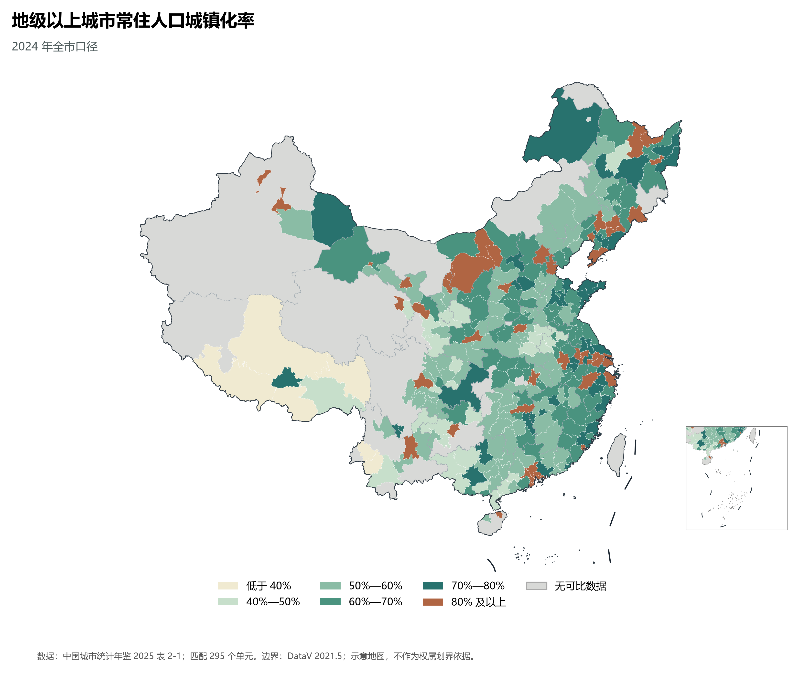

# 10.5 城市人口与城镇化格局

城市既是人口集聚的地点，也是包含城区、镇和乡村的行政地域。比较城市人口时，必须区分市辖区与全市范围；同一指标的统计年份、行政范围和人口口径也应一致。常住人口城镇化率是城镇常住人口占该地区常住人口的比重，反映人口居住结构，不等同于建成区面积占比或人口密度。

## 一、市域城镇化率的空间差异

图 10-11 将《中国城市统计年鉴 2025》表 2-1 的 2024 年全市常住人口城镇化率与地市级行政边界关联。295 个有可比数据的单元中，城镇化率在 50% 至不足 70% 的共有 172 个；80% 及以上的有 47 个。这里每个行政单元按一个样本计数，不能将其平均值解释为全国人口加权城镇化率。

**图 10-11 地级以上城市常住人口城镇化率**：2024 年全市口径，按行政代码匹配；灰色表示没有可比数据。统计资料为《中国城市统计年鉴 2025》表 2-1，行政边界为 DataV 2021.5 版。

有数据的城市中，深圳、佛山、东莞和厦门等东南沿海城市处于 80% 及以上组，乌鲁木齐、克拉玛依、乌海和嘉峪关等内陆城市也处于这一组。较高比例并不只出现在沿海。日喀则、那曲和昌都等市处于不足 40% 组。这些差异描述的是各自行政范围内的人口结构，并不能单凭地图判定形成原因。

城市行政区面积和所辖县域规模不同，颜色覆盖的面积不代表该等级的人口规模。人口高度集中的城区可能只占市域地图的一小部分，而市域内较低的总体比重也不意味着城区人口稀少。若要比较城市中心的集聚程度，应进一步结合市辖区或城区人口、人口密度和通勤范围。

## 二、人口与经济指标如何配合阅读

常住人口规模说明一个市域居住人口的数量，城镇化率说明城镇人口所占比例；地区生产总值反映一定时期内生产活动的经济总量，人均地区生产总值则将总量与人口联系起来。四者回答的问题不同：人口大市不一定具有最高的城镇化率，经济总量高也不能直接等同于居民收入高。跨市比较应使用同年、同范围的数据，并注意地区生产总值的现价口径。

例如，年鉴表中辽宁朝阳市 2024 年常住人口为 276 万人、城镇化率为 52.17%，吉林长春市分别为 909 万人和 68.43%。这说明两市不仅人口规模不同，城镇人口所占比例也不同；差异的成因还需要结合产业、人口流动及市域内部资料分析。

## 三、图面覆盖与边界

图中的 367 个底图单元有 295 个匹配到可用值，其余 72 个没有可比数据，包括部分自治州、地区、省直辖县级单位以及年鉴表中该指标为空的城市。港澳台地区未纳入这一统计系列，灰色不表示城镇化率为零。统计数据为 2024 年，底图边界为 2021.5 版，存在行政区划变动的地方需核对边界后再做精细比较。本图为学习用途的示意图；公开出版使用时应核对地图审查要求和底图授权。

## 参考与数据来源

1. 国家统计局城市社会经济调查司编：《中国城市统计年鉴 2025》，表 2-1。
2. 城市行政代码：中国城市数据面板数据（2000—2024 年）“原始数据”表，2024 年记录。
3. 地市级行政边界：DataV 行政区划边界数据，2021.5 版。
