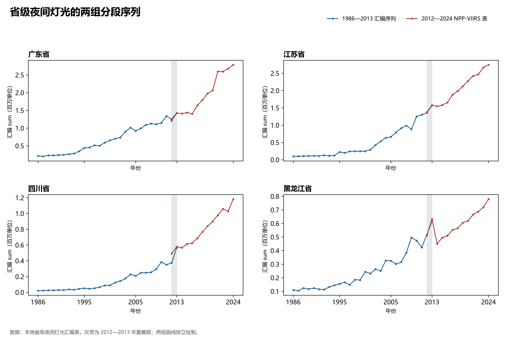

# 10.6 夜间灯光的分段时间序列

夜间灯光记录地表夜间照明的空间与时间变化，可用于观察人类活动分布。它与人口、产业和基础设施存在联系，但同一亮度变化可能对应不同过程。行政区汇总值将区内不同地点合并，解释时需要区分灯光总量、像元均值与空间形态。

## 一、为什么需要分段阅读

本地夜光统计工作簿分别提供“1986—2013（类 VIIRS NTL）”和“2012—2024（NPP-VIIRS）”两张表。两表均包含 sum、mean、count 等字段，具有 2012、2013 两个重叠年份。对内地 31 个省区市的 62 对重叠观测进行配对，像元数 count 均相同，但后一组 sum 与前一组 sum 的比值介于 **0.863 与 1.598**，中位数约 **1.021**。重叠期总体接近并不代表每个地区、每个年份都可直接拼接。

图 10-12 将两组序列分别绘出，保留重叠年份。蓝线和红线的连接关系不是一次无缝传感器交接；年度数值差异也不能直接归因于城市建设或某项政策。

**图 10-12 省级夜间灯光的两组分段序列**：广东、江苏、四川和黑龙江四个案例；灰带为重叠年份。纵轴为工作簿 sum 字段除以一百万，各面板的纵轴范围分别设置。

## 二、同一组序列内部的变化

2012—2024 年表中，广东、江苏、四川和黑龙江的汇总指标均增加，增幅分别约为 130.9%、99.8%、140.1% 和 52.3%。四省在这一表内各自的 count 均保持不变，因此上述比较不是由表中像元数增减直接产生。

| 省份 | 2012 年 sum | 2024 年 sum | 2012—2024 年变化 |
|:---|---:|---:|---:|
| 广东 | 1,206,626.75 | 2,786,062.50 | 130.9% |
| 江苏 | 1,373,029.50 | 2,743,213.50 | 99.8% |
| 四川 | 492,376.50 | 1,182,166.13 | 140.1% |
| 黑龙江 | 511,528.91 | 779,236.44 | 52.3% |

总量受行政区面积和像元数量影响，不能用省际 sum 排名代替人口密度、发展水平或照明效率排名。观察区域内部的扩张方向、建成区边缘和街区差异，需要原始空间栅格；判断灯光变化与经济活动的关系，还应与同口径的统计、土地覆盖及设施资料配合。

## 数据来源与适用范围

数据来自“夜间灯光数据—省份（1986—2024 年）”工作簿的两张原表。本节采用工作簿中的指标标度，不将 sum 写成未经核实的物理辐亮度单位。产品处理方法、传感器间校准和分区边界版本尚需原始产品说明支持；本节因此保留两组独立序列，不据此计算跨组的长期增长率。
