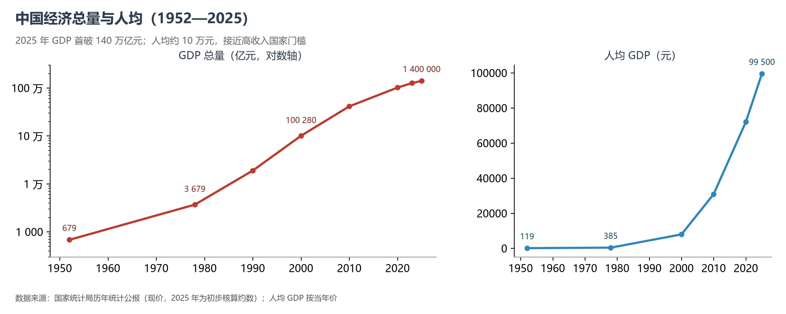
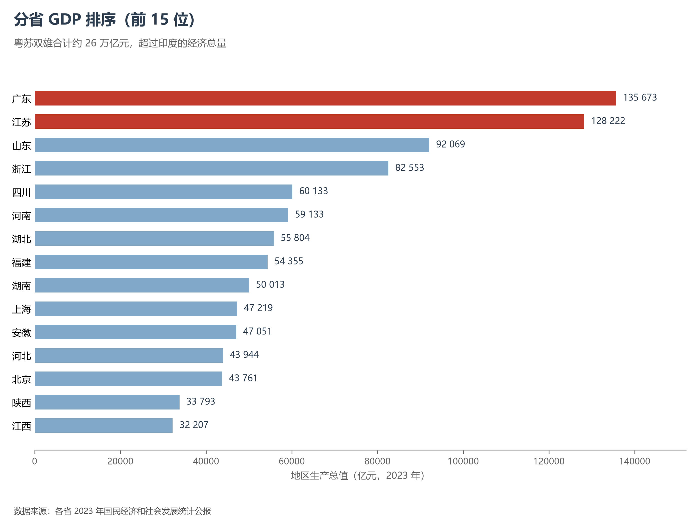
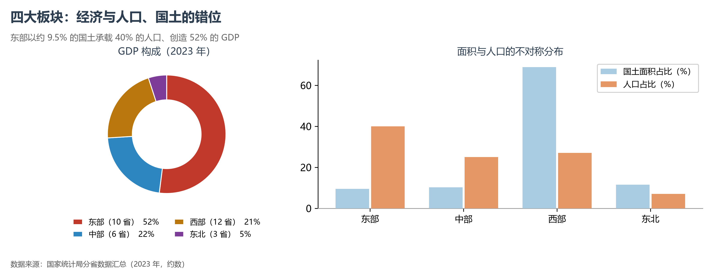

# 11.1 经济总量与区域格局

2025 年，中国国内生产总值（GDP）历史性突破 140 万亿元大关。按不变价格折算，这一体量已是 1952 年新中国统计初期的 200 余倍，中国由此持续稳居世界第二大经济体、全球第一大工业制造国与全球第一大货物贸易国。

然而，在宏观总量的耀眼数字之下，中国经济最具张力、最富内涵的画卷写在它的**空间地理账本**上：从改革开放初期东南沿海特区的单兵突进，到“东部率先、中部崛起、西部追赶、东北转型”的板块轮动，九百六十余万平方公里的国土正在经历一场人类历史上规模最大、复杂度最高的区域要素重组与生产力空间再造。

**图 11-1 中国经济总量与人均 GDP（1952—2025）**：对数轴上的增长曲线，改革开放是斜率的分水岭。

## 一、分省格局：“万亿俱乐部”与多梯队版图

中国 34 个省级行政区由于区位禀赋、资源储备、历史底蕴与开放程度的差异，形成了体量悬殊、分工明确的经济矩阵：

| 经济体量梯队 | GDP 门槛区间 | 涵盖省区市样本 (2024—2025) | 核心经济特征与主导支柱产业 |
|:---|:---|:---|:---|
| **“超级双雄”第一梯队** | 12 万亿元以上 | **广东** (~13.8 万亿)、**江苏** (~13.2 万亿) | 规模体量媲美世界前十经济体；全球消费电子与先进制造中枢；外贸第一大省与实体民营经济高地 |
| **十万亿冲刺第二梯队** | 6 万亿—10 万亿元 | **山东** (~9.8 万亿)、**浙江** (~8.6 万亿)、**四川** (~6.3 万亿)、**河南** (~6.1 万亿) | 工业门类最齐备的北方经济龙头（鲁）；数字经济与民营经济先行区（浙）；西南与内陆经济第一极（川豫） |
| **四至五万亿中坚梯队** | 4 万亿—6 万亿元 | **湖北**、**福建**、**湖南**、**安徽**、**上海**、**河北**、**北京** | 长江中游新兴智能制造走廊（鄂湘皖）；东部超高密度金融与科技创新双核极（京沪）；两岸融合与民营制造（闽） |
| **两至三万亿稳健梯队** | 2 万亿—4 万亿元 | **陕西**、**江西**、**辽宁**、**重庆**、**云南**、**广西**、**山西**、**内蒙古**、**贵州**、**新疆** | 能源矿产战略大基地（晋陕蒙新）；内陆制造与国际陆海门户（渝桂滇赣）；东北老工业转型重镇（辽） |
| **万亿以下生态屏障梯队** | 1 万亿元以下 | **天津** (~1.7 万亿)、**黑龙江** (~1.6 万亿)、**吉林** (~1.4 万亿)、**甘肃**、**海南**、**宁夏**、**青海**、**西藏** | 国家生态安全与边疆屏障；现代热带特色农林与自由贸易港（琼）；现代冰雪经济与老工业振兴基地 |

### 1. 粤苏“双雄”领跑：富可敌国的产业巨擘
- **广东省**（常住人口超 1.2 亿，GDP 近 14 万亿元）：已连续 36 年蝉联全国经济总量第一。以深圳、广州为双核的珠江三角洲，集聚了全球最密集的智能手机、通信设备、新能源汽车与工业机器人研发制造产业链。全省进出口总额突破 8 万亿元，独占全国外贸总额的近五分之一；
- **江苏省**（常住人口约 8500 万，GDP 超 13 万亿元）：全国制造业密度最高、区域发展最为均衡的省份。以苏南“万亿地级市群”（苏州、无锡、常州）为骨干，实体经济与外向型精密制造享誉全球。江苏拥有全国最多的“千亿县”（昆山、江阴、张家港、常熟等），实体工业增加值位列全国首位；
- 粤苏两省的经济总量相加，已超过印度、英国或法国的全年 GDP，构成了支撑中国经济抵御全球风浪的中流砥柱。

### 2. 梯度落差与集聚效应
排序表的另一端，西藏、青海的年度 GDP 分别在 2400 亿与 3800 亿元左右。最大省份与最小省份的 GDP 绝对体量相差逾 55 倍，远远高于两省之间的人口倍率差距（约 34 倍）。这种悬殊反映的不是贫富悬殊的制度性扭曲，而是现代工业文明向沿海优良港口、大平原交通枢纽深度集聚的客观地理规律，以及青藏高原作为“中华水塔”和生态保护红线必须实施的非工业化战略定位。

**图 11-2 分省 GDP 排序（前 15 位，2023 年）**：粤苏双雄领跑，浙鲁居第二梯队。

## 二、四大板块的不对称结构与空间错位

将国土面积、常住人口与 GDP 总量三维交织，中国呈现出深刻的“四大经济板块不对称格局”：

| 经济板块 | 涵盖省份数量 | 国土面积占比 | 常住人口占比 | GDP 总量占比 (2024) | 人均 GDP 区间 (万元/人) |
|:---|:---:|:---:|:---:|:---:|:---:|
| **东部地区** | 10 省市 (含京津冀鲁沪苏浙闽粤琼) | 9.5% | 39.8% | **52.2%** (~73.1万亿元) | 12.5 — 20.0 |
| **中部地区** | 6 省 (晋皖赣豫鄂湘) | 10.7% | 25.8% | **21.8%** (~30.5万亿元) | 7.0 — 9.5 |
| **西部地区** | 12 省区市 (川渝贵云藏陕甘青宁新桂蒙) | **71.4%** | 27.2% | **21.4%** (~30.0万亿元) | 5.2 — 9.0 |
| **东北地区** | 3 省 (辽吉黑) | 8.4% | 6.8% | **4.6%** (~6.4万亿元) | 5.8 — 7.2 |

这一不对称分布构成了中国空间经济最显著的几何特征：
1. **经济与人口的“东南倾” vs 国土的“西北大”**：东部 10 省市仅用全国不到十分之一的土地，孕育了全国一半以上的经济产值；而西部 12 省区市雄踞七成以上辽阔疆域，GDP 占比仅略超五分之一。这种反差映射出“胡焕庸线”两侧生态承载力与水热条件的刚性物理约束；
2. **人均 GDP 的阶梯状分异**：北京、上海的人均 GDP 已跨越 19 万元人民币（折合 2.7 万美元以上，达到初级发达经济体水准），江苏、浙江亦双双突破 12 万元；而在西北、西南和东北的部分欠发达省份（如甘肃、黑龙江、广西），人均 GDP 尚在 5 万—6 万元之间。最高省份与最低省份的人均极差达 3.5 倍以上，这正是国家坚定推进“西部大开发”、“东北全面振兴”与“中部崛起”战略的根本逻辑所在。

**图 11-3 四大板块的经济、人口与国土占比**：经济与人口的"东南倾"和国土的"西北大"互为镜像。

## 三、世界视角：世界第二背后的“三本大账”

从全球政治经济学的广角镜审视中国经济地理，必须读懂三本深层次的大账：

### 1. 结构账：从“世界制造大国”向“高附加值服务网络”攀升
中国拥有全球最庞大的实体制造业，制造业增加值占全球近 30%，超过美、德、日三国的总和，且是全球唯一拥有联合国产业分类全部工业门类的国家。然而，现代服务业（研发设计、现代金融、工业软件、知识产权）占 GDP 比重约 55%，与美欧成熟发达经济体（75%—80%）相比仍有显著差距。高端制造与现代生产性服务业的深度融合，是中国沿海与核心城市群未来跃升的主攻方向。

### 2. 人均账：跨越“中等收入陷阱”的临界考验
中国 14 亿人口的人均 GDP 已稳步突破 1.35 万美元，逼近世界银行设定的高收入国家门槛线（约 1.4 万美元）。在庞大的人口底座与深度老龄化少子化的双重约束下，中国不能单靠低成本劳动要素投入，而必须通过全要素生产率（TFP）的提升与新质生产力的突破，完成从“要素驱动”向“创新驱动”的惊险一跃。

### 3. 空间账：建设“全国统一大市场”的地理突围
以各省人均 GDP 的离散系数衡量，中国的区域内生差距远大于美国各州之间（如加州与密西西比州）的相对差距。各省区市历史上曾存在的行政壁垒、地方保护主义、招商引资税收恶性竞争与物流断头路，人为割裂了规模经济优势。构建“全国统一大市场”，破除地方行政藩篱，促进资本、技术、人才在东中西部顺畅对流，将中国辽阔的地理纵深与超大规模市场红利彻底释放，是中国经济长期可持续增长的最强护城河。

## 参考与数据来源

1. 全国经济总量与宏观指标：国家统计局历年《国民经济和社会发展统计公报》（2024—2025）、各省市统计局年度经济数据。
2. 区域经济板块统计口径：国家统计局《关于印发〈东西中部和东北地区划分方法〉的通知》。
3. 国际横向对比：世界银行（World Bank）WDI 数据库、国际货币基金组织（IMF）世界经济展望数据库。
