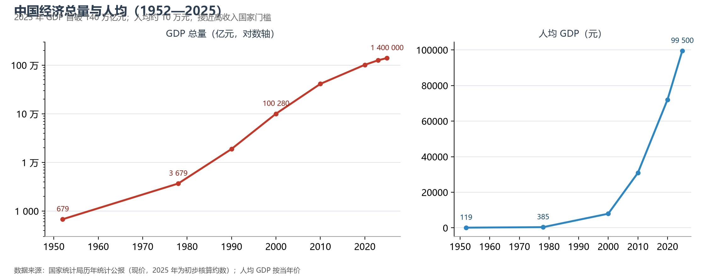
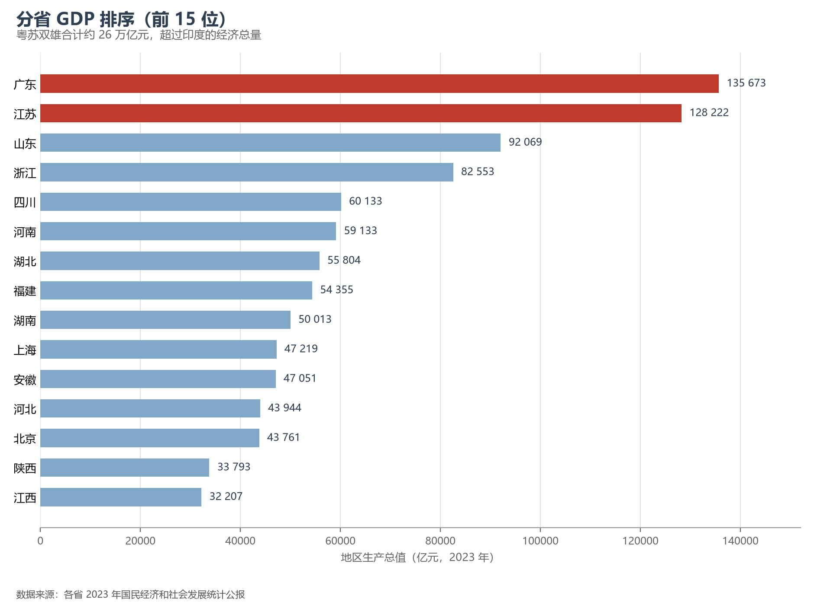
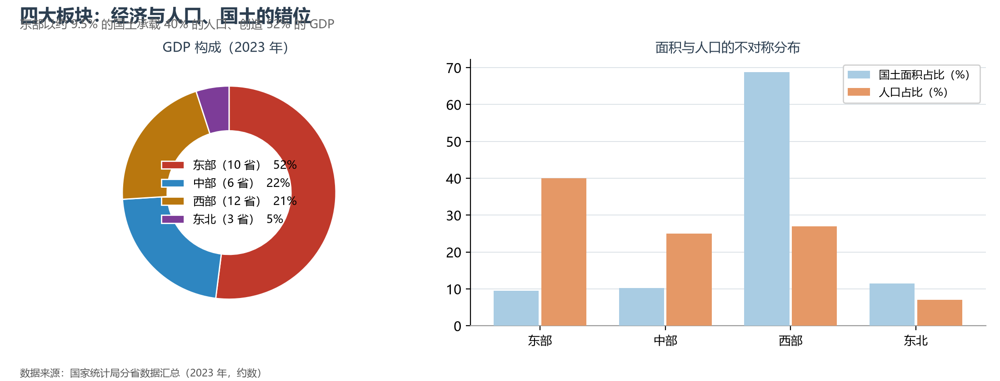

# 11.1 经济总量与区域格局

2025 年，中国国内生产总值首次突破 140 万亿元——按不变价计算是 1952 年的 200 余倍，稳居世界第二大经济体、最大制造业国家与最大货物贸易国。但中国经济的空间账本比总量更耐读：一部"东部先跑、中部跟上、西部追赶、东北转型"的板块轮动史。

**图 11-1 中国经济总量与人均 GDP（1952—2025）**：对数轴上的增长曲线，改革开放是斜率的分水岭。

## 一、分省格局：粤苏双雄与"万亿俱乐部"

广东、江苏两省 GDP 分别约 13.6 万亿与 12.8 万亿元（2023 年），合计超过印度的经济总量；全国 GDP 逾万亿元的城市已达 26 座。排序表的另一端是青海、西藏——最大与最小省份的经济差距约 55 倍，远大于人口差距，这正是经济集聚的体现。

**图 11-2 分省 GDP 排序（前 15 位，2023 年）**：粤苏双雄领跑，浙鲁居第二梯队。

## 二、四大板块的错位

把国土、人口与 GDP 摆在一起，四大板块呈现鲜明的不对称：东部 10 省市以约 9.5% 的国土承载 40% 的人口、创造约 52% 的 GDP；西部 12 省区市占有近七成国土，人口与 GDP 占比均约五分之一到四分之一；东北三省人口与经济占比均已降至 7% 与 5% 以下。人均 GDP 的极差同样清晰：北京、上海人均已超过 19 万元（相当于部分中等发达国家水平），而甘肃不足 5 万元——区域差距仍是中国最大的地理现实之一，也是西部大开发、中部崛起、东北振兴战略存在的理由。

**图 11-3 四大板块的经济、人口与国土占比**：经济与人口的"东南倾"和国土的"西北大"互为镜像。

## 三、世界视角：世界第二背后的三本账

第一本是**结构账**：中国制造业增加值占全球约 30%，是唯一拥有全部工业门类的国家，但服务业占比（约 55%）仍低于发达经济体 15—20 个百分点。第二本是**人均账**：人均 GDP 约 10 万元（约 1.35 万美元），刚接近高收入国家门槛（世界银行标准约 1.4 万美元），内需与生产率的接力决定能否跨过去。第三本是**空间账**：以人均 GDP 衡量的省际差距，中国显著大于美国州际差距——这既是中国经济纵深所在，也是"全国统一大市场"要拆除的隐性墙。

## 参考与数据来源

1. 全国数据：国家统计局《2025 年国民经济和社会发展统计公报》（GDP 首破 140 万亿元）。
2. 分省数据：各省 2023 年统计公报；制造业与服务业占比：国家统计局。
