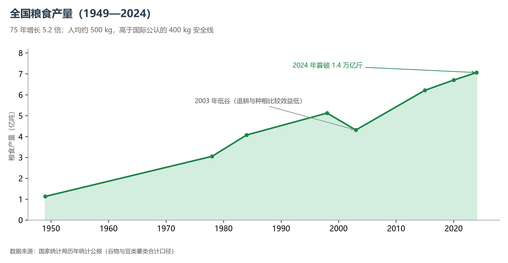
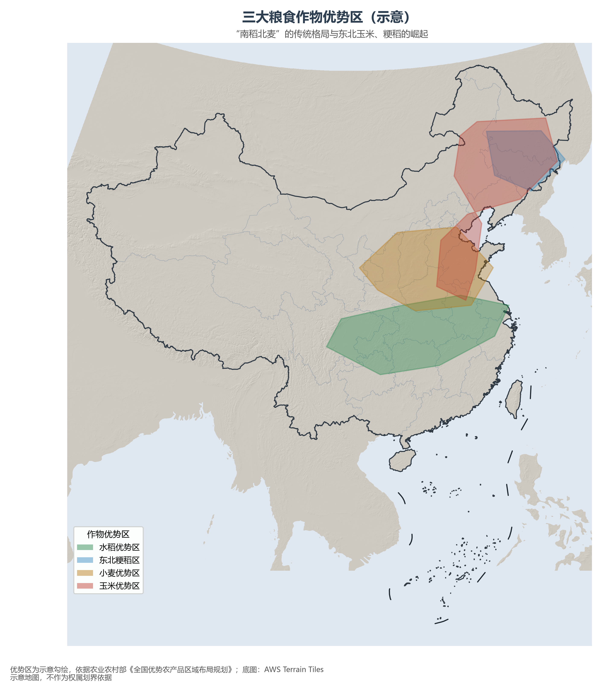

# 11.2 农业地理

2024 年，中国粮食总产量达到 14030 亿斤（约 7.015 亿吨），在连续九年稳定在 1.3 万亿斤台阶的基础上，历史上首次突破 **1.4 万亿斤** 新门槛。人均粮食占有量超过 495 公斤，显著高于联合国粮农组织划定的 400 公斤人均粮食安全国际公认线。

“以占世界 9% 的耕地和 6% 的淡水资源，养活了占世界近 18% 的人口”——这是中国农业地理最富史诗色彩的成就。这一奇迹的背后，是极具地带性规律的三大粮食作物带布局、农牧渔复合生产体系，以及当代中国粮食安全战略的坚强护航。

**图 11-4 全国粮食产量（1949—2024）**：75 年增长 5.2 倍；2003 年低谷后开启"十九连丰"。

## 一、“三大作物带”与“北粮南运”的历史地缘大逆转

传统农耕认知中的“南稻北麦”，已无法准确概括当代中国高度集约化、空间重构后的复杂粮食生产图谱。卫星遥感与国家统计数据清晰呈现出**水稻、小麦、玉米**三大粮食作物的现代空间优势带：

| 粮食作物 | 全年总产量 (万吨) | 核心优势产区省份 | 水热与地貌生境特征 | 空间生产格局与战略功能 |
|:---|:---:|:---|:---|:---|
| **水稻 (稻谷)** | ~20600 | 湖南、黑龙江、江西、安徽、湖北、江苏、四川、广东 | 秦岭—淮河以南水网平原与丘陵（双季稻/单季稻）；东北温带平原黑土湿地（单季优质粳稻） | 中国口粮第一大支柱；长江流域南方传统籼稻与东北高品质粳稻“南北并立” |
| **小麦** | ~13800 | 河南、山东、安徽、河北、江苏、新疆、陕西、湖北 | 华北平原、黄淮海冲积平原、汾渭谷地；年降水 400—800 mm，光热充足、土层深厚 | 口粮第二大支柱；黄淮海主产区占全国小麦产量 75% 以上，冬小麦夏玉米一年两熟 |
| **玉米** | ~29000 | 黑龙江、吉林、内蒙古、山东、辽宁、河南、河北、新疆 | 东北平原松嫩平原、黄淮海平原、西南喀斯特丘陵；温带半湿润平原，喜光喜温耐旱 | 全国播种面积与总产量第一的作物；核心饲料粮与深加工原料；沿“镰刀弯”集中布局 |

### 1. 东北粳稻崛起与全国粮仓重心的向北漂移
在三大主粮中，水稻版图的北扩最富革命性：过去被视为高寒荒野的东北黑土地（三江平原、松嫩平原），依托大型农田水利灌溉体系、水库提水与耐寒优质粳稻育种技术的飞跃，迅速崛起为全国最大的粳稻主产区。黑龙江省水稻种植面积与商品稻产量连续多年位居全国第一，生产了全国 30% 以上的商品粳米，使得“东北大米”成为全国优质口粮代名词。

### 2. “南粮北运”到“北粮南运”的历史性大逆转
- **古代运河时代（南粮北调）**：先秦至明清两千余年，由于南方水热丰沛、水稻高产，朝廷始终依赖京杭大运河将江南、江淮的漕粮源源不断北运，供养北方的京师百官、边关戍卒与平原平民；
- **当代工业化时代的地理翻转（北粮南运）**：改革开放后，东南沿海平原（珠三角、苏南、闽南、浙东）因高速工业化和城市化，大批良田转变为厂房道路，高附加值的花卉、果蔬、水产养殖取代了传统口粮；与此同时，北方依托机井开采深层地下水、大型农机作业与化肥普及，旱地粮食单产成倍提升。
- 如今，黑龙江、吉林、内蒙古、河南四省区贡献了全国一半以上的跨省调出粮。每年秋后，数以千万吨计的玉米、大豆与稻谷经由哈大、京哈铁路专列与营口、大连等北方港口沿海南下，驶向广东、浙江、福建、上海等主销区，构成了维系现代中国粮食供需的超级大动脉。

**图 11-5 三大粮食作物优势区（示意）**：水稻、小麦、玉米的优势产区与商品粮基地高度重合。

## 二、13 大粮食主产省与粮食安全的“四道制度防线”

在全国 31 个省区市中，国家科学划定了 **13 个粮食主产省**（黑龙江、河南、山东、安徽、吉林、河北、江苏、内蒙古、四川、湖南、湖北、江西、辽宁）。这 13 个主产省以全国约 65% 的耕地面积，贡献了全国 78% 以上的粮食总产量与 85% 以上的商品粮调出量：
- **黑龙江省**：年粮食产量逼近 1600 亿斤（约 8000 万吨），占全国粮食总产量的九分之一，相当于全省不仅养活了自身 3100 万常住人口，还能调出足够供给 1.5 亿人一整年消耗的口粮，是名副其实的“中华大粮仓”；
- **河南省**：以全国十分之一的小麦产量保障着国人的面案，生产了全国二分之一的火腿肠、三分之一的方便面、四分之三的汤圆和冷冻水饺。

为守住 14 亿多中国人的饭碗，国家确立了不可逾越的**四道制度防线**：
1. **坚守 18 亿亩耕地红线**：第三次全国国土调查明确将 18.65 亿亩耕地和 15.46 亿亩永久基本农田作为刚性指标，实行“长牙齿”的硬措施，严禁耕地“非农化”、防止“非粮化”；
2. **建设 10 亿亩高标准农田**：在平原盆地平整土地、连通渠网、硬化机耕道，建成“旱涝保收、高产稳产、生态友好”的现代化良田；
3. **深入推进“种业振兴”行动**：攻关核心种源，水稻、小麦实现 100% 自主选育，大豆、玉米高产耐密耐旱新品种培育提速，杜绝“洋种子卡脖子”；
4. **粮食安全党政同责与利益补偿**：打破过去“产粮大县往往是财政穷县”的逆向激励怪圈，建立主产区与主销区省际横向利益补偿机制，由东南粮食净调入省份向北方粮食调出省份提供财政与产业补偿，确保“种粮抓粮者不吃亏”。

## 三、“大食物观”与多元食物供给体系的地理重塑

在人均热量供给充分保障的今天，居民膳食结构正由“吃得饱”向“吃得健康、营养多元”加速演进。国家明确提出树立**“大食物观”**，超越传统仅向耕地要热量的局限，向森林、草原、江河湖海全域拓展食物资源空间：

| 农业食物部门 | 战略地位与规模指标 | 核心地理产业集聚带 | 空间生态适应性机制 |
|:---|:---|:---|:---|
| **设施蔬菜与果品** | 全球第一大蔬菜与水果生产国；年产蔬菜逾 8 亿吨 | 山东寿光、河北沧州、江苏盐城、甘肃河西走廊、海南三亚（南菜北运） | 日光温室与智能大棚技术突破季节与气温限制；戈壁农业不占农田开发非耕地光热 |
| **现代畜牧业** | 全球第一大猪肉生产国；年出栏生猪近 7 亿头 | 河南、四川、湖南、山东、湖北、河北、内蒙古、新疆 | 生猪养殖向玉米粮食就地产区与环保容量大区集聚；内蒙古新疆天然草场实施草畜平衡 |
| **水产养殖业** | 全球第一大水产国；水产养殖产量占全球 60% 以上 | 湖北（千湖之省淡水养殖）、广东、江苏、山东、福建、浙江（沿海近海与深海） | 全球唯一养殖水产总量超过野外捕捞量的渔业大国；深海大型智能网联养殖工船破浪走向深蓝 |
| **林下经济与木本粮油** | 油茶、核桃、板栗、林下食用菌与中药材 | 湖南湘西（油茶）、贵州山区、秦巴山地、黑龙江小兴安岭（林下黑木耳） | 充分挖掘丘陵山地垂直空间与林下漫射光；发展木本油料补充耕地大豆食用油缺口 |

## 四、世界视角：口粮绝对安全与大豆供应链隐忧

审视中国农业地理的全球账本，呈现出“口粮绝对安全”与“饲料蛋白高度依赖外部供应链”的二元特征：
- **绝对安全的口粮底座**：中国小麦、稻谷的自给率连续多年超过 100%，两大口粮库存充沛，不仅能平抑全球粮价动荡带来的通胀冲击，更在突发自然灾害面前拥有数年以上的从容储备；
- **不可忽视的结构性软肋——大豆与油料**：为保障粮食口粮绝对安全，中国有限的耕地资源向水稻和小麦倾斜，使得种植密度低、单产相对较少的大豆种植面积受到压缩。中国每年进口大豆逾 **1 亿吨**，对外依存度常年超过 80%，进口来源高度集中于南美巴西（占约 70%）与北美美国（占约 20%）。进口大豆主要用于榨取食用大豆油与提供高蛋白豆粕（饲料工业的命脉基石）；
- **应对之策**：国家正通过“大豆玉米带状复合种植”在黄淮海和西南地区推广间套作技术，同时积极开拓黑海沿岸、南美以及非洲等“一带一路”多元化农产品进口走廊，构建全球韧性农业供应链。

## 参考与数据来源

1. 粮食与农业年度统计：国家统计局《中国统计年鉴》（2024）、农业农村部年度农村经济统计公报。
2. 耕地资源与土地利用底数：自然资源部、国家统计局《第三次全国国土调查主要数据公报》。
3. 渔业与水产养殖数据：农业农村部渔业渔政管理局《中国渔业统计年鉴》（2024）。
4. 国际农业贸易监测：联合国粮农组织（FAO）数据库、中国海关总署农产品进出口月度统计。
