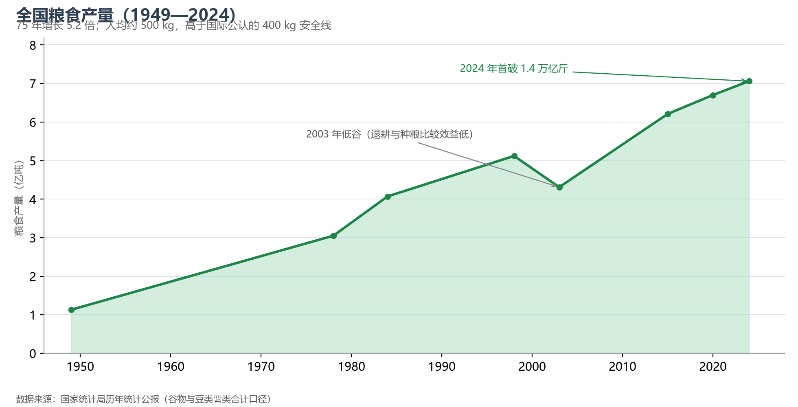
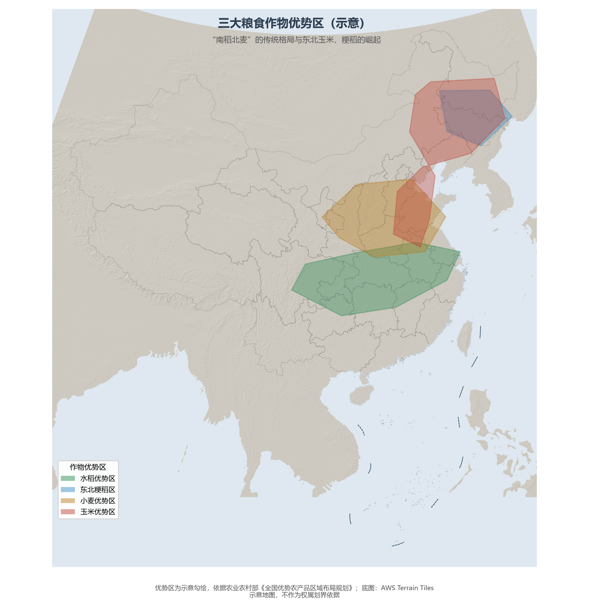

# 11.2 农业地理

2024 年，全国粮食产量首次站上 1.4 万亿斤（7.06 亿吨）——连续多年稳定在 1.3 万亿斤以上，人均占有量约 500 kg，高于国际公认的 400 kg 安全线。用世界 9% 的耕地养活近 18% 的人口，是中国农业地理最凝练的一句话。

**图 11-4 全国粮食产量（1949—2024）**：75 年增长 5.2 倍；2003 年低谷后开启"十九连丰"。

## 一、"南稻北麦"与三大作物带

传统格局是"南稻北麦"，但卫星与统计描绘的当代版图更为立体：

- **水稻**：仍是第一大口粮，秦岭—淮河以南的长江流域是绝对主区，而东北粳稻区（黑龙江水稻面积全国第一）的崛起改写了"北大荒"的定义；
- **小麦**：集中华北平原与黄淮海地区（豫、鲁、皖、冀四省产量过半），冬小麦—夏玉米的一年两熟是这片土地的标准节律；
- **玉米**：播种面积已居粮食作物之首，从东北平原经黄淮海延伸到西南山地，"镰刀弯"地区调减后向优势区集中。

**图 11-5 三大粮食作物优势区（示意）**：水稻、小麦、玉米的优势产区与商品粮基地高度重合。

## 二、商品粮基地与粮食安全战略

全国 13 个粮食主产省贡献了约 75% 的产量，其中黑龙江（约 7 800 万吨）、河南、山东、吉林、内蒙古居前——"北粮南运"取代了历史上的"南粮北运"。背后的制度安排是"粮食安全党政同责 + 耕地红线 + 高标准农田 + 种业振兴"的组合拳；区域补偿机制（主销区向主产区支付补偿）正在把"谁种粮谁吃亏"变成"谁种粮谁受益"。

## 三、农牧渔与"大食物观"

农业地理不止于粮食：畜牧业集中于内蒙古、新疆、河北的草原与农区 hybrid 带，生猪养殖向粮食主产区（河南、四川、湖南）集中；渔业以水产养殖为主（占渔业产量近八成），养殖产量占全球六成以上；设施农业（蔬菜大棚）在山东寿光等地形成了全国性"菜篮子"枢纽。"大食物观"正把食物来源从耕地扩展到森林、草原、湖泊与海洋——向江河湖海要热量蛋白，是中国人饭局的下一个边疆。

## 四、世界视角：单产奇迹与隐忧

中国三大主粮单产已达世界先进水平（水稻单产约为世界平均的 1.6 倍），化肥农药使用量在零增长行动后连年下降。隐忧同样写在账本上：大豆对外依存度超过八成，饲料粮的进口通道集中在巴西与美国——粮食安全的"卡脖子"不在主粮而在蛋白。农业地理的下一章，将是"藏粮于地、藏粮于技"与全球农业供应链布局的双线并进。

## 参考与数据来源

1. 粮食产量与主产区：国家统计局历年统计公报、农业农村部公开数据。
2. 作物优势区：农业农村部《全国优势农产品区域布局规划》；水产与畜牧：《中国渔业统计年鉴》《中国畜牧兽医年鉴》。
