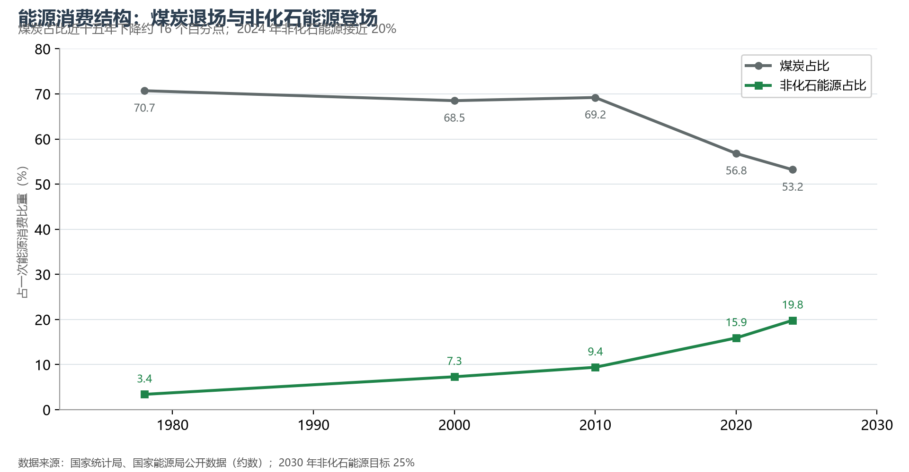

# 11.3 工业与能源

中国是全球工业体系最完整的国家：联合国产业分类中全部 41 个工业大类、207 个中类、666 个小类一应俱全；制造业增加值占全球约 30%，相当于第二名到第十名的总和。工业的地理是一张"基地地图"，能源的地理是一张"西电东送、北煤南运、西气东输"的调度图——两张图叠在一起，就是中国经济的骨架。

## 一、四大工业基地：从辽中南到珠三角

- **辽中南**：共和国工业长子，钢铁（鞍山）、石化（大连）、装备制造（沈阳）的重镇，正经历老工业基地的转型阵痛；
- **京津唐（京津冀）**：科技研发与高端制造并举，北京向"研发脑"转型、天津与河北承接制造与重化；
- **沪宁杭（长三角）**：规模最大、门类最全的综合性工业基地，从集成电路（上海、无锡）到新能源汽车（合肥、常州）再到船舶（南通），产业链纵深全球罕见；
- **珠三角**：从"三来一补"起家的世界工厂，已升级为全球电子信息与智能制造的高地——深圳—东莞—广州的产业走廊聚集了全球约七成的消费电子代工产能。

中西部承接产业转移的"新基地"正在改写地图：重庆的笔电与汽车、郑州的智能手机、西安的半导体、贵阳的大数据——"东数西算"与产业西移让内陆省份第一次站上高端制造的起跑线。

## 二、能源生产与消费：世界最大的能源系统

中国一次能源生产与消费总量均居世界第一。消费结构正在历史性换挡：煤炭占比从 1978 年的 70.7% 降至 2024 年的约 53%，非化石能源占比升至约 20%——2024 年可再生能源新增装机占全国新增装机的八成以上，风电光伏累计装机突破 14 亿千瓦，超过煤电。"双碳"目标（2030 碳达峰、2060 碳中和）把这条换挡曲线写进了国家承诺。

**图 11-6 能源消费结构演变**：煤炭占比下降与非化石能源占比上升的两条曲线。

## 三、资源与消费的错位：三大调度工程

能源地理的核心矛盾是"资源在西部、消费在东部"：煤炭集中于晋陕蒙新（四省区产量占全国八成以上），水能在西南，风、光在"三北"与青藏，而负荷中心在东部沿海。三大国家级工程由此而生：**西电东送**（南、中、北三通道，特高压线路累计输送能力逾 3 亿千瓦）、**西气东输**（一线至四线，管道年输气能力逾千亿立方米）、**北煤南运**（大秦线、浩吉铁路两条亿吨级运煤通道）。中国建成了全球规模最大的特高压输电网络——"电从远方来"是东部城市的隐形命脉。

## 四、世界视角：世界工厂的两面

世界工厂的另一面是世界最大的能源与原料进口方：原油对外依存度约七成、天然气约四成、铁矿石约八成。供应链安全因此成为工业地理的新变量——新能源产业链（光伏、锂电、风电）中国占全球产能的一半到九成，把"资源约束"转化为"制造优势"，是过去十年最成功的产业地理重写。下一个十年，绿电富集的西部将成为"东数西算"与绿色氢氨的新工业区——能源地图正在从"西煤东运"转向"西电东送、西绿东用"。

## 参考与数据来源

1. 制造业占比与工业门类：工业和信息化部、国家统计局公开资料。
2. 能源结构：国家统计局、国家能源局历年公报；风光装机：国家能源局 2024 年全国电力工业统计。
3. 特高压与油气管道：国家电网、中国石油公开数据。
