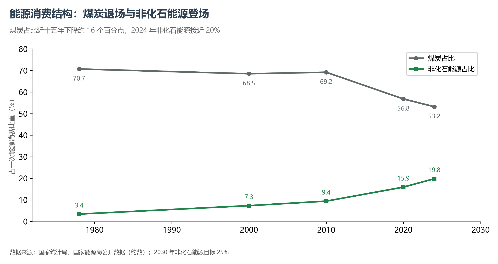
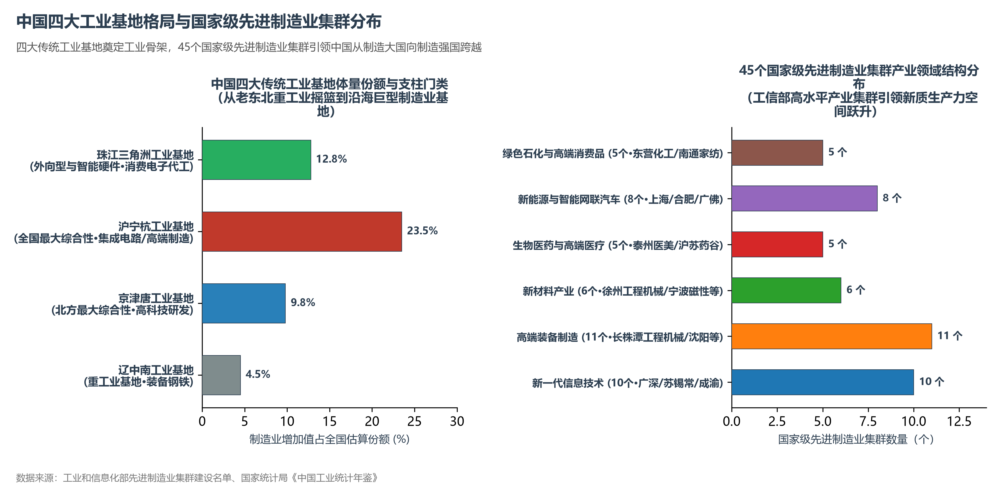

# 11.3 工业与能源

中国拥有当今世界规模最庞大、门类最齐全、产业配套最完备的工业体系：在联合国产业分类所列出的全部 41 个工业大类、207 个工业中类、666 个工业小类中，中国是全球唯一一个全谱系涵盖的国家。制造业增加值占全球比重接近 30%，超过了美国、日本、德国三国的总和。

工业的本质是“用能源将原料加工为产品”，因此工业地理与能源地理互为表里。如果把中国工业的实体看作一张由沿海向内陆梯次延展的“基地地图”，那么能源系统就是一张由“西电东送、西气东输、北煤南运”交织而成的空间输血网络。两张巨网的深度耦合，构成了中国现代化进程最强劲的动力引擎。

**图 11-6 能源消费结构演变**：煤炭占比下降与非化石能源占比上升的两条曲线。

## 一、能源生产与消费：世界最大能源系统的“双碳”换挡

中国既是全球第一大能源生产国，也是第一大能源消费国。在迈向“2030 年前碳达峰、2060 年前碳中和”的战略牵引下，中国能源消费结构正在发生历史性的绿色跨越：

| 能源类别 | 消费占比演进 (1978 → 2024) | 核心资源富集大区 | 战略定位与演变态势 |
|:---|:---:|:---|:---|
| **煤炭** | **70.7% → 约 53.5%** | 山西、内蒙古、陕西、新疆（“晋陕蒙新”产煤占全国 80% 以上） | 压舱石与兜底保障；从粗放燃烧转向清洁高效利用、超低排放坑口燃煤发电与煤化工深加工 |
| **石油** | 22.7% → 约 18.2% | 大庆（松辽盆地）、胜利（渤海湾）、塔里木盆地、鄂尔多斯盆地 | 工业血液与战略化工原料；原油对外依存度超 70%；深海油气（渤海、南海）突破 |
| **天然气** | 3.2% → 约 8.8% | 四川盆地（页岩气/致密气）、塔里木盆地、鄂尔多斯盆地、柴达木盆地 | 低碳过渡清洁桥梁；常规天然气与非常规页岩气并举；天然气对外依存度约 40% |
| **非化石能源 (水/风/光/核)** | **3.4% → 约 19.5%** | 水电在西南（川滇藏）；风光在“三北”（西北/华北/东北）；核电在沿海（粤浙闽鲁苏） | 新时代主力增量；风电光伏累计装机突破 14 亿千瓦超越煤电；核电在运在建规模领跑全球 |

中国能源地理最核心的天然矛盾，在于**资源禀赋与用电负荷的空间大错位**：
- **资源端在“西”在“北”**：80% 以上的煤炭储量和产量集中在晋陕蒙新；80% 的可开发水能蓄积在西南金沙江、雅砻江、大渡河与澜沧江；全国 70% 以上的陆上风能与太阳能富集在西北荒漠戈壁；
- **消费端在“东”在“南”**：京津冀、长三角、粤港澳大湾区以及沿江城市群，消耗了全国 70% 以上的电力与化石能源。这一巨大地理反差，催生了举世瞩目的三大跨区域能源调度超级工程。

## 二、四大传统工业基地与先进制造业集群跃迁

从历史地理看，中国现代工业沿着沿海大动脉与大江大河依次铺展，演化出各具千秋的**四大传统工业基地**；而进入新发展阶段，以工信部评选的 **45 个国家级先进制造业集群** 为龙头，中国工业空间正由“粗放重化集聚”向“协同创新网络”全维跃迁：

**图 11-7 中国四大工业基地格局与国家级先进制造业集群分布**：四大传统工业基地奠定工业骨架，45个国家级先进制造业集群引领中国从制造大国向制造强国跨越。

### 1. 四大传统工业基地的深层解构
1. **辽中南重工业基地（沈阳、大连、鞍山、本溪）**：
   - 依托丰富的铁矿（鞍山）、煤炭（抚顺）与便利海港，新中国“一五”时期奠定了共和国工业长子的地位。以鞍钢、沈飞、大连船舶重工等重型机械、国防军工、舰船海工与石化为支柱。当前正大力推进传统装备的智能化、绿色化改造，摆脱重工业路径依赖；
2. **京津唐工业基地（北京、天津、唐山、廊坊）**：
   - 北方最大的综合性工业基地。北京依托中关村与科研院所主攻人工智能、生物医药与工业软件研发设计；天津主攻航空航天（空客总装线）、先进动力电池与高端石化；唐山依托曹妃甸优良深水大港发展千万吨级精品特钢与绿色化工；
3. **沪宁杭（长三角）工业基地（上海、南京、杭州、苏州、无锡、常州、宁波）**：
   - 全球规模最大、门类最齐全、创新密度最高的综合性工业基地。在集成电路设计与晶圆制造（上海张江、无锡）、大飞机整机与大客机航电系统（中国商飞）、新能源汽车与动力电池（合肥、常州）、高技术船舶与海工装备（南通）等高精尖领域构建起全球无与伦比的“一小时配套圈”；
4. **珠江三角洲工业基地（广州、深圳、东莞、佛山、珠海、中山）**：
   - 改革开放初期从“三来一补”三工轻纺起家，经过四十余年蜕变，升级为全球最高效的电子信息、通信终端、工业无人机与智能家电创新高地。深圳华为、腾讯、大疆，东莞生益科技、OPPO、vivo 与佛山美的，构筑起全球七成消费级硬件电子从图纸到量产仅需 48 小时的超敏捷供应链。

### 2. 45 个国家级先进制造业集群的空间重组
国家先进制造业集群重点聚焦六大核心战略领域，打破了传统“行政区划割据”的界限：
- **新一代信息技术集群（10 个）**：深圳—东莞新一代电子信息、广佛惠超高清视频和智能家电、成渝电子信息、长三角集成电路等；
- **高端装备制造集群（11 个）**：长沙工程机械、沈阳高端装备制造、株洲先进轨道交通装备、西安航空产业等；
- **新能源与智能网联汽车集群（8 个）**：上海汽车产业、广佛汽车产业、长三角新能源汽车产业集群；
- **中西部内陆新型工业增长极的壮丽突围**：成渝地区智能手机与笔电产量独占全球三分之一；武汉“中国光谷”光纤光缆占全球市场 25%；西安闪存芯片与新能源整车基地声名显赫；贵州利用清凉气候与廉价绿电打造全国最大大数据机房走廊。中西部不再是单纯的原材料输出地，而是成为了支撑中国高精尖产业的关键战略大后方。

## 三、三大跨区域能源调度网络与特高压革命

为破解“西资东耗”的地理阻隔，中国构筑起世界规模最大的超级能源传输网络：

| 能源大通道 | 空间走向与骨干走廊 | 输送能力与规模指标 | 关键工程与地缘价值 |
|:---|:---|:---|:---|
| **西电东送** | **北通道**：晋蒙陕甘宁新 → 京津冀鲁 **中通道**：川渝藏（长江干流） → 华中长三角 **南通道**：云贵（澜沧江/南盘江） → 粤港澳 | 跨省跨区输电能力超 **3 亿千瓦**；特高压交直流线路 40 余条 | 世界首创 ±800 kV 直流与 1000 kV 交流特高压技术；白鹤滩—江苏/浙江、向家坝—上海特高压工程，千里江水闪电送达 |
| **西气东输** | **一线至四线**：新疆塔里木/中亚边境 → 长三角/珠三角/华中 **川气东送**：四川达州/普光气田 → 沪苏浙皖 | 干支线管道总长超 4 万公里；年输送天然气能力超 **1500 亿立方米** | 终结东部大城市燃煤供气历史；中亚—土库曼斯坦跨境气田与塔里木沙漠深层气贯通连轴 |
| **北煤南运** | **铁运三横一纵**：大秦铁路（4亿吨级）、朔黄铁路、瓦日铁路（重载大通道）；浩吉铁路（纵贯南北大动脉） | 年外运煤炭超 **10 亿吨**；重载万吨列车全自动化运行 | 大秦铁路是世界年运量最大的重载电气化铁路；浩吉铁路直通两湖一江，填补华中内陆煤炭缺口 |

## 四、世界视角：制造强国与新能源安全双重跨越

作为“世界工厂”，中国对外部能源与矿产原料的依存度依然可观：原油对外依存度常年超 70%，天然气超 40%，高品位铁矿石对外依存度超 75%。然而，中国正在通过一场深刻的工业能源革命改写地缘竞争规则：
- 在太阳能光伏组件（硅料、硅片、电池片）、动力锂电池与新能源汽车“新三样”领域，中国掌握了全球 60% 至 90% 的产能与绝大部分核心专利；
- 过去以石油、煤炭等地下不可再生化石资源为核心的传统工业地缘政治，正加速转变为以可再生制造装备、智能电网与关键金属精炼（稀土、锂、钴、镍）为主导的新型工业地缘格局。中国不仅是工业产品的全球供应中心，更成为了引领全球低碳转型最重要的绿色技术母机。

## 参考与数据来源

1. 工业规模与门类全谱系：工业和信息化部年度工业发展报告、国家统计局《中国工业统计年鉴》（2024）。
2. 先进制造业集群认定：工业和信息化部《关于公布国家先进制造业集群名单的通知》。
3. 能源消费结构与电网外送：国家能源局年度电力工业统计公报、国家电网与南方电网《特高压西电东送工程年报》。
4. 煤炭与油气管道运行：中国煤炭工业协会发展报告、中国国家管网集团油气干网运行监测数据。
