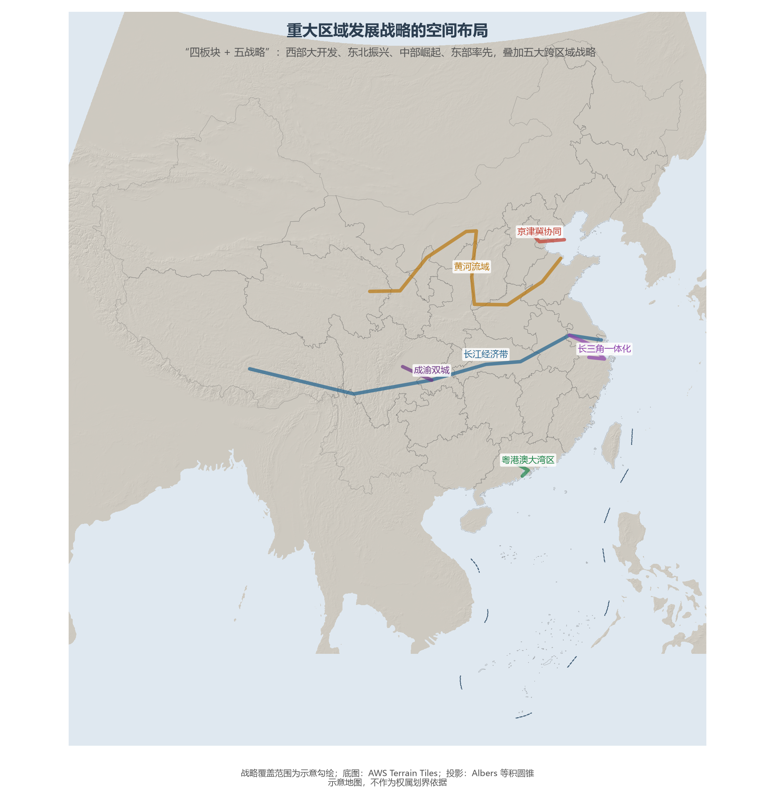

# 11.4 区域发展战略

如果为当代中国经济地理画出一张"战略叠加图"，会发现层层叠叠的圈与线：四大板块的总体战略打底，五条跨区域战略干道穿针，十余个城市群战略落子。理解这些战略，就是理解国家如何用政策梯度对冲市场的马太效应。

**图 11-7 重大区域发展战略的空间布局**：长江经济带与黄河流域一南一北横贯东西，京津冀、长三角、大湾区、成渝构成四极。

## 一、四大板块：总体框架

- **西部大开发**（2000 年启动）：从基建补课到"新时代推进西部大开发形成新格局"（2020 年），西部的角色从"资源供给地"转向"生态屏障 + 能源基地 + 开放前沿"（中欧班列与陆海新通道的起点）；
- **东北全面振兴**（2003 年振兴老工业基地，2023 年新时代推动东北全面振兴）：从"投资不过山海关"的困境中寻找粮食（全国 1/4 粮食产量）、装备制造与沿边开放的翻盘变量；
- **中部地区崛起**（2006 年）：承东启西的制造业转移主承接地，湖北、湖南、安徽、河南构成"新中部工业带"；
- **东部率先发展**：创新驱动与制度型开放（自贸区、自贸港）的主战场。

## 二、五条战略干道

**京津冀协同发展**（2014）以疏解北京非首都功能为"牛鼻子"，雄安新区是千年大计的落子；**长三角一体化**（2018）升格为国家战略，沪苏浙皖以"一网通办"率先试验要素市场统一；**粤港澳大湾区**（2019 纲要）探索跨制度的大湾区市场；**长江经济带**（2014）以"共抓大保护、不搞大开发"重塑沿江产业布局——覆盖 11 省市、贡献全国近半 GDP 的黄金水道带；**黄河流域生态保护和高质量发展**（2019）则把生态约束写在了北方母亲河的流域治理中。

## 三、从"梯度"到"轴带"

中国区域战略的空间逻辑正在演变：1980 年代的"经济特区—沿海开放"是点状试验，1990 年代的"梯度推进"假设雁阵有序飞，今天的战略则是"轴带 + 圈群"——长江、黄河两条轴带贯通东西，五大城市群构成增长极，中欧班列与西部陆海新通道再把内陆钉进全球供应链。区域政策的坐标系已从"让一部分地区先富起来"切换为"在统一大市场中实现区域协调"。

## 参考与数据来源

1. 战略文件：中共中央、国务院《关于建立更加有效的区域协调发展新机制的意见》、各区域战略规划纲要。
2. 板块划分：国家统计局四大经济板块口径。
