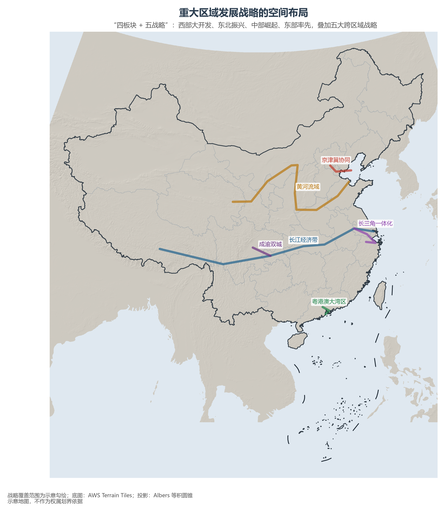

# 11.4 区域发展战略

若为当代中国经济地理绘出一幅空间治理蓝图，映入眼帘的必是由四大板块、跨区域战略干道、重大江河流域协同与多极城市群相互交织的壮丽网络。

自由放任的市场力量往往天然趋向于资金与人才向少数沿海特大城市单向极化集聚（马太效应）；而中国特色社会主义制度的最显著优势，正是能够通过具有高度预见性、超大尺度的**国家区域协调发展战略**，构筑跨板块、跨流域的转移支付与基础设施反哺网络，确保辽阔国土在多元分工中迈向共同富裕。

**图 11-8 重大区域发展战略的空间布局**：长江经济带与黄河流域一南一北横贯东西，京津冀、长三角、大湾区、成渝构成四极。

## 一、“四大板块”统筹：筑牢国家空间经济底座

国家区域协调发展战略以“四大经济板块”为总体框架，根据各板块资源环境承载能力与比较优势，赋予其差异化战略使命：

| 经济板块 | 启动与深化历程 | 核心战略定位 | 关键政策抓手与破局变量 |
|:---|:---|:---|:---|
| **西部大开发** | 2000 年全面启动；2020 年印发《关于新时代推进西部大开发形成新格局的指导意见》 | 大生态、大开放、大能源、大安全战略纵深；新时代陆海内外联动枢纽 | 西部陆海新通道、成渝双城经济圈、“沙戈荒”风光大基地、边境口岸与中欧班列始发枢纽 |
| **东北全面振兴** | 2003 年实施振兴东北老工业基地；2023 年新时代推动东北全面振兴座谈会 | 国家国防安全、粮食安全、生态安全、能源安全、产业安全的战略“五大安全”压舱石 | 现代化大农业高标准建设、传统高端装备数字化重塑、向北开放新前沿（中俄经贸走廊与冰雪经济） |
| **中部地区崛起** | 2006 年确立促进中部崛起；2021 年印发新时代推动中部地区高质量发展的意见 | 承东启西的重要先进制造业基地、现代农业高地与综合交通枢纽 | 长江中游城市群与中原城市群联动；高质量承接沿海万亿级电子信息与装备制造转移 |
| **东部率先发展** | 改革开放发端；新时代确立“走在前列、勇挑大梁” | 创新驱动主引擎、世界级产业集群策源地与制度型对外开放前沿 | 自贸试验区与海南自由贸易港；高水平原始创新大科学装置；“共同富裕示范区”（浙江） |

## 二、跨区域重大战略：轴带贯通与江河大协同

在四大板块之上，中央系统确立了贯通东西、连接陆海的跨流域重大战略，推动经济地理从“割裂的行政区经济”走向“全流域大协同”：

### 1. 长江经济带战略：共抓大保护，不搞大开发
- **空间跨度**：覆盖沿江 11 个省市（上海、江苏、浙江、安徽、江西、湖北、湖南、重庆、四川、贵州、云南），面积约 205 万平方公里，人口和 GDP 均占全国 40% 以上；
- **治理哲学根本转型**：彻底摒弃过去“各自截流、化工围江、过度排污”的野蛮扩张模式。严格推行沿江 1 公里内严禁新建重化工园区、长江干流“十年禁渔”等铁腕措施，实现了长江干流水质全线持续保持 Ⅱ 类；
- **综合立体走廊**：依托长江黄金水道（世界内河货运量第一）推进三峡枢纽水运新通道建设，联动沿江高速铁路与港口枢纽，构筑以沪苏浙为龙头、中上游各节点无缝协同的绿色发展巨型横轴。

### 2. 黄河流域生态保护和高质量发展：母亲河的绿色誓言
- **空间跨度**：涵盖沿黄 9 个省区（青海、四川、甘肃、宁夏、内蒙古、陕西、山西、河南、山东），是北方生态屏障、粮食主产区与现代能源走廊；
- **“四水四定”刚性红线**：黄河流域水资源总量仅为长江的 7% 左右，水资源开发利用率高达 80%（远超 40% 的生态警戒线）。国家确立“以水定城、以水定地、以水定人、以水定产”的铁律；
- **上中下游差异化功能分区**：上游（三江源、祁连山、若尔盖湿地）专职涵养水源；中游（晋陕黄土高原）全面推进退耕还林还草与水土保持，实现入黄泥沙断崖式锐减；下游（黄泛平原与黄河三角洲）保障黄河安澜与河口湿地生物多样性，实现生态与农工协调发展。

## 三、四大增长极与空间大重组：从“梯度推移”到“多中心网络化”

回溯改革开放四十余年历程，中国区域经济的空间组织范式经历了三次深刻跃迁：
1. **1980 年代“点状试验”**：以深圳、珠海、汕头、厦门四大经济特区和 14 个沿海港口城市开放为主，实行特殊政策优惠；
2. **1990 年代“梯度推移假说”**：预设沿海资本与产业会像大雁飞行一样，自发由东向中西部逐级梯度转移，但在实践中中西部常面临被沿海单向虹吸的“资本真空”；
3. **新时代“增长极 + 轴带 + 统一大市场”网络化空间体系**：
   - 确立了**京津冀、长三角、粤港澳大湾区、成渝双城经济圈**“四极”顶层格局，四极占全国经济总量超过 45%；
   - 依托长江、黄河两条横向巨轴与沿海通道、京广通道两条纵向干线，构筑“两横两纵”经济主骨架；
   - 强调各地区不再盲目追求各自追求大而全的完整工业体系，而是立足各自自然环境禀赋：宜工则工、宜农则农、宜粮则粮、宜荒则荒、宜商则商，在全国统一大市场的要素对流中实现更高水平的动态均衡。

## 参考与数据来源

1. 战略纲领文件：中共中央、国务院《关于建立更加有效的区域协调发展新机制的意见》、《长江经济带发展规划纲要》、《黄河流域生态保护和高质量发展规划纲要》。
2. 区域经济运行数据：国家发展改革委区域协调发展司公开报告、国家统计局年度区域经济监测数据。
3. 四水四定与流域生态：水利部《黄河流域水资源公报》（2024）、生态环境部《中国生态环境状况公报》（2024）。
