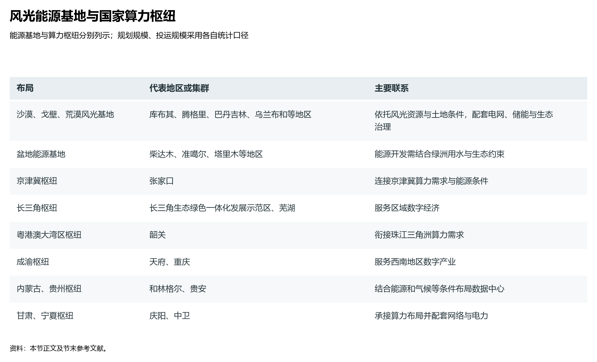
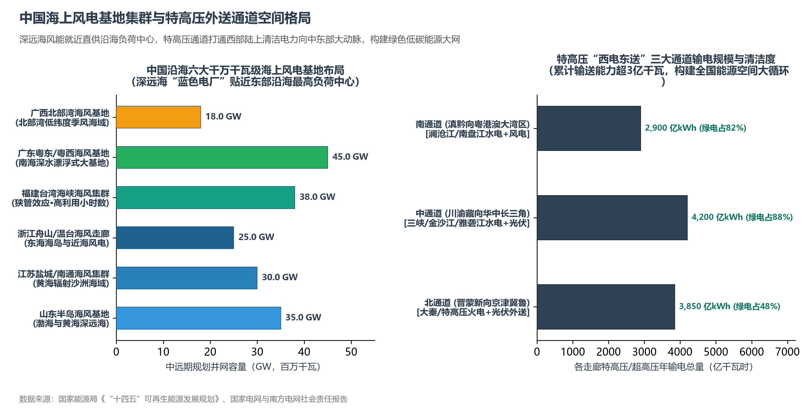

# 11.5 新型能源与算力地理

进入 2020 年代，中国经济地理的物理底层正在经历一场前所未有的“新质重构”：在广袤的西北内陆，过去被视为生态包袱的沙漠、戈壁与荒漠化土地，由于光照强烈、风力资源充沛，迅速转变为全球装机规模最大的清洁能源基地；与此同时，数据与算力成为类似煤炭与水力的新型战略资源，“东数西算”国家战略全维铺展，将东部稠密人口产生的海量数字需求，源源不断输往西部绿电富集、气温冷凉的数据中心集群。

从“开采地下化石能源”走向“捕捉天空风光电能”，从“重载铁路线北煤南运”走向“特高压电网与光纤通信网瓦特转比特”，中国经济地理完成了一场从“高碳物质运输”到“光速信息算力”的伟大空间跃迁。

**图 11-9 风光能源基地与国家算力枢纽**：分别列示风光基地的代表地区、八大国家算力枢纽及其数据中心集群，说明能源、网络与需求之间的联系。

## 一、“沙戈荒”大基地：荒漠化土地的生态能源再造

为落实碳达峰、碳中和目标，国家发展改革委与国家能源局系统规划在沙漠、戈壁、荒漠地区布局总装机高达 **4.5 亿千瓦（450 GW）** 的大型风电光伏基地集群。这一规模相当于 20 座三峡水电站的总装机容量：

| “沙戈荒”大基地集群 | 核心依托地貌生境 | 规划与并网容量 | 生态环境与综合产业效益 |
|:---|:---|:---:|:---|
| **内蒙古库布其沙漠基地** | 鄂尔多斯黄河“几字弯”南岸沙漠沙丘 | ~48 GW | “光伏治沙”标杆；板上发电、板下种植优质牧草、板间肉羊养殖；削减入黄泥沙 |
| **腾格里沙漠基地** | 内蒙古阿拉善、甘肃中卫、武威绿洲边缘 | ~40 GW | 连通宁夏—湖南特高压直流大通道；将极端干热大漠转变为千里绿电枢纽 |
| **巴丹吉林沙漠基地** | 内蒙古西部极干旱区与荒漠草原过渡带 | ~35 GW | 配套特高压外送四川与华中；利用大面积平坦荒漠发展千万千瓦级单体电站 |
| **乌兰布和沙漠基地** | 内蒙古巴彦淖尔黄河西岸流动沙丘 | ~28 GW | 阻截风沙东移侵袭河套平原；改善黄河沿线局地微气候，蒸发量减少 25% |
| **柴达木盆地基地** | 青海海西高原极度干旱荒漠戈壁 | ~32 GW | 高海拔、强紫外线、空气稀薄透明度极高；与黄河上游水电构成大型水光互补系统 |
| **新疆“三基地一通道”** | 哈密、准噶尔盆地、塔里木盆地边缘荒漠 | ~50 GW | 新疆“外送第二/第三通道”支撑；风光火储一体化；打造向西开放绿色工业基地 |

“光伏治沙”实现了生态与工业的双赢奇迹：高耸密布的光伏阵列大幅降低地表风速，板面遮阳使强烈的阳光直射减弱，土壤表层水分蒸发量降低 20%—30%。板下原本寸草不生的流沙逐步恢复了地表生物结皮，播撒的苜蓿、沙打旺、柠条等耐旱植物茁壮成长，沙漠荒野化作了绿意盎然的“光伏草原”。

## 二、海上风电走廊：东南沿海的“深蓝电厂”

在陆地大基地之外，中国东南沿海走向了深远海风能开发的新边疆：

**图 11-10 中国海上风电基地集群与特高压外送通道空间格局**：深远海风能就近直供沿海负荷中心，特高压通道打通西部陆上清洁电力向中东部大动脉，构建绿色低碳能源大网。

### 1. 沿海禀赋与“零距离”负荷中心优势
中国拥有 1.8 万公里大陆海岸线，受台湾海峡两岸山脉的“狭管效应”与季风环流强力驱动，东南沿海近海与深远海风能资源丰富。更重要的是，海上风电基地与中国经济最发达、用电负荷最高的长三角、粤港澳、闽东南城市群“零距离”接壤，完全省去了数千公里的远距离外送损耗：
- **装机规模领跑全球**：截至 2024 年底，中国海上风电累计并网容量突破 4000 万千瓦，连续四年位居全球首位；
- **六大千万千瓦级基地**：山东半岛、江苏盐城/南通、浙江舟山/温台、福建台湾海峡、广东粤东/粤西、广西北部湾六大海风产业集群蓬勃崛起；
- **装备制造业的极限突破**：单机容量 16 兆瓦、18 兆瓦乃至 20 兆瓦的超大型抗台风海上风电机组相继在福建、广东海域成功并网发电；漂浮式海上风电技术挺进水深超 100 米、距岸超 50 公里的深海公海大洋。

## 三、“东数西算”：数据网络与绿色电网的时空交响

在数字经济时代，算力是如同电力一样的基础公共要素。全球训练大型人工智能模型与海量数据处理需要耗费极其巨大的电能并产生剧烈热量，数据中心的能耗成本占运营总成本的 60% 以上：

### 1. “东数西算”的核心地理逻辑
东部地区（京津冀、长三角、珠三角）土地资源极度稀缺、工业与生活用电紧张、电力价格相对较高、夏季炎热需耗费巨额空调电费；而西部地区绿电充裕（风、光、水、火丰富且廉价）、年均气温凉爽干燥、地质构造稳定——“东数西算”应运而生。

### 2. 8 大国家算力枢纽节点与 10 大国家数据中心集群
国家发改委等四部门统筹划定了全国算力骨架：
- **东部四大实时枢纽（京津冀、长三角、粤港澳大湾区、成渝）**：
  - 下设张家口集群、长三角生态绿色示范区/芜湖集群、韶关集群、天府/两江集群；
  - **分工定位**：重点服务于网络时延要求极高（毫秒级）的实时业务，如工业互联网控制、金融高频量化交易、车路协同自动驾驶与即时远程协同；
- **西部四大绿色低碳算力枢纽（内蒙古、贵州、甘肃、宁夏）**：
  - 下设和林格尔集群、贵安集群、庆阳集群、中卫集群；
  - **分工定位**：重点承接对网络时延要求不敏感（数十至数百毫秒级）的海量后台业务，如全国大模型人工智能深度训练、全景离线视频渲染、海量冷数据长期归档与容灾备份；
- **能耗与气候指标（PUE 刚性控制）**：国家明确要求东部枢纽集群新建大型数据中心电能利用效率（PUE）必须低于 1.25，西部枢纽集群低于 1.20。贵阳利用喀斯特天然地下溶洞与常年 15℃ 均温降温，和林格尔与中卫利用北方漫长严寒干燥冬季全面引入自然风冷，使得中国超算中心的综合能耗指标居于全球最前列。

## 四、世界视角：大国地理纵深的新质生产力跃迁

纵观近代工业史，各国的传统工业区大多受制于煤铁产地与港口岸线；一旦资源枯竭，内陆与边缘荒原往往沦为衰败的“铁锈地带”。

而在当代中国，辽阔复杂的国土纵深非但没有成为发展负担，反而通过高水平基础设施重塑为无与伦比的竞争优势：
- 昔日贫瘠干旱的沙漠与戈壁，变身成为取之不尽的绿色能源矩阵；
- 遥远封闭的高原与深山盆地，变身为存放数字文明基底的算力冷泉；
- 纵贯数千公里的特高压直流通道与超宽带全光骨干通信网，让光子与电子在国土之上全速奔涌，完成了从“西煤东运”到“西数东算、西绿东用”的世纪跨越。中国经济地理在新质生产力浪潮中，展现出了惊人的空间弹性与战略纵深。

## 参考与数据来源

1. “沙戈荒”基地顶层布局：国家发改委、国家能源局《以沙漠、戈壁、荒漠地区为重点的大型风电光伏基地规划布局方案》（发改运行〔2022〕195 号）。
2. 可再生能源与海上风电：国家能源局年度全国电力工业统计公报（2024 年全国风电光伏装机突破 14 亿千瓦）、中国海上风电行业发展年度报告。
3. “东数西算”实施进展：国家发展改革委、中央网信办、工业和信息化部、国家能源局全国一体化大数据中心协同创新体系规划监测数据（2024）。
4. 数据中心绿色节能评价：中国信通院《中国数据中心能效与低碳发展报告》（2024）。
