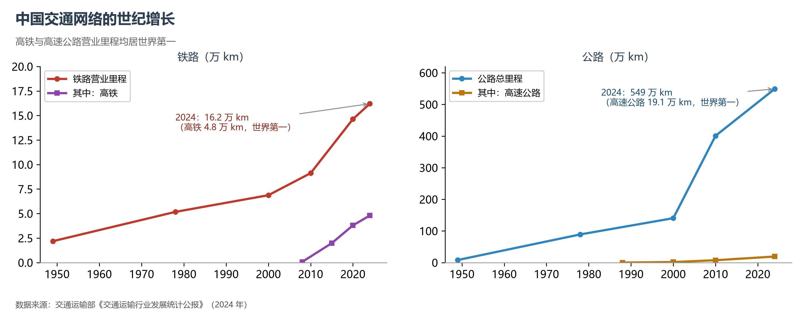
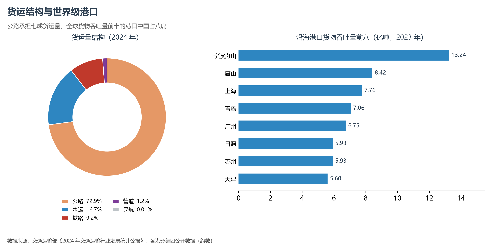

# 12.1 综合交通网络

中国拥有当今世界规模最庞大、覆盖最致密、技术最先进的综合立体交通网络。截至 2024 年底，全国铁路营业里程达到 16.2 万公里（其中高速铁路突破 4.8 万公里，占全球高铁总里程 70% 以上）；公路总里程突破 549 万公里（其中高速公路达 19.1 万公里，稳居世界第一）；内河航道通航里程 12.8 万公里（三级及以上高等级航道逾 1.5 万公里）；民航定期航班通航运输机场达到 263 个；城市轨道交通运营线路里程突破 1 万公里。

然而，在宏大的里程数字之上，理解中国交通地理的关键在于把握其**空间拓扑结构、运输方式分工与人口经济密度的深度咬合**：路网的“东密西疏”、大宗能源的“西煤东运”、农副产品的“北粮南运”与“南菜北调”，共同构成了与国土人口和产业分布高度同构的时空网络。

**图 12-1 中国铁路与公路网络的世纪增长**：高铁与高速公路里程均居世界第一。

## 一、五大运输方式的分工与现代货运矩阵

2024 年，中国全社会客货周转与货物运输总量持续攀升，全年完成全社会货运量约 **578 亿吨**，各类运输方式在不同运距、货种与时效维度上分工明确、优势互补：

| 运输方式 | 营业线网规模 (2024) | 货运量份额占比 | 客运发送量与特征 | 核心技术经济与地理适用范式 |
|:---|:---|:---:|:---|:---|
| **公路运输** | 总里程 549 万 km；高速公路 19.1 万 km | **~73.0%** (约 422 亿吨) | 承担短途集散与城乡毛细血管客运；私家车与公路客运普及 | “门到门”直达中短途运输；时效灵活；重载物流与电商快递主通道 |
| **水路运输** | 内河航道 12.8 万 km；沿海深水泊位群 | **~17.2%** (约 99 亿吨) | 以海运邮轮与琼州海峡等江海轮渡客运为主 | 运量极大、成本极低、能耗极小；承担 **90% 以上的外贸货物运输**；长江黄金水道货运量世界第一 |
| **铁路运输** | 营业里程 16.2 万 km；高铁 4.8 万 km | **~8.8%** (约 51 亿吨) | 年旅客发送量突破 **38 亿人次**；高铁占铁路客运 75% 以上 | 运量大、全天候、能耗低；主攻煤炭、矿石、粮食、化肥等中长途大宗能源物资与中欧班列集装箱 |
| **管道运输** | 油气长输干线总里程近 19 万 km | **~0.9%** (液体/气体折算) | 不承担人员客运 | 密闭、安全、连续不间断；原油、成品油与天然气跨大区调配的隐形生命线 |
| **民用航空** | 定期航班机场 263 个；航线里程超千万 km | **<0.1%** (高货值货物) | 年旅客吞吐量超 **7.2 亿人次**；中长距离商务出行支柱 | 速度极快（800—900 km/h）；服务芯片、精密仪器、冷链医药、生鲜果蔬与跨境电商高端航空物流 |

在客运端，中国高铁以全球最稠密的班次网络（日均开行动车组逾 1 万列）和极高的正点率，彻底重构了中长途出行生态；民航则在大跨度跨省（如北京—广州、上海—成都）及出疆入藏干线上构筑起高效的空中走廊。

**图 12-2 货运量结构与沿海港口货物吞吐量前八**：全球货物吞吐量前十的港口中国占八席。

## 二、“6 轴 7 廊 8 通道”：国家综合立体交通网顶层骨架

2021 年中共中央、国务院印发《国家综合立体交通网规划纲要》，绘制了面向 2035 年乃至本世纪中叶的国家空间交通总蓝图。该规划彻底打破过去各种运输方式各自为政的壁垒，构建起以“极、圈、轴、廊、通道”为骨架的综合立体交通系统：

### 1. 以“四极”为战略支点的国家综合交通主轴（6 条主轴）
以**京津冀、长三角、粤港澳大湾区、成渝地区双城经济圈**四大城市群为极核，连接这四极构成了全国客货流最密集、经济要素最活跃的 **6 条国家综合立体交通主轴**：
- **京津冀—长三角主轴**：沿京沪通道，连接两大都市连绵区；
- **京津冀—粤港澳主轴**：沿京港澳通道，纵贯华北大平原、中原与华南门户；
- **京津冀—成渝主轴**：连通北方政治中心与西南战略大后方；
- **长三角—粤港澳主轴**：沿东南沿海通道，连接中国最大的两大经济增长极；
- **长三角—成渝主轴**：依托长江黄金水道与沿江高速铁路通道，构筑横贯东西的长江经济带交通命脉；
- **粤港澳—成渝主轴**：连通华南海上丝路门户与西部陆海枢纽。

### 2. 7 条走廊与 8 条通道辐射全国腹地
- **7 条国家级走廊**：涵盖京哈走廊、陇海走廊、厦蓉走廊、福银走廊、沿江走廊、西北走廊（进疆）与西南走廊（入藏），将沿边开放口岸与中西部内陆节点深度缝合；
- **8 条区际通道**：包括绥满通道、黄河黑山通道、沿海通道、呼南通道、包（银）海通道等，实现实体线网总规模 70 万公里，构筑“全国 123 出行交通圈”（都市区 1 小时通勤、城市群 2 小时通达、全国主要城市 3 小时覆盖）与“全球 123 快货物流圈”（国内 1 天送达、周边国家 2 天送达、全球主要城市 3 天送达）。

## 三、世界视角：超大规模“人口密度基础设施”的中国方案

放眼全球交通地理发展史，不同国家的交通体系是其人口密度、地理幅员与制度环境共同塑造的产物：
- **美国模式（低密度公路航空主导）**：幅员辽阔但城市呈郊区化低密度蔓延，私人小汽车与航空极其发达，铁路客运几近萎缩，主要依托重载铁路运煤与集装箱；
- **欧洲模式（中等密度城际铁路）**：国土被各国行政边界分割，以中短途城际列车与高速公路并重；
- **中国方案（超高密度高铁网络 + 综合立体快线）**：中国在人口超 10 亿、东部人口密度极高的地理国情下，开创了人类交通史上最具集约效益的“人口密度基础设施”：
  - 高铁把“50 万人口以上城市高铁通达率超 95%”由图纸化为现实，不仅比航空节省了数以亿吨计的碳排放与航油消耗，更有效避免了美国式的土地大面积硬化铺路与大城市蔓延造成的能源挥霍；
  - 这种高速、准点、大容量的轨道与港口网络，极大压缩了要素流通的时空交易摩擦，成为推动中国 14 亿人走向现代化统一大市场最硬核的地理支撑。

## 参考与数据来源

1. 交通网络里程与运输统计：交通运输部历年《交通运输行业发展统计公报》（2024）、国家铁路局铁道统计公报。
2. 综合交通规划蓝图：中共中央、国务院《国家综合立体交通网规划纲要》（2021 年 2 月印发）。
3. 港口吞吐量与集装箱数据：交通运输部水运局年度统计、中国港口协会年度分析公报。
