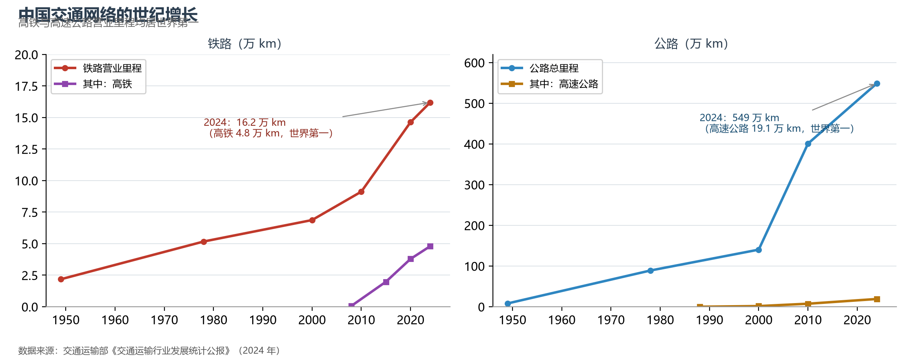
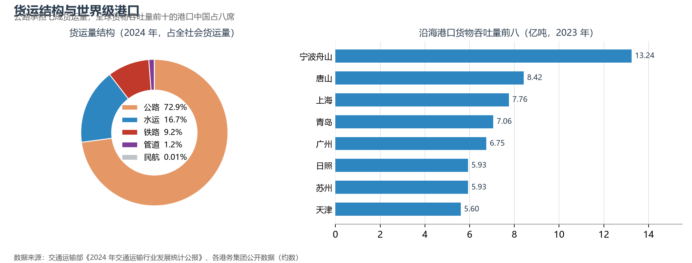

# 12.1 综合交通网络

中国拥有世界规模最大的交通网络：铁路营业里程 16.2 万 km（其中高铁 4.8 万 km，占全球七成），公路总里程 549 万 km（其中高速公路 19.1 万 km，居世界第一），内河航道 12.8 万 km，定期航班通航机场 263 个，城市轨道交通运营里程逾 1 万 km。网络规模之外，真正的地理变量是**结构与密度**：东密西疏的路网、西煤东运的专线、贯通南北的高铁主轴，共同织成一张与人口经济分布同构的网。

**图 12-1 中国铁路与公路网络的世纪增长**：高铁与高速公路里程均居世界第一。

## 一、各运输方式的分工

2024 年全社会货运量约 578 亿吨：公路以约 73% 的份额承担"门到门"的短驳与集散；水运以约 17% 承担外贸与大宗干线（长江干线货运量连续多年世界内河第一）；铁路以约 9% 主攻煤炭、矿石、粮食等大宗与集装箱班列；管道输送油气（油气管道总里程约 19 万 km）；民航则以客为主，货机网络服务高值货物。客运端，高铁以 30 亿人次以上的年发送量成为中长距离出行的绝对主力，民航年旅客吞吐量回升至 7 亿人次量级。

**图 12-2 货运量结构与沿海港口货物吞吐量前八**：全球货物吞吐量前十的港口中国占八席。

## 二、"6 轴 7 廊 8 通道"：国家综合立体交通网

2021 年印发的《国家综合立体交通网规划纲要》给出了 2035 年的蓝图：以京津冀、长三角、粤港澳、成渝为四极，由 6 条主轴、7 条走廊、8 条通道组成的国家综合立体交通网主骨架，实体线网总规模合计 70 万 km 左右。它的空间逻辑与城市群战略完全咬合——交通网的节点就是经济圈的极核。

## 三、世界视角：基建密度的两级跨越

以铁路密度论，中国（约 168 km/万 km²）高于美国（约 150）而低于日本、德国；但高铁把"人口 50 万以上城市高铁通达率超过 95%"变成了现实——这在幅员大国中绝无仅有。对比美国"航空 + 公路"体系与中国"高铁 + 高速"体系，本质是人口密度与城市分布差异的交通响应：中国的高铁网络是全球最大规模的"人口密度基础设施"实验，其班次密度（日均逾 1 万列）让"轨道上的中国"成为新的地理常识。

## 参考与数据来源

1. 里程与货运量：交通运输部《2024 年交通运输行业发展统计公报》、国家铁路局公开数据。
2. 立体交通网规划：《国家综合立体交通网规划纲要》（2021 年 2 月）。
