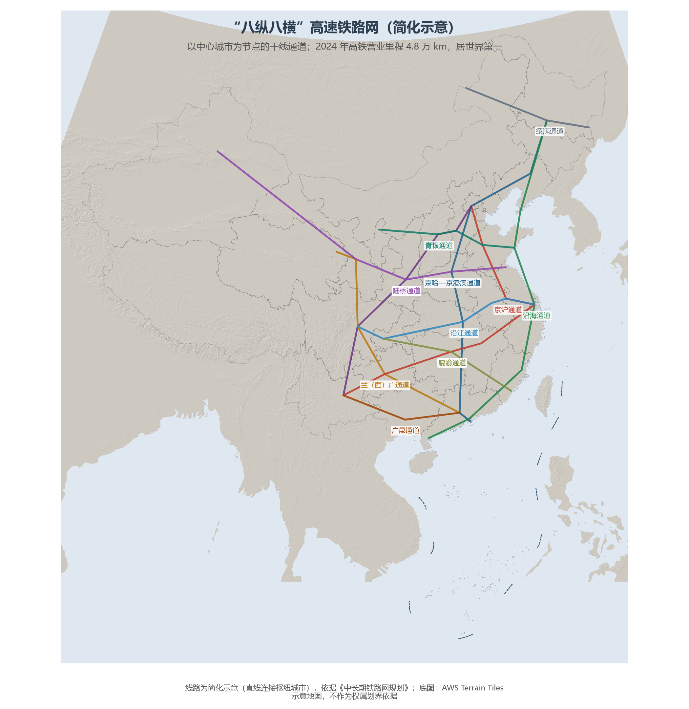

# 12.2 铁路与高速铁路网络

中国铁路网的骨架史是一部"干线命名史"：1881 年的唐胥铁路只有 9.7 km；1909 年詹天佑主持的京张铁路第一次由中国人自主设计；1949 年全国铁路仅 2.18 万 km 且残缺不全；2008 年京津城际开启高铁时代；今天，"八纵八横"主通道加密成网，CR450 动车组试验时速已达 450 km。

**图 12-3 "八纵八横"高速铁路网（简化示意）**：以中心城市为节点的干线通道，直线连接枢纽示意。

## 一、八纵八横：主通道的逻辑

《中长期铁路网规划》（2016 年）确定的"八纵八横"主通道，纵线自沿海、京沪、京港（台）、京哈—京港澳、呼南、京昆、包（银）海到兰（西）广，横线自绥满、京兰（藏）、青银、陆桥、沿江、沪昆到厦渝、广昆。逻辑清晰可读：**纵线**把东部沿海与内陆纵深串联，**横线**让长三角、长江中游、成渝在沿江通道上连成一线，陆桥通道（连云港—乌鲁木齐，与第二亚欧大陆桥重合）则把中国铁路直接焊进欧亚铁路网。

## 二、经典干线与工程地标

- **京沪高铁**（1 318 km，2011 年通车）：全球最繁忙的高铁走廊，年发送旅客逾 2 亿人次，"复兴号"在此跑出 350 km/h 的商业运营时速；
- **京广高铁**（2 298 km）：纵贯南北的动脉，串联京津冀、中原、长江中游、珠三角四大城市群；
- **沪昆高铁**（2 252 km）：东西向最长的高铁，让"八小时从上海到昆明"成为现实；
- **兰新高铁**（1 776 km）：穿越戈壁风沙区的高铁，世界一次性建成里程最长；
- **青藏铁路**（格尔木—拉萨段 1 142 km，2006 年通车）：550 km 多年冻土与 5 072 m 的唐古拉山口，是世界海拔最高的铁路；在建的**川藏铁路**（雅安—林芝段）将攻克全世界最险峻的地形梯度（爬升逾 2 000 m、隧洞比逾 80%）。

## 三、中欧班列：铁路的国际延长线

2011 年开行的中欧班列已通达欧洲 20 余国的 200 余个城市，累计开行超 10 万列（2024 年）——它把"陆桥通道"延长为跨大陆供应链：重庆的笔电、义乌的小商品、成都的整车经阿拉山口、霍尔果斯出境，15 天抵达杜伊斯堡。海运 40 天、空运 10 倍运价的区间，正是这条钢铁走廊的地理价值。

## 四、世界视角：高铁里程的全球格局

全球高铁营业里程约 6.5 万 km，中国占七成以上——第二位的西班牙（约 3 100 km）不足中国的 1/15。但高铁的意义不在里程而在时空收缩：京津冀、长三角、大湾区内部已形成"1 小时交通圈"，全国"八纵八横"完成后，省际时空距离整体压缩过半。以运营速度、网络规模与商业模式的综合计，中国高铁是本世纪全球交通基础设施最重大的地理重构。

## 参考与数据来源

1. 里程与班列：国家铁路局、国铁集团公开数据（2024 年）。
2. 规划：《中长期铁路网规划》（2016）；川藏铁路：国铁集团公开资料。
