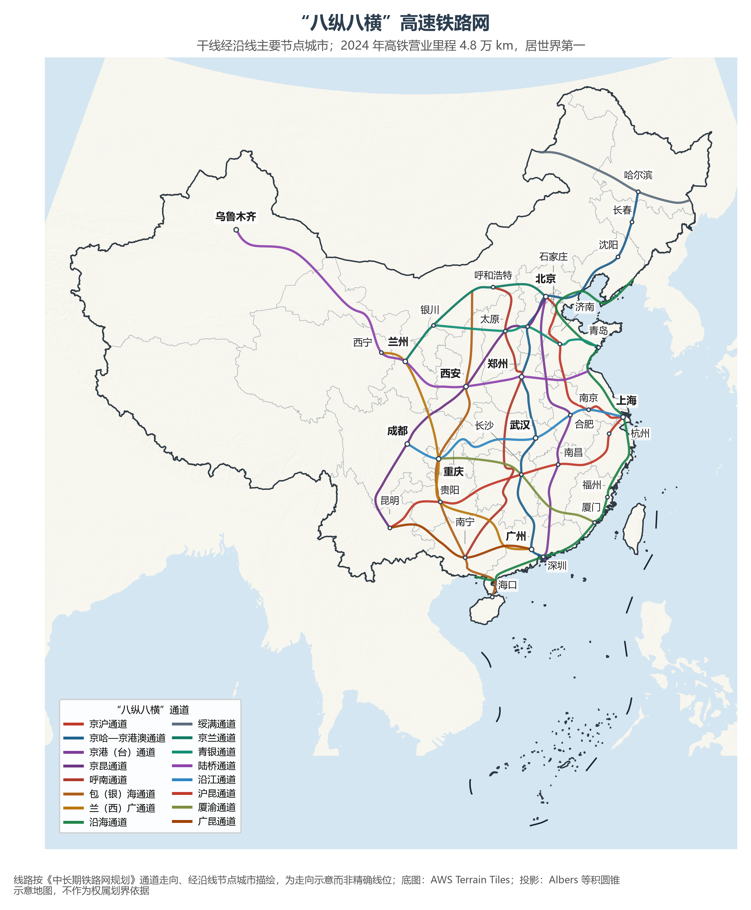
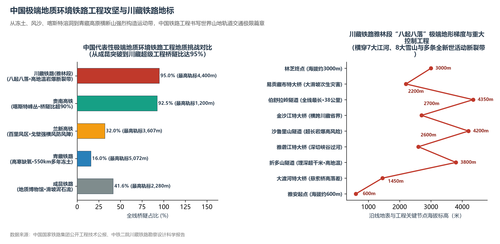

# 12.2 铁路与高速铁路网络

中国铁路的发展史，是一部荡气回肠的民族现代化自强史与地理天堑攻坚史。

从 1881 年清末开平矿务局主持修建的第一条 9.7 公里唐胥铁路，到 1909 年詹天佑主持中国人自主设计勘测的京张铁路打破西方技术垄断；从 1949 年新中国接手时仅存 2.18 万公里残破干线，到 2008 年京津城际铁路鸣笛开启中国高铁纪元；今天，中国已建成世界上规模最大、运行速度最高、工程地质环境最极端、系统技术最完备的高速铁路网。复兴号动车组以 350 km/h 商业运营时速在大江南北呼啸驰骋，新一代 CR450 动车组更在试验段跑出了 453 km/h 的世界商业列车试验极速。

**图 12-3 "八纵八横"高速铁路网（简化示意）**：以中心城市为节点的干线通道，直线连接枢纽示意。

## 一、“八纵八横”主通道的地理逻辑与空间缝合

依据国家《中长期铁路网规划》，中国高速铁路网在早期“四纵四四横”主骨架的基础上，全面升级为以沿海、京沪、京港台等为代表的“**八纵**”主通道，以及沿江、陆桥、沪昆等为代表的“**八横**”主走廊：

| 主通道类别 | 主要走廊名称 | 核心起讫点与主要途经省市 | 空间地理连接与国家战略功能 |
|:---|:---|:---|:---|
| **“八纵”南北大通道** | **沿海通道** | 大连—秦皇岛—天津—烟台—连云港—上海—杭州—福州—广州—湛江—北海 | 纵贯东部沿海第一线；连接环渤海、长三角、海峡西岸、粤港澳与北部湾 |
| | **京沪通道** | 北京—天津—济南—蚌埠—南京—上海 (杭州) | 全球客流最密集的高铁走廊；“复兴号”350 km/h 标杆线；连接两大核心经济极 |
| | **京港 (台) 通道** | 北京—雄安—商丘—合肥—南昌—深圳—香港 (九龙) | 纵贯中东部内陆腹地；连通雄安新区与粤港澳大湾区；预留跨海峡通道 |
| | **京哈—京港澳通道** | 哈尔滨—长春—沈阳—北京—石家庄—郑州—武汉—长沙—广州—深圳 | 贯穿东北、华北、华中与华南的国家中轴超级脊柱；客货分流黄金干线 |
| | **呼南通道** | 呼和浩特—大同—太原—郑州—襄阳—常德—益阳—邵阳—永州—桂林—南宁 | 沟通黄河中游、长江中游与华南西南的内陆大纵深通道 |
| | **京昆通道** | 北京—石家庄—太原—西安—成都 (重庆)—昆明 | 穿行华北平原、黄土高原、秦岭大巴山至云贵高原；西南入京最快捷通道 |
| | **包 (银) 海通道** | 包头—延安—西安—重庆—贵阳—南宁—湛江—海口 | 西部内陆呼包鄂榆向南经成渝、黔中直达北部湾与海南自由贸易港 |
| | **兰 (西) 广通道** | 兰州 (西宁)—成都 (重庆)—贵阳—广州 | 连接西北丝路起点与西南极核、直通华南沿海的斜向大通道 |
| **“八横”东西大走廊** | **绥满通道** | 绥芬河—牡丹江—哈尔滨—齐齐哈尔—海拉尔—满洲里 | 东北向北开放大动脉；沟通中俄边境绥芬河与满洲里口岸 |
| | **京兰通道** | 北京—呼和浩特—包头—银川—中卫—兰州 | 沿阴山南麓与黄河几字弯行进；连接华北与西北干线 |
| | **青银通道** | 青岛—济南—石家庄—太原—银川 | 穿越南太行山横谷；黄河流域中下游出海与能源通道 |
| | **陆桥通道** | 连云港—徐州—郑州—西安—兰州—西宁—乌鲁木齐 | 紧贴新亚欧大陆桥走向；贯通沿海与西北边陲长达 3400 余公里东西大动脉 |
| | **沿江通道** | 上海—南京—合肥—武汉—重庆—成都 (攀枝花) | 与长江黄金水道水乳交融；支撑长江经济带全流域一体化的高速客运骨架 |
| | **沪昆通道** | 上海—杭州—南昌—长沙—贵阳—昆明 | 东西向跨越地形阶梯最长的高铁走廊（2252 km）；横跨江南水乡至云贵高原 |
| | **厦渝通道** | 厦门—龙岩—赣州—长沙—常德—张家界—黔江—重庆 | 东南海丝起点沟通长江中游与西南山地的内陆辐射通道 |
| | **广昆通道** | 广州—南宁—百色—昆明 | 华南珠三角向大西南延伸、辐射中南半岛的沿边陆路高铁 |

这一主网络彻底打破了中国崇山峻岭与江河险滩的自然割裂，使京津冀、长三角、大湾区、成渝各大城市群之间实现了“半日生活圈”，全国 1000 公里范围内的主要大城市之间进入“4 小时轨道圈”。

## 二、极端地质环境的工程突破：从成昆到川藏的工程奇迹

中国幅员辽阔，地形三级阶梯落差悬殊，地质构造运动剧烈，滑坡、泥石流、断裂带、高寒冻土、深层岩爆等极端地质灾害密集分布。一代代中国铁路工程师向自然极限发起挑战，在世界铁路工程史上书写了空前绝后的壮举：

**图 12-4 中国极端地质环境铁路工程攻坚与川藏铁路地标**：从冻土、风沙、喀斯特溶洞到青藏高原横断山强烈构造运动带，中国铁路工程书写世界山地轨道交通极限篇章。

### 1. 中国标志性高难度铁路工程地质攻坚对比
1. **成昆铁路（1970 年建成）**：穿越被称为“地质博物馆”与“筑路禁区”的横断山大渡河、金沙江断裂带。全线 41.6% 为桥隧工程，攻克了大型滑坡、崩塌、滚石与泥石流，被联合国誉为 20 世纪人类征服自然的三大奇迹之一；
2. **青藏铁路（2006 年全线贯通）**：格尔木至拉萨段全长 1142 公里，穿越连续多年冻土区 550 公里。研发运用“以桥代路”、“抛石路基”、“通风热棒”等动态降温专利技术，攻克高寒缺氧（轨顶最高标高 5072 米唐古拉山口）与高原极度脆弱生态保护三大世界难题；
3. **兰新高铁（2014 年通车）**：世界上一次性建成里程最长的高速铁路（1776 km）。在穿越新疆百里风区、三十里风区（瞬时风力可达 12 级以上）时，沿线首创“下沉式路堑”、“防风明洞”与“钢筋混凝土挡风墙”，确保高速列车在风沙飞石中安全平稳运行；
4. **贵南高铁（2023 年通车）**：穿行云贵高原与两广丘陵过渡带的典型喀斯特峰丛深洼地貌，全线桥隧比高达 92.5%，攻克了大规模岩溶溶洞、突泥涌水与断裂带软岩大变形。

### 2. 世纪工程：川藏铁路雅安至林芝段的极限挑战
正在全线推进的**川藏铁路雅安至林芝段**（雅林段长约 1011 公里），被公认为“人类历史上施工难度最大、地质条件最恶劣的铁路工程”：
- **“八起八落”地形梯度极限**：线路从四川盆地（雅安海拔约 600 米）向“世界屋脊”青藏高原（林芝海拔约 3000 米）爬升，中途需要连续 8 次跨越深切大峡谷（大渡河、雅砻江、金沙江、澜沧江、怒江等）、8 次翻越巍峨雪山（折多山、沙鲁里山、芒康山、伯舒拉岭等），累计爬升高度超过 1.4 万米；
- **全线桥隧比高达 95%**：全线几乎完全是由“桥梁与隧道”串联而成，其中隧道总长逾 840 公里，深埋超千米的特长隧道密布（全线最长的伯舒拉岭隧道长达 38 公里）；
- **地质构造多重灾害并发**：深层开挖直面高达 60℃—80℃ 的罕见“高地温”、极易引发钢轨扭曲的高地应力极强“岩爆”、多条全新世活动断裂带的剧烈错动，以及冰崩、融雪泥石流隐患。川藏铁路不仅是连接藏区与内地的战略大动脉，更代表着人类工程地质科学向地球极限发起的最壮丽突围。

## 三、世界视角：时空收缩与大国统一大市场的轨道底座

审视全球轨道交通发展格局，全球高速铁路运营总里程约 6.5 万公里，中国独占其中的 **70% 以上**；排名第二的西班牙（约 3100 公里）与第三的日本（约 3000 公里）加在一起，尚不足中国的七分之一。

但高铁对于中国地理的真正意义，远远超越了里程的统计：
- **彻底改变时空观念**：在传统绿皮车时代，从北京到广州需要历时一天一夜，从上海到成都甚至需要近两日；而在“八纵八横”织就的今天，千里一日还成为日常现实。时空收缩大幅削减了人口迁移、商务沟通、旅游探亲与信息交换的摩擦阻力；
- **重塑经济与城镇地理布局**：高铁不仅强化了四大核心城市群的吸纳能级，更通过中途设站激活了沿线数百座原本边缘化的小城市与县城，使得先进制造、外向型服务业与现代物流得以向内陆腹地梯度疏解扩散；
- **中国标准的全球出海**：雅万高铁在印度尼西亚全线商业运营、中老铁路全线贯通直抵万象、匈塞铁路稳步推进，中国高铁以“全系统、全要素、全产业链”的成熟工程实力，正在重塑亚欧大陆乃至全球的发展中国家交通基础设施版图。

## 参考与数据来源

1. 铁路营业里程与技术指标：国家铁路局历年《铁道统计公报》（2024）、中国国家铁路集团有限公司公开年度数据。
2. 铁路中长期规划：国家发展和改革委员会、交通运输部、中国铁路总公司《中长期铁路网规划》（发改基础〔2016〕1536 号）。
3. 川藏铁路与重大工程地质资料：中国工程院《川藏铁路建设重大工程地质问题与对策研究报告》、中铁二院工程集团川藏铁路设计专报。
