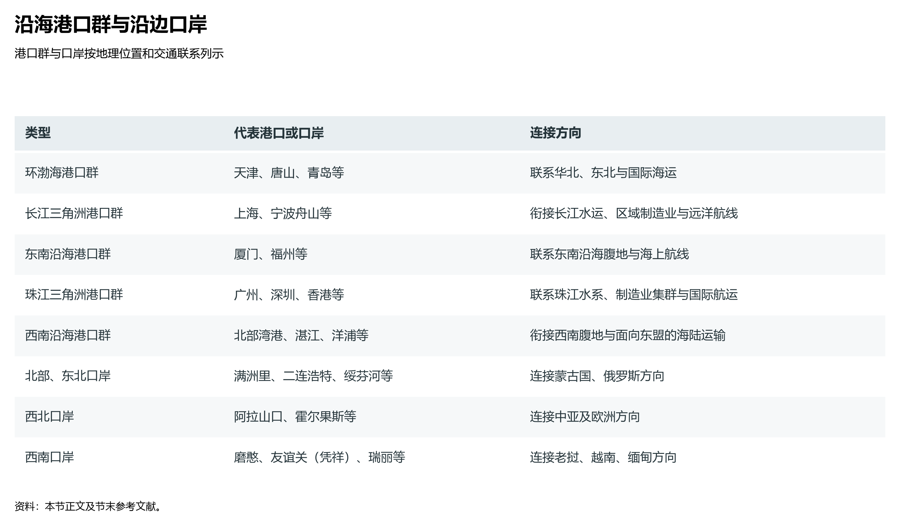
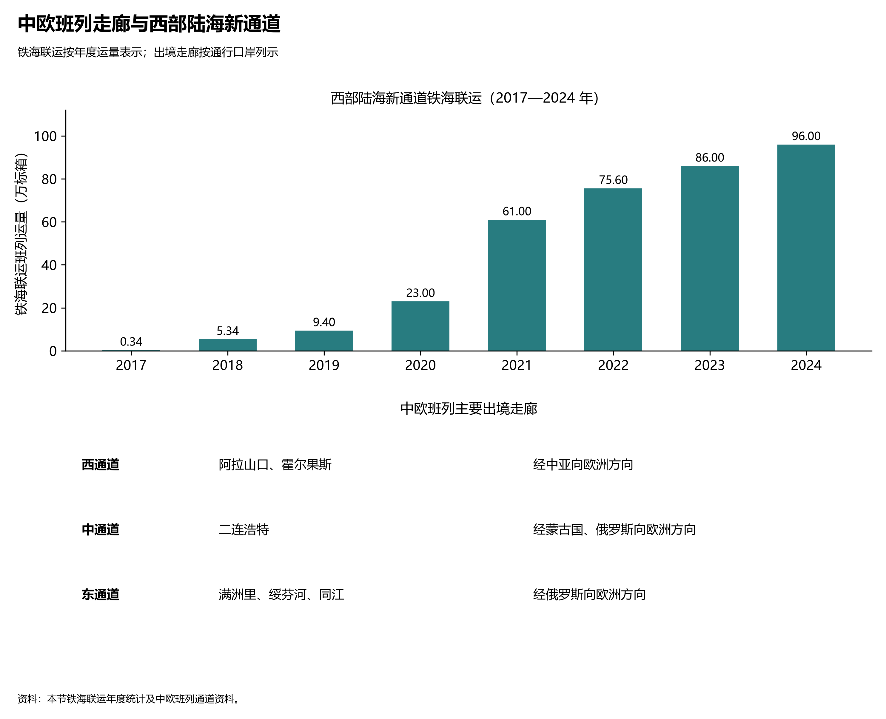

# 12.3 沿边沿海通道与枢纽

如果把中国的综合交通网络视为一个巨大的生命体，那么其外围轮廓上的两条大弧线——**东南沿海的世界级深水港口群**与**西北/西南陆地边界上的沿边开放口岸带**——便是中国与全球资源、资本与市场深度交互的“战略呼吸端口”。

在过去的数百年里，世界经贸地理长期由西方大西洋海权体系所主导；而今天，中国通过“向东挺进深蓝海洋、向西贯通欧亚大陆、向南开辟陆海新通道”的立体布局，构建起海陆并举、内外双向互济的对外开放交通新格局。

**图 12-5 沿海港口群与沿边口岸**：按地理位置列示五大沿海港口群和主要沿边口岸，比较其腹地与对外连接方向。

## 一、五大沿海港口群：全球最密集的航运枢纽集聚带

中国大陆拥有长达 1.8 万公里的海岸线与众多优良深水基岩海湾。伴随着全球制造业向中国集中，中国建成了世界上吞吐量最大、泊位最深、自动化程度最高的**五大沿海港口群**。全球货物吞吐量排名前十的大港中，中国独占八席；集装箱吞吐量排名前十中，中国占据七席：

| 沿海港口群 | 核心枢纽港口 | 标杆港口吞吐量指标 (2024) | 腹地依托与关键货种流向 | 战略分工定位 |
|:---|:---|:---|:---|:---|
| **长三角港口群** | 宁波舟山港、上海港、连云港港、南通港 | 宁波舟山港货物吞吐量 **13.8 亿吨** (全球第一)；上海港集装箱 **5150 万 TEU** (全球第一) | 沪苏浙皖长江全流域腹地；集装箱外贸、大宗铁矿石、原油中转、LNG 接收 | 全球货物吞吐量最大、集装箱航运网络最密集的国际航运中心核心极 |
| **环渤海港口群** | 天津港、青岛港、唐山港、日照港、大连港 | 唐山港超 8 亿吨；青岛港集装箱超 3000 万 TEU；天津港超 2200 万 TEU | 华北、东北、西北及黄河流域；煤炭下水、原油进口、进口铁矿石与机械汽车 | 北方国际航运枢纽；保障国家能源大宗物资运输生命线（“北煤南运”装船港） |
| **珠三角港口群** | 深圳港、广州港、香港港、珠海港 | 深圳港集装箱超 3000 万 TEU；广州港超 2500 万 TEU | 广东省、泛珠三角与西南内陆；消费电子、家用电器、服装鞋帽、汽车制造外贸 | 全球高密度集装箱班轮航线聚集地；粤港澳大湾区现代国际航运服务走廊 |
| **东南沿海港口群** | 厦门港、福州港、泉州港 | 厦门港集装箱超 1250 万 TEU | 福建全省、江西及赣南腹地；对台直航通商、“21世纪海上丝绸之路”核心区 | 祖国大陆对台经贸合作前沿平台；对接东南亚区域航线母港 |
| **西南沿海港口群** | 北部湾港 (钦州、防城港、北海)、海南洋浦港 | 北部湾港货物吞吐量突破 4.5 亿吨，集装箱超 900 万 TEU | 广西、成渝、云贵等西部内陆大腹地；大宗散货、东盟水果与农产品冷链、化工品 | 西部陆海新通道国际门户港；面向东盟自贸区（RCEP）距离最短的海运枢纽 |

上海洋山深水港四期全自动化码头与青岛港全自动化集装箱码头，运用 5G 通信、北斗高精度导航与无人自动化导引小车（AGV），作业效率领跑全球，展现了中国港口由“汗水型装卸”向“全数字化智慧绿港”的深刻蜕变。

## 二、沿边口岸带与中欧班列三大出境走廊

在长达 2.28 万公里的陆地边界线上，中国分布着 100 余个一类国家级陆路口岸，它们构成了陆上丝绸之路与周边国家互联互通的核心卡口：

**图 12-6 中欧班列战略走廊与西部陆海新通道货运网络**：中欧班列重塑亚欧大陆陆权供应链，陆海新通道破除西南内陆无出海口桎梏构建向南直面东盟经贸大走廊。

### 1. 中欧班列三大跨境铁路通道布局
截至 2024 年，**中欧班列累计开行突破 10 万列**，货值超 4200 亿美元，通达欧洲 25 个国家的 220 余座城市，形成三大主干出境走廊：
- **西通道（阿拉山口、霍尔果斯口岸）**：经兰新铁路汇聚成渝、郑州、武汉、义乌等地的班列，穿越天山向西出境进入哈萨克斯坦，通达中亚五国、俄罗斯与欧洲腹地。阿拉山口与霍尔果斯两口岸承担了中欧班列出境总运量的 **52% 以上**；
- **中通道（二连浩特口岸）**：经集二铁路向北出境，穿越蒙古国纵贯线，直达俄罗斯莫斯科及东欧，承担中欧班列约 18.5% 的货运量；
- **东通道（满洲里、绥芬河、同江中俄跨江铁路桥）**：经滨洲铁路出境，直通俄罗斯西伯利亚大铁路。同江中俄跨江铁路大桥通车后，开辟了黑龙江省对俄能源矿产运输新通道，东通道占班列运量的近 30%。

### 2. 西南沿边新干线：中老铁路与泛亚通道贯通
在西南边疆，2021 年底全线开通运营的**中老铁路**（昆明至老挝万象，全长 1035 公里），以磨憨口岸为枢纽，累计发送旅客超 4000 万人次、运输跨境货物超 4500 万吨，使老挝实现了从“陆锁国”向“陆联国”的华丽转变；中越、中缅国际铁路通道建设持续推进，打开了中国西南直通中南半岛和印度洋的大通道。

## 三、西部陆海新通道：西南腹地出海格局的世纪突围

长期以来，中国西南地区（重庆、四川、贵州、云南）由于高山阻隔，物资出海主要依赖长江黄金水道向东航行，至上海港后再换装海轮出口。这一传统路径长达 2000 多公里，沿途需经历三峡船闸翻坝等待，耗时往往长达两至三周。

2019 年国家发改委印发《西部陆海新通道总体规划》，从根本上颠覆了这一历史格局：
- **空间走向**：以**重庆**为运营组织中心，以成都、贵阳、昆明为关键节点，铁路线路向南纵贯贵州高原与两广山地，直达广西北部湾港（钦州、防城港）和海南洋浦港，再通过海运直达新加坡与东盟各国；
- **运距与时间大幅压缩**：与绕道长江出海相比，向南陆海联运运距整体压缩 **1000 余公里**，全程运输时间节省 **10 至 15 天**以上；
- **发运量爆发式飙升**：西部陆海新通道铁海联运集装箱班列发运量，从 2017 年试运行之初的 3382 标箱，迅猛攀升至 2024 年的近 **100 万标箱（TEU）**，7 年间激增近 300 倍。汽车零部件、电子产品、重庆笔电、光伏组件南下，东盟的热带水果（榴莲、山竹）、天然橡胶、矿石北上，构筑起贯穿亚欧大陆与东南亚的“黄金双向走廊”。

## 四、世界视角：从单一海权走向陆海统筹的双轮驱动

在近代全球贸易地理中，“临海即中心，内陆即边缘”几乎是一条不可逾越的地理宿命。

中国对外交通基础设施的深刻变革，在于打破了这种绝对依附海洋的单一维度：
- 一方面，继续以无与伦比的沿海大港集群，牢牢掌控全球 30% 以上的集装箱干线物流与海权贸易主动权；
- 另一方面，通过中欧班列、中老铁路与西部陆海新通道，将封闭的亚欧大陆内陆重新激活为充满生机的繁荣走廊。海运保障大宗外贸的基本盘，陆桥提供高敏捷性与抗风险的陆上安全备份通道，这种“陆海统筹、东西双向互济”的综合交通布局，为大国应对地缘政治风浪提供了前所未有的战略弹性。

## 参考与数据来源

1. 港口货物与集装箱吞吐量：交通运输部《全国水运交通行业发展统计公报》（2024）、上海国际航运研究中心《全球港口发展报告》。
2. 中欧班列开行统计：中国国家铁路集团有限公司中欧班列统计公报（累计突破 10 万列数据）。
3. 西部陆海新通道运营数据：国家发展和改革委员会西部陆海新通道建设工作推进会公报、广西北部湾国际港务集团年度报告。
