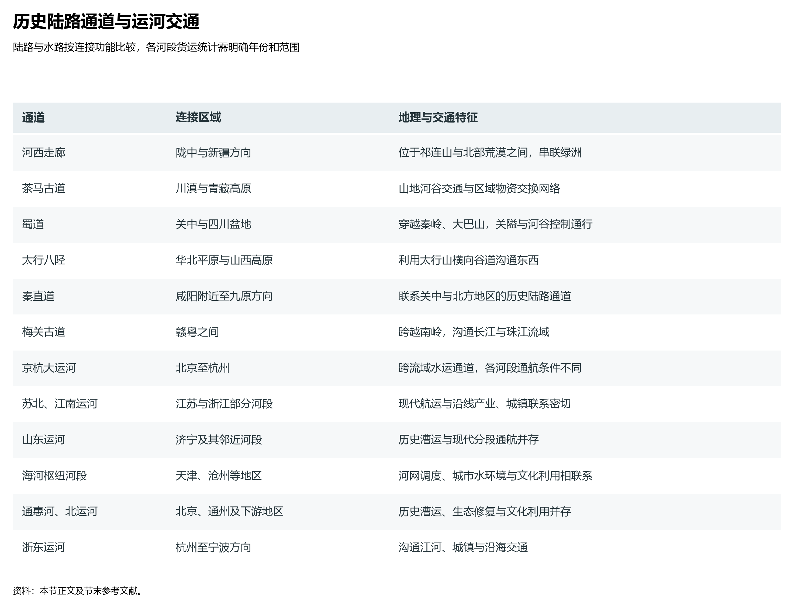
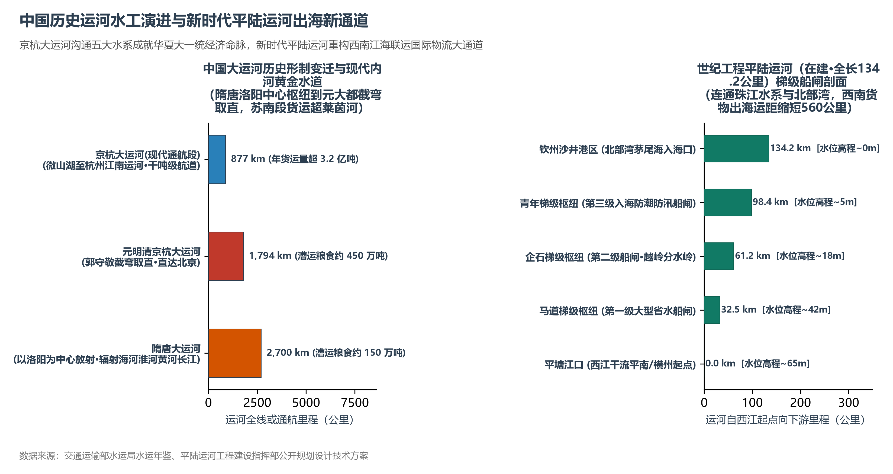

# 12.4 历史地理通道与大运河

今天在大江南北飞驰的“复兴号”高速列车与密集交织的国家高速公路网，绝非人工凭空绘制的现代产物。

倘若将今天的交通干线图与历代古地图重叠对比，便会浮现出一个令人惊叹的地理规律：京广高铁的走向与古代南北驿道及大运河南下航线高度重合；兰新高铁与连霍高速完全铺设在两千年前张骞西巡开辟的河西走廊之上；西成高铁穿越秦岭的桥隧选线，精准复现了三国诸葛亮北伐征战的金牛道与褒斜道。数千年来，中国三级阶梯的地貌格局与江河走势，早已规定了人类最理想、最顺应自然的地理通行通道。

**图 12-7 历史陆路通道与运河交通**：按连接区域与交通功能，对照河西走廊、蜀道、太行八陉、梅关古道及主要运河河段。

## 一、古代陆路大走廊：天堑之中的地缘命门

中国地势西高东低、山系纵横交错，大自然在高原与平原之间预留了若干条关乎天下分合与族群迁徙的“地缘咽喉”：

| 历史古道名称 | 空间地理走向 | 地形地貌与自然天堑 | 历史战略经略功能 | 现代交通通道重叠与演进 |
|:---|:---|:---|:---|:---|
| **河西走廊** | 甘肃乌鞘岭以西至敦煌玉门关，长逾 1000 km | 祁连山冰雪融水与巴丹吉林/腾格里沙漠夹持的绿洲窄带 | 中原通往西域的陆权咽喉；汉武帝列置“河西四郡”锁钥亚欧丝路 | 兰新铁路、兰新高铁、连霍高速公路（G30）完全重合此走廊 |
| **蜀道 (关中入川古道)** | 陕西汉中/西安经秦岭大巴山至四川成都 | 金牛道、褒斜道、子午道、傥骆道、米仓道；悬崖栈道与剑门天险 | 勾连关中政治中枢与“天府之国”巴蜀；历代兵家争夺天下的生死险隘 | 宝成铁路、西成高铁（桥隧比超 90%）、京昆高速（G5）穿透秦岭 |
| **太行八陉** | 太行山断裂带横穿峡谷（晋冀豫交界） | 军都陉、蒲阴陉、飞狐陉、井陉、滏口陉、白陉、太行陉、轵关陉 | 华北平原沟通山西黄土高原的唯一天然隘口；娘子关与井陉口控驭天下 | 石太铁路、石太客运专线、青银高速、大秦铁路煤运重载通道 |
| **茶马古道** | 云南普洱/大理经丽江入藏（滇藏线）；四川雅安经康定入藏（川藏线） | 横断山脉怒江、澜沧江、金沙江深切峡谷；高寒雪山山口 | 汉藏多民族商贸与茶马互市生命线；骡马帮在绝壁踩出的千古商道 | 川藏公路（318国道）、滇藏铁路、在建川藏铁路雅林段骨干走向 |
| **秦直道** | 陕西咸阳林光宫直通内蒙古包头九原郡，长逾 700 km | 黄土高原子午岭山脊斩山填谷夯筑；平坦宽阔，世界最早军用硬化路 | 大秦帝国铁骑三天三夜飞驰阴山前线抵御匈奴的“国家军事高速” | 现代包茂高速公路（G65）及周边国道沿子午岭山脊平行布线 |

这些古道不仅是军队调动与商旅行进的通道，更是在地理自然破碎的板块之间，输送政令、融合民族、维系大一统帝国的地缘钢骨。

## 二、水运大动脉：沟通南北的运河网络与工程演进

由于中国的主要江河（长江、黄河、淮河、珠江）受西高东低地势驱动几乎全由西向东奔流入海，东西水运天然通畅，而南北向的水路沟通则必须依靠人工开凿的运河水工系统：

**图 12-8 中国历史运河水工演进与新时代平陆运河出海新通道**：京杭大运河沟通五大水系成就华夏大一统经济命脉，新时代平陆运河重构西南江海联运国际物流大通道。

### 1. 灵渠（公元前 214 年，广西兴安）：世界最早的越岭水工奇迹
秦始皇征服百越时，为解决数十万大军军粮运输难题，监御史史禄主持在南岭大庾岭余脉开凿灵渠。工程师在湘江上游修建人字形砌石滚水坝“铧嘴”，将奔流的湘江之水按“三七分水”精准切分：三成入南渠汇入珠江水系漓江，七成入北渠回注长江水系湘江。灵渠不仅第一次打通了长江流域与珠江流域，更开创了船闸雏形（斗门），使岭南从此不可分割地融入中华文明政治经济版图。

### 2. 隋唐大运河（7 世纪初）：洛阳为中心的放射状帝国大网
隋炀帝大业年间动用数百万劳力，在历代沟渠基础上全线开凿以东都洛阳为中心的大运河：向东北通济渠延展至涿郡（北京），向东南开通济渠与邗沟连通江淮至余杭（杭州），总里程长达 **2700 余公里**。这一大运河首次在地理上将海河、黄河、淮河、长江与钱塘江五大水系连为一体，成为盛唐与北宋时期运送江南赋税与漕粮维系北疆政权的经济动脉。

### 3. 元明清京杭大运河（13 世纪末定型）：郭守敬截弯取直的大一统动脉
元朝定都大都（北京）后，全国政治中心北移至幽燕。元代著名水利学家郭守敬等人主持废弃了迂回河南洛阳的陈旧路线，实施了举世闻名的“截弯取直”工程：自北京通州向南直通天津，向南穿过山东鲁中丘陵西侧洼地（利用微山湖、南四湖水源与分水枢纽南旺工程实现“七分朝天子，三分下江南”），由淮安入江都连江南运河，全长 **1794 公里**。明清两代每年运送数百万石漕粮北上，孕育了扬州、淮安、济宁、临清、德州等运河沿线明珠般的商埠城镇。

### 4. 现代京杭大运河：超越莱茵河的当代内河货运神话
在现代铁路公路高度发达的今天，京杭大运河依然散发着强劲的经济生命力：
- 黄河以南的苏北段与江南段常年通行 1000 吨至 2000 吨级标准集装箱驳船船队；
- 大运河江苏段全年完成货物吞吐量超过 **3.2 亿吨**，这一货运规模不仅超过了欧洲莱茵河与多瑙河的内河货运总量，更是并行京沪铁路货运能力的数倍；
- 2022 年 4 月，通过统筹南水北调东线与流域生态补水，京杭大运河实现了百年来首次全线水流贯通，北方干涸断流的河道重新焕发水清岸绿的生态生机。

## 三、新时代运河世纪工程：平陆运河重构西南出海大通道

进入 2020 年代，新中国成立以来建设的第一条通江达海的运河工程——**平陆运河**在广西全线开工建设，续写了灵渠两千年江海联运的全新篇章：
- **工程地理格局**：平陆运河始于广西南宁横州市西江干流平塘江口，沿沙坪河向上穿越南岭余脉低矮分水岭，再沿钦江顺流而下，直通广西北部湾钦州港茅尾海，全长 **134.2 公里**；
- **高落差省水船闸技术**：工程按内河 Ⅰ 级航道标准建设（可通航 5000 吨级巨轮），规划建设马道、企石、青年三大梯级大型省水船闸，梯级最高天然水位落差达 65 米，年单向通过能力超 1 亿吨；
- **重塑西南出海物流版图**：平陆运河建成后，广西与云贵川等西南内陆腹地的丰富矿产、机械整车与工业品，无需再绕行 1000 多公里经广东珠江口出海，出海航程直接缩短 **560 公里**以上，为西部大开发与面向东盟开放开辟了最便捷的绿色水运大动脉。

## 四、世界视角：统一大帝国的空间生命线与文化凝聚力

放眼人类古代文明史，古罗马帝国依靠坚固的石板军道维系地中海统治，印加帝国开辟皇家栈道横跨安第斯山脉。然而，中国历史地理通道与大运河系统的独特性在于：
- **超大规模经济循环的物理支撑**：中国运河不仅服务于军队调动，更在于调和广袤国土上的水热与物产错配——“运河北上输漕粮，南下运棉布；驿道西通丝绸，东引商贾”；
- **不可磨灭的文化精神纽带**：正是这些开凿于绝壁栈道、黄土山脊与江淮平原的大通道，抵御了巨大地理尺度的自然阻隔，将黄河流域、长江流域与珠江流域牢牢焊接成为一个荣辱与共、命运交织的多民族大一统文明整体。

## 参考与数据来源

1. 历史交通路线与关隘考证：谭其骧《中国历史地图集》、严耕望《唐代交通图考》、韩茂莉《中国历史地理十六讲》（北京大学出版社）。
2. 大运河通航与货运量数据：交通运输部水运局水运统计公报、国家发展改革委《大运河文化保护传承利用“十四五”时期实施方案》。
3. 灵渠与平陆运河工程技术资料：水利部水利史研究会编《中国水利史纲》、平陆运河工程建设指挥部公开设计报告（2023—2024）。
