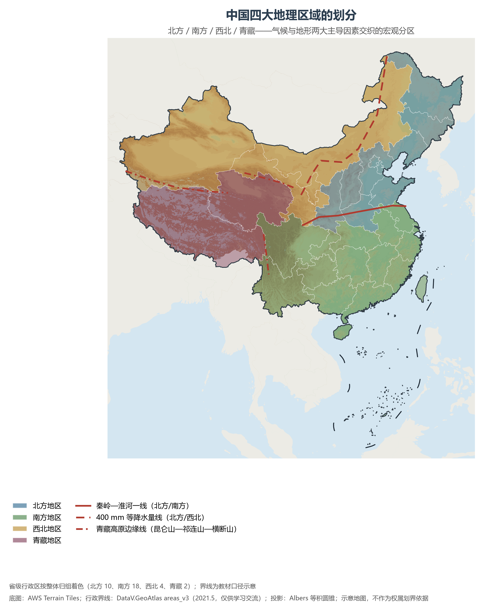
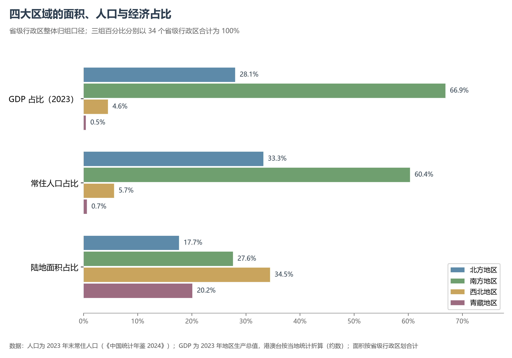
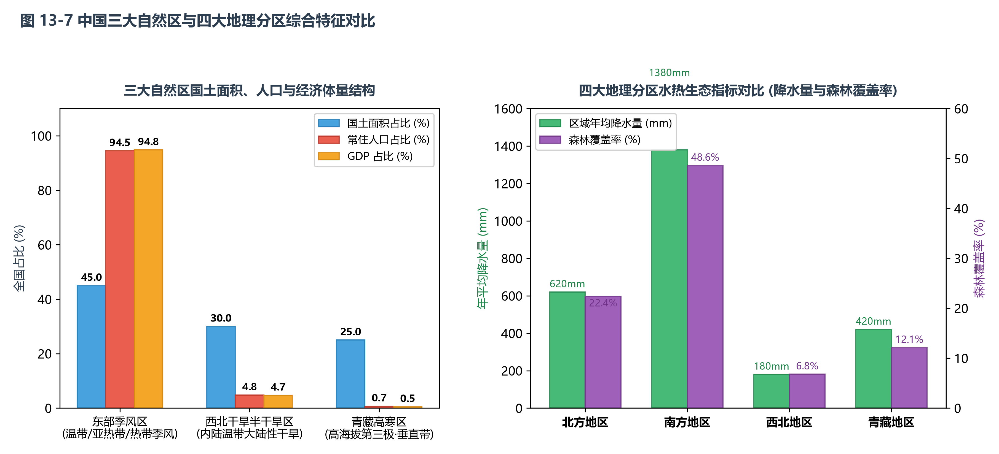

# 13.1 四大地理区域的划分

在 960 万 km² 的陆地国土与约 300 万 km² 的主张管辖海域之上，黑龙江漠河冬季能达到 −50 ℃ 以下的极寒，海南岛与南海诸岛却长夏无冬；新疆吐鲁番盆地与塔里木腹地终年难得一场透雨，江南水乡与华南沿海却常因梅雨连绵与台风暴雨汛情严峻；青藏高原平均海拔超 4000 米横空出世，长江与黄河下游冲积平原却海拔不及数十米。要把一个地理异质性如此显著、人地系统演化如此复杂的超大陆型国家系统剖析，最基础也最核心的认识工具就是综合地理区划——将相似的自然水热基底、地貌骨架、农业熟制与人文经济组合归并，区域间的共性规律与差异特征便清晰显现。中国地理认知中最通行、影响最深远的空间框架，正是将全国 34 个省级行政区系统归入**北方地区、南方地区、西北地区、青藏地区**四大区域。

## 一、主导动力与三条宏观地理界线

四大地理区域的划定并非人为的随意切割，而是深刻受控于中国大地构造格局与季风气候环流两大动力系统。其划分依据可提炼为**气候动力**（气温年较差、热量积温与降水干湿组合）与**地貌阶梯**（海拔高度、构造地貌单元与大地形阻隔）两条主导线索，空间上落实为三条标志性的地理界线：

| 标志性界线 | 划开的地理大区 | 关键自然与气候指标 | 关键农业与人文地理内涵 |
|:---|:---|:---|:---|
| **秦岭—淮河一线** | 北方地区 ∣ 南方地区 | 1 月 0 ℃ 等温线、年降水量 800 mm 等值线、暖温带与亚热带分界线、湿润区与半湿润区分界线、河流有无冬季结冰期 | 水田农业（水稻）与旱地农业（小麦/玉米）分界、一年两熟/三熟与两年三熟分界、温带落叶阔叶林与亚热带常绿阔叶林分界、传统“南船北马”交通分界 |
| **400 mm 等降水量线** | 北方地区 ∣ 西北地区 | 季风区与非季风区大致界线、半湿润区与半干旱区分界线、东部森林生态系统与温带草原荒漠生态系统分界 | 农耕文明核心区与传统游牧文明区历史交错带、种植业为主与畜牧业为主分水岭、生态脆弱环境敏感带 |
| **青藏高原边缘线** | 北方/西北/南方 ∣ 青藏地区 | 昆仑山脉—阿尔金山脉—祁连山脉—横断山脉一线，大致沿 3000—4000 m 等高线展布，中国地势第一级阶梯与第二级阶梯分界线 | 高原高寒气候与季风/大陆性气候分界、高原草甸高寒牧业/河谷农业与低海拔农业分界、“亚洲水塔”源区与受水区阶梯过渡 |

秦岭—淮河一线作为中国最经典的人文—自然综合过渡带，其地理阻隔效应不仅体现在自然要素的断层上，更深刻塑造了中国南北方的文化认同与生活方式：线北河流冬春封冻、土壤以潮土及褐土为主、面食为主粮、传统民居注重防寒保暖与向阳采光；线南河网稠密终年不冻、土壤以酸性红黄壤及水稻土为主、稻米为主食、民居注重通风散热与排水。400 mm 等降水量线自大兴安岭西麓向西南延伸，经张家口、兰州直至拉萨以东，构成了季风降水能够深入内陆的最远锋线，历史上长城的走向与该线高度契合，见证了农耕民族定居开垦与游牧民族逐水草而居数千年的竞合互动。青藏高原边缘线则是最为纯粹的地貌断崖：剧烈隆升的地块将高原地表推至对流层中上部，气压仅为海平面的 50%—60%，年均气温剧降，越过这一边缘，所有动植物物种谱系与人类经济活动均被赋予了极端高寒低氧的特殊印记。

**图 13-1 中国四大地理区域的划分**：底图为地形晕渲，四区界线为教材口径示意。

## 二、四大区域行政区划归组与综合要素矩阵

在实际地理教学、宏观政策统计与经济分析中，通常以省级行政边界为基础，将全国 34 个省级行政区完整划入四大区域（括号内为省级行政区数量）：
- **北方地区**（10 个）：北京市、天津市、河北省、山西省、辽宁省、吉林省、黑龙江省、山东省、河南省、陕西省；
- **南方地区**（18 个）：上海市、江苏省、浙江省、安徽省、福建省、江西省、湖北省、湖南省、广东省、广西壮族自治区、海南省、重庆市、四川省、贵州省、云南省、香港特别行政区、澳门特别行政区、台湾省；
- **西北地区**（4 个）：内蒙古自治区、甘肃省、宁夏回族自治区、新疆维吾尔自治区；
- **青藏地区**（2 个）：青海省、西藏自治区。

四大区域在国土纵深、人口承载、经济能级与资源禀赋上展现出极度悬殊而又高度互补的空间格局：

| 综合地理指标 | 北方地区 | 南方地区 | 西北地区 | 青藏地区 | 全国总计 / 综合说明 |
|:---|:---:|:---:|:---:|:---:|:---|
| **陆地面积**（万 km²） | 170.6 | 265.4 | 333.9 | 195.1 | 约 965 万 km²（含港澳台） |
| **陆地面积占比**（%） | 17.7% | 27.5% | 34.6% | 20.2% | 100.0% |
| **常住人口**（亿人，2023） | 4.79 | 8.69 | 0.82 | 0.10 | 14.40 亿人（含港澳台） |
| **常住人口占比**（%） | 33.3% | 60.4% | 5.7% | 0.7% | 100.0% |
| **人口密度**（人/km²） | 280.8 | 327.4 | 24.6 | 5.1 | 全国平均约 149 人/km² |
| **地区生产总值**（万亿元，2023） | 37.5 | 89.3 | 6.1 | 0.6 | 约 133.5 万亿元（含折算） |
| **经济总量占比**（%） | 28.1% | 66.9% | 4.6% | 0.4% | 100.0% |
| **人均 GDP**（万元/人，2023） | ~7.83 | ~10.28 | ~7.44 | ~6.00 | 全国平均约 8.94 万元/人 |
| **多年平均降水量**（mm） | 400—800 | 800—2000+ | <400（大部<200） | 50—1000（东南向西北骤减） | 呈现东南向西北梯度递减 |
| **主要土壤类型** | 黑土、褐土、黄绵土、潮土 | 红壤、黄壤、水稻土、紫色土 | 灰钙土、荒漠土、棕钙土、盐碱土 | 高寒草甸土、高寒草原土、冻土 | 反映生物气候地带性分异 |
| **耕地熟制与作物** | 一年一熟至两年三熟（小麦/玉米/大豆） | 一年两熟至三熟（水稻/油菜/热带水果） | 一年一熟（灌溉春小麦/棉花/瓜果） | 一年一熟（青稞/豌豆/耐寒油菜） | 水热决定农业生产潜能 |
| **生态与战略定位** | 政治核心、大国粮仓、重工能源基地 | 经济引擎、创新枢纽、对外贸易前沿 | 资源保障、绿色能源、陆上丝路西部门户 | 亚洲水塔、生态安全屏障、边疆国防要塞 | 区域功能空间分工高度协同 |

**图 13-2 四大区域的面积、人口与经济占比**：南方以约 28% 的国土承载了六成人口、创造了三分之二的经济总量。

## 三、学术基石：三大自然区方案与四大地理分区的耦合机制

理解四大地理分区的科学本质，必须回溯中国现代地理学的奠基性成就。1950 年代，中国科学院地理科学与资源研究所黄秉维先生主持编制了《中国综合自然区划（初稿）》，确立了以气候（热量与水分平衡）和大地貌为第一级划分指标的**中国三大自然区**学说：
1. **东部季风区**（约占全国陆地面积 45%，集中 94% 以上人口）：受夏季风强烈影响，气候湿润半湿润，广泛发育森林与农田，是中国农业文明的发祥地与现代城镇化核心区；
2. **西北干旱半干旱区**（约占陆地面积 30%，人口仅占约 5%）：深居内陆、水汽隔绝，年降水量不足 400 mm，以草原、荒漠、干旱内流盆地与绿洲灌溉为主要景观；
3. **青藏高寒区**（约占陆地面积 25%，人口不足 1%）：平均海拔超过 4000 m，太阳辐射极强但气温低劣，受垂直地带性严格制约，广泛分布现代冰川、多年冻土与高寒草甸。

中学地理与社会应用层面的“四大地理分区”，本质上是**三大自然区在兼顾省级行政区划统计边界下的衍生与重组**：
- **东部季风区**由于南北纬度跨度超过 30 度，内部热量差异极大，以**秦岭—淮河一线**为天然界桩，横向一分为二：北部为**北方地区**（温带季风气候），南部为**南方地区**（亚热带与热带季风气候）；
- **西北干旱半干旱区**与**青藏高寒区**分别对应**西北地区**与**青藏地区**。但由于行政管理的整体性原则，内蒙古自治区全境被统一划入西北地区，青海省与西藏自治区全境统一划入青藏地区。

**图 13-7 中国三大自然区与四大地理分区综合特征对比**：左图对比三大自然区国土面积、常住人口与 GDP 体量结构；右图呈现四大地理分区在平均降水量与森林覆盖率上的生态分化。

## 四、过渡带精微解构：自然界线与行政边界的空间穿插

任何将连续的自然地理界面裁决为离散行政单元的划分，都必然面临“过渡带”的地理折衷。四大区域的分界线并非锋利如刀，而是穿插着一系列引人入胜的地理过渡与倒错现象：

| 代表性过渡地带 | 涉及行政区 | 自然地理归属 | 行政归组归属 | 关键地理特征与倒错解构 |
|:---|:---|:---|:---|:---|
| **秦巴山地与汉中盆地** | 陕西省南部（汉中、安康、商洛） | 南方地区（长江水系汉江流域、亚热带湿润气候） | 北方地区 | 秦岭主脊以南气候湿润，广泛种植水稻、油菜、茶叶与柑橘，民居呈现南方穿斗式青瓦房风貌，但行政上隶属陕西省（传统北方省份）。 |
| **陇南白龙江流域** | 甘肃省东南部（陇南市） | 南方地区（长江水系嘉陵江支流、北亚热带气候） | 西北地区 | 处于青藏高原东坡与秦岭西端交接处，山高谷深、植被葱郁，是甘肃唯一的长江流域与柑橘、茶叶产区，素有“陇上江南”之称。 |
| **大兴安岭东麓与呼伦贝尔** | 内蒙古自治区东部（呼伦贝尔、兴安盟、通辽、赤峰） | 北方地区（东部季风区、黑土湿润半湿润带） | 西北地区 | 拥有肥沃的暗栗钙土与黑土，主要河流属松花江与辽河水系，广泛种植玉米、大豆与水稻，景观与经济结构完全融入东北平原，但行政上属内蒙古。 |
| **藏东南察隅与墨脱河谷** | 西藏自治区林芝市 | 南方地区乃至热带区（低海拔河谷、雅鲁藏布江大峡谷水汽通道） | 青藏地区 | 迎印度洋西南季风暖湿气流，海拔骤降至 1000 米以下，年降水量超 2000 mm，发育着世界纬度最高的热带季风常绿阔叶林与香蕉、芭蕉林，与高寒西藏形成极致对比。 |
| **川西高原与横断山区** | 四川省西部（甘孜藏族自治州、阿坝藏族羌族自治州） | 青藏高寒区（第一级阶梯主体、高寒草原与草甸） | 南方地区 | 平均海拔 3500—4500 米，主要生计为牦牛牧业与高寒草甸生态保护，地貌与文化属于典型青藏高原，但行政隶属于四川省。 |
| **淮河中游与豫东南/皖北** | 河南省信阳市、安徽省蚌埠以北 | 南北过渡带（淮河南北两岸） | 河南归北方，安徽归南方 | 信阳水田遍布、盛产“信阳毛尖”，在气候与文化上兼具南北特色；皖北平原以旱作小麦玉米为主，行政上随安徽省归入南方组。 |

这些过渡带不仅是地理科学探索生物多样性、生态交错区（ecotone）的绝佳天然实验室，也是理解中国统一多民族国家行政区划“犬牙相入”（打破山川天然闭合、防止割据）深层政治智慧的生动注脚。

## 五、世界坐标系下的四大区域：一个区域即一个超大国

将中国四大区域置于全球地理与经济坐标系中审视，各区域的体量与功能足以比肩甚至超越世界一流大国：

- **南方地区**：常住人口约 8.7 亿，不仅远超整个欧洲联盟（约 4.5 亿）与美国（约 3.4 亿）的人口总和，其约 89.3 万亿元（约合 12.6 万亿美元）的经济总量，单独列出即可超越日本与德国的总和，稳居世界第三大经济体（仅次于中美两国）。这里集聚了全球最大规模的高端制造集群、世界上最繁忙的沿海海港群（宁波舟山港、上海港、深圳港、广州港），是全球化产业链不可替代的超强中枢。
- **北方地区**：人口 4.79 亿，体量与欧盟相当；地区生产总值约 37.5 万亿元（约合 5.3 万亿美元），单独衡量已超过日本或德国本土经济体量。这里坐拥中国首都北京与雄安新区国家战略高地，守护着保障 14 亿人吃饭的“东北+黄淮海”粮食压舱石，开采着全国七成以上的煤炭与超半数陆上原油，是大国博弈不可或缺的重工业硬核底座与粮食能源安全屏障。
- **西北地区**：坐拥 334 万 km² 陆地空间，相当于 9 个德国的面积，人口 8188 万与德国相当。虽然降水匮乏，但这里拥有中国规模最大的“沙戈荒”风电光伏清洁能源大基地、世界最大的稀土矿床（白云鄂博）与最深层油气宝藏；依托中欧班列西通道与亚欧大陆桥，从过去的“内陆末梢”一跃成为向西开放、连接中亚与欧洲的战略前沿。
- **青藏地区**：虽然人口仅约 959 万（相当于匈牙利一国规模），但其平均 4000 米以上的高度顶起了整个地球的“第三极”。作为长江、黄河、澜沧江、怒江、雅鲁藏布江、印度河等数十条跨国与骨干江河的源头，直接维系着下游东亚、南亚、东南亚近 20 亿人的生命水源；其积雪冰川与下垫面热力反馈深刻调节着北半球乃至全球大气环流，其战略生态价值与地缘屏障意义不可估量。

## 参考与数据来源

1. 自然区划基石：黄秉维《中国综合自然区划（初稿）》（科学出版社，1959）；郑度、葛全胜等《中国综合自然区划研究》（《地理学报》，2013）。
2. 行政归组与宏观统计：国家统计局《中国统计年鉴 2024》各省常住人口、地区生产总值、粮食与土地利用数据（2023 年截面数据，港澳台按当地官方统计及年均汇率折算）。
3. 水资源与生态指标：水利部《中国水资源公报 2023》各流域与水资源分区降水量；国家林业和草原局森林覆盖率统计。
4. 地理界线坐标与投影：沿用本书统一定义的标准 Albers 等积圆锥投影与标准行政区划底图（DataV.GeoAtlas 2021.5）。
