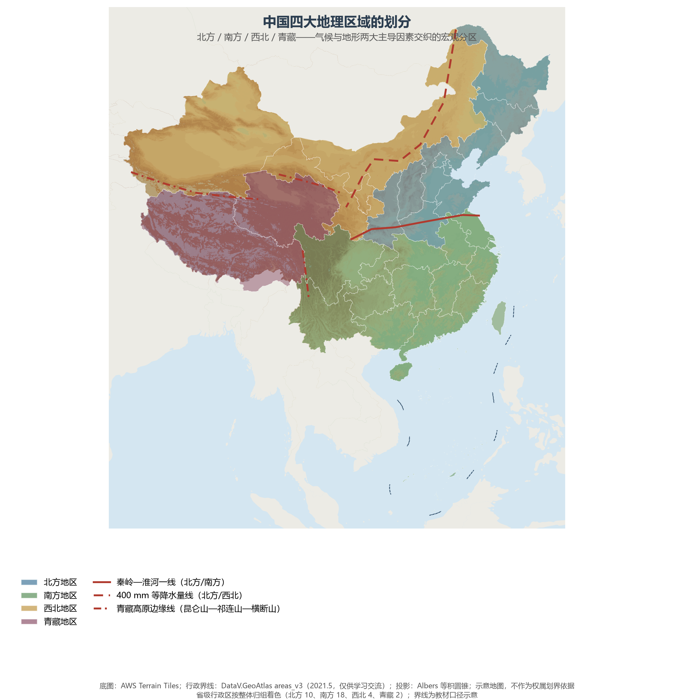
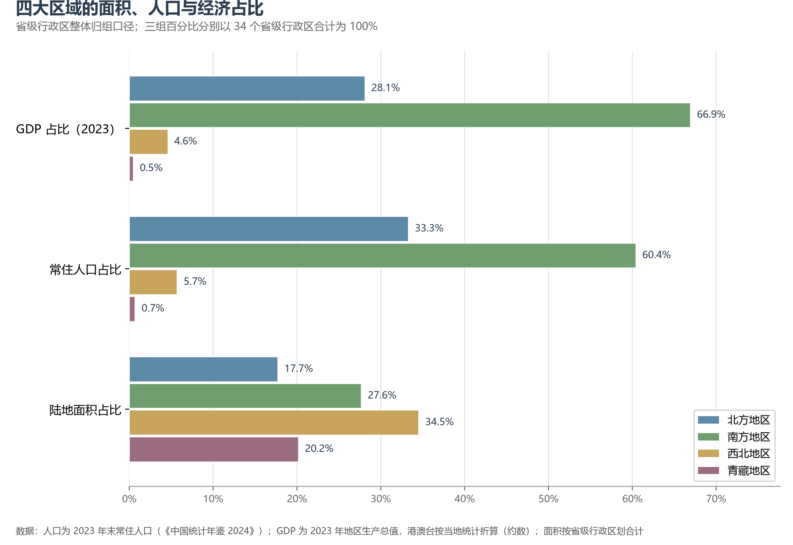

# 13.1 四大地理区域的划分

960 万 km² 的国土之上，黑龙江能冷到 −50 ℃，海南岛却四季如夏；塔里木盆地终年难逢一场雨，江南水乡却为梅雨所苦。要把一个差异如此巨大的国家讲清楚，第一件工具就是分区——把相似的自然与人文组合归并在一起，区域之间的对比便一目了然。中国地理最通行、影响最深的分区方案，是把全国 34 个省级行政区归入**北方地区、南方地区、西北地区、青藏地区**四大区域。

## 一、两条主导线索与三条界线

四大区域的划分依据可以归结为两条主导线索：**气候**（气温与降水的组合）与**地形**（海拔与地貌格局）。由此得出三条标志性界线：

| 界线 | 划开的区域 | 地理含义 |
|------|-----------|---------|
| **秦岭—淮河一线** | 北方地区 ∣ 南方地区 | 1 月 0 ℃ 等温线、800 mm 等降水量线、暖温带与亚热带分界、水田与旱地分界 |
| **400 mm 等降水量线** | 北方地区 ∣ 西北地区 | 季风区与非季风区的大致界线、半湿润与半干旱分界、农牧交错带 |
| **青藏高原边缘线** | ∣ 青藏地区 | 昆仑山—祁连山—横断山一线，约相当于 3 000—4 000 m 等高线，第一级阶梯的边缘 |

秦岭—淮河一线是中国最重要的一条人文—自然复合界线：线以北河流冬季封冻、耕地以旱地为主、农作物两年三熟或一年两熟；线以南河流不冻、水田连片、一年两熟到三熟。400 mm 等降水量线把季风所能滋养的东部与依赖高山雪水的内蒙古西部、新疆分开——这条线两侧，正是历史上农耕与游牧两大世界长期互动的地带。青藏高原边缘线最简单也最彻底：海拔本身就是一切，越过昆仑山、祁连山或横断山，气候、植被、农业、人口密度全部换了一套系统。

**图 13-1 中国四大地理区域的划分**：底图为地形晕渲，四区界线为教材口径示意。

## 二、四大区域包括哪些行政区

按教材口径把 34 个省级行政区整体归组，四大区域的构成如下（括号内为省级行政区数量）：

| 区域 | 省级行政区构成 |
|------|---------------|
| **北方地区**（10） | 北京市、天津市、河北省、山西省、辽宁省、吉林省、黑龙江省、山东省、河南省、陕西省 |
| **南方地区**（18） | 上海市、江苏省、浙江省、安徽省、福建省、江西省、湖北省、湖南省、广东省、广西壮族自治区、海南省、重庆市、四川省、贵州省、云南省、香港特别行政区、澳门特别行政区、台湾省 |
| **西北地区**（4） | 内蒙古自治区、甘肃省、宁夏回族自治区、新疆维吾尔自治区 |
| **青藏地区**（2） | 青海省、西藏自治区 |

这一归组兼顾自然与行政两方面：内蒙古按其主体（高原牧区、灌溉绿洲）划入西北；东北三省与黄河中下游各省同属温带季风的旱作世界，同归北方。13.2—13.4 节的分区总论与 13.5 节的分省详述均采用这一口径。

## 三、四大区域的体量对照

四大区域的体量对比极为悬殊：

| 区域 | 面积占比 | 人口占比（2023） | GDP 占比（2023） | 气候类型 | 农业类型 | 代表地形区 |
|------|---------|----------------|-----------------|---------|---------|-----------|
| 北方地区 | 17.7% | 33.3% | 28.1% | 温带季风为主 | 旱地农业 | 东北平原、华北平原、黄土高原 |
| 南方地区 | 27.6% | 60.4% | 66.9% | 亚热带、热带季风 | 水田农业 | 长江中下游平原、东南丘陵、四川盆地 |
| 西北地区 | 34.5% | 5.7% | 4.6% | 温带大陆性 | 灌溉农业、畜牧业 | 内蒙古高原、塔里木盆地、准噶尔盆地 |
| 青藏地区 | 20.2% | 0.7% | 0.5% | 高原山地 | 河谷农业、高寒牧业 | 青藏高原、柴达木盆地 |

**图 13-2 四大区域的面积、人口与经济占比**：南方以约 28% 的国土承载了六成人口、创造了三分之二的经济总量。

三组数字放在一起，中国地理的基本格局便浮现出来：**东南半壁以不足三成的国土聚集了六成人口**，与 9.2 节的胡焕庸线互为印证；**西北与青藏合计占据全国一半以上的国土，却只居住着 6.4% 的人口**——那里不是不重要，而是被降水与海拔设定了另一种发展逻辑：生态屏障、能源资源与战略纵深。

## 四、世界视角：一个区域即一个大国

把四大区域放到世界坐标系里，其体量足以颠覆直觉：

- **南方地区**人口约 8.7 亿，超过欧盟（约 4.5 亿）与美国（约 3.4 亿）之和；2023 年地区生产总值约 89.3 万亿元，按年均汇率粗折约 12.6 万亿美元——单独拿出来已超过日本与德国两国之和。
- **北方地区**生产总值约 37.5 万亿元（约 5.3 万亿美元），单独衡量已超过日本；人口 4.79 亿，与欧盟相当。
- **青藏地区**人口约 959 万，大体相当于匈牙利一个国家，却顶着一整块世界屋脊——其战略价值（江河之源、生态屏障、国界边防）远非人口数字所能衡量。
- **西北地区**人口 8 188 万，与德国相当，分摊着全国约三分之一的国土。

## 五、口径说明：归组与过渡带

四大区域是**自然—人文综合区**，不是行政实体。省级整体归组是一种便于统计的简化，实际的自然界线穿过的正是那些著名的过渡带：

- **陕西秦岭南北**——汉中盆地与安康地区属亚热带季风气候、水田遍布，行政上却随陕西归入北方组；
- **甘肃陇南**——白龙江谷地已属长江流域，是甘肃省内的"南方"；
- **内蒙古东部**——呼伦贝尔、兴安、通辽、赤峰一带处半湿润区，大兴安岭东麓的农业景观与东北无异，行政上却与西北组同省；
- **河南信阳、安徽淮北**——恰骑在秦岭—淮河过渡带上，省内兼有南北方景观。

分区是认识地理差异的脚手架，不是刀切斧砍的边界；阅读以下各节时，既要用好分区，也要看到过渡。

## 参考与数据来源

1. 分区方案与界线：通行地理教材口径（秦岭—淮河、400 mm 等降水量线、青藏高原边缘）；界线坐标与第 4 章等值线一致。
2. 面积、人口与 GDP：按附录 A 口径分省合计（人口为 2023 年末常住人口，《中国统计年鉴 2024》；GDP 为 2023 年地区生产总值，港澳台按当地统计折算，约数）；百分比以 34 个省级行政区合计为 100。
3. 国际对比：欧盟、美国、日本、德国、匈牙利人口与 GDP 为 2023 年公开统计口径；汇率折算按 2023 年年均汇率（约 7.08）粗算，仅作量级参照。
4. 行政界线底图：DataV.GeoAtlas areas_v3（2021.5，仅供学习交流）。
