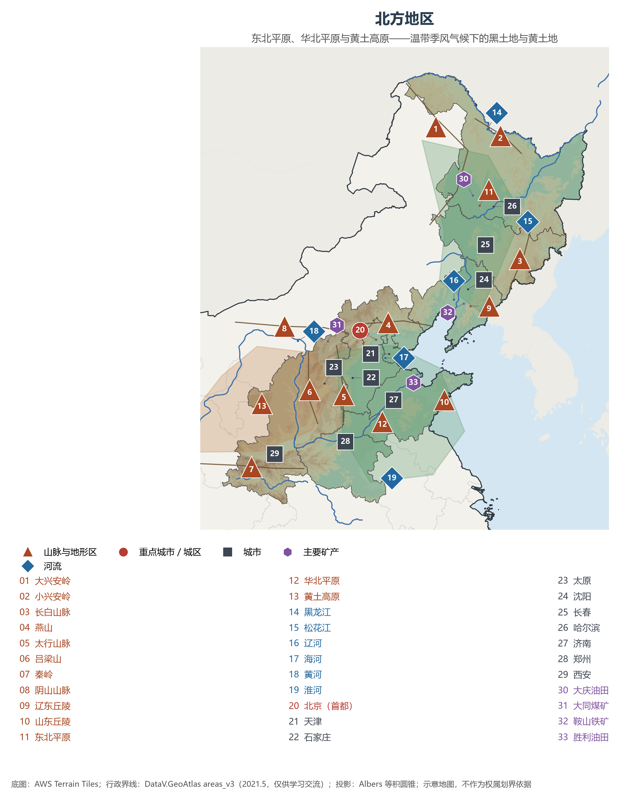
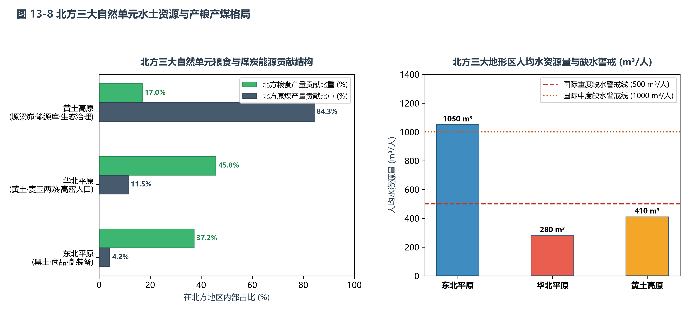

# 13.2 北方地区

北方地区包括东北三省、京津冀晋、山东、河南与陕西共 10 个省级行政区，陆地面积约 170.6 万 km²，常住人口 4.79 亿，2023 年地区生产总值约 37.5 万亿元。这片被黄土地、黑土地与广袤山脉覆盖的热土，不仅是中华文明最重要的发祥地之一——八大古都中的六座（西安、洛阳、开封、安阳、郑州、北京）在此巍然挺立，也是当代中国最坚实的大国粮仓与能源工业骨骼：东北黑土地产出全国四分之一以上的商品粮，晋陕两省支撑起全国半数以上的原煤供应。

## 一、行政区划范围与人口经济概况

北方地区内部各省份在国土尺度、资源禀赋与发展阶段上各有专长：

| 省级行政区 | 陆地面积（km²） | 常住人口（万，2023） | GDP（亿元，2023） | 行政中心 | 核心地理与经济特征 |
|:---|:---:|:---:|:---:|:---|:---|
| **北京市** | 16,410 | 2,186 | 43,760 | 北京 | 全国政治中心、文化中心、国际交往中心、科技创新中心，减量双控与减量提质 |
| **天津市** | 11,966 | 1,364 | 16,737 | 天津 | 北方最大海港门户，全国先进制造研发基地与北方国际航运核心区 |
| **河北省** | 188,800 | 7,393 | 43,944 | 石家庄 | 京津生态环境支撑区与产业转型前沿，雄安新区“千年大计”起笔之地，钢铁大省 |
| **山西省** | 156,700 | 3,466 | 25,666 | 太原 | “煤海”能源革命综合改革试点，黄土高原表里山河，小杂粮与历史古建第一大省 |
| **内蒙古东部** | *(行政属内蒙)* | *(~1,100)* | *(~10,000)* | — | 呼伦贝尔、兴安盟、通辽、赤峰四盟市自然属于东北区，玉米大豆与商品粮基地 |
| **辽宁省** | 148,700 | 4,182 | 30,209 | 沈阳 | 东北经济龙头与工业摇篮，辽中南重工业基地，沈阳装备制造与大连港口石化 |
| **吉林省** | 187,400 | 2,339 | 13,532 | 长春 | 中国汽车工业摇篮（一汽）、长白山生态屏障与松辽平原百亿斤黄金玉米带 |
| **黑龙江省** | 473,000 | 3,062 | 15,884 | 哈尔滨 | 中国“北大仓”，粮食总产连续 15 年全国第一（1600 亿斤），大庆油田与冰雪旅游 |
| **山东省** | 157,900 | 10,123 | 92,069 | 济南 | 北方经济第一大省，工业农业双料强省，齐鲁文化中心，黄河入海口与半岛港口群 |
| **河南省** | 167,000 | 9,815 | 59,133 | 郑州 | “大国面案”，全国第一小麦生产省，中原城市群核心，综合交通枢纽“十”字交汇 |
| **陕西省** | 205,600 | 3,952 | 33,793 | 西安 | 关中平原科技工业与古都文化、陕北神府亿吨级能源基地、陕南秦巴南水北调水源涵养 |

**图 13-3 北方地区**：三大地形区与主要河流、城市、矿产分布（编号说明见图下）。

## 二、三大自然单元的地貌骨架与土壤指纹

北方地区的宏观地貌自东向西呈现极其分明的“三大地形单元与两大山海半岛”格局：

| 地形单元 | 涵盖范围与面积 | 地形地貌结构特征 | 主导土壤与地球化学指纹 | 关键生态与人地关系特征 |
|:---|:---|:---|:---|:---|
| **东北平原** | 松嫩平原、三江平原、辽河平原（约 35 万 km²） | 中国最大平原，外围由大兴安岭、小兴安岭、长白山“马蹄形”山脉环抱，内部坦荡开阔 | **黑土、黑钙土、草甸土**：深厚有机质富集，土壤肥力极高，被称为“耕地中的大熊猫” | 机械化规模耕作水平最高，“捏把黑土冒油花”；面临黑土层变薄退化风险，正推行秸秆覆盖还田“梨树模式”保护性耕作 |
| **华北平原** | 海河平原、黄淮平原、鲁西北平原（约 30 万 km²） | 黄河、海河、淮河大川泥沙合力冲积形成的巨型平原，地势低平微倾，黄河在平原呈“地上悬河”脊状隆起 | **潮土、冲积黄土、盐碱土**：土层极其深厚疏松，保肥蓄水良好，但局部低洼地易返盐返碱 | 中国人口最密集、农垦历史最悠久的平原之一；深层地下水曾长期超采形成巨型漏斗区，南水北调中东线实施后回补显著 |
| **黄土高原** | 晋陕峡谷两岸、陇东陇中、宁南（约 64 万 km²） | 全球黄土覆盖最厚（数百米）、面积最广的古老沉积区，流水强烈切割下形成塬、梁、峁深沟大壑 | **黄绵土、褐土**：粉砂颗粒细致、孔隙度高、遇水垂直节理崩塌，极易发生水土冲刷 | 曾是黄河巨量泥沙之源；经过数十年植树造林、封山育林、打坝淤地，植被覆盖率已翻倍，黄河入黄泥沙呈现断崖式下降 |
| **辽东/山东半岛** | 渤海两翼山地丘陵（面积约 10 万 km²） | 胶东丘陵与辽东山地，花岗岩低山丘陵连绵，基岩海岸岬角海湾相间 | **棕壤、粗骨土**：微酸性至中性，排水良好 | 北方优质温带水果（烟台苹果、莱阳梨、大连大樱桃）主产区与海洋经济前沿 |

三大单元不仅构成了北方地貌的物理底盘，其土壤类型（黑土、冲积潮土、风成黄土）更是大自然赋予北方农业生产潜力的深层基因。

## 三、温带季风气候的“冷”与“旱”动力学

北方地区整体深处北纬 32° 以北，主体属于典型的**温带季风气候**（北部大兴安岭伸入寒温带，华北平原与关中盆地属暖温带）：
- **气温分异与热量阶梯**：冬季在强大西伯利亚冷高压控制下，偏北季风长驱直入，南北温差极大——黑龙江漠河 1 月平均气温低至 −26 ℃ 至 −30 ℃，东北全境河流封冻期长达 4—6 个月；而黄河南岸与关中平原 1 月均温维持在 0 ℃ 附近。夏季太阳直射点北移、昼长夜短，全境普遍暖热（7 月均温普遍超 20 ℃），形成极利于作物生长的“雨热同期”。
- **降水梯度与水热错位**：年降水量自东南部的 800 mm 向西北边缘的 400 mm 逐步递减，且年内分配极度集中——60%—80% 的降水倾泻在 7—8 月的“七下八上”雨季，极易引发局地暴雨洪涝；而春季（3—5 月）升温迅猛、蒸发强烈但季风雨带尚在华南，降水量不及全年的 10%，由此产生严重的**华北春旱**，正值冬小麦拔节返青需水高峰，水热时空错位矛盾极度尖锐。
- **低温冷害与气候韧性**：东北平原积温有限（无霜期 110—160 天），作物易遭受春季早霜与秋季早霜袭击（“冷涡”引发的低温冷害）；华北平原春末初夏常遇“干热风”灾害导致小麦灌浆受阻。近年来北方在耐寒耐旱品种选育、节水微喷灌与气象早期预警上建立了系统防线。

**图 13-8 北方三大自然单元水土资源与产粮产煤格局**：左图对比三大自然单元在北方内部粮食与煤炭供应的结构分工；右图展示三大自然单元人均水资源量与国际缺水警戒线的关系。

## 四、大国粮仓与“北粮南运”历史逆转

在传统中国历史上，“江南熟，天下足”代表了南方稻米向北方的单向漕运调配；而当代中国农业地理经历了一场世纪大逆转——**“北粮南运”**成为维系 14 亿人饭碗的全新基石：
1. **东北黑土粮仓（国家稳固压舱石）**：东北三省与内蒙古东部拥有广阔平坦的沃野，人均耕地面积是全国平均水平的 3 倍以上，粮食综合机械化率超 98%。黑龙江省粮食年总产量稳定突破 1600 亿斤（达 1603 亿斤），连续 15 年位居全国第一，净调出粮食占全国超三分之一；吉林玉米与大豆、辽宁优质水稻形成规模集群。东北已成为中国最大、最稳定的粳稻、商品玉米与大豆战略供应基地。
2. **华北平原粮袋（小麦主产区）**：华北平原凭借深厚土层与光热优势，形成了以“冬小麦—夏玉米”一年两熟为主的精耕细作体系。河南省小麦年产量占全国总量的四分之一以上，享有“中原粮仓、大国面案”之美誉；山东省不仅小麦产量常年稳居前列，蔬菜产量更是连续数十年冠绝全国（寿光设施蔬菜销往全国）。
3. **黄土高原特色旱作与生态农业**：退耕还林还草工程实施后，黄土高原摆脱了“越穷越垦、越垦越穷”的恶性循环，发展出全球规模最大的优质矮砧苹果种植带（陕西延安、洛川，山西吉县等苹果产量占全国超四成），小杂粮（谷子、糜子、燕麦、红枣、核桃）成为特色富民支柱。

## 五、工业基地蜕变、能源血脉与重大区域战略

北方地区是新中国工业化“长子”诞生的摇篮，更是支撑现代工业运转的能源血脉：
- **两大传统工业基地的深层重构**：
  - **辽中南重工业基地**：依托丰富的铁矿（鞍山、本溪）、煤矿与石油（辽河），新中国第一炉钢水、第一艘万吨轮船、第一架喷气式战斗机在此诞生。当前，辽中南正摆脱单一原料依赖，向大连绿色石化与高技术造船、沈阳高端数控机床与航空航天装备等先进制造业转型；
  - **京津唐综合性工业基地**：紧密依托环渤海港口群与京津智力资源，北京中关村引领全国人工智能与集成电路创新，天津发展航空航天与海洋工程装备，唐山推动高品质特种钢材与绿色临港工业。
- **“煤海油田”战略能源保障体系**：北方拥有全国最富集的化石能源储量。山西大同、朔州，陕西榆林神府，与内蒙古鄂尔多斯连成世界级的“煤炭金三角”，原煤产量占全国 70% 以上；晋陕蒙能源基地通过大秦铁路、朔黄铁路、瓦日铁路、浩吉铁路等重载铁路将“北煤南运”，并通过特高压输电通道将煤电直送华东与华南；大庆油田（累计产油超 25 亿吨）、胜利油田与渤海海上油田筑牢了中国原油自给安全防线。
- **重大国家发展战略交汇**：
  - **京津冀协同发展**：着力疏解北京非首都功能，高标准建设河北雄安新区与北京城市副中心，打破行政壁垒，形成 1 小时城际铁路通勤圈与跨流域生态廊道；
  - **新时代东北全面振兴**：聚焦维护国家“国防安全、粮食安全、生态安全、能源安全、产业安全”五大安全重任，推动体制机制创新与现代化产业体系建设；
  - **黄河流域生态保护和高质量发展**：坚持“以水定城、以水定地、以水定人、以水定产”，黄河中游水土保持与下游生态廊道建设并举，推动北方经济走向绿色韧性发展。

## 参考与数据来源

1. 面积与人口：国家统计局《中国统计年鉴 2024》（2023 年末各省常住人口与陆地面积）。
2. 粮食统计：国家统计局《2024 年全国粮食生产数据公告》（黑龙江 1603 亿斤、河南小麦比重）。
3. 能源与水资源数据：国家能源局《2023 年全国电力与煤炭工业统计公报》；水利部《中国水资源公报 2023》（海河流域与黄河流域水资源总量、南水北调受水水量）。
4. 地理与生态研究：中国科学院地理科学与资源研究所《黄土高原水土保持与水沙演变评估报告》（2022）。
