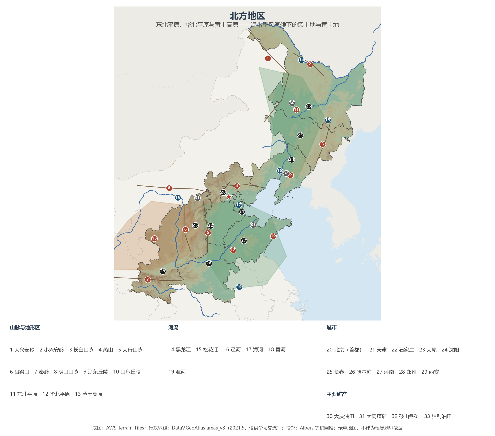

# 13.2 北方地区

北方地区包括东北三省、京津冀晋、山东、河南与陕西 10 个省级行政区，面积约 171 万 km²，常住人口 4.79 亿，2023 年地区生产总值约 37.5 万亿元。这里是中华文明的核心舞台之一：黄河滋养了最早的农耕文明，八大古都中的六座（西安、洛阳、开封、安阳、郑州、北京）坐落于此；这里也是当代中国的粮仓与能源库——东北黑土地生产着全国约五分之一的粮食，晋陕蒙撑起了全国煤炭产量的七成。

## 一、行政区划范围

| 省级行政区 | 面积（km²） | 常住人口（万，2023） | 行政中心 |
|-----------|------------|--------------------|---------|
| 北京市 | 16 410 | 2 186 | 北京 |
| 天津市 | 11 966 | 1 364 | 天津 |
| 河北省 | 188 800 | 7 393 | 石家庄 |
| 山西省 | 156 700 | 3 466 | 太原 |
| 辽宁省 | 148 700 | 4 182 | 沈阳 |
| 吉林省 | 187 400 | 2 339 | 长春 |
| 黑龙江省 | 473 000 | 3 062 | 哈尔滨 |
| 山东省 | 157 900 | 10 123 | 济南 |
| 河南省 | 167 000 | 9 815 | 郑州 |
| 陕西省 | 205 600 | 3 952 | 西安 |

自然地理上的北方并不与省界完全重合：内蒙古东部（呼伦贝尔—大兴安岭一带）的景观与东北无异，陕南汉中盆地已是亚热带风光，豫南信阳骑在秦岭—淮河过渡带上（见 13.1 节第五小节）。

## 二、三大地形区的骨架

北方地形自东向西呈现三大单元：**东北平原**（约 35 万 km²，中国最大平原）由松嫩平原、三江平原与辽河平原拼成，大兴安岭、小兴安岭与长白山合围出马蹄形格局；**华北平原**（约 30 万 km²）是黄河、海河、淮河合力冲积的成果，北部的海河平原与南部的黄淮平原以黄河为脊；**黄土高原**（约 60 万 km²）是全球黄土覆盖最厚、最连续的区域，塬、梁、峁纵横沟壑。此外，山东丘陵与辽东丘陵分插渤海两岸，汾河谷地与渭河平原（关中）嵌在山西、陕西的山地之间，秦岭横亘南缘，构成与南方之间的天然屏障。

**图 13-3 北方地区**：三大地形区与主要河流、城市、矿产分布（编号说明见图下）。

三块土地各有各的"土"：东北平原是**黑土**——世界三大黑土区之一，有机质含量高，一寸黑土要数百年才能形成；华北平原是黄河带来的**冲积土**，深厚肥沃，但旱涝盐碱曾是老大难；黄土高原是**风成的黄土**——细腻粉砂遇水易蚀，千年水土流失塑造了这里的地貌与艰辛。

## 三、温带季风：冷与旱的功课

北方全境属温带季风气候（西北缘向大陆性过渡），温度带自北向南跨寒温带、中温带与暖温带三带。冬季寒冷漫长：漠河 1 月均温约 −26 ℃，河流封冻期在东北可达半年；夏季短促而雨热同期，降水自东南的 800 mm 向西北的 400 mm 递减。熟制随之而变：东北一年一熟，华北两年三熟到一年两熟。两样气候苦头最出名：**华北春旱**——春季升温快、蒸发旺而雨季未到，冬小麦返浆水贵如油；**东北低温冷害**——积温勉强，一场早霜足以让玉米减产。

## 四、大江大河：从黑土到黄河

北方是黄河、海河、辽河、黑龙江—松花江四大家族的家园。东北诸河含沙量小、汛期短、结冰期长，松花江航运撑起东北水网；华北的海河水系呈扇形汇聚天津，径流小而季节差异极大；黄土高原的黄河支流（无定河、渭河、汾河）输走了黄河九成以上的泥沙——16 亿 t 的年输沙量曾在下游堆积出地上悬河，经四十余年治理已降至约 2 亿 t（见 5.3 节）。华北缺水是北方地理最紧的约束：黄淮海流域以全国 7.2% 的水资源承载约 35% 的人口与经济总量，地下水长期超采，直到南水北调东中线通水（2014 年）才略有喘息（见 5.5 节）。

## 五、大粮仓与老工业

**农业**上，北方是中国最大的商品粮基地：松嫩平原、三江平原是九大商品粮基地中的北方成员，东北三省粮食产量常年占全国约五分之一，含内蒙古东部则超过四分之一；黑龙江 2024 年粮食产量首次突破 1 600 亿斤，连续 15 年居全国第一。华北平原是冬小麦—玉米两年三熟的核心区，山东、河南两省粮食产量常年稳居全国前五。黄土高原在退耕还林（见 7.2 节）之后，小杂粮与苹果成了新的名片。

**工业**上，北方是共和国工业的摇篮：辽中南与京津唐两大重工业基地书写了"一五"以来的工业史——鞍山的钢、长春一汽的车、大连的船、大庆的油；156 项重点工程三分之一以上落地东北。能源家底至今仍是北方最大的牌：山西、陕西、内蒙古三省区原煤产量合计占全国约七成，大同、平朔、神府东胜的煤田与太原、鄂尔多斯的"煤都"之名相映（见 11.3 节）。

**城市与战略**上，北京是首都所在，天津是北方最大港口城市，京津冀协同发展、东北全面振兴先后上升为国家战略（见 11.4 节）。北方的问题与优势同样鲜明：资源型城市转型、人口外流与产业结构偏重，是东北振兴要解的题；而雄安新区、山东半岛城市群与黄河流域生态保护和高质量发展，是北方正在书写的新篇。

## 六、世界视角：世界三大黑土区之一

全球黑土带只有三块：乌克兰大平原、美国密西西比河流域与中国东北平原。三者纬度相近、同样"一两土一两油"，也都经历过开垦过度、黑土变薄的经历——美国 1930 年代的"黑风暴"直接催生了现代水土保持立法，乌克兰黑土层百年间平均损失近半，中国东北则自 2022 年起以《黑土地保护法》护住"耕地中的大熊猫"。东北平原的复种条件虽不及美国玉米带（一年一熟对一年两熟），但人均耕地远高于全国平均，规模化与机械化程度最高，是名副其实的"北大仓"。

## 参考与数据来源

1. 面积、人口：附录 A 口径（《中国统计年鉴 2024》，2023 年末常住人口）；GDP 分省合计口径见 13.1 节。
2. 粮食：国家统计局分省粮食产量数据；东北三省占比、黑龙江 2024 年 1 600 亿斤（科技日报、新华网报道）。
3. 黄淮海流域水资源 7.2%、人口与经济约 35%：国家发展改革委（2024）、水利部南水北调工程口径。
4. 煤炭占比：国家统计局、国家能源局公开数据（详见 11.3 节）。
5. 世界黑土对比：联合国粮农组织（FAO）全球土壤伙伴关系资料、《黑土地保护法》（2022）。
