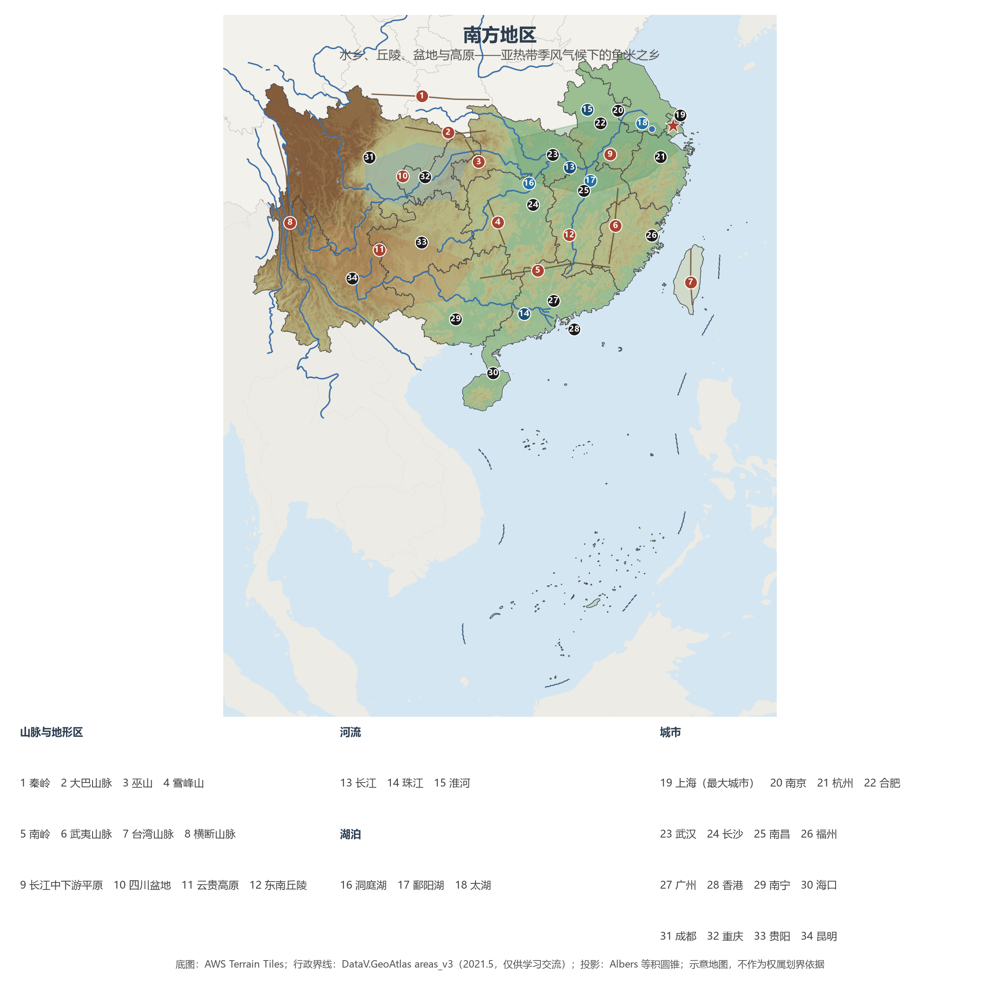

# 13.3 南方地区

南方地区包括长江中下游与东南沿海各省、西南各省区市及港澳台共 18 个省级行政区，面积约 268 万 km²，常住人口 8.69 亿，2023 年地区生产总值约 89.3 万亿元。自唐宋"经济重心南移"完成以来，南方就是中国的财赋重地；今天，它以约 28% 的国土承载全国六成人口、创造三分之二的经济总量，长三角与珠三角两大引擎都从这里起跳。

## 一、行政区划范围

| 省级行政区 | 面积（km²） | 常住人口（万，2023） | 行政中心 |
|-----------|------------|--------------------|---------|
| 上海市 | 6 340 | 2 487 | 上海 |
| 江苏省 | 107 200 | 8 526 | 南京 |
| 浙江省 | 105 500 | 6 627 | 杭州 |
| 安徽省 | 140 100 | 6 121 | 合肥 |
| 福建省 | 124 000 | 4 183 | 福州 |
| 江西省 | 166 900 | 4 515 | 南昌 |
| 湖北省 | 185 900 | 5 838 | 武汉 |
| 湖南省 | 211 800 | 6 568 | 长沙 |
| 广东省 | 179 700 | 12 706 | 广州 |
| 广西壮族自治区 | 237 600 | 5 027 | 南宁 |
| 海南省 | 35 400 | 1 043 | 海口 |
| 重庆市 | 82 400 | 3 191 | 重庆 |
| 四川省 | 486 000 | 8 368 | 成都 |
| 贵州省 | 176 200 | 3 865 | 贵阳 |
| 云南省 | 394 100 | 4 673 | 昆明 |
| 香港特别行政区 | 1 114 | 750 | — |
| 澳门特别行政区 | 33 | 68 | — |
| 台湾省 | 36 000 | 2 342 | — |

注：港澳台人口为当地口径（香港、澳门为 2023 年年中人口，台湾为 2023 年末口径），GDP 按当地统计折算人民币（约数，见附录 A）。

## 二、五类地貌拼出的南方

南方是四大区域中地貌最破碎、类型最齐全的一块：**长江中下游平原**（约 20 万 km²）由江汉平原、洞庭湖平原、鄱阳湖平原、皖中沿江平原与长江三角洲串珠状连成；**东南丘陵**（江南丘陵、两广丘陵、闽浙丘陵的合称）红壤遍布；**四川盆地**（约 26 万 km²）紫色砂页岩风化出"紫色盆地"，成都平原因都江堰而"水旱从人"；**云贵高原**喀斯特地貌发育，"地无三里平"；**横断山区**高山深谷南北纵列，是中国山地垂直带谱最完整的地方。边缘的秦岭、大巴山、巫山、南岭、武夷山把南方围合成相对独立的地理单元。

**图 13-4 南方地区**：平原、丘陵、盆地、高原与主要河湖分布（编号说明见图下）。

土壤与地貌一一对应：丘陵上是**红壤**（酸性，宜茶宜杉），盆地是**紫色土**，平原洼地是人工耕作千年的**水稻土**——"红壤丘陵茶果飘香、平原水乡稻鱼共生"正是南方农业地理的写照。

## 三、亚热带季风：雨热同期的极致

南方主体属**亚热带季风气候**，南缘（雷州半岛、海南、云南南部、台湾南部）进入**热带季风气候**。年降水量普遍在 800—1 600 mm，东南沿海与山地迎风坡超过 2 000 mm；无霜期长，一年两熟到三熟。季风的年际脾气在这里表现最烈：**梅雨**（6 月中旬至 7 月上旬长江中下游的连绵降水）与**伏旱**（7—8 月副高控制下的晴热少雨）首尾相接，**台风**夏秋登陆（年均 7—8 个），冬季寒潮亦可长驱直入两广——南方的农业、水利与城市内涝治理，本质上都是与季风的谈判（见 4.4 节）。

## 四、水乡中国的水

南方是中国的"水袋"：长江、珠江两大水系与东南沿海诸河贡献了全国水资源总量的八成以上（历年《中国水资源公报》口径）。长江横贯东西，干流航运能力相当于数条铁路（"黄金水道"，见 5.2 节）；珠江水量居全国第二，撑起珠三角的吞吐；洞庭湖、鄱阳湖、太湖构成中国最大的淡水湖群。水多也水患：1998 年长江流域大洪水之后，退田还湖、退耕还林与堤防体系重塑了人水关系（见 7.2 节）。

## 五、稻作文明与外向型经济

**农业**上，南方是稻作文明的故乡：水田连片、一年两熟至三熟，江汉、洞庭、鄱阳、成都、珠江三角洲五大平原是九大商品粮基地中的南方主力；淡水渔业以长江水系为最盛，"鱼米之乡"名副其实。丘陵山地贡献了全国绝大部分的茶叶、柑橘与蔗糖，云南、贵州的立体气候造就"一山有四季"的作物谱系。西南还是少数民族最集中的地区——云南一省即有 25 个世居少数民族，民族自治地方遍布（见 9.3 节）。

**经济**上，南方的领先是历史与现实的双重叠加：唐宋以后经济重心南移，明清江南市镇与珠三角贸易网络已执全国之牛耳；1980 年以来，深圳、珠海、汕头、厦门、海南五个经济特区与浦东开发先后把南方推向改革开放前沿。今天的南方坐拥长三角（约 33 万亿元 GDP、2.4 亿人口）、珠三角（粤港澳大湾区）、成渝、长江中游四大城市群（见 10.2 节），贡献了全国对外贸易的绝大部分，也是数字经济与制造业升级的主战场。方言版图同样以南方为最——吴、湘、赣、客家、粤、闽诸方言的复杂程度，正是南方山地阻隔、移民层叠的空间注脚。

## 六、世界视角：水稻与人

南方的水稻版图放在世界上看更有分量：全球约九成稻米产于亚洲，中国是世界最大稻米生产国，长江流域的稻作历史可上溯至上万年前的上山文化。杂交水稻自 1970 年代推广以来把中国水稻单产推至世界前列，袁隆平团队的成就随后推广到东南亚、非洲与美洲——从养活自己到造福世界，南方水乡写下了人口地理学上最重要的注脚之一。

## 参考与数据来源

1. 面积、人口：附录 A 口径（《中国统计年鉴 2024》；港澳台为当地口径）；GDP 分省合计口径见 13.1 节。
2. 水资源占比：水利部历年《中国水资源公报》（南方四区合计占比常年 80% 以上）。
3. 台风登陆频数：中国气象局口径（详见 4.4 节）。
4. 城市群数据：国家统计局及各省公报（详见 10.2 节）。
5. 稻作历史与杂交水稻：浙江上山文化考古公开成果、农业农村部公开资料。
