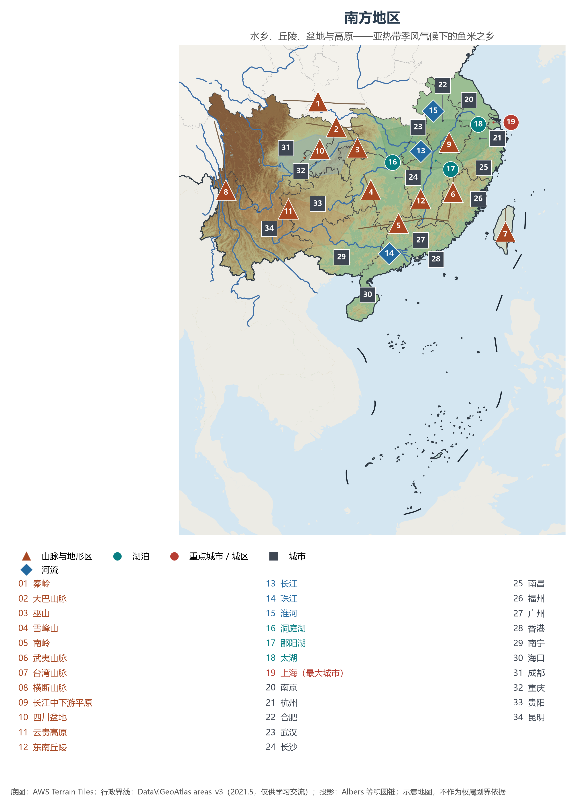
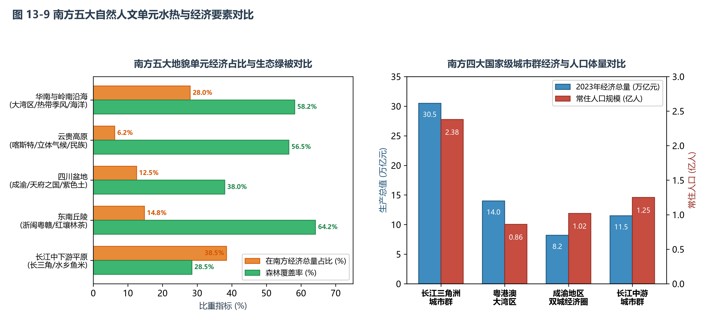

# 13.3 南方地区

南方地区横跨长江流域、珠江流域与东南沿海诸河，涵盖上海、江苏、浙江、安徽、福建、江西、湖北、湖南、广东、广西、海南、重庆、四川、贵州、云南以及香港、澳门特别行政区与台湾省共 18 个省级行政区，陆地面积约 265.4 万 km²，常住人口 8.69 亿，2023 年全区经济总量达 89.3 万亿元。自唐宋“经济重心南移”最终确立以来，南方便是中华大地的财富渊薮与文明重镇；当代中国南方更以全国不足 28% 的国土，承载了超过 60% 的人口、贡献了近 67% 的国内生产总值与绝大部分的高新技术外贸出口，长三角、粤港澳大湾区与成渝地区双城经济圈三大巨型动力引擎在此交相辉映。

## 一、行政区划范围与经济人口格局

南方地区省份数量众多、类型丰富，涵盖了直辖市、经济强省、沿边少数民族自治区与特别行政区：

| 省级行政区 | 陆地面积（km²） | 常住人口（万，2023） | GDP（亿元，2023） | 行政中心 | 核心地理与经济定位 |
|:---|:---:|:---:|:---:|:---|:---|
| **上海市** | 6,340 | 2,487 | 47,219 | 上海 | 国际经济、金融、贸易、航运与科技创新中心，长三角龙头，全球集装箱第一大港 |
| **江苏省** | 107,200 | 8,526 | 128,222 | 南京 | 全国第二经济大省，实体经济与制造业高地，全省平原水网密布，13 个地级市均入全国百强 |
| **浙江省** | 105,500 | 6,627 | 82,553 | 杭州 | 民营经济发祥地，数字经济第一省，共同富裕示范区，宁波舟山港货物吞吐量全球第一 |
| **安徽省** | 140,100 | 6,121 | 47,051 | 合肥 | 全面融入长三角一体化，新型显示、新能源汽车与量子科技新兴创新策源地 |
| **福建省** | 124,000 | 4,183 | 54,355 | 福州 | “八山一水一分田”，森林覆盖率连续数十年全国第一，海上丝绸之路核心区与对台前沿 |
| **江西省** | 166,900 | 4,515 | 32,207 | 南昌 | 鄱阳湖生态经济区，江南鱼米之乡，有色金属之乡（铜、钨、稀土），红色摇篮 |
| **湖北省** | 185,900 | 5,838 | 55,804 | 武汉 | “九省通衢”，长江中游城市群核心，长江三峡工程所在地，“光谷”光电子信息产业基石 |
| **湖南省** | 211,800 | 6,568 | 50,013 | 长沙 | “三湘四水”，洞庭湖粮仓与有色金属之乡，工程机械与先进轨道交通世界级产业集群 |
| **广东省** | 179,700 | 12,706 | 135,673 | 广州 | 连续 35 年全国经济第一大省，外贸进出口总额占全国近两成，粤港澳大湾区核心实体 |
| **广西壮族自治区** | 237,600 | 5,027 | 27,202 | 南宁 | 中国面向东盟开放合作前沿门户，喀斯特山水名胜，平陆运河出海通道与全国最大糖罐子 |
| **海南省** | 35,400 | 1,043 | 7,551 | 海口 | 中国最大经济特区与海南自由贸易港，热带特色高效农业基地，南繁育种科研圣地 |
| **重庆市** | 82,400 | 3,191 | 30,146 | 重庆 | 西南唯一直辖市，“山城”，长江上游经济中心，全球最大笔记本电脑生产基地，西部陆海新通道运营中枢 |
| **四川省** | 486,000 | 8,368 | 60,133 | 成都 | 西南综合第一大省，成都平原“天府之国”，全国最大清洁能源基地（水电），成渝双核之一 |
| **贵州省** | 176,200 | 3,865 | 20,865 | 贵阳 | 全境无平原之省，喀斯特发育极致，全国首个国家级大数据综合试验区与世界级大桥博物馆 |
| **云南省** | 394,100 | 4,673 | 30,021 | 昆明 | “植物王国、动物王国、世界花园”，面向南亚东南亚辐射中心，25 个世居少数民族多元文化 |
| **香港特别行政区** | 1,114 | 750 | ~26,900 | — | 国际金融中心、国际航运中心、国际贸易中心与国际创新科技中心 |
| **澳门特别行政区** | 33 | 68 | ~3,300 | — | 世界旅游休闲中心，中国与葡语国家商贸合作服务平台，横琴深度合作区 |
| **台湾省** | 36,000 | 2,342 | ~54,000 | 台北 | 祖国宝岛，西隔台湾海峡与福建相望，半导体集成电路先进制造与外向型经济体系 |

**图 13-4 南方地区**：平原、丘陵、盆地、高原与主要河湖分布（编号说明见图下）。

## 二、五大地貌单元的自然机理与土壤指纹

南方地区是中国地貌类型最齐全、地表起伏最破碎、生态垂直过渡最显著的地理大区。全区可解构为五大各具特色的自然地貌单元：

| 地貌单元 | 地理分布与范围 | 构造与地貌机理 | 典型土壤类型 | 关键农业与人地适应 |
|:---|:---|:---|:---|:---|
| **长江中下游平原** | 宜昌以东沿江连绵（江汉、洞庭、鄱阳、太湖平原与长三角，约 20 万 km²） | 新生代构造断陷盆地与第四纪河流湖泊泥沙沉积复合而成，河网水系密度居全国之冠，淡水湖泊密集 | **水稻土、冲积潮土**：历经数千年人工耕作、水旱轮作培育熟化而成，有机质丰富，耕层深厚柔软 | 传统“鱼米之乡”与“水乡泽国”；水稻种植历史逾万年（上山文化）；当代面临平原高密城镇化与河湖湿地防洪调蓄的双重平衡 |
| **东南丘陵** | 淮河以南、云贵高原以东的广大丘陵（江南丘陵、浙闽丘陵、两广丘陵，约 100 万 km²） | 加里东、印支与燕山运动形成的古老褶皱断块，长期在高温多雨气候下强力风化侵蚀，红层盆地与低山丘陵镶嵌 | **红壤、黄壤**：富铁铝化强烈，呈强酸性、粘重、缺磷少钙、肥力较低，但土层深厚 | “丘上林草蓄水、坡地果茶飘香、沟谷水田耕作”的立体生态农业；中国名茶（龙井、普洱、铁观音）、油茶、毛竹与柑橘的核心主产区 |
| **四川盆地** | 四川东部与重庆大部（约 26 万 km²），外围由大巴山、巫山、大娄山、横断山环抱 | 古生代至新生代深厚内陆凹陷盆地，地层充填了数百米至数千米厚的侏罗系与白垩系红色砂泥岩 | **紫色土**：岩石风化迅速形成的物理成壤土，富含磷、钾与钙等微量矿物养分，质地疏松微酸至微碱性，抗蚀力差 | 盆西为都江堰自流润泽的成都平原（天府之国），盆东为长寿岭、华蓥山等条带状平行岭谷，土质肥沃、复种指数高，农业与城镇高度繁盛 |
| **云贵高原** | 云南东部与贵州全境（约 30 万 km²），地势自西北向东南阶梯递降（海拔 1000—2000 m） | 古生代厚层可溶性碳酸盐岩（石灰岩、白云岩）在大气降水和富含腐殖质酸性水长年溶蚀下形成的巨型喀斯特地貌 | **石灰土（黑色与红色石灰土）、黄壤**：土层浅薄不连续，保水保肥困难，地表多岩石裸露 | 峰丛洼地、孤峰、天坑、溶洞与暗河纵横，极易发生“地下水滚滚流，地表干旱闹水荒”现象与水土石漠化；经过退耕还林与封育保护生态持续好转 |
| **华南与岭南沿海** | 南岭以南的雷州半岛、海南岛、南海诸岛及台湾岛西南沿海平原 | 处于亚热带与热带海洋过渡带，基岩海岸、红树林淤泥海岸与珊瑚礁海岸交错，河流入海冲积平原肥沃 | **砖红壤、赤红壤**：淋溶极强、铁铝完全胶体化、呈强酸性 | 全年无霜期长达 360 天以上，一年三熟，是中国最重要的热带作物种植基地（橡胶、胡椒、剑麻、椰子、热带反季节瓜菜基地） |

**图 13-9 南方五大自然人文单元水热与经济要素对比**：左图对比五大地貌单元在南方内部的经济体量占比与森林覆盖率；右图呈现长三角、粤港澳、成渝与长江中游四大城市群的经济总量与人口规模。

## 三、亚热带与热带季风的雨热节律

南方地区主体属于**亚热带季风气候**，南岭以南及海南、台湾南部进入**热带季风气候**。其水热运行具备鲜明的季风韵律与动力机制：
- **热量丰沛与无霜期漫长**：全区年平均气温在 15—22 ℃ 之间，日均温 ≥10 ℃ 积温达 4500—8000 ℃·d 以上；无霜期长达 240—360 天，作物生长期贯穿全年。农田耕作制度普遍实行一年两熟（水稻—小麦/油菜）至一年三熟（双季稻加冬菜/绿肥）。
- **年降水充沛与极值峰谷**：年降水量普遍介于 800—2000 mm 之间，火烧寮（台湾东北部迎风坡）多年平均年降水量超 6500 mm，是中国“雨极”；十万大山、武夷山迎风坡降水量均超 2500 mm。
- **独特的季风汛期阶段性更迭**：
  - **华南前汛期与“龙舟水”**（4—6 月）：冷暖气团频繁在南岭一带剧烈交锋，造成持续大范围暴雨；
  - **江淮梅雨**（6 月中旬至 7 月上旬）：西太平洋副热带高压脊线稳定维持在北纬 20°—25°，江淮流域形成长达数周的梅雨锋持续性降水；
  - **长江中下游伏旱**（7—8 月）：副高脊线向北跳跃至北纬 30° 附近，长江中下游受下沉气流控制，晴热少雨，形成蒸发强烈的夏秋伏旱；
  - **后汛期热带气旋与秋台风**（7—10 月）：西北太平洋与南海台风频繁登陆华南与华东沿海，年均登陆 7—8 次，带来强降水与风暴潮，既是主要气象灾害，也是回补南方水库库容的重要水源。

## 四、稻作文明的极致与现代“大食物观”全域拓展

南方是世界上最重要的水稻驯化发源地（浙江上山文化 1 万年前已驯化水稻，河姆渡文化骨耜出土成堆）。漫长的人类精耕细作，在南方地表雕刻出极致的人工生态系统：
1. **水田农业与高产商品粮基地**：江汉平原、洞庭湖平原、鄱阳湖平原、成都平原与珠江三角洲是传统九大商品粮基地的主力；袁隆平院士领衔的杂交水稻研发体系（三系法、两系法至超级杂交稻）诞生于湖南，不仅推动中国水稻亩产屡破世界纪录，更广泛输出造福全球。
2. **大食物观下的多元供给高地**：
   - **水产养殖业冠绝全球**：南方淡水水系纵横，淡水水产养殖产量占全国 80% 以上；沿海深远海养殖与现代海洋牧场蓬勃发展（如广东、福建桁架类大型深水网箱）；
   - **基塘农业与生态智慧**：珠江三角洲与太湖流域创造的“桑基鱼塘、蔗基鱼塘、果基鱼塘”，实现了陆地与水面能量物质循环闭环，列入全球重要农业文化遗产（GIAHS）；
   - **特色经济林果大省**：南方提供了全国 95% 以上的茶叶、柑橘、荔枝、龙眼、香蕉，以及天然橡胶、油茶、甘蔗原料，云南咖啡豆与反季节高原夏菜直供全国乃至出口海外。

## 五、全球制造中心、创新枢纽与世界级城市群

南方是当代中国拥抱全球化最彻底、市场经济活力最旺盛的地区：
- **世界级城市群集群崛起**：
  - **长江三角洲城市群**（以上海为龙头，苏浙皖协同）：覆盖 41 个城市、2.4 亿人口，GDP 突破 30 万亿元，集成电路、生物医药、人工智能与新能源汽车制造占全国比重超三成，是世界前六大城市群之一；
  - **粤港澳大湾区**（“9+2”城市格局）：以广州、深圳、香港、澳门为核心引擎，坐拥全球最具活力的电子信息硬件创新供应链（“硅谷研发、大湾区量产”），香港国际金融中心与内地腹地深度嵌合；
  - **成渝地区双城经济圈**：中国西部人口最稠密、工业最成熟的第四大增长极，聚焦电子信息、汽车制造、装备工业，成为国家构建“战略腹地”的关键载体；
  - **长江中游城市群**（武汉、长株潭、环鄱阳湖）：以长江黄金水道为纽带，承接沿海产业转移，打造全国先进制造业与交通枢纽高地。
- **超级港口群的海权枢纽**：世界前十大集装箱与货物吞吐量港口中，南方占据六席（宁波舟山港、上海港、深圳港、广州港、青岛以南各港）。中国对外贸易总额的 70% 以上经由南方沿海口岸离岸出海。

## 六、方言拼图与多元一体的文化聚落

南方破碎的山川水网与历史上的中原移民南迁潮，造就了中国最为复杂绚烂的文化与语言景观：
- **汉语方言的避难所与活化石**：北方地区大部分使用北方官话；而南方由于山地阻隔，保留了吴语（苏浙沪）、湘语（湖南）、赣语（江西）、客家话（赣南、闽西、粤北）、闽语（福建、潮汕、海南、台湾）、粤语（广府、珠三角）六大汉语言方言，保存了大量古汉语声调、入声字与音韵特征。
- **少数民族汇聚地**：云贵高原、两广丘陵与西南山区是中国世居少数民族最集中的区域（壮、苗、彝、侗、瑶、白、傣、哈尼等）。
- **因地制宜的聚落建筑美学**：皖南与徽州马头墙小青瓦（防火防风）、客家大型生土夯筑土楼（防卫与家族聚居）、江南临水而居的“小桥流水人家”水巷民居、岭南通风格栅“镬耳屋”、湘西黔东临水依山的干栏式吊脚楼、西双版纳热带竹楼，展现了人与自然深度和谐的营造力学与生存智慧。

## 参考与数据来源

1. 面积与人口：国家统计局《中国统计年鉴 2024》各省常住人口、陆地面积；香港、澳门特区政府统计处公报；台湾省统计公报（2023 年截面数据）。
2. 城市群与经济数据：国家发展和改革委员会《长江三角洲区域一体化发展规划纲要》监测数据；广东省与粤港澳大湾区建设领导小组统计公报。
3. 水文气象数据：水利部《中国水资源公报 2023》（长江流域、珠江流域、东南诸河水资源总量占全国比重）；中国气象局《中国气候公报 2023》（降水量与台风登陆数据）。
4. 农业与土壤科学：农业农村部种植业与渔业统计年报；中国科学院南京土壤研究所《中国土壤》（科学出版社）。
